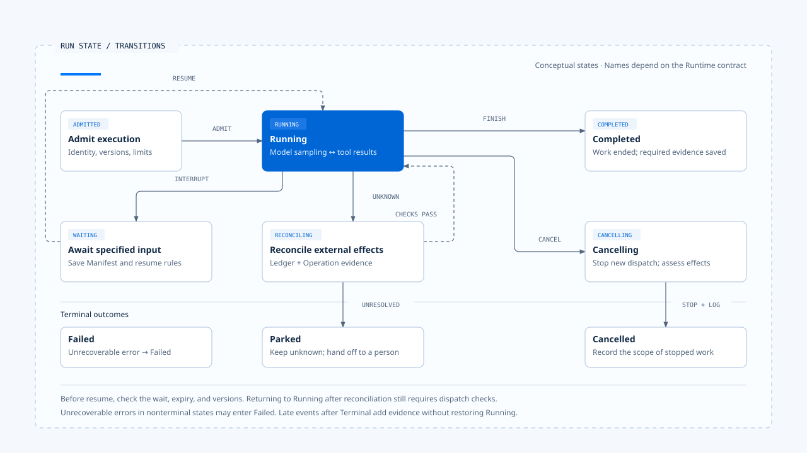
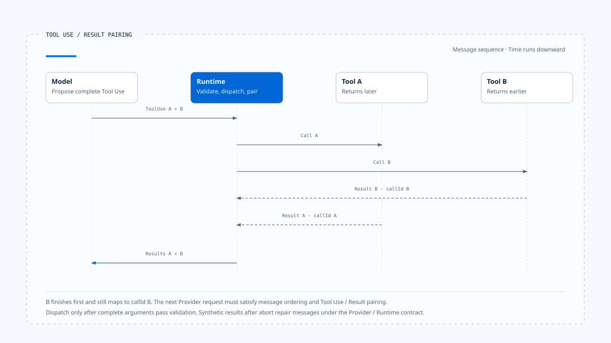

# Run Loop and state transitions

[English](./03-run-loop-and-state-transitions.md) | [繁體中文](./03-run-loop-and-state-transitions-zh-TW.md)

After a model returns text, the Runtime may still be processing tools or saving state; after the model proposes a Tool Call, authorization and dispatch may still be pending. The Run Loop processes these intermediate results in order until execution reaches completion, failure, cancellation, rejection, or a recoverable waiting state.

If a system represents the entire process with `isLoading`, model streaming, tool scheduling, and human waiting all share one boolean. The Runtime needs more explicit states to determine whether the next step is valid and whether external operations are still in progress.

## The Run Loop manages state and the next action

The Agent Loop is often abbreviated as:

~~~text
呼叫模型 → 執行工具 → 把結果送回模型 → 重複
~~~

This describes the main model and tool cycle. Before each next step, the Runtime must also check:

- Whether the Run has been cancelled or is waiting for external input.
- Whether the Tool Call is authorized.
- Whether Budget is exhausted or Deadline has passed.
- Whether the previous result has completed the required persistence.

Together, these conditions determine whether the Runtime can continue and where it can recover after interruption.

Conceptually, this can be written as:

~~~ts
while (!state.isTerminal) {
  assertRunOwnership(state);
  enforceDeadlineAndBudget(state);
  observeCancellation(state);

  const next = decideNextStep(state);

  if (next.kind === "wait") return persistInterrupt(next);
  if (next.kind === "model") state = await runModel(next);
  if (next.kind === "tools") state = await runTools(next);
  if (next.kind === "finish") state = commitTerminal(next);
}
~~~

This code sketches the responsibilities the Runtime must handle. An imperative loop can express them directly; a Graph Runtime distributes `decideNextStep()` across nodes, edges, commands, and interrupts. Implementations differ, but each must maintain these execution conditions.

## Conceptual states

This article uses several conceptual states to explain valid transitions. When reading Chat Gun or CCB, map them back to each project's enums, Graph State, and return values.

| State | What the Runtime may do | What should not happen |
|---|---|---|
| Admitted | Create a Run and validate the manifest and required dependencies | Emit a started event before admission |
| Running | Call models, schedule tools, and record progress | Ignore cancellation or continue beyond Budget |
| Waiting | Save a checkpoint/interrupt and await specified input | Accept any new message and continue directly |
| Cancelling | Stop new dispatches, propagate abort, and handle started work | Claim that cancellation means external effects do not exist |
| Reconciling | Query the Ledger and external Operation | Retry directly while effects remain unknown |
| Terminal | Report Completed, Cancelled, Failed, or another terminal determination | Let late progress or an old finalizer change state back to Running |

- The diagram summarizes conceptual states and major transitions; actual names depend on the Runtime contract. Returning to Running after reconciliation still requires checks before subsequent dispatches; evidence obtained after termination is retained in effect records.
- [Open the diagram and implementation notes](../../assets/agent-runtime/foundations/03-run-loop-and-state-transitions/03-run-state-transitions-en.html).

Whether Waiting counts as Terminal depends on the product and Runtime contract. For one HTTP request, waiting may end the current response; for a durable Task, it remains a recoverable nonterminal state. Articles and APIs must state their observation scope instead of marking a Task Completed simply because a request ended.

## From a model request to the next Step

### Preparing model input

The Runtime retrieves currently visible content from Graph State or message history, adds the system prompt, Context, and Tool descriptors selected by the Harness, and applies model and Token limits. The Harness owns authority over Context sources and selection rules; the Runtime sends content under that contract and records the versions actually used.

A model request should at least correlate with Run, Step, Model Request, and manifest. If a Provider times out or returns an invalid format, the Runtime can then identify which request needs failure handling, retry, or an allowed fallback.

### Receiving and assembling streams

A Provider may send text deltas, thinking/reasoning metadata, tool use deltas, and usage before producing a complete assistant message. The Runtime may turn safe progress into Events, but UI deltas cannot directly become authoritative messages; if a stream breaks, it must assess whether existing content can be saved, whether tool blocks are complete, and whether another sample is allowed.

### Broken streams and incomplete output

Text already delivered to the user may remain as progress, while the assistant message entering the next round must still pass structural checks. If a tool use block lacks the end of its arguments, the Runtime should mark it as incomplete output, stop dispatch, and handle it according to strategy.

### Interpreting the model result

Complete model results generally fall into several categories:

- Ordinary content only, with no other pending work: proceed to completion checks.
- Tool Calls present: save the message and call identities before entering the tool path.
- Clarification needed: save the waiting reason and recovery conditions under the product contract.
- Invalid format, Provider failure, or exhausted Budget: enter failure handling, fallback, or a constrained response.

The model saying "done" is content. The Runtime must still confirm that no unfinished Tool Calls, unwritten checkpoints, unhandled cancellation, or operations with unknown effects remain before committing Completed.

## How Tool Calls return to the Loop

A Tool Call must retain the call ID, tool name, and input produced by the model; the Runtime then performs these steps:

1. Check whether the Tool exists in the current Capability Set.
2. Validate the input Schema and trusted Execution Context.
3. Obtain a decision from the Harness Authorization/Confirmation Port.
4. Dispatch according to scheduler, concurrency, lock, rate limit, and execution profile.
5. Convert the typed outcome into a Tool Result the model can consume while preserving traceability.

If any step rejects the call, the Runtime must retain the specific reason. Results that distinguish invalid input, lack of authorization, cancellation, noncommit, and unknown effects let the model decide whether to revise its proposal, explain the situation to the user, or stop.

### Parallel results and message ordering

When multiple tools execute concurrently, completion order may differ from proposal order. When writing messages back, the Runtime must still follow the Provider's tool use/result contract and retain each call ID. A missing result or an invalid message insertion may cause rejection of the next model request.

[Open the HTML diagram](../../assets/agent-runtime/foundations/03-run-loop-and-state-transitions/03-tool-use-result-pairing-en.html)

In the diagram, B finishes before A; the Runtime preserves pairing by call ID and assembles the next model request after collecting the valid results required for this round. The Provider contract still determines the arrangement of results within that request.

## CCB's imperative query loop

In the pinned version, `src/query.ts` directly shows a while-loop structure: the outer layer prepares QueryParams, while the inner layer calls the model using messages, checks tool use, passes calls to `runTools`, and carries results into the next round. AsyncGenerator emits messages, progress, and results to the caller; AbortSignal, turn count, task budget, and compaction are also consumed along this path.

`toolOrchestration.ts` groups tools that are known to be safe to run concurrently and conservatively executes the others in sequence. This handles scheduling within one query without providing resource locks across processes; two independent queries editing the same file still need ownership at a higher level or conflict controls within the tool.

### Repairing messages after Abort

When a Query is aborted, message history may retain tool use without Tool Results. CCB handles these unpaired messages to preserve the conversation structure of subsequent requests; leaving history incomplete may cause the next Provider request to fail its message contract.

## Chat Gun's Graph loop

Chat Gun's `mcp-agent.ts` expresses the same responsibilities through nodes and conditional edges. After a model call, the Graph checks for Tool Calls; each concrete call enters an authorization gate, moves to confirmation when needed, reaches physical dispatch only after approval, and returns the completed ToolMessage to the model node.

The Graph expresses waiting and branching, while composition settings and adapters supply the corresponding controls. Inspection must continue through the trusted Principal used for Authorization, confirmation store persistence, activation conditions for the tool dispatch pipeline, and reconciliation capabilities for external effects.

`deep-researcher.ts` shows another branch: a Planner can route input to direct, weather, calculation, research, or clarify. Clarify uses interrupt to stop the Graph; recovery must still pass the response Schema and task conditions. A semantic Router selects the next business node but cannot replace Runtime concurrency locks, ownership, or terminal guards.

## Turn, Step, Run, and Task

A Task can have multiple Runs, a Run can have multiple model turns, and a turn may produce multiple Tool Calls. Frameworks use these names differently, so limits must specify their units:

| Limit | Problem it prevents | Common misunderstanding |
|---|---|---|
| Max turns | Endless model and tool cycling | Does not necessarily limit parallel tools within one turn |
| Token budget | Uncontrolled Context or generation cost | Is not a dollar cost cap |
| Deadline | A Run exceeding acceptable duration | Does not mean external I/O has been revoked |
| Tool attempt budget | Repeated dispatch of one effect | Does not prevent the model from proposing another Tool Call |
| Task budget | Total limits across Steps or subtasks | Implementation must state whether it persists across Runs |

Budget must be concrete before execution, and the Runtime deducts or reserves capacity before each Provider or Tool call. Discovering an overrun after a response arrives can no longer prevent the cost or side effect.

## Retry differs from the model's next proposal

After a tool fails, the model may use the Tool Result to propose different arguments; the Runtime may also retry the same Attempt without returning to the model. The former is a new action proposal, while the latter is an execution strategy, and they need separate Budgets and Evidence.

Automatic retry is appropriate only after noncommit is confirmed, the error is classified as retryable, sufficient Budget remains, and cancellation has not taken effect. Unknown effects after dispatch require reconciliation first; otherwise, "try again" can perform the operation twice.

### Conditions for model fallback

Switching models may change Tool Calling, Context Window, or Structured Output capabilities. The Harness should first supply allowed alternatives; the Runtime then decides whether to switch based on the Provider failure type and records the model and version used in the new request.

## How cancellation enters the state machine

A Cancel Command changes which subsequent work the Runtime permits. The Runtime first stops new model and tool dispatches, passes AbortSignal to cancellable work, and waits for or assesses operations already started; external effects already committed must still be retained and handled.

| Cancellation point | What the Runtime can do |
|---|---|
| Before a model request | Send no request and converge to Cancelled. |
| During model streaming | Abort transport, save required events, and assess the Provider result. |
| Before tool dispatch | Do not call the underlying tool; record cancelled before dispatch. |
| During external I/O | Attempt abort; effects may still succeed, fail, or remain unknown. |
| After external Commit | Do not claim revocation; use reconciliation or compensation. |
| While Waiting | Close the wait or create a cancellation decision so a later Resume cannot revive old work. |

The UI stop button may both terminate the stream connection and submit a business cancel, but those paths still need separate tracking. Closing a browser response body does not guarantee that a remote Run or tool has stopped.

## What a Terminal Result should express

A Terminal Result is the Runtime's final determination for a Run. Its conceptual fields may include:

~~~ts
interface TerminalResult {
  runId: string;
  status: "completed" | "cancelled" | "failed" | "rejected" | "parked";
  reasonCode?: string;
  finalMessageId?: string;
  usage: ExecutionUsage;
  evidenceRefs: string[];
}
~~~

If Waiting is modeled as a recoverable nonterminal state, the API must retain the Task/Run waiting reason when ending its response, rather than marking it `completed`. Programs interpret status and reason codes; the Harness produces display text from the result.

### Results that arrive after termination

Terminal State must converge in one direction. Old progress received after Completed may be kept as Audit Evidence or discarded, but it cannot restore Running. If an external effect is found to have committed after Cancelled, create an effect reconciliation result and retain both the original Run's cancellation determination and the evidence obtained later.

## Where failures originate

| Failure | Meaning the Runtime should retain | Possible next action |
|---|---|---|
| Provider unavailable | Model request did not complete | Retry/fallback/fail under allowed policy |
| Malformed model output | Cannot form a valid message or Tool Call | Repair, sample again, or fail |
| Tool input invalid | Actual dispatch did not begin | Feed back a Tool Result or reject |
| Authorization denied | Policy does not permit the action | Do not dispatch; let the model/product explain |
| Timeout before dispatch | Confirmed not committed | Retry if eligible |
| Timeout after dispatch | Effects unknown | Reconcile; do not retry blindly |
| Cancel observed | Stop new work | Assess effects in flight before converging |
| Budget exhausted | Add no new model/tool work | Constrained response or Failed |
| Event delivery failed | Execution state may still be successful | Redeliver events or let the consumer replay |

Wrapping all these cases in Exceptions and throwing them to the outermost layer loses retry eligibility, user explanations, and operational evidence. The Runtime needs typed outcomes; the model-visible Tool Result is one projection of an outcome.

## How to verify state transitions

### Transition Test

- Running may transition to Waiting, Cancelling, or Terminal.
- Terminal rejects state changes from ordinary progress, late Tool Results, or old finalizers.

### Budget Test

- Check remaining capacity before each Provider/Tool dispatch.
- Count retries separately from new model proposals instead of sharing one ambiguous counter.

### Cancellation Test

- Cancellation before dispatch leaves the underlying tool uncalled.
- Cancellation after dispatch retains the outcome and does not treat abort as evidence of external noncommit.

### Message Contract Test

- Each tool use has a corresponding result or explicit repair.
- The next model request follows the Provider Schema even when tool completion order changes.

### Late Event Test

- Deltas/progress after Terminal do not revive the Run.
- Events from a different generation do not update the current visible activity.

## Engineering judgment

When checking a Run Loop, verify valid states, remaining Budget, and execution results before and after each iteration. Model output, tool results, and user input may all change the next action; the Runtime's state authority determines whether execution may continue under the contract.

A Graph expresses branches through nodes and edges, while a while-loop shows control flow directly. Either approach must place cancellation, Tool Result correlation, and terminal guards in the production path to maintain consistent state through failures and late events.

## Implementation references and scope

### [Claude Code Best](https://github.com/claude-code-best/claude-code)

- `src/query.ts`
- `src/QueryEngine.ts`
- `src/services/tools/toolOrchestration.ts`
- `src/services/tools/toolExecution.ts`
- `src/services/api/claude.ts`

### [Chat Gun](https://github.com/HsienW/chat-gun)

- `backend/src/agents/mcp-agent.ts`
- `backend/src/agents/deep-researcher.ts`
- `backend/src/runtime/tool-dispatch/pipeline.ts`
- `backend/src/runtime/tool-dispatch/scheduler.ts`
- `backend/src/runtime/side-effect/governed-outcome.ts`
- `backend/src/platform/agent-runtime-events.ts`

This article uses pinned source versions and existing test arrangements. The states in the table compare responsibilities; their concrete names depend on each source repository. This round did not exercise real Providers, external MCP, cancellation across processes, or database fault drills.

## Further reading

- [Persistence, Interrupt, and Resume](./04-persistence-interrupt-and-resume-zh-TW.md)
- [Retries and side effects](../../agent-harness/action-governance/05-retry-and-side-effects-zh-TW.md)
