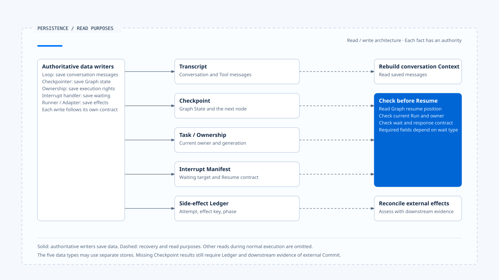
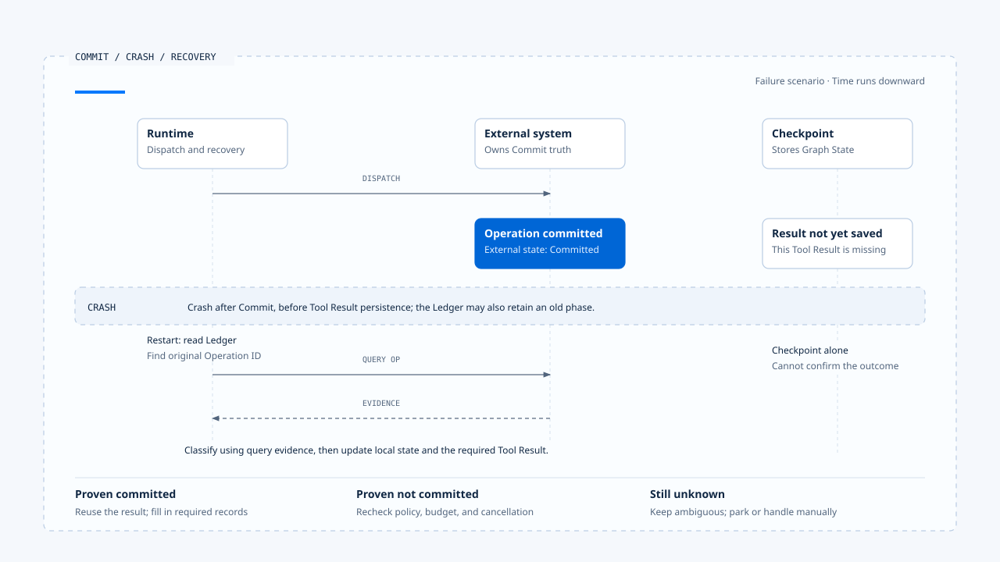

# 持久化、Interrupt 与 Resume

[English](./04-persistence-interrupt-and-resume.md) | [繁體中文](./04-persistence-interrupt-and-resume-zh-TW.md) | [简体中文](./04-persistence-interrupt-and-resume-zh-CN.md)

> 以下内容所提到的
> CCB 为 [claude-code-best](https://github.com/claude-code-best/claude-code) 的简称。
> Chat Gun 为 [chat-gun](https://github.com/HsienW/chat-gun)。

Runtime 等待确认时暂停执行，过一段时间再收到回复；另一种情况是工具已调用外部系统，程序在保存结果前崩溃。两者都需要恢复，但核对的数据各有侧重：前者要知道在等谁、等什么；后者还要查明外部操作是否已经生效。

只保存对话历史，无法回答这些问题。可恢复的 Runtime 必须分清 transcript、checkpoint、ownership、interrupt manifest 与 side-effect evidence 各自证明什么。

## 五种持久化数据

| 数据 | 保存内容 | 可以证明什么 | 不能单独证明什么 |
|---|---|---|---|
| Transcript／Messages | 用户、assistant、tool use 与 result | 模型曾看过哪些消息 | Run 当前权威状态、外部 Commit |
| Graph Checkpoint | Graph State、node 位置、可恢复数据 | Runtime 可以从哪个状态继续 | 下游业务效果一定成功或失败 |
| Task／Ownership | Task、active Run、generation、terminal | 谁目前拥有执行权 | Graph 内部每个 Step 的内容 |
| Interrupt Manifest | 等待原因、Schema、关联、期限、版本 | 哪个输入可以恢复哪次等待 | 外部副作用尚未发生 |
| Side-effect Ledger | Attempt、effect key、phase、operation evidence | 某项外部操作已准备、派送、提交或仍不明 | Graph message 已成功持久化 |

这五份数据可以位于同一数据库，也可能分散在 Agent Server、产品数据库与外部系统。设计时仍要说明各自的更新顺序与故障窗口；即使使用同一份 JSON 保存，也要知道哪些字段已提交、哪些仍待外部确认。

[开启 HTML 图解](../../assets/agent-runtime/foundations/04-persistence-interrupt-and-resume/04-persistence-responsibilities-en.html)

左侧合并呈现各数据的权威写入端，右侧则列出查读用途。五种数据不必共享同一个交易；恢复时要依待查问题取得对应数据，外部 Commit 还需结合下游证据判读。

## Transcript、Memory 与 Checkpoint

Transcript 保存对话内容，让模型与用户知道先前说过什么。Memory 从多次互动中提取可重用信息，可能有较长生命周期；Context Compression 则在 Token 压力下保留当前任务所需摘要。它们服务模型认知。

Checkpoint 服务执行恢复。它需要保存 Runtime 在哪个 node、有哪些 pending Tool Call、目前是否等待，以及 Resume 后应进入哪条 edge。即使摘要完整重述了任务，Runtime 仍不能从自然语言推回一个可靠的 state machine position。

Checkpoint 中的 Graph State 若要用作长期 Memory，需要另经筛选。直接把每次执行细节带进下一次模型请求，会增加 Context，还可能重新带入旧工具错误与过期政策。

## Interrupt 前要先留下什么

Runtime 准备等待人工确认或用户补充时，顺序很重要：

1. 建立 waiting reason 与目标 action。
2. 保存 Interrupt Manifest，包含关联、Schema、版本、期限与一次性消费条件。
3. 将 Graph／Run 状态写到可恢复位置。
4. 发出等待事件，让 Harness 显示问题或确认内容。
5. 停止后续模型与工具派送。

若系统先显示确认窗口，保存 manifest 却失败，用户会看到一个无法恢复的等待；若先标示 Waiting，工具仍在背景派送，批准画面也失去意义。持久化与可见状态需要明确的提交顺序，不能靠前端画面维持一致。

## Resume 是一个受验证的 Command

Resume payload 要让处理端辨识指定等待，并核对回复者与输入内容。概念契约可以表示为：

~~~ts
interface ResumeCommand<T> {
  interruptId: string;
  threadId: string;
  taskId?: string;
  runId?: string;
  principal: TrustedPrincipal;
  scope: TrustedScope;
  schemaVersion: string;
  manifestVersion: string;
  payload: T;
}
~~~

Runtime 或 Harness 的 Resume handler 收到后，要核对：

- Interrupt 是否仍存在且尚未消费。
- Thread、Task、Run 与等待 owner 是否一致。
- Principal、Tenant、Scope 与 Resource 是否仍符合要求。
- 回复是否符合指定 Schema，没有把 UI 额外字段误当成合法 payload。
- Manifest、Policy 与 Runtime Version 是否兼容。
- 是否已过期、取消、被 supersede 或进入 Terminal。

### 一次性消费与重新派送

核对通过后，处理端以原子方式消费这次等待，避免两个相同回复都让 Runtime 继续。若消费与 enqueue／resume 分成两步，还要处理中间崩溃：

- 已标成 consumed，却没有重新启动：任务会停在已消费、未派送的状态，需要恢复机制接手。
- 已启动，却尚未 consume：重复回复可能再次取得派送机会。

## Clarification 与 Confirmation 的恢复条件

Clarification 要补足模型执行所缺的任务数据，例如地点或目标格式；Confirmation 则批准一个已具体化的敏感操作。两者都可能使用 Interrupt，各自的 manifest 与恢复条件需要依用途定义。

Chat Gun 的 Deep Researcher 会保存 clarification manifest，再以 `interrupt()` 停下 Graph；回复经 normalized input reader 与 response Schema 验证后，才回到厘清节点。Action Governance 的 confirmation graph 则绑定 Tool Call、resource、policy decision 与批准者，核对成功后才进 authorized dispatch。

将一般对话中的「可以」直接套到 pending Tool Call，会跳过 action、resource 与有效期限；把确认 payload 当成模型厘清答案，又可能把 `approve` 字段送进不接受它的 Schema。两条路可以共用底层 Interrupt Primitive，各自的处理端仍需依指定契约验证。

## Chat Gun 的恢复边界

`deep-researcher.ts` 在固定版本建立 `MemorySaver` 并编译 Graph。这足以说明 Graph 如何在 Thread 内停止与 Resume，也能支持相应 mock／本地测试；它不提供跨进程 PostgreSQL durability 的证据。

`clarification-resume-authorization.ts` 会核对指定等待的关联、期限、Schema 与兼容性，再决定是否可以消费。`confirmation-graph.ts` 则在授权路径保存待确认数据并恢复派送。两条路径说明不同 Resume consumer 如何工作，不能相加后宣称所有 Graph 已具备统一 durable recovery。

### 开发观察与正式部署

`current-langgraph-runtime-boundary.md` 记录 Dev Run／Thread 与 Graph Checkpoint 的观察，也另列正式 Agent Server PG／Redis 的持久化证据范围。本地开发 Runtime 的停止与继续记录，只支持该环境下的行为；Worker lease、数据库断线、Redis 故障及强制终止后的恢复，都需要相应部署与故障时间点的验证。

## Crash Window 要逐段分析

一次可能产生外部效果的 Tool Call，至少有以下窗口：

- 图中选取 Commit 后、Tool Result 保存前的故障窗口；下表再列出其他位置。回查结果分为已提交、已证明未提交与仍无法判读，分别进入结果重用、派送条件检查或停放处理。
- [开启故障图解与恢复注记](../../assets/agent-runtime/foundations/04-persistence-interrupt-and-resume/04-commit-checkpoint-crash-en.html)。

| 崩溃位置 | Runtime 已知的事 | 恢复后的处理 |
|---|---|---|
| Tool dispatch 前 | 底层工具尚未被调用 | 可依 policy 重新调度 |
| 已建立 Attempt，尚未送出 | 有本地准备记录 | 核对 dispatch evidence，再决定 |
| 已送出，外部尚未回应 | 效果不明 | 以 Operation ID 查询或 reconcile |
| 外部已 Commit，Tool Result 尚未保存 | 下游有结果，Checkpoint 没有 | 重用外部结果，禁止盲目重做 |
| Tool Result 已保存，模型尚未再取样 | 工具结果可用 | 从 checkpoint 接回模型 |
| Terminal 已提交，事件尚未送达 | Run 已结束 | 重送／重播事件，不重跑任务 |

Runtime 若只看最后一个 Checkpoint，第三与第四种情况都可能被误判为「工具没有完成」。恢复流程需要 Tool Adapter 或外部系统提供查询能力，并以 Side-effect Ledger 保存的 effect key、attempt 与已知 phase，定位要回查的操作。

## Ledger 与外部真相

Business Effect Ledger 记录 Runtime 对副作用的理解，例如 prepared、executing、committed、failed_not_committed、ambiguous 或 compensated。它可以阻止本地重复派送、串起 retry 与 reconciliation，也能留下 Audit Evidence。

### 下游 Commit 与本地记录的时间差

若 Runtime 在下游 Commit 后、写入 committed 前崩溃，Ledger 会保留旧 phase。恢复时必须以外部 Operation ID 查询，再更新本地判断。下游若缺少 idempotency 或可用的状态查询，Runtime 就要保留结果不明，停止自动重试并交给人工处理。

端到端 exactly-once 的主张，还需要下游去重与提交契约支持；本地 Ledger 的记录只能提供其中一部分证据。

Chat Gun 的 `business-effect-ledger.ts`、`tool-execution-runner.ts` 与 reconciler 接点提供这套分流的 Primitive。核对特定 Agent 时，仍要沿 Registry 与 composition root 追踪模块的接入条件，以及哪些 Tool Call 会经过这些控制。

## CCB compaction 的保存范围

CCB 的 `autoCompact.ts` 依 Context threshold 触发压缩，也有递归保护与连续失败 circuit breaker；`compact.ts` 会先尝试 session-memory compaction，再产生压缩结果。这些做法保护 query loop 的 Context 预算，让长 Session 可以继续推理。

Compaction 保存模型可见内容；执行恢复还需要 Graph node、pending approval、Tool Attempt phase 或外部 Operation 等数据。程序重启后，即使能重新加载摘要，仍须核对执行状态与恢复位置。Memory、compaction 与 checkpoint 各有自己的保存范围。

## 版本兼容性

等待可能跨过程序部署。Resume 时若工具 Schema、Graph node、policy 或 model capability 已变更，旧 checkpoint 未必能直接执行。Manifest 至少要让 Runtime 判断：

- Graph／workflow version 是否仍有对应 reader。
- Tool descriptor 与 input Schema 是否兼容。
- Approval 绑定的 resource 与 policy version 是否仍可接受。
- Resume payload 是否需要 migration。
- 旧模型输出的 Tool Call 是否仍能由目前 adapter 解码。

无法证明兼容时，应返回 Incompatible Resume 或转人工处理。若直接用新 Schema 解释旧 payload，原批准与操作内容可能出现歧义，因此版本变更需要明确的兼容规则或 migration。

## Resume 与 Replay 的执行范围

Resume 从已保存状态继续；Replay 则重新处理过去输入或事件，可用于除错、评估与建立 Projection。遇到可能产生副作用的路径时，Replay 必须隔离执行或重用既有结果。

重播范围需要在契约中写清楚：

- 重建 Projection：处理端依 Event ID 去重，更新显示或索引。
- 重新调用 Tool：使用明确的 Command，核对派送权限与 effect evidence。

这样才能在读取历史事件时，控制哪些处理会再次影响外部系统。

## 常见恢复错误

### 先显示等待，再保存 manifest

保存失败后，用户看得到问题，回复却无法对回任何 pending state。

### 收到新消息就 Resume 最近一次等待

同一 Thread 可能有多个历史 Interrupt，错绑回复会让旧 action 被重新启动。

### Checkpoint 没有结果就重试工具

外部可能已 Commit。缺少 Tool Result 代表 Runtime 不知道，不代表操作没发生。

### 把 MemorySaver 当成 production durability

程序重启、Worker 移转或多实例时，内存数据不再提供恢复保证。

### Deploy 后强制读取旧 checkpoint

Graph 与 Tool Schema 已变更时，未做 manifest compatibility check 可能在错误 node 或错误资源上继续。

## 如何验证持久化与 Resume

### Interrupt Ordering Test

- 在 manifest write、checkpoint write 与等待事件之间注入失败。
- 确认用户不会收到一个无法消费的等待。

### Single-consume Test

- 两个相同 Resume 同时进入，只允许一个取得消费权。
- 消费成功但 dispatch 前崩溃时，系统仍有可恢复状态。

### Compatibility Test

- 使用旧 Schema、错误 manifest version 与已移除 Tool descriptor 恢复，应得到明确拒绝。

### Crash Window Test

- 在外部 Commit 前后、Ledger write 前后与 Tool Result checkpoint 前后终止程序。
- 恢复后分辨未提交、已提交与 ambiguous，不以 retry 代替查证。

### Deployment Test

- 重新启动 Worker、切换 process、暂停数据库或 Redis，再核对 Thread／Run／Interrupt 与 ownership。
- Dev `MemorySaver` 测试与正式 Agent Server 测试分开记录。

## 本篇的工程判断

判断 Runtime 能否恢复，要检查保存数据的用途，以及崩溃发生在哪两次写入之间。Conversation 提供对话内容，Checkpoint 提供执行位置；durable ownership、兼容 manifest 与外部 Commit 则需要各自的证据。

Resume 先核对等待与版本，再判读外部效果，最后决定从哪一步继续。证据不足时，Runtime 应保存原因并停止自动动作，让回查或人工处理有明确的接手位置。

## 实现参照与适用范围

### [Chat Gun](https://github.com/HsienW/chat-gun)

- `backend/src/agents/deep-researcher.ts`
- `backend/src/runtime/recovery/clarification-manifest.ts`
- `backend/src/runtime/recovery/clarification-resume-authorization.ts`
- `backend/src/runtime/recovery/resume-response-schema-registry.ts`
- `backend/src/runtime/authorization/confirmation.ts`
- `backend/src/runtime/authorization/confirmation-graph.ts`
- `backend/src/runtime/side-effect/business-effect-ledger.ts`
- `backend/src/runtime/side-effect/tool-execution-runner.ts`
- `docs/decisions/current-langgraph-runtime-boundary.md`

### [Claude Code Best](https://github.com/claude-code-best/claude-code)

- `src/services/compact/autoCompact.ts`
- `src/services/compact/compact.ts`
- `src/query.ts`

来源库固定版本与证据限制沿用本区 README。本篇没有执行跨进程 restart、正式 PostgreSQL／Redis、真实外部 Tool 或故障演练；文中的五种数据是责任分类，不表示来源库使用相同存储架构。

## 接续阅读

- [Agent Runtime 设计原则](./05-runtime-design-principles-zh-CN.md)
- [人工确认与批准有效性](../../agent-harness/action-governance/03-human-confirmation-zh-CN.md)
