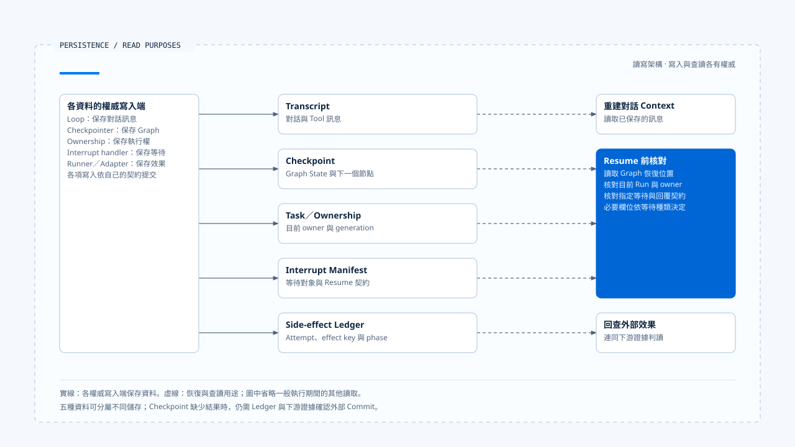
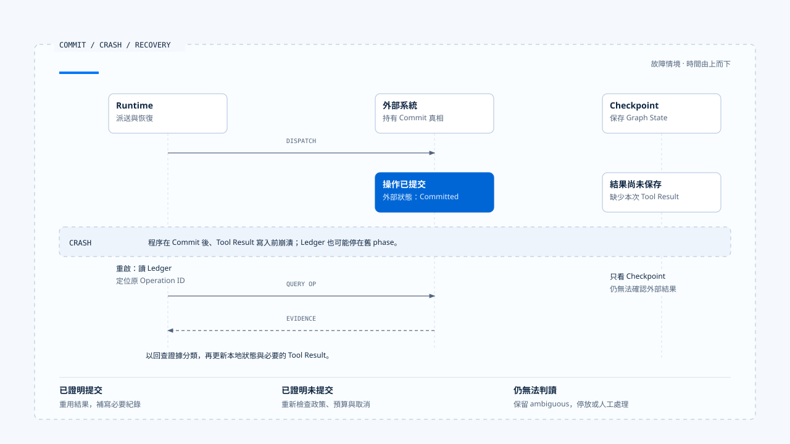

# 持久化、Interrupt 與 Resume

[English](./04-persistence-interrupt-and-resume.md) | [繁體中文](./04-persistence-interrupt-and-resume-zh-TW.md)

Runtime 等待確認時暫停執行，過一段時間再收到回覆；另一種情況是工具已呼叫外部系統，程序在保存結果前崩潰。兩者都需要恢復，但核對的資料各有側重：前者要知道在等誰、等什麼；後者還要查明外部操作是否已經生效。

只保存對話歷史，無法回答這些問題。可恢復的 Runtime 必須分清 transcript、checkpoint、ownership、interrupt manifest 與 side-effect evidence 各自證明什麼。

## 五種持久化資料

| 資料 | 保存內容 | 可以證明什麼 | 不能單獨證明什麼 |
|---|---|---|---|
| Transcript／Messages | 使用者、assistant、tool use 與 result | 模型曾看過哪些訊息 | Run 當前權威狀態、外部 Commit |
| Graph Checkpoint | Graph State、node 位置、可恢復資料 | Runtime 可以從哪個狀態繼續 | 下游業務效果一定成功或失敗 |
| Task／Ownership | Task、active Run、generation、terminal | 誰目前擁有執行權 | Graph 內部每個 Step 的內容 |
| Interrupt Manifest | 等待原因、Schema、關聯、期限、版本 | 哪個輸入可以恢復哪次等待 | 外部副作用尚未發生 |
| Side-effect Ledger | Attempt、effect key、phase、operation evidence | 某項外部操作已準備、派送、提交或仍不明 | Graph message 已成功持久化 |

這五份資料可以位於同一資料庫，也可能分散在 Agent Server、產品資料庫與外部系統。設計時仍要說明各自的更新順序與故障窗口；即使使用同一份 JSON 保存，也要知道哪些欄位已提交、哪些仍待外部確認。

[開啟 HTML 圖解](../../assets/agent-runtime/foundations/04-persistence-interrupt-and-resume/04-persistence-responsibilities.html)

左側合併呈現各資料的權威寫入端，右側則列出查讀用途。五種資料不必共享同一個交易；恢復時要依待查問題取得對應資料，外部 Commit 還需結合下游證據判讀。

## Transcript、Memory 與 Checkpoint

Transcript 保存對話內容，讓模型與使用者知道先前說過什麼。Memory 從多次互動中提取可重用資訊，可能有較長生命週期；Context Compression 則在 Token 壓力下保留當前任務所需摘要。它們服務模型認知。

Checkpoint 服務執行恢復。它需要保存 Runtime 在哪個 node、有哪些 pending Tool Call、目前是否等待，以及 Resume 後應進入哪條 edge。即使摘要完整重述了任務，Runtime 仍不能從自然語言推回一個可靠的 state machine position。

Checkpoint 中的 Graph State 若要用作長期 Memory，需要另經篩選。直接把每次執行細節帶進下一次模型請求，會增加 Context，還可能重新帶入舊工具錯誤與過期政策。

## Interrupt 前要先留下什麼

Runtime 準備等待人工確認或使用者補充時，順序很重要：

1. 建立 waiting reason 與目標 action。
2. 保存 Interrupt Manifest，包含關聯、Schema、版本、期限與一次性消費條件。
3. 將 Graph／Run 狀態寫到可恢復位置。
4. 發出等待事件，讓 Harness 顯示問題或確認內容。
5. 停止後續模型與工具派送。

若系統先顯示確認視窗，保存 manifest 卻失敗，使用者會看到一個無法恢復的等待；若先標示 Waiting，工具仍在背景派送，批准畫面也失去意義。持久化與可見狀態需要明確的提交順序，不能靠前端畫面維持一致。

## Resume 是一個受驗證的 Command

Resume payload 要讓處理端辨識指定等待，並核對回覆者與輸入內容。概念契約可以表示為：

~~~ts
interface ResumeCommand<T> {
  interruptId: string;
  threadId: string;
  taskId?: string;
  runId?: string;
  principal: TrustedPrincipal;
  scope: TrustedScope;
  schemaVersion: string;
  manifestVersion: string;
  payload: T;
}
~~~

Runtime 或 Harness 的 Resume handler 收到後，要核對：

- Interrupt 是否仍存在且尚未消費。
- Thread、Task、Run 與等待 owner 是否一致。
- Principal、Tenant、Scope 與 Resource 是否仍符合要求。
- 回覆是否符合指定 Schema，沒有把 UI 額外欄位誤當成合法 payload。
- Manifest、Policy 與 Runtime Version 是否相容。
- 是否已過期、取消、被 supersede 或進入 Terminal。

### 一次性消費與重新派送

核對通過後，處理端以原子方式消費這次等待，避免兩個相同回覆都讓 Runtime 繼續。若消費與 enqueue／resume 分成兩步，還要處理中間崩潰：

- 已標成 consumed，卻沒有重新啟動：任務會停在已消費、未派送的狀態，需要恢復機制接手。
- 已啟動，卻尚未 consume：重複回覆可能再次取得派送機會。

## Clarification 與 Confirmation 的恢復條件

Clarification 要補足模型執行所缺的任務資料，例如地點或目標格式；Confirmation 則批准一個已具體化的敏感操作。兩者都可能使用 Interrupt，各自的 manifest 與恢復條件需要依用途定義。

Chat Gun 的 Deep Researcher 會保存 clarification manifest，再以 `interrupt()` 停下 Graph；回覆經 normalized input reader 與 response Schema 驗證後，才回到釐清節點。Action Governance 的 confirmation graph 則綁定 Tool Call、resource、policy decision 與批准者，核對成功後才進 authorized dispatch。

將一般對話中的「可以」直接套到 pending Tool Call，會跳過 action、resource 與有效期限；把確認 payload 當成模型釐清答案，又可能把 `approve` 欄位送進不接受它的 Schema。兩條路可以共用底層 Interrupt Primitive，各自的處理端仍需依指定契約驗證。

## Chat Gun 的恢復邊界

`deep-researcher.ts` 在固定版本建立 `MemorySaver` 並編譯 Graph。這足以說明 Graph 如何在 Thread 內停止與 Resume，也能支持相應 mock／本地測試；它不提供跨程序 PostgreSQL durability 的證據。

`clarification-resume-authorization.ts` 會核對指定等待的關聯、期限、Schema 與相容性，再決定是否可以消費。`confirmation-graph.ts` 則在授權路徑保存待確認資料並恢復派送。兩條路徑說明不同 Resume consumer 如何工作，不能相加後宣稱所有 Graph 已具備統一 durable recovery。

### 開發觀察與正式部署

`current-langgraph-runtime-boundary.md` 記錄 Dev Run／Thread 與 Graph Checkpoint 的觀察，也另列正式 Agent Server PG／Redis 的持久化證據範圍。本地開發 Runtime 的停止與繼續紀錄，只支持該環境下的行為；Worker lease、資料庫斷線、Redis 故障及強制終止後的恢復，都需要相應部署與故障時間點的驗證。

## Crash Window 要逐段分析

一次可能產生外部效果的 Tool Call，至少有以下窗口：

- 圖中選取 Commit 後、Tool Result 保存前的故障窗口；下表再列出其他位置。回查結果分為已提交、已證明未提交與仍無法判讀，分別進入結果重用、派送條件檢查或停放處理。
- [開啟故障圖解與恢復註記](../../assets/agent-runtime/foundations/04-persistence-interrupt-and-resume/04-commit-checkpoint-crash.html)。

| 崩潰位置 | Runtime 已知的事 | 恢復後的處理 |
|---|---|---|
| Tool dispatch 前 | 底層工具尚未被呼叫 | 可依 policy 重新排程 |
| 已建立 Attempt，尚未送出 | 有本地準備紀錄 | 核對 dispatch evidence，再決定 |
| 已送出，外部尚未回應 | 效果不明 | 以 Operation ID 查詢或 reconcile |
| 外部已 Commit，Tool Result 尚未保存 | 下游有結果，Checkpoint 沒有 | 重用外部結果，禁止盲目重做 |
| Tool Result 已保存，模型尚未再取樣 | 工具結果可用 | 從 checkpoint 接回模型 |
| Terminal 已提交，事件尚未送達 | Run 已結束 | 重送／重播事件，不重跑任務 |

Runtime 若只看最後一個 Checkpoint，第三與第四種情況都可能被誤判為「工具沒有完成」。恢復流程需要 Tool Adapter 或外部系統提供查詢能力，並以 Side-effect Ledger 保存的 effect key、attempt 與已知 phase，定位要回查的操作。

## Ledger 與外部真相

Business Effect Ledger 記錄 Runtime 對副作用的理解，例如 prepared、executing、committed、failed_not_committed、ambiguous 或 compensated。它可以阻止本地重複派送、串起 retry 與 reconciliation，也能留下 Audit Evidence。

### 下游 Commit 與本地紀錄的時間差

若 Runtime 在下游 Commit 後、寫入 committed 前崩潰，Ledger 會保留舊 phase。恢復時必須以外部 Operation ID 查詢，再更新本地判斷。下游若缺少 idempotency 或可用的狀態查詢，Runtime 就要保留結果不明，停止自動重試並交給人工處理。

端到端 exactly-once 的主張，還需要下游去重與提交契約支持；本地 Ledger 的紀錄只能提供其中一部分證據。

Chat Gun 的 `business-effect-ledger.ts`、`tool-execution-runner.ts` 與 reconciler 接點提供這套分流的 Primitive。核對特定 Agent 時，仍要沿 Registry 與 composition root 追蹤模組的接入條件，以及哪些 Tool Call 會經過這些控制。

## CCB compaction 的保存範圍

CCB 的 `autoCompact.ts` 依 Context threshold 觸發壓縮，也有遞迴保護與連續失敗 circuit breaker；`compact.ts` 會先嘗試 session-memory compaction，再產生壓縮結果。這些做法保護 query loop 的 Context 預算，讓長 Session 可以繼續推理。

Compaction 保存模型可見內容；執行恢復還需要 Graph node、pending approval、Tool Attempt phase 或外部 Operation 等資料。程序重啟後，即使能重新載入摘要，仍須核對執行狀態與恢復位置。Memory、compaction 與 checkpoint 各有自己的保存範圍。

## 版本相容性

等待可能跨過程式部署。Resume 時若工具 Schema、Graph node、policy 或 model capability 已變更，舊 checkpoint 未必能直接執行。Manifest 至少要讓 Runtime 判斷：

- Graph／workflow version 是否仍有對應 reader。
- Tool descriptor 與 input Schema 是否相容。
- Approval 綁定的 resource 與 policy version 是否仍可接受。
- Resume payload 是否需要 migration。
- 舊模型輸出的 Tool Call 是否仍能由目前 adapter 解碼。

無法證明相容時，應回傳 Incompatible Resume 或轉人工處理。若直接用新 Schema 解釋舊 payload，原批准與操作內容可能出現歧義，因此版本變更需要明確的相容規則或 migration。

## Resume 與 Replay 的執行範圍

Resume 從已保存狀態繼續；Replay 則重新處理過去輸入或事件，可用於除錯、評估與建立 Projection。遇到可能產生副作用的路徑時，Replay 必須隔離執行或重用既有結果。

重播範圍需要在契約中寫清楚：

- 重建 Projection：處理端依 Event ID 去重，更新顯示或索引。
- 重新呼叫 Tool：使用明確的 Command，核對派送權限與 effect evidence。

這樣才能在讀取歷史事件時，控制哪些處理會再次影響外部系統。

## 常見恢復錯誤

### 先顯示等待，再保存 manifest

保存失敗後，使用者看得到問題，回覆卻無法對回任何 pending state。

### 收到新訊息就 Resume 最近一次等待

同一 Thread 可能有多個歷史 Interrupt，錯綁回覆會讓舊 action 被重新啟動。

### Checkpoint 沒有結果就重試工具

外部可能已 Commit。缺少 Tool Result 代表 Runtime 不知道，不代表操作沒發生。

### 把 MemorySaver 當成 production durability

程序重啟、Worker 移轉或多實例時，記憶體資料不再提供恢復保證。

### Deploy 後強制讀取舊 checkpoint

Graph 與 Tool Schema 已變更時，未做 manifest compatibility check 可能在錯誤 node 或錯誤資源上繼續。

## 如何驗證持久化與 Resume

### Interrupt Ordering Test

- 在 manifest write、checkpoint write 與等待事件之間注入失敗。
- 確認使用者不會收到一個無法消費的等待。

### Single-consume Test

- 兩個相同 Resume 同時進入，只允許一個取得消費權。
- 消費成功但 dispatch 前崩潰時，系統仍有可恢復狀態。

### Compatibility Test

- 使用舊 Schema、錯誤 manifest version 與已移除 Tool descriptor 恢復，應得到明確拒絕。

### Crash Window Test

- 在外部 Commit 前後、Ledger write 前後與 Tool Result checkpoint 前後終止程序。
- 恢復後分辨未提交、已提交與 ambiguous，不以 retry 代替查證。

### Deployment Test

- 重新啟動 Worker、切換 process、暫停資料庫或 Redis，再核對 Thread／Run／Interrupt 與 ownership。
- Dev `MemorySaver` 測試與正式 Agent Server 測試分開記錄。

## 本篇的工程判斷

判斷 Runtime 能否恢復，要檢查保存資料的用途，以及崩潰發生在哪兩次寫入之間。Conversation 提供對話內容，Checkpoint 提供執行位置；durable ownership、相容 manifest 與外部 Commit 則需要各自的證據。

Resume 先核對等待與版本，再判讀外部效果，最後決定從哪一步繼續。證據不足時，Runtime 應保存原因並停止自動動作，讓回查或人工處理有明確的接手位置。

## 實作參照與適用範圍

### [Chat Gun](https://github.com/HsienW/chat-gun)

- `backend/src/agents/deep-researcher.ts`
- `backend/src/runtime/recovery/clarification-manifest.ts`
- `backend/src/runtime/recovery/clarification-resume-authorization.ts`
- `backend/src/runtime/recovery/resume-response-schema-registry.ts`
- `backend/src/runtime/authorization/confirmation.ts`
- `backend/src/runtime/authorization/confirmation-graph.ts`
- `backend/src/runtime/side-effect/business-effect-ledger.ts`
- `backend/src/runtime/side-effect/tool-execution-runner.ts`
- `docs/decisions/current-langgraph-runtime-boundary.md`

### [Claude Code Best](https://github.com/claude-code-best/claude-code)

- `src/services/compact/autoCompact.ts`
- `src/services/compact/compact.ts`
- `src/query.ts`

來源庫固定版本與證據限制沿用本區 README。本篇沒有執行跨程序 restart、正式 PostgreSQL／Redis、真實外部 Tool 或故障演練；文中的五種資料是責任分類，不表示來源庫使用相同儲存架構。

## 接續閱讀

- [Agent Runtime 設計原則](./05-runtime-design-principles-zh-TW.md)
- [人工確認與批准有效性](../../agent-harness/action-governance/03-human-confirmation-zh-TW.md)
