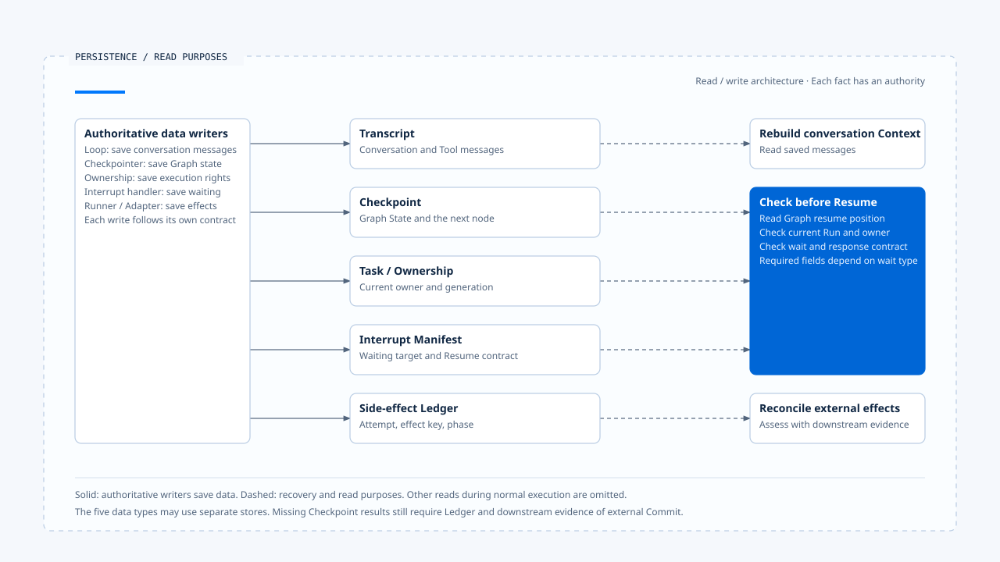
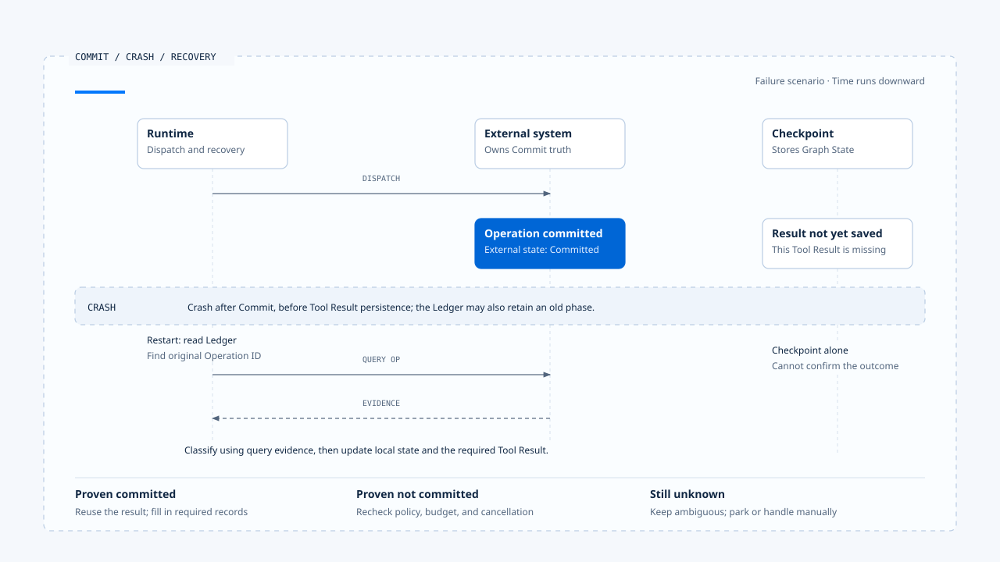

# Persistence, Interrupt, and Resume

[English](./04-persistence-interrupt-and-resume.md) | [繁體中文](./04-persistence-interrupt-and-resume-zh-TW.md)

> In the following content:
> CCB is short for [claude-code-best](https://github.com/claude-code-best/claude-code).
> Chat Gun refers to [chat-gun](https://github.com/HsienW/chat-gun).

A Runtime pauses for confirmation and receives a response later; in another case, a tool has called an external system when the process crashes before saving the result. Both require recovery, but their checks emphasize different data: the former needs to know who and what it awaits, while the latter must also determine whether an external operation has taken effect.

Conversation history alone cannot answer these questions. A recoverable Runtime must distinguish what transcripts, checkpoints, ownership, interrupt manifests, and side-effect evidence each prove.

## Five kinds of persisted data

| Data | What it stores | What it can prove | What it cannot prove alone |
|---|---|---|---|
| Transcript/Messages | User, assistant, tool use, and result messages | Which messages the model has seen | Current authoritative Run state or external Commit |
| Graph Checkpoint | Graph State, node position, and recoverable data | The state from which the Runtime can continue | Whether a downstream business effect succeeded or failed |
| Task/Ownership | Task, active Run, generation, and terminal state | Who currently owns execution | The contents of every Step inside the Graph |
| Interrupt Manifest | Waiting reason, Schema, correlation, expiry, and versions | Which input may resume which wait | That an external side effect has not occurred |
| Side-effect Ledger | Attempt, effect key, phase, and operation evidence | Whether an external operation is prepared, dispatched, committed, or still unknown | That a Graph message was persisted successfully |

These five kinds of data may share a database or span an Agent Server, product database, and external systems. The design must still describe their update order and failure windows; even if one JSON object stores everything, the system must know which fields have committed and which still await external confirmation.

[Open the HTML diagram](../../assets/agent-runtime/foundations/04-persistence-interrupt-and-resume/04-persistence-responsibilities-en.html)

The left side groups the authoritative writers of each kind of data, while the right lists reading purposes. The five kinds need not share one transaction; recovery retrieves the data relevant to the question, and external Commit still requires downstream evidence.

## Transcript, Memory, and Checkpoint

A Transcript stores conversation content so the model and user know what was said. Memory extracts reusable information across interactions and may have a longer lifecycle; Context Compression retains summaries needed for the current task under Token pressure. These support the model's understanding.

A Checkpoint supports execution recovery. It must retain the Runtime's node, pending Tool Calls, whether it is waiting, and which edge to take after Resume. Even a summary that fully restates the task cannot let the Runtime infer a reliable state machine position from natural language.

Using Graph State from a Checkpoint as long-term Memory requires separate filtering. Carrying every execution detail directly into the next model request increases Context and may reintroduce old tool errors and outdated policies.

## What to retain before an Interrupt

When the Runtime prepares to wait for human confirmation or additional user input, ordering matters:

1. Establish the waiting reason and target action.
2. Save an Interrupt Manifest containing correlation, Schema, versions, expiry, and conditions for consumption exactly once.
3. Write Graph/Run state to a recoverable position.
4. Emit a waiting event so the Harness can display the question or confirmation request.
5. Stop subsequent model and tool dispatches.

If the system displays a confirmation dialog before a failed manifest save, the user sees a wait that cannot be resumed; if it marks Waiting while tools keep dispatching in the background, the approval screen loses its meaning. Persistence and visible state need an explicit commit order; the frontend display cannot maintain consistency for them.

## Resume is a validated Command

A Resume payload must let the handler identify the specified wait and verify the responder and input. A conceptual contract can be expressed as:

~~~ts
interface ResumeCommand<T> {
  interruptId: string;
  threadId: string;
  taskId?: string;
  runId?: string;
  principal: TrustedPrincipal;
  scope: TrustedScope;
  schemaVersion: string;
  manifestVersion: string;
  payload: T;
}
~~~

On receipt, the Runtime or Harness Resume handler must check:

- Whether the Interrupt still exists and remains unconsumed.
- Whether Thread, Task, Run, and the waiting owner match.
- Whether Principal, Tenant, Scope, and Resource still meet requirements.
- Whether the response follows the specified Schema without treating extra UI fields as valid payload.
- Whether Manifest, Policy, and Runtime Version are compatible.
- Whether the wait has expired, been cancelled, been superseded, or entered Terminal.

### Consumption exactly once and redispatch

After validation, the handler atomically consumes the wait so two identical responses cannot both continue the Runtime. If consumption and enqueue/resume occur in separate steps, a crash between them also needs handling:

- Marked consumed but not restarted: the task remains consumed but undispatched, requiring a recovery mechanism to take over.
- Started but not yet consumed: a duplicate response may acquire another opportunity to dispatch.

## Recovery conditions for Clarification and Confirmation

Clarification supplies missing task data for model execution, such as a location or target format; Confirmation approves a concrete sensitive operation. Both may use Interrupts, but each needs a manifest and recovery conditions defined for its purpose.

Chat Gun's Deep Researcher saves a clarification manifest before stopping the Graph with `interrupt()`; a response returns to the clarification node only after passing the normalized input reader and response Schema. The Action Governance confirmation graph binds Tool Call, resource, policy decision, and approver, and enters authorized dispatch only after successful checks.

Applying a conversational "yes" directly to a pending Tool Call skips action, resource, and expiry checks; treating a confirmation payload as a model clarification answer may send an `approve` field into a Schema that rejects it. The two paths may share an underlying Interrupt Primitive, while their handlers still validate against their specified contracts.

## Chat Gun's recovery boundary

In the pinned version, `deep-researcher.ts` creates a `MemorySaver` and compiles the Graph. This explains how a Graph stops and resumes within a Thread and supports corresponding mock/local tests; it provides no evidence of PostgreSQL durability across processes.

`clarification-resume-authorization.ts` checks correlation, expiry, Schema, and compatibility for the specified wait before deciding whether it may be consumed. `confirmation-graph.ts` saves pending confirmation data and resumes dispatch in the authorization path. These demonstrate different Resume consumers; combining their capabilities does not establish uniform durable recovery across all Graphs.

### Development observations and production deployment

`current-langgraph-runtime-boundary.md` records observations of Dev Runs/Threads and Graph Checkpoints, and separately states the persistence evidence available for production Agent Server PG/Redis. Stop and resume records from a local development Runtime support behavior in that environment only; Worker leases, database disconnections, Redis failures, and recovery after forced termination require verification in the corresponding deployment and at the relevant failure points.

## Analyze each Crash Window separately

A Tool Call that may produce external effects has at least these windows:

- The diagram selects the failure window after Commit but before Tool Result persistence; the table below lists other positions. Reconciliation distinguishes committed, proven not committed, and still unknown, leading respectively to result reuse, dispatch eligibility checks, or parking.
- [Open the failure diagram and recovery notes](../../assets/agent-runtime/foundations/04-persistence-interrupt-and-resume/04-commit-checkpoint-crash-en.html).

| Crash point | What the Runtime knows | Handling after recovery |
|---|---|---|
| Before Tool dispatch | The underlying tool has not been called | Reschedule under policy |
| Attempt created but not sent | A local preparation record exists | Check dispatch evidence before deciding |
| Sent, external system has not responded | Effects unknown | Query by Operation ID or reconcile |
| External Commit completed, Tool Result not saved | The downstream system has a result; the Checkpoint does not | Reuse the external result; prohibit blind repetition |
| Tool Result saved, model has not sampled again | Tool result is available | Return to the model from the checkpoint |
| Terminal committed, event not delivered | The Run has ended | Redeliver/replay the event without rerunning the task |

If the Runtime reads only the last Checkpoint, it may mistake both the third and fourth cases for "the tool did not finish." Recovery needs query capabilities from the Tool Adapter or external system and uses the effect key, attempt, and known phase in the Side-effect Ledger to locate the operation to reconcile.

## The Ledger and external truth

A Business Effect Ledger records the Runtime's understanding of side effects, such as prepared, executing, committed, failed_not_committed, ambiguous, or compensated. It can prevent duplicate local dispatch, connect retry and reconciliation, and retain Audit Evidence.

### The gap between downstream Commit and local records

If the Runtime crashes after downstream Commit but before recording committed, the Ledger retains an old phase. Recovery must query using the external Operation ID before updating the local determination. If the downstream system lacks idempotency or usable status queries, the Runtime must preserve the unknown outcome, stop automatic retries, and hand off to a person.

An end-to-end exactly-once claim also needs downstream deduplication and commit contracts; local Ledger records provide only part of that evidence.

Chat Gun's `business-effect-ledger.ts`, `tool-execution-runner.ts`, and reconciler integration points provide Primitives for this routing. For a particular Agent, inspection must still follow the Registry and composition root to determine activation conditions and which Tool Calls pass through these controls.

## What CCB compaction preserves

CCB's `autoCompact.ts` triggers compression at a Context threshold and includes recursion protection and a circuit breaker for consecutive failures; `compact.ts` first attempts session-memory compaction before producing a compacted result. These mechanisms protect the query loop's Context budget so long Sessions can continue reasoning.

Compaction preserves model-visible content; execution recovery additionally needs data such as Graph nodes, pending approvals, Tool Attempt phases, and external Operations. Even if a summary can be reloaded after process restart, execution state and recovery position still require checks. Memory, compaction, and checkpoints each preserve a different scope.

## Version compatibility

A wait may span a deployment. If Tool Schemas, Graph nodes, policy, or model capabilities change before Resume, an old checkpoint may no longer execute directly. The Manifest must at least let the Runtime determine:

- Whether a reader still exists for the Graph/workflow version.
- Whether the Tool descriptor and input Schema are compatible.
- Whether the resource and policy version bound to Approval remain acceptable.
- Whether the Resume payload needs migration.
- Whether the current adapter can still decode Tool Calls from old model output.

When compatibility cannot be established, return Incompatible Resume or hand off for manual handling. Applying a new Schema directly to an old payload may create ambiguity in the original approval and action, so version changes need explicit compatibility rules or migration.

## Execution scope of Resume and Replay

Resume continues from saved state; Replay reprocesses past input or events for debugging, evaluation, and Projection construction. On paths that may produce side effects, Replay must isolate execution or reuse existing results.

The contract must state the replay scope:

- Rebuilding a Projection: the handler deduplicates by Event ID and updates displays or indexes.
- Calling a Tool again: use an explicit Command and check dispatch permission and effect evidence.

This lets the system control which handlers may affect external systems again while reading historical events.

## Common recovery errors

### Displaying a wait before saving the manifest

After persistence fails, the user can see a question but the response cannot be linked to any pending state.

### Resuming the latest wait whenever a new message arrives

A Thread may contain multiple historical Interrupts; binding a response incorrectly can restart an old action.

### Retrying a tool because the Checkpoint has no result

The external system may already have committed. A missing Tool Result means the Runtime does not know; it does not prove the operation never occurred.

### Treating MemorySaver as production durability

After process restart, Worker migration, or execution across instances, memory data no longer provides recovery guarantees.

### Forcing an old checkpoint to load after deployment

When Graph and Tool Schemas have changed, skipping manifest compatibility checks can continue execution at the wrong node or on the wrong resource.

## How to verify persistence and Resume

### Interrupt Ordering Test

- Inject failures between manifest write, checkpoint write, and the waiting event.
- Verify that users do not receive a wait whose response cannot be consumed.

### Single-consume Test

- Submit two identical Resume commands concurrently and allow only one to acquire consumption rights.
- Retain recoverable state if the process crashes after successful consumption but before dispatch.

### Compatibility Test

- Recovery using an old Schema, wrong manifest version, or removed Tool descriptor should receive an explicit rejection.

### Crash Window Test

- Terminate the process before and after external Commit, Ledger writes, and the Tool Result checkpoint.
- After recovery, distinguish not committed, committed, and ambiguous; verify before retrying.

### Deployment Test

- Restart Workers, switch processes, or pause the database or Redis, then check Thread/Run/Interrupt and ownership.
- Record Dev `MemorySaver` tests separately from production Agent Server tests.

## Engineering judgment

Assessing whether a Runtime can recover requires checking the purpose of saved data and the two writes between which a crash occurred. Conversation provides dialogue content, while Checkpoint provides execution position; durable ownership, compatible manifests, and external Commit each require their own evidence.

Resume first validates the wait and versions, then assesses external effects, and finally decides where to continue. When evidence is insufficient, the Runtime should save the reason and stop automatic action so reconciliation or manual handling has a clear point to take over.

## Implementation references and scope

### [Chat Gun](https://github.com/HsienW/chat-gun)

- `backend/src/agents/deep-researcher.ts`
- `backend/src/runtime/recovery/clarification-manifest.ts`
- `backend/src/runtime/recovery/clarification-resume-authorization.ts`
- `backend/src/runtime/recovery/resume-response-schema-registry.ts`
- `backend/src/runtime/authorization/confirmation.ts`
- `backend/src/runtime/authorization/confirmation-graph.ts`
- `backend/src/runtime/side-effect/business-effect-ledger.ts`
- `backend/src/runtime/side-effect/tool-execution-runner.ts`
- `docs/decisions/current-langgraph-runtime-boundary.md`

### [Claude Code Best](https://github.com/claude-code-best/claude-code)

- `src/services/compact/autoCompact.ts`
- `src/services/compact/compact.ts`
- `src/query.ts`

Pinned source versions and evidence limits follow this section's README. This article does not exercise restarts across processes, production PostgreSQL/Redis, real external Tools, or fault drills; its five data categories classify responsibilities without asserting a shared storage architecture across source repositories.

## Further reading

- [Agent Runtime design principles](./05-runtime-design-principles-zh-TW.md)
- [Human confirmation and approval validity](../../agent-harness/action-governance/03-human-confirmation-zh-TW.md)
