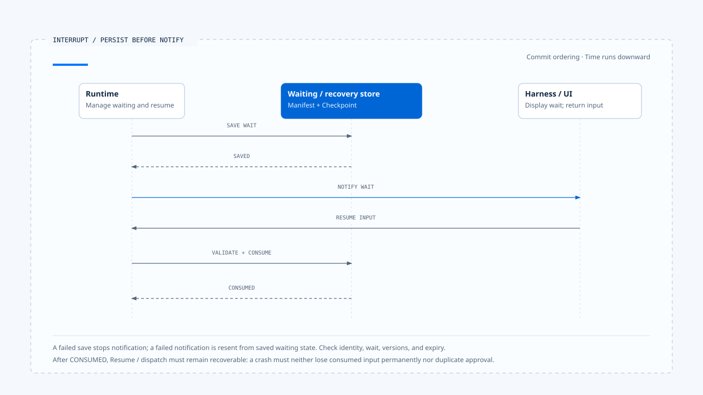

# Agent Runtime 设计原则

[English](./05-runtime-design-principles.md) | [繁體中文](./05-runtime-design-principles-zh-TW.md) | [简体中文](./05-runtime-design-principles-zh-CN.md)

> 以下内容所提到的
> CCB 为 [claude-code-best](https://github.com/claude-code-best/claude-code) 的简称。
> Chat Gun 为 [chat-gun](https://github.com/HsienW/chat-gun)。

工具调用已经成功，Runtime 却在保存 Tool Result 前崩溃；重新启动后，程序只看到 Checkpoint 没有结果，于是再调用一次。若这个工具是读文件，代价只是多做一次；若它是退款或寄信，同一套恢复逻辑便会制造第二个外部效果。

这个情境需要 Runtime 明确保存「效果不明」，并在重试前查证。设计原则要把这类判断落到状态、契约与处理程序，让系统遇到故障时有明确的后续动作。

[前篇](./04-persistence-interrupt-and-resume-zh-CN.md) 已分开 transcript、checkpoint、ownership、interrupt manifest 与 side-effect evidence。本篇沿着同一条执行路径，整理 Runtime 应维持的不变条件。

## 让原则落到执行位置

一条 Runtime 原则要回答四件事：

| 问题 | 例子 |
|---|---|
| 它保护哪项事实 | Terminal Run 不再回到 Running |
| 谁有权改变这项事实 | Run State Authority |
| 哪个 consumer 执行检查 | Event reducer、finalizer、resume handler |
| 检查失败时如何停止 | 拒绝旧事件、返回 incompatible、转 reconciliation |

文件若主张「可恢复」「可观测」或「Exactly-once」，就要列出相应的状态字段、检查点、拒绝分支与故障测试，让读者能核对这项能力的实际范围。

## 1. 每种状态只有一个权威来源

Runtime State、Task Ownership、UI Projection 与 Side-effect Ledger 可以同时保存 `running` 或 `completed` 一类信息，只有一份数据能决定接下来是否合法。UI 显示是 Projection，Log 是 Evidence，下游系统则持有外部 Commit 的真相；它们不能互相代替。

实现时，所有会改变状态的入口应回到同一个 repository、state machine 或 Agent Server API。若 HTTP handler 可以直接把 Task 标成 completed，Graph finalizer 也能写入 terminal，两边迟早会在取消、late event 或 crash recovery 时产生不同答案。

单一权威会增加 adapter 与 command 的设计工作，也可能让简单操作多一次数据访问。这项取舍换来明确的查证位置：发生冲突时，工程人员可以先读取权威状态，再检查各份 Projection 为何不同。

## 2. 状态转移必须有类型与前置条件

Run 从 Running 进入 Waiting，需要 waiting reason、manifest 与 resume contract；从 Running 进入 Completed，则需确认没有未结束 Tool Call、效果不明或待处理取消。只写 `status = nextStatus`，会把所有不变条件交给调用者记忆。

概念接口可以写成：

~~~ts
transition(command, currentState): TransitionResult
~~~

`command` 带上 expected version、actor、reason 与必要 evidence，state machine 再检查目前状态是否接受它。未知 command、版本冲突或缺少证据时，系统返回 typed rejection，保留目前状态与拒绝原因。

Chat Gun 的 ownership claim／supersede、confirmation consume 与 clarification resume 都呈现这种做法的局部形式；它们仍属不同 aggregate，不能因为各自有检查便推论全系统使用同一套 transaction。

## 3. Terminal State 单向收敛

Completed、Cancelled、Failed 或 Rejected 一旦成为权威结果，progress event、旧 generation 与重复 finalizer 不得把 Run 改回 Running。若后来查到新的外部效果证据，系统可以建立 reconciliation record 或 corrective action，却不应重写历史，把原本的取消伪装成正常完成。

### 后端写入与前端显示各自检查

每个写入端都要核对 state 与 version，前端则需检查事件的 Run 与 generation：

- 只有 UI reducer 挡住 late event 时，后端 Task 仍可能被旧 Worker 覆写。
- 只有 repository 做 CAS 时，前端若忽略 generation，旧活动仍可能盖过新 Run。

后续更正可以透过新事件、新判定或新的 recovery Task 表达，保留原 Run 当时为何结束，以及后来取得了什么证据。

## 4. Budget 与 Deadline 在执行前具体化

Runtime 会消耗模型 Token、时间、工具尝试与外部成本。若限制只存在于 Prompt，模型可以理解它，程序却无法在下一次派送前拒绝；若限制要等到 Provider 回应后才统计，超额成本早已发生。

Execution Request 应带入本次可执行的 limits，Runtime 再在每个 Model Step、Tool Attempt 与 Retry 前保留或扣除额度。不同 Budget 不宜合成一个 `remaining`：

- Turn budget 控制模型与工具循环。
- Token／cost budget 控制 Provider 使用量。
- Tool attempt budget 控制同一效果的派送次数。
- Deadline 控制整个 Run 还剩多少时间。

Fallback 与 retry 同样消耗资源。切换模型后重新送出完整 Context，要计入新请求的使用量；外部 Tool 在 timeout 后 retry，则要先确认先前 attempt 未提交。

## 5. Interrupt 先持久化，再对外显示等待

Runtime 进入 Clarification 或 Human Approval 前，要先保存可恢复数据与等待状态，再发出 UI event。反过来做，用户可能回复一个尚未落盘、甚至保存失败的 Interrupt。

[开启 HTML 图解](../../assets/agent-runtime/foundations/05-runtime-design-principles/05-persist-before-notify-en.html)

图中先确认等待数据已保存，再通知 Harness。回复通过核对并消费指定等待后，仍需可恢复地衔接 Resume 或派送，避免程序在两步之间崩溃后遗失输入。

### 保存与通知之间的失败

Persist-before-notify 要求系统定义提交顺序，以及跨存储或跨进程失败时的处理方式：

- Manifest 保存成功、事件送达失败：重送事件。
- 事件已送达、manifest 保存失败：撤销等待，或让回复处理端取得明确错误。

各项写入可以由不同存储系统承担，仍须处理画面与后端状态之间的时间差。

Resume 只消费对到指定 waiting state 的输入。Thread、Task、Run、Principal、Scope、Schema、Version 与 expiry 中，哪些是必要字段取决于等待种类；只核对可由 Client 提供的 Interrupt ID 不够。

## 6. 效果不明是一个正式结果

Tool 调用超时有两种含义：请求尚未送出，或已送出但回应没有回来。只有前者能安全归类为未提交；后者需要 `ambiguous_after_dispatch` 一类结果，让 Runtime 停止自动 retry。

Chat Gun 的 governed outcome、Tool execution runner 与 Ledger 将成功、拒绝、未提交、效果不明与取消分开记录，让后续处理端依结果采取不同动作：

| Outcome | 合法后续 |
|---|---|
| Rejected before dispatch | 回灌拒绝或结束，不调用工具 |
| Failed not committed | 符合 policy 与 budget 时 retry |
| Ambiguous after dispatch | 以 Operation ID reconcile |
| Committed | 重用结果，禁止重复产生效果 |
| Cancelled | 判读取消发生时点与既有效果 |

Ledger、replay key 与 lock 可以降低重复操作，不能自行产生 exactly-once。下游系统若没有 idempotency、查询或 transaction boundary，Runtime 最多能保存不确定性并停止自动动作。

## 7. Event 描述事实，Command 表达意图

`ToolDispatchRequested` 是 Command；`ToolDispatchStarted`、`ToolCommitted` 与 `RunCancelled` 是 Event。两者若共用含糊的 message，replay consumer 可能把历史事实当成再执行一次的要求。

Runtime Event 应带 immutable identity、sequence、type 与 payload。Consumer 可以重建 UI、Metrics 或 Audit Projection，却不应从显示文案反推权威状态。Command 则带 expected state、actor、deadline 与 idempotency information，由 authority 接受或拒绝。

事件投递状态与 Run 执行结果需要分开判读。Run 已 Completed、UI 未收到 terminal event 时，系统应重送事件或重新读取权威 state，让画面取得既有结果。

## 8. 取消是合作式状态转移

AbortSignal 可以中止仍愿意回应 abort 的 Provider 或 Tool，不能保证远端服务撤销已接收的工作。Runtime 收到 Cancel Command 后，先停止新增工作，再向 in-flight operation 传递取消，最后依已取得的 outcome 收敛。

Run 的取消状态与外部效果要分开记录。若退款在取消前已 Commit，Runtime 可以把 Run 判定为 Cancelled，同时保存已提交 effect，让 Harness 向用户说明或启动 compensation。结果契约需要同时表达「后续工作已停止」与「退款已提交」。

CCB 的 query abort、Chat Gun 前端 transport stop 与 business cancel 提供不同层次的控制。核对取消能力时，应沿调用路径追到处理端，确认 AbortController 影响哪些工作，以及外部效果如何判读。

## 9. Durability 与 Isolation 必须由部署证据支持

接口名称最容易让人过度推论。`MemorySaver` 能提供 Graph checkpoint API，不代表跨进程持久化；`isolated_process` profile 能描述需求，不代表 production Sandbox Runner 已部署；Redis lock adapter 存在，也不表示每个正式 Tool Call 都取得并续租成功。

工程文件应分开记录：

1. 类型或 Primitive 已存在。
2. 单元测试涵盖某个案例。
3. 正式入口已接入并启用。
4. 部署环境已取得动态证据。
5. 故障与竞态已经演练。

每个接点都会影响整条路径的保证。例如前半段虽有完整类型，末端 adapter 在 production 却使用 Noop，文件就应指出该控制尚未生效，并列出正式接入需要的条件。

## 10. 用故障注入验证不变条件

正常路径很难证明 Runtime 的边界。需要在两次状态变更之间刻意中止，观察恢复后会采取什么动作：

| 注入位置 | 要检查的事 |
|---|---|
| Model request 送出后 | timeout／abort 是否保留 request 与 budget evidence |
| Tool dispatch 前 | 被取消或拒绝时底层工具调用次数为零 |
| External Commit 后 | Checkpoint 缺结果时是否先 reconcile |
| Interrupt 保存时 | UI 不会收到无法恢复的 pending request |
| Resume consume 后 | crash 不造成同一批准被二次消费 |
| Terminal write 后 | event delivery retry 不重跑 Run |
| Ownership supersede 后 | 旧 finalizer 不释放新 generation |

Failure Drill 要使用正式 composition 与接近部署的 adapter。全部 dependency 都换成无状态 mock，通常只能验证分支判断，不能支持 durability、lock lease 或下游 effect 的结论。

## 将原则放回两种 Runtime

CCB 的 query loop让模型与工具控制流直接可读，Abort、turn budget、tool batching 与 compaction 也有清楚接点。它适合观察单程序 Coding Agent 如何维持消息契约；若要扩到远端多 Worker、durable interrupt 与业务 side effect，还需补入相应 authority 与 persistence。

Chat Gun 使用 LangGraph 承担 Run／Thread／Graph State，再以 ownership、authorization、tool dispatch、Ledger 与 recovery 模块补足产品语义。这种分层避免重建整套 Agent Server，代价是每个扩展都必须证明接在正式 Graph、Registry 与部署 adapter 上。

两种实现都要检查本篇的不变条件。长任务与 durable recovery 需要持久化状态、明确的转移条件，以及处理失败的程序路径；选定控制流形式后，仍要逐项核对这些能力。

## 设计检查表

| 检查项目 | 可以接受的证据 | 仍不足的证据 |
|---|---|---|
| 单一权威 | 所有 transition 经同一 authority／CAS | 多张表最后看起来一致 |
| Terminal 收敛 | Late event／stale finalizer test | UI 没有显示错误 |
| Budget enforcement | 派送前 gate 与 usage record | Prompt 写了成本限制 |
| Durable interrupt | 跨进程 restart 与 single-consume | MemorySaver 单元测试 |
| Side-effect safety | 外部 idempotency／query、Ledger 与 reconciliation | 本地 replay key |
| Cancellation | 不同 dispatch phase 的 outcome | AbortController 已建立 |
| Event replay | Event ID、sequence、idempotent consumer | 有很多 Log |
| Isolation | 正式 runner、capability enforcement 与故障测试 | ExecutionProfile 类型存在 |

## 本篇的工程判断

Runtime 需要在失败后交代发生了什么、哪个状态算数，以及下一步是否安全。状态权威、typed outcome、Budget 与 effect evidence，让程序能依证据作出这些判断，并留下停止或继续的原因。

任何宣称都应沿着正式入口走到底。接口、模块与测试可以证明设计已经有落点；跨进程恢复、隔离与外部副作用保证，则要由部署及故障演练补上。

## 实现参照与适用范围

### [Chat Gun](https://github.com/HsienW/chat-gun)

- `docs/decisions/current-langgraph-runtime-boundary.md`
- `backend/src/operations/execution-composition-root.ts`
- `backend/src/runtime/interaction/ownership.ts`
- `backend/src/runtime/input/query-guard.ts`
- `backend/src/platform/agent-runtime-events.ts`
- `backend/src/runtime/side-effect/governed-outcome.ts`
- `backend/src/runtime/side-effect/tool-execution-runner.ts`
- `backend/src/runtime/side-effect/business-effect-ledger.ts`

### [Claude Code Best](https://github.com/claude-code-best/claude-code)

- `src/query.ts`
- `src/QueryEngine.ts`
- `src/services/tools/toolOrchestration.ts`
- `src/services/compact/autoCompact.ts`

本文整理的是可检查的 Runtime 原则，不宣称两个来源库已实现同一套状态机。来源版本、第三方定位与未执行测试的限制沿用本区 README。

## 接续阅读

- [一次 Run 的完整走法](./06-one-run-walkthrough-zh-CN.md)
- [Agent Harness 设计原则](../../agent-harness/foundations/04-design-principles-zh-CN.md)
