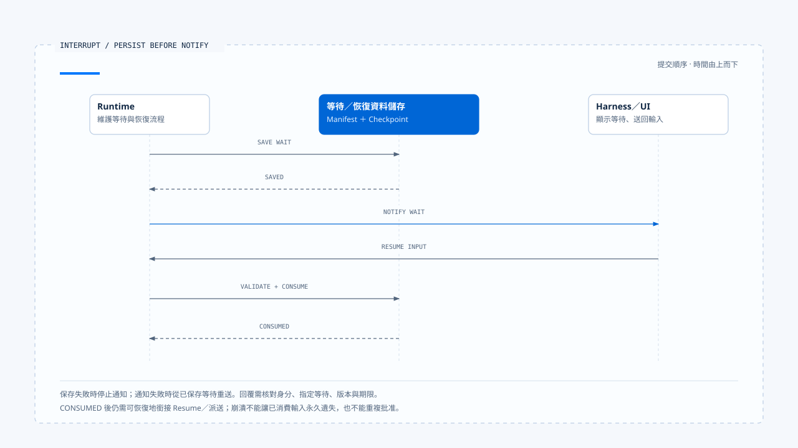

# Agent Runtime 設計原則

[English](./05-runtime-design-principles.md) | [繁體中文](./05-runtime-design-principles-zh-TW.md)

> 以下內容所提到的
> CCB 為 [claude-code-best](https://github.com/claude-code-best/claude-code) 的簡稱。
> Chat Gun 為 [chat-gun](https://github.com/HsienW/chat-gun)。

工具呼叫已經成功，Runtime 卻在保存 Tool Result 前崩潰；重新啟動後，程式只看到 Checkpoint 沒有結果，於是再呼叫一次。若這個工具是讀檔，代價只是多做一次；若它是退款或寄信，同一套恢復邏輯便會製造第二個外部效果。

這個情境需要 Runtime 明確保存「效果不明」，並在重試前查證。設計原則要把這類判斷落到狀態、契約與處理程式，讓系統遇到故障時有明確的後續動作。

[前篇](./04-persistence-interrupt-and-resume-zh-TW.md) 已分開 transcript、checkpoint、ownership、interrupt manifest 與 side-effect evidence。本篇沿著同一條執行路徑，整理 Runtime 應維持的不變條件。

## 讓原則落到執行位置

一條 Runtime 原則要回答四件事：

| 問題 | 例子 |
|---|---|
| 它保護哪項事實 | Terminal Run 不再回到 Running |
| 誰有權改變這項事實 | Run State Authority |
| 哪個 consumer 執行檢查 | Event reducer、finalizer、resume handler |
| 檢查失敗時如何停止 | 拒絕舊事件、回傳 incompatible、轉 reconciliation |

文件若主張「可恢復」「可觀測」或「Exactly-once」，就要列出相應的狀態欄位、檢查點、拒絕分支與故障測試，讓讀者能核對這項能力的實際範圍。

## 1. 每種狀態只有一個權威來源

Runtime State、Task Ownership、UI Projection 與 Side-effect Ledger 可以同時保存 `running` 或 `completed` 一類資訊，只有一份資料能決定接下來是否合法。UI 顯示是 Projection，Log 是 Evidence，下游系統則持有外部 Commit 的真相；它們不能互相代替。

實作時，所有會改變狀態的入口應回到同一個 repository、state machine 或 Agent Server API。若 HTTP handler 可以直接把 Task 標成 completed，Graph finalizer 也能寫入 terminal，兩邊遲早會在取消、late event 或 crash recovery 時產生不同答案。

單一權威會增加 adapter 與 command 的設計工作，也可能讓簡單操作多一次資料存取。這項取捨換來明確的查證位置：發生衝突時，工程人員可以先讀取權威狀態，再檢查各份 Projection 為何不同。

## 2. 狀態轉移必須有型別與前置條件

Run 從 Running 進入 Waiting，需要 waiting reason、manifest 與 resume contract；從 Running 進入 Completed，則需確認沒有未結束 Tool Call、效果不明或待處理取消。只寫 `status = nextStatus`，會把所有不變條件交給呼叫者記憶。

概念介面可以寫成：

~~~ts
transition(command, currentState): TransitionResult
~~~

`command` 帶上 expected version、actor、reason 與必要 evidence，state machine 再檢查目前狀態是否接受它。未知 command、版本衝突或缺少證據時，系統回傳 typed rejection，保留目前狀態與拒絕原因。

Chat Gun 的 ownership claim／supersede、confirmation consume 與 clarification resume 都呈現這種做法的局部形式；它們仍屬不同 aggregate，不能因為各自有檢查便推論全系統使用同一套 transaction。

## 3. Terminal State 單向收斂

Completed、Cancelled、Failed 或 Rejected 一旦成為權威結果，progress event、舊 generation 與重複 finalizer 不得把 Run 改回 Running。若後來查到新的外部效果證據，系統可以建立 reconciliation record 或 corrective action，卻不應重寫歷史，把原本的取消偽裝成正常完成。

### 後端寫入與前端顯示各自檢查

每個寫入端都要核對 state 與 version，前端則需檢查事件的 Run 與 generation：

- 只有 UI reducer 擋住 late event 時，後端 Task 仍可能被舊 Worker 覆寫。
- 只有 repository 做 CAS 時，前端若忽略 generation，舊活動仍可能蓋過新 Run。

後續更正可以透過新事件、新判定或新的 recovery Task 表達，保留原 Run 當時為何結束，以及後來取得了什麼證據。

## 4. Budget 與 Deadline 在執行前具體化

Runtime 會消耗模型 Token、時間、工具嘗試與外部成本。若限制只存在於 Prompt，模型可以理解它，程式卻無法在下一次派送前拒絕；若限制要等到 Provider 回應後才統計，超額成本早已發生。

Execution Request 應帶入本次可執行的 limits，Runtime 再在每個 Model Step、Tool Attempt 與 Retry 前保留或扣除額度。不同 Budget 不宜合成一個 `remaining`：

- Turn budget 控制模型與工具循環。
- Token／cost budget 控制 Provider 使用量。
- Tool attempt budget 控制同一效果的派送次數。
- Deadline 控制整個 Run 還剩多少時間。

Fallback 與 retry 同樣消耗資源。切換模型後重新送出完整 Context，要計入新請求的使用量；外部 Tool 在 timeout 後 retry，則要先確認先前 attempt 未提交。

## 5. Interrupt 先持久化，再對外顯示等待

Runtime 進入 Clarification 或 Human Approval 前，要先保存可恢復資料與等待狀態，再發出 UI event。反過來做，使用者可能回覆一個尚未落盤、甚至保存失敗的 Interrupt。

[開啟 HTML 圖解](../../assets/agent-runtime/foundations/05-runtime-design-principles/05-persist-before-notify.html)

圖中先確認等待資料已保存，再通知 Harness。回覆通過核對並消費指定等待後，仍需可恢復地銜接 Resume 或派送，避免程序在兩步之間崩潰後遺失輸入。

### 保存與通知之間的失敗

Persist-before-notify 要求系統定義提交順序，以及跨儲存或跨程序失敗時的處理方式：

- Manifest 保存成功、事件送達失敗：重送事件。
- 事件已送達、manifest 保存失敗：撤銷等待，或讓回覆處理端取得明確錯誤。

各項寫入可以由不同儲存系統承擔，仍須處理畫面與後端狀態之間的時間差。

Resume 只消費對到指定 waiting state 的輸入。Thread、Task、Run、Principal、Scope、Schema、Version 與 expiry 中，哪些是必要欄位取決於等待種類；只核對可由 Client 提供的 Interrupt ID 不夠。

## 6. 效果不明是一個正式結果

Tool 呼叫逾時有兩種含義：請求尚未送出，或已送出但回應沒有回來。只有前者能安全歸類為未提交；後者需要 `ambiguous_after_dispatch` 一類結果，讓 Runtime 停止自動 retry。

Chat Gun 的 governed outcome、Tool execution runner 與 Ledger 將成功、拒絕、未提交、效果不明與取消分開記錄，讓後續處理端依結果採取不同動作：

| Outcome | 合法後續 |
|---|---|
| Rejected before dispatch | 回灌拒絕或結束，不呼叫工具 |
| Failed not committed | 符合 policy 與 budget 時 retry |
| Ambiguous after dispatch | 以 Operation ID reconcile |
| Committed | 重用結果，禁止重複產生效果 |
| Cancelled | 判讀取消發生時點與既有效果 |

Ledger、replay key 與 lock 可以降低重複操作，不能自行產生 exactly-once。下游系統若沒有 idempotency、查詢或 transaction boundary，Runtime 最多能保存不確定性並停止自動動作。

## 7. Event 描述事實，Command 表達意圖

`ToolDispatchRequested` 是 Command；`ToolDispatchStarted`、`ToolCommitted` 與 `RunCancelled` 是 Event。兩者若共用含糊的 message，replay consumer 可能把歷史事實當成再執行一次的要求。

Runtime Event 應帶 immutable identity、sequence、type 與 payload。Consumer 可以重建 UI、Metrics 或 Audit Projection，卻不應從顯示文案反推權威狀態。Command 則帶 expected state、actor、deadline 與 idempotency information，由 authority 接受或拒絕。

事件投遞狀態與 Run 執行結果需要分開判讀。Run 已 Completed、UI 未收到 terminal event 時，系統應重送事件或重新讀取權威 state，讓畫面取得既有結果。

## 8. 取消是合作式狀態轉移

AbortSignal 可以中止仍願意回應 abort 的 Provider 或 Tool，不能保證遠端服務撤銷已接收的工作。Runtime 收到 Cancel Command 後，先停止新增工作，再向 in-flight operation 傳遞取消，最後依已取得的 outcome 收斂。

Run 的取消狀態與外部效果要分開記錄。若退款在取消前已 Commit，Runtime 可以把 Run 判定為 Cancelled，同時保存已提交 effect，讓 Harness 向使用者說明或啟動 compensation。結果契約需要同時表達「後續工作已停止」與「退款已提交」。

CCB 的 query abort、Chat Gun 前端 transport stop 與 business cancel 提供不同層次的控制。核對取消能力時，應沿呼叫路徑追到處理端，確認 AbortController 影響哪些工作，以及外部效果如何判讀。

## 9. Durability 與 Isolation 必須由部署證據支持

介面名稱最容易讓人過度推論。`MemorySaver` 能提供 Graph checkpoint API，不代表跨程序持久化；`isolated_process` profile 能描述需求，不代表 production Sandbox Runner 已部署；Redis lock adapter 存在，也不表示每個正式 Tool Call 都取得並續租成功。

工程文件應分開記錄：

1. 型別或 Primitive 已存在。
2. 單元測試涵蓋某個案例。
3. 正式入口已接入並啟用。
4. 部署環境已取得動態證據。
5. 故障與競態已經演練。

每個接點都會影響整條路徑的保證。例如前半段雖有完整型別，末端 adapter 在 production 卻使用 Noop，文件就應指出該控制尚未生效，並列出正式接入需要的條件。

## 10. 用故障注入驗證不變條件

正常路徑很難證明 Runtime 的邊界。需要在兩次狀態變更之間刻意中止，觀察恢復後會採取什麼動作：

| 注入位置 | 要檢查的事 |
|---|---|
| Model request 送出後 | timeout／abort 是否保留 request 與 budget evidence |
| Tool dispatch 前 | 被取消或拒絕時底層工具呼叫次數為零 |
| External Commit 後 | Checkpoint 缺結果時是否先 reconcile |
| Interrupt 保存時 | UI 不會收到無法恢復的 pending request |
| Resume consume 後 | crash 不造成同一批准被二次消費 |
| Terminal write 後 | event delivery retry 不重跑 Run |
| Ownership supersede 後 | 舊 finalizer 不釋放新 generation |

Failure Drill 要使用正式 composition 與接近部署的 adapter。全部 dependency 都換成無狀態 mock，通常只能驗證分支判斷，不能支持 durability、lock lease 或下游 effect 的結論。

## 將原則放回兩種 Runtime

CCB 的 query loop讓模型與工具控制流直接可讀，Abort、turn budget、tool batching 與 compaction 也有清楚接點。它適合觀察單程序 Coding Agent 如何維持訊息契約；若要擴到遠端多 Worker、durable interrupt 與業務 side effect，還需補入相應 authority 與 persistence。

Chat Gun 使用 LangGraph 承擔 Run／Thread／Graph State，再以 ownership、authorization、tool dispatch、Ledger 與 recovery 模組補足產品語意。這種分層避免重建整套 Agent Server，代價是每個擴充都必須證明接在正式 Graph、Registry 與部署 adapter 上。

兩種實作都要檢查本篇的不變條件。長任務與 durable recovery 需要持久化狀態、明確的轉移條件，以及處理失敗的程式路徑；選定控制流形式後，仍要逐項核對這些能力。

## 設計檢查表

| 檢查項目 | 可以接受的證據 | 仍不足的證據 |
|---|---|---|
| 單一權威 | 所有 transition 經同一 authority／CAS | 多張表最後看起來一致 |
| Terminal 收斂 | Late event／stale finalizer test | UI 沒有顯示錯誤 |
| Budget enforcement | 派送前 gate 與 usage record | Prompt 寫了成本限制 |
| Durable interrupt | 跨程序 restart 與 single-consume | MemorySaver 單元測試 |
| Side-effect safety | 外部 idempotency／query、Ledger 與 reconciliation | 本地 replay key |
| Cancellation | 不同 dispatch phase 的 outcome | AbortController 已建立 |
| Event replay | Event ID、sequence、idempotent consumer | 有很多 Log |
| Isolation | 正式 runner、capability enforcement 與故障測試 | ExecutionProfile 型別存在 |

## 本篇的工程判斷

Runtime 需要在失敗後交代發生了什麼、哪個狀態算數，以及下一步是否安全。狀態權威、typed outcome、Budget 與 effect evidence，讓程式能依證據作出這些判斷，並留下停止或繼續的原因。

任何宣稱都應沿著正式入口走到底。介面、模組與測試可以證明設計已經有落點；跨程序恢復、隔離與外部副作用保證，則要由部署及故障演練補上。

## 實作參照與適用範圍

### [Chat Gun](https://github.com/HsienW/chat-gun)

- `docs/decisions/current-langgraph-runtime-boundary.md`
- `backend/src/operations/execution-composition-root.ts`
- `backend/src/runtime/interaction/ownership.ts`
- `backend/src/runtime/input/query-guard.ts`
- `backend/src/platform/agent-runtime-events.ts`
- `backend/src/runtime/side-effect/governed-outcome.ts`
- `backend/src/runtime/side-effect/tool-execution-runner.ts`
- `backend/src/runtime/side-effect/business-effect-ledger.ts`

### [Claude Code Best](https://github.com/claude-code-best/claude-code)

- `src/query.ts`
- `src/QueryEngine.ts`
- `src/services/tools/toolOrchestration.ts`
- `src/services/compact/autoCompact.ts`

本文整理的是可檢查的 Runtime 原則，不宣稱兩個來源庫已實作同一套狀態機。來源版本、第三方定位與未執行測試的限制沿用本區 README。

## 接續閱讀

- [一次 Run 的完整走法](./06-one-run-walkthrough-zh-TW.md)
- [Agent Harness 設計原則](../../agent-harness/foundations/04-design-principles-zh-TW.md)
