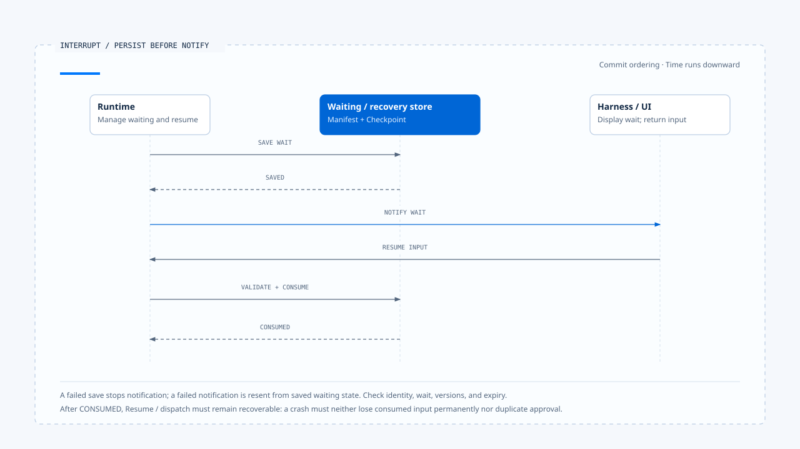

# Agent Runtime design principles

[English](./05-runtime-design-principles.md) | [繁體中文](./05-runtime-design-principles-zh-TW.md)

> In the following content:
> CCB is short for [claude-code-best](https://github.com/claude-code-best/claude-code).
> Chat Gun refers to [chat-gun](https://github.com/HsienW/chat-gun).

A tool call succeeds, but the Runtime crashes before saving its Tool Result; after restart, the program sees no result in the Checkpoint and calls the tool again. For a file read, the cost is duplicate work; for a refund or email, the same recovery logic produces a second external effect.

This scenario requires the Runtime to record unknown effects explicitly and verify them before retrying. Design principles must place these decisions in states, contracts, and handlers so the system has a defined next action after failure.

[The previous article](./04-persistence-interrupt-and-resume-zh-TW.md) separated transcripts, checkpoints, ownership, interrupt manifests, and side-effect evidence. This article follows the same execution path to organize the invariants a Runtime should maintain.

## Place principles at execution points

A Runtime principle must answer four questions:

| Question | Example |
|---|---|
| Which fact does it protect | A Terminal Run never returns to Running |
| Who may change that fact | Run State Authority |
| Which consumer performs the check | Event reducer, finalizer, resume handler |
| How processing stops when the check fails | Reject stale events, return incompatible, enter reconciliation |

Documentation that claims "recoverable," "observable," or "Exactly-once" must list the corresponding state fields, checks, rejection branches, and failure tests so readers can verify the actual scope of that capability.

## 1. Each kind of state has one authoritative source

Runtime State, Task Ownership, UI Projection, and Side-effect Ledger may all store information such as `running` or `completed`, but only one record may determine which next actions are valid. UI display is a Projection, Logs are Evidence, and downstream systems own the truth of external Commit; each serves a separate role.

In implementation, all entry points that change state should return to the same repository, state machine, or Agent Server API. If an HTTP handler can mark a Task completed directly while a Graph finalizer also writes terminal state, they will eventually disagree during cancellation, late events, or crash recovery.

A single authority adds adapter and command design work and may require another data access for simple operations. That tradeoff provides a clear verification point: when a conflict occurs, engineers can read authoritative state before investigating why Projections differ.

## 2. State transitions need types and preconditions

A Run moving from Running to Waiting needs a waiting reason, manifest, and resume contract; moving from Running to Completed requires checking that no unfinished Tool Calls, unknown effects, or pending cancellation remain. Writing only `status = nextStatus` leaves callers responsible for remembering every invariant.

A conceptual interface can be written as:

~~~ts
transition(command, currentState): TransitionResult
~~~

The `command` carries an expected version, actor, reason, and required evidence; the state machine checks whether the current state accepts it. Unknown commands, version conflicts, or missing evidence produce typed rejections that preserve current state and the rejection reason.

Chat Gun's ownership claim/supersede, confirmation consume, and clarification resume each demonstrate part of this approach; they remain separate aggregates, and individual checks do not establish a shared transaction across the system.

## 3. Terminal State converges in one direction

Once Completed, Cancelled, Failed, or Rejected becomes authoritative, progress events, old generations, and duplicate finalizers must not restore Running. If new external effect evidence is found later, the system may create a reconciliation record or corrective action, but it should not rewrite history and present an earlier cancellation as normal completion.

### Backend writes and frontend display each need checks

Each writer must check state and version, while the frontend checks the Run and generation of events:

- If only the UI reducer blocks late events, an old Worker may still overwrite the backend Task.
- If only the repository uses CAS, a frontend that ignores generation may still let old activity overwrite a new Run.

Later corrections can use new events, determinations, or recovery Tasks, preserving why the original Run ended and what evidence arrived afterward.

## 4. Make Budget and Deadline concrete before execution

A Runtime consumes model Tokens, time, tool attempts, and external costs. If a limit exists only in a Prompt, the model may understand it but code cannot enforce rejection before the next dispatch; if accounting happens only after a Provider response, excess cost has already occurred.

The Execution Request should carry actionable limits, and the Runtime reserves or deducts capacity before each Model Step, Tool Attempt, and Retry. Different Budgets should not collapse into one `remaining` value:

- Turn budget controls the model and tool cycle.
- Token/cost budget controls Provider usage.
- Tool attempt budget controls dispatch count for the same effect.
- Deadline controls the time left for the entire Run.

Fallbacks and retries also consume resources. Resending full Context after switching models counts toward the new request's usage; retrying an external Tool after timeout requires confirmation that the previous attempt did not commit.

## 5. Persist Interrupts before displaying a wait

Before entering Clarification or Human Approval, the Runtime must save recoverable data and waiting state, then emit the UI event. Reversing that order may let a user answer an Interrupt that has not reached storage or whose save has failed.

[Open the HTML diagram](../../assets/agent-runtime/foundations/05-runtime-design-principles/05-persist-before-notify-en.html)

The diagram confirms waiting data is saved before notifying the Harness. After a response passes validation and consumes the specified wait, the system must still connect it recoverably to Resume or dispatch so a crash between the two steps does not lose the input.

### Failures between persistence and notification

Persist-before-notify requires a defined commit order and handling for failures across stores or processes:

- Manifest saved, event delivery failed: redeliver the event.
- Event delivered, manifest save failed: revoke the wait or return an explicit error to the response handler.

Different storage systems may handle the writes, but the gap between display and backend state still needs handling.

Resume consumes only input bound to the specified waiting state. Which of Thread, Task, Run, Principal, Scope, Schema, Version, and expiry are required depends on the wait type; checking only an Interrupt ID supplied by the Client is insufficient.

## 6. Unknown effects are an explicit outcome

A Tool timeout can mean either that the request was never sent or that it was sent but no response returned. Only the former can safely be classified as not committed; the latter needs an outcome such as `ambiguous_after_dispatch` so the Runtime stops automatic retries.

Chat Gun's governed outcome, Tool execution runner, and Ledger record success, rejection, noncommit, unknown effects, and cancellation separately so downstream handlers can act on each result:

| Outcome | Valid next action |
|---|---|
| Rejected before dispatch | Feed back rejection or finish without calling the tool |
| Failed not committed | Retry if policy and budget permit |
| Ambiguous after dispatch | Reconcile using Operation ID |
| Committed | Reuse the result and prohibit duplicate effects |
| Cancelled | Assess when cancellation occurred and which effects already exist |

Ledgers, replay keys, and locks can reduce duplicate operations but cannot create exactly-once behavior by themselves. Without downstream idempotency, queries, or a transaction boundary, the Runtime can at most retain uncertainty and stop automatic action.

## 7. Events describe facts; Commands express intent

`ToolDispatchRequested` is a Command; `ToolDispatchStarted`, `ToolCommitted`, and `RunCancelled` are Events. If they share an ambiguous message, a replay consumer may mistake a historical fact for a request to execute again.

A Runtime Event should carry immutable identity, sequence, type, and payload. Consumers may rebuild UI, Metrics, or Audit Projections but should not infer authoritative state from display text. A Command instead carries expected state, actor, deadline, and idempotency information for the authority to accept or reject.

Event delivery status and Run execution outcome require separate interpretation. If a Run is Completed but the UI missed the terminal event, the system should redeliver the event or reread authoritative state so the display receives the existing result.

## 8. Cancellation is a cooperative state transition

AbortSignal can stop Providers or Tools that still respond to abort, but it cannot guarantee that a remote service revokes work it has accepted. On receiving a Cancel Command, the Runtime first stops adding work, propagates cancellation to operations in flight, and converges according to the outcomes it obtains.

Run cancellation and external effects need separate records. If a refund committed before cancellation, the Runtime may mark the Run Cancelled while retaining the committed effect so the Harness can explain it or initiate compensation. The result contract needs to express both "subsequent work stopped" and "the refund committed."

CCB query abort, Chat Gun frontend transport stop, and business cancel provide controls at different levels. Verification should follow the call path to handlers, identify which work AbortController affects, and establish how external effects are assessed.

## 9. Durability and Isolation need deployment evidence

Interface names readily invite excessive conclusions. `MemorySaver` provides a Graph checkpoint API without establishing persistence across processes; an `isolated_process` profile can describe requirements without proving a production Sandbox Runner is deployed; a Redis lock adapter does not establish that every production Tool Call successfully acquires and renews a lease.

Engineering documentation should record these separately:

1. A type or Primitive exists.
2. A unit test covers a case.
3. A production entry point integrates and enables it.
4. Runtime evidence has been obtained from the deployed environment.
5. Failure and concurrency drills have been performed.

Each integration point affects guarantees along the whole path. For example, if the first half has complete types but the final adapter uses Noop in production, documentation should state that the control is not yet effective and list the conditions required to enable it in production.

## 10. Verify invariants through fault injection

The normal path rarely establishes Runtime boundaries. Deliberately stop execution between state changes and observe what recovery does:

| Injection point | What to check |
|---|---|
| After sending a Model request | Timeout/abort retains request and budget evidence |
| Before Tool dispatch | Cancellation or rejection leaves the underlying tool call count at zero |
| After External Commit | Missing Checkpoint results trigger reconciliation first |
| During Interrupt persistence | The UI receives no pending request that cannot be recovered |
| After Resume consume | A crash does not let the same approval be consumed twice |
| After Terminal write | Event delivery retry does not rerun the Run |
| After Ownership supersede | The old finalizer does not release the new generation |

Failure Drills need production composition and adapters close to those deployed. Replacing every dependency with stateless mocks usually verifies branching only and cannot support conclusions about durability, lock leases, or downstream effects.

## Applying the principles to two Runtimes

CCB's query loop makes model and tool control flow directly readable, with clear integration points for Abort, turn budget, tool batching, and compaction. It is useful for observing how a Coding Agent maintains message contracts within one process; extending it to remote Workers, durable interrupts, and business side effects requires corresponding authority and persistence.

Chat Gun uses LangGraph for Run/Thread/Graph State and adds product semantics through ownership, authorization, tool dispatch, Ledger, and recovery modules. This layering avoids rebuilding an entire Agent Server, but each extension must demonstrate its connection to production Graphs, Registries, and deployed adapters.

Both implementations need checks against these invariants. Long tasks and durable recovery require persisted state, explicit transition conditions, and failure handling paths; selecting a control flow form still leaves those capabilities to verify individually.

## Design checklist

| Check | Acceptable evidence | Evidence that remains insufficient |
|---|---|---|
| Single authority | All transitions pass through the same authority/CAS | Multiple tables appear consistent at the end |
| Terminal convergence | Late event/stale finalizer tests | The UI displays no error |
| Budget enforcement | Gates before dispatch and usage records | A cost limit written in the Prompt |
| Durable interrupt | Restart across processes and single-consume behavior | MemorySaver unit tests |
| Side-effect safety | External idempotency/queries, Ledger, and reconciliation | A local replay key |
| Cancellation | Outcomes at different dispatch phases | An AbortController exists |
| Event replay | Event ID, sequence, and idempotent consumers | Many Logs exist |
| Isolation | Production runner, capability enforcement, and failure tests | An ExecutionProfile type exists |

## Engineering judgment

After failure, a Runtime must explain what happened, which state is authoritative, and whether the next action is safe. State authority, typed outcomes, Budget, and effect evidence let code make those judgments from evidence and retain reasons to stop or continue.

Every claim should be traced from the production entry point through the entire path. Interfaces, modules, and tests can show that a design has concrete implementation points; recovery across processes, isolation, and external side-effect guarantees require deployment evidence and failure drills as well.

## Implementation references and scope

### [Chat Gun](https://github.com/HsienW/chat-gun)

- `docs/decisions/current-langgraph-runtime-boundary.md`
- `backend/src/operations/execution-composition-root.ts`
- `backend/src/runtime/interaction/ownership.ts`
- `backend/src/runtime/input/query-guard.ts`
- `backend/src/platform/agent-runtime-events.ts`
- `backend/src/runtime/side-effect/governed-outcome.ts`
- `backend/src/runtime/side-effect/tool-execution-runner.ts`
- `backend/src/runtime/side-effect/business-effect-ledger.ts`

### [Claude Code Best](https://github.com/claude-code-best/claude-code)

- `src/query.ts`
- `src/QueryEngine.ts`
- `src/services/tools/toolOrchestration.ts`
- `src/services/compact/autoCompact.ts`

This article organizes verifiable Runtime principles without claiming that both source repositories implement the same state machine. Source versions, third-party status, and limits from tests not performed follow this section's README.

## Further reading

- [A complete Run walkthrough](./06-one-run-walkthrough-zh-TW.md)
- [Agent Harness design principles](../../agent-harness/foundations/04-design-principles-zh-TW.md)
