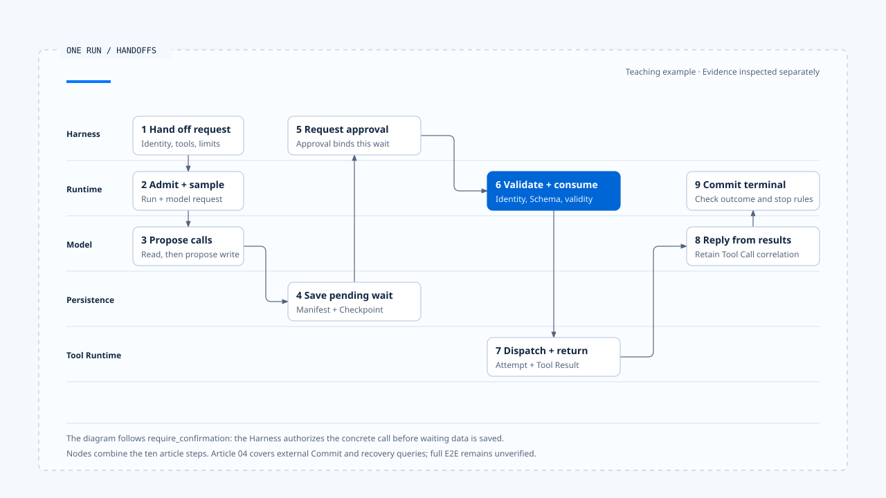

# 一次 Run 的完整走法

[English](./06-one-run-walkthrough.md) | [繁體中文](./06-one-run-walkthrough-zh-TW.md) | [简体中文](./06-one-run-walkthrough-zh-CN.md)

> 以下内容所提到的
> CCB 为 [claude-code-best](https://github.com/claude-code-best/claude-code) 的简称。
> Chat Gun 为 [chat-gun](https://github.com/HsienW/chat-gun)。

用户要求把一份报告写入工作区。模型先读取现有文件，再提出 `write_file`；产品规则要求这类修改先经人工确认。画面上只会看到一个确认问题和最后回复，Runtime 内部则要保存 Tool Call、停止派送、恢复指定等待，最后才能判断这次 Run 是否完成。

本篇沿着一个教学案例，串起前五篇的执行责任。各段参照来源如下：

- 确认流程：Chat Gun `confirmation-graph` 的 `write_file` 测试与 MCP Agent 接线。
- 模型与工具循环：CCB 的 query 与工具执行路径。
- 副作用故障分支：Chat Gun 的 governed outcome 与 Ledger 模块。

上述来源是分开查读的证据；本文按各段的观察范围说明，完整 E2E 仍需另行验证。

## 场景与识别

假设 Harness 已辨认工作区、用户与文件范围，交付以下要求：

「把报告内容写入 `reports/summary.md`。先显示将写入的路径与摘要，取得我的确认后再执行。」

本例使用以下概念识别：

| Identity | 范例 | 用途 |
|---|---|---|
| Thread ID | `thread-report` | 对话与 Graph 容器 |
| Task ID | `task-publish-report` | 写入报告的产品目标 |
| Run ID | `run-01` | 本次 Runtime 执行 |
| Generation | `7` | 此 Task 目前可见 owner |
| Tool Call ID | `call-write-01` | 模型提出的具体 `write_file` |
| Interrupt ID | `interrupt-confirm-01` | 待确认项目 |
| Attempt ID | `attempt-write-01` | 实际派送尝试 |
| Effect Key | `effect-report-summary` | 同一写入效果的重播关联 |

表中的值是教学用设置，用来说明各识别之间的关系。若工具只修改本机文件，外部 Operation ID 可能不存在；Runtime 仍要保存 Tool Call 与 Attempt，才能区分「尚未执行」「已写入」与「结果不明」。

- 图中九个节点合并下文十个步骤，聚焦需要确认的分支。外部提交与故障回查由第四篇的图解展开；各段来源仍属分开查读的证据，完整 E2E 尚待验证。
- [开启泳道图与步骤对照](../../assets/agent-runtime/foundations/06-one-run-walkthrough/06-one-run-swimlane-en.html)。

## 1. Harness 交付 Execution Request

Harness 在 Runtime 开始前完成输入、Context、能力与政策选择。概念要求包含：

~~~ts
{
  context: {
    threadId: "thread-report",
    taskId: "task-publish-report",
    runId: "run-01",
    generation: 7,
    principal: trustedPrincipal,
    scope: workspaceScope
  },
  input: normalizedUserInput,
  contextPack: governedContext,
  capabilities: [readFile, writeFile],
  limits: runLimits,
  manifest: executionManifest,
  decisionPorts: { authorizeAction, requestHumanApproval }
}
~~~

Runtime 不从 Prompt 文字建立 `principal`，也不接受模型替自己增加 `write_file`。若 manifest version 不支持、Run 已被 supersede，或必要 Decision Port 不存在，admission 应在任何模型与工具调用前失败。

### 这一步需要的证据

- Execution Request 与 canonical identity。
- Capability、limits 与 manifest 的实际版本。
- Ownership claim 或 Agent Server Run 建立结果。
- Admission rejection 的 reason code。

Harness 应依 admission 结果更新画面，让显示状态能对回这组执行证据。

## 2. Runtime 接纳 Run

Runtime 验证请求后，建立或取得 `run-01`，确认它是 `task-publish-report` generation 7 的 owner，再提交 Run started state 与事件。此时系统可以调用模型，尚未执行任何工具。

如果同一 Task 已由另一个 Run 持有，处理方式取决于 Harness 交付的 interaction policy：拒绝、排队或 supersede。Runtime 不能私下启动第二个可见 owner；supersede 成功也只表示 ownership 改变，旧 Run 的 Provider request 或 Tool I/O 还需要取消。

### 可能停止的地方

- Ownership version 冲突。
- Deadline 已过。
- Budget 为零或不合法。
- Checkpoint／Run Store 无法建立必要状态。

这些失败都发生在工具之前，可以明确说明没有派送 `write_file`。

## 3. Runtime 调用模型

### 读文件与结果回灌

Runtime 以受治理 Context 与 `read_file`／`write_file` descriptors 建立 Model Request，保存 request identity，再接收并处理 Provider stream。模型可能先产生文字，接着提出读文件 Tool Call；Runtime 只有在完整 tool use block 与参数通过解码后，才进入工具路径。

读文件属于本例已允许的能力。Runtime 验证路径仍在 workspace scope，交给 Tool Runtime 执行，再将包含 call ID 的 Tool Result 接回 messages。模型取得文件内容后形成修改摘要，提出：

~~~json
{
  "name": "write_file",
  "callId": "call-write-01",
  "input": {
    "path": "reports/summary.md",
    "content": "..."
  }
}
~~~

### 模型参数与可信执行数据

JSON 是教学数据。Principal、Scope 与 policy version 应由可信入口提供，与模型可控制的 input 分开传递。

## 4. 保存 Tool Call，请求授权

Runtime 先把 assistant tool use 与 `call-write-01` 保存到 Run／Graph State，再把具体 action、resource、input digest 与 canonical execution context 交给 Authorization Port。Harness 根据文件范围与风险政策回复 `require_confirmation`。

这个结果表示操作尚未获准派送。Runtime 不能先写文件、再显示确认，也不能让模型自行把「用户一开始要求修改」解读成对所有具体内容的批准。

Chat Gun 的 `mcp-agent.ts` 会把 Tool Call 从模型节点导向 authorization gate；confirmation graph 测试则以 `write_file` mock 验证等待批准前底层工具调用次数为零。测试工具返回文字，不代表它真的改写文件，这项限制要保留。

## 5. 建立 Interrupt 并停止派送

Runtime／Harness 形成待确认 descriptor，至少绑定：

- Interrupt、Thread、Run 与 Tool Call。
- Principal、Tenant、Scope 与 Resource。
- Action、input digest 或能判断输入未变的数据。
- Authorization decision／policy version。
- 到期时间、Resume Schema 与 manifest version。

系统先保存 pending confirmation 与 checkpoint，再发出 Waiting for Human 事件。Runtime 此时停止新 Tool dispatch；API 可以结束这次 stream，Task 仍处于可恢复等待，不能标成 Completed。

固定版本的 Chat Gun confirmation descriptor 具备多项绑定与一次性消费条件。本文以源代码与处理端实际检查的字段为准；完整参数 hash、资源版本与最新 policy 的重新判定，仍需另外找到实现证据。

## 6. Harness 显示确认内容

Harness 将 descriptor 转成用户可理解的问题，例如路径、摘要与风险，不暴露 secret 或无关 Context。用户可以批准、拒绝，或让等待过期。

这一步属产品互动。Runtime 只接收结构化 Approval／Deny command，不应直接读 UI 组件状态。Browser 关闭、stream 中断或按钮消失，也不等于 pending confirmation 已被取消；产品需另送出 cancel 或 expiry transition。

若用户在一般对话中输入「可以」，Input Harness 要先辨认它是否是 Resume，并附上可信关联。单凭文字内容，Runtime 无法知道用户批准哪一个 Tool Call。

## 7. 恢复前核对批准

用户批准后，Harness 建立可信 Resume Command。恢复处理端依序核对 pending state、Interrupt ID、Run／Thread、批准者、Scope、Resource、Schema、期限与兼容版本，再以原子操作消费这次批准。

核对失败时不派送工具：

| 失败 | Runtime 结果 |
|---|---|
| 已过期 | 返回 expired，维持或结束等待 |
| 已消费 | 拒绝 replay，不再执行 |
| Principal／Scope 不符 | 拒绝批准，留下 Audit Evidence |
| Resource／Tool Call 不符 | 视为错绑，不套用到其他调用 |
| Manifest 不兼容 | 返回 incompatible resume |
| Task 已取消或被 supersede | 不复活旧 Run |

### 批准后沿用的授权结果

Chat Gun 的 confirmation 路径在成功消费后沿用先前已评估的 authorization result，再进 `executeAuthorizedTyped()`。若产品要求每次批准后重查最新政策，还需要另行接入政策检查；固定版本的这条路径只支持上述沿用行为。

## 8. Tool Runtime 建立 Attempt 并派送

批准有效后，Runtime 建立 `attempt-write-01` 与 effect identity，进入 Tool Dispatch Pipeline。完整路径可能包含：

1. Tool registration 与 input Schema。
2. 必要 dependency 与 canonical execution context。
3. Scheduler、rate limiter、circuit breaker 与 step lock。
4. ExecutionProfile、secret reference 与 egress policy。
5. Runner 执行与 structured outcome。

### 正式接线与隔离范围

这些控制是否全部启用，要查 Registry、工具来源与组装设置。Chat Gun 固定版本的 pipeline 依工具来源与设置决定是否接入；安全文件也明列没有 production `SandboxRunnerPort` 实现。Authorization 通过后，OS isolation 仍需由执行 profile、runner 与部署环境提供证据。

本例的 `write_file` 若由 mock runner 执行，能证明 Graph 在批准后调用一次底层工具，不能证明真实文件内容、文件锁与 crash durability。正式环境仍需核对 workspace adapter 与资源状态。

## 9. Tool Result 回到模型

工具成功时，Runtime 建立与 `call-write-01` 对应的 Tool Result，保存 structured outcome，再将模型可读内容接回 messages。模型根据结果产生最后说明，Runtime 同时累积 usage、attempt 与 evidence refs。

外层函数 resolved 不能直接判定业务成功。Structured result 可能在 transport 层成功送达，内层 outcome 却是 `ambiguous_after_dispatch` 或 `rejected`；Runtime 与模型 adapter 都要读取内层语义。

若 Tool Result malformed 或遗失 call ID，Runtime 应停止下一次模型请求或先修复消息契约。把结果当成一般 user message 附上，可能使 Provider 拒绝后续对话，也会失去 Tool Call correlation。

## 10. Runtime 提交 Terminal Result

模型产生完成内容后，Runtime 还要确认：

- 没有未完成 Tool Call 或 pending Interrupt。
- Attempt 已得到可判读 outcome。
- 必要 Checkpoint 与 Run state 已写入。
- Cancel、Deadline 与 Budget 没有要求另一种终止状态。

条件成立后，Runtime 以 CAS 或相应状态权威提交 Completed，保存 Terminal Result，再送出 terminal event。Harness 根据 Run state、Tool Result 与资源证据，向用户显示「已更新报告」。

Terminal event 投递失败时，系统应重送事件或让 Client 重新读取权威状态。它不能因此重跑 `write_file`。

## Commit 后崩溃的分支

把 `write_file` 换成会调用外部系统的工具，或假设文件系统写入后程序立刻崩溃，便会出现另一条路：

~~~text
Attempt 已派送
  → 外部操作 Commit
  → 程序崩潰
  → Tool Result／Checkpoint 尚未保存
~~~

重启后，Graph 只看到 Tool Call，不能推论操作未执行。Runtime 先读 Ledger，再以 effect key 或 external Operation ID 查询：

- 若证明已 Commit，重用结果并补写 Tool Result。
- 若证明未提交，且 policy／budget 允许，才建立下一个 Attempt。
- 若下游仍无法判读，保留 ambiguous，停止自动重试。
- 若业务支持补偿且政策允许，建立新的 compensation action，并保留原事件与补偿记录。

Chat Gun 的 side-effect 模块提供 governed outcome、Ledger、runner、reconciler 与 saga 接点。它们与 confirmation graph 的测试是不同证据线，本文只用来说明完整 Runtime 应如何接合，不宣称固定版本已有一条正式 `write_file` E2E 覆盖全部步骤。

## 取消发生在不同位置

| 取消时点 | 可以安全承诺的事 |
|---|---|
| Model Request 前 | 模型尚未调用，Tool 也未派送。 |
| Waiting for Human | 不消费后续批准，关闭或失效 pending manifest。 |
| Tool dispatch 前 | 底层 runner 调用次数应为零。 |
| Tool execution 中 | 已传递 abort；外部效果仍需判读。 |
| Commit 后 | 原效果已存在，取消只停止后续工作。 |
| Terminal 后 | Cancel Command 应拒绝或成为另一项 corrective request。 |

取消的完成回复应说明已停止哪个范围。若外部结果不明，只写「已取消」会让用户误以为操作没有发生。

## Runtime Event 序列

一条概念事件序列可能如下：

| Sequence | Event | 说明 |
|---:|---|---|
| 1 | `run.started` | `run-01` 取得 generation 7 |
| 2 | `model.started` | 建立第一个 Model Request |
| 3 | `tool.requested` | 模型提出读文件 |
| 4 | `tool.completed` | 读文件结果保存 |
| 5 | `tool.requested` | 提出 `call-write-01` |
| 6 | `run.waiting` | 等待 `interrupt-confirm-01` |
| 7 | `run.resumed` | Approval 已验证并消费 |
| 8 | `tool.dispatched` | 建立 `attempt-write-01` |
| 9 | `tool.completed` | 写入结果保存 |
| 10 | `run.completed` | Terminal Result 提交 |

实际系统可能有更多事件或不同名称。Sequence 只在定义的 scope 内排序，UI 事件处理端还要核对 runId 与 generation。若 event 10 之后收到旧 Run 的 event 4，应依执行归属与 terminal guard 保留目前状态。

## CCB 的对照路径

CCB 的外层输入处理准备 messages、tools、`canUseTool`、Abort 与 budgets，再交给 `query()`。`queryLoop()` 调用模型，`runTools`／tool execution 在具体 Tool Call 上请求 Permission，执行后把 Tool Result 加回 messages，直到模型不再要求工具或停止条件成立。

这条 imperative path 可以对照本例的 3、4、8、9、10 步。CCB Interactive Permission 透过用户确认或调整输入取得决策；Chat Gun 则以 tenant、scope、confirmation descriptor 与 Graph Resume 等契约交接。两者需要分别核对各自的授权、等待与恢复证据。

## 这个案例能证明什么

| 主张 | 可用证据 | 本文保留的限制 |
|---|---|---|
| 确认前不派送测试工具 | Confirmation Graph state 与 mock 调用次数 | Mock 不证明真实文件未改变 |
| 批准后执行一次 | Same-thread resume 与 mock 调用次数 | 不等于跨进程 durable resume |
| MCP Agent 有授权与派送节点 | 正式 Graph 源代码与 edge | 仍需查实际配置与依赖 |
| Tool pipeline 可返回 typed outcome | Pipeline／structured result 源代码 | 依工具来源与 feature flag 启用 |
| Effect ambiguous 可进 reconciliation | Runner、Ledger 与 reconciler 接点 | 未执行真实外部 operation |
| 部分事件处理端可过滤 late event | Generation-aware reducer 与测试 | 其他 event 类型须逐项核对 |

多个单元测试可以支持分段判断，不能合称一次完整 E2E。若要把本例升格成正式验证，需从 Browser／SDK 入口送出请求，经真实 Agent Server、持久化 Store、Approval consumer、Tool adapter 与外部资源，再注入 crash、restart 与 late event。

## 本篇的工程判断

检查一次 Run 是否完整，要把 admission、Tool Call、Decision、Attempt、Effect 与 Terminal Result 串回同一组 Identity。每个可能故障的位置，都应留下足以决定下一步的数据，最后回复也要符合这些证据。

拒绝、过期、取消与效果不明都需要正式状态。Runtime 保留原因与关联识别后，Harness 才能交代任务停在哪里，恢复流程也能找到可接手的位置。

## 实现参照与适用范围

### [Chat Gun](https://github.com/HsienW/chat-gun)

- `backend/src/agents/mcp-agent.ts`
- `backend/src/runtime/authorization/confirmation.ts`
- `backend/src/runtime/authorization/confirmation-graph.ts`
- `backend/src/runtime/authorization/confirmation-graph.test.ts`
- `backend/src/runtime/tool-dispatch/pipeline.ts`
- `backend/src/runtime/tool-dispatch/structured-tool-result.ts`
- `backend/src/runtime/side-effect/governed-outcome.ts`
- `backend/src/runtime/side-effect/tool-execution-runner.ts`
- `backend/src/runtime/side-effect/business-effect-ledger.ts`
- `backend/src/runtime/recovery/clarification-resume-authorization.ts`

### [Claude Code Best](https://github.com/claude-code-best/claude-code)

- `src/query.ts`
- `src/services/tools/toolExecution.ts`
- `src/services/tools/toolOrchestration.ts`
- `src/hooks/toolPermission/handlers/interactiveHandler.ts`

本文没有执行教学情境，也没有重新执行来源库测试。`write_file` 确认案例、正式 MCP Agent、side-effect runner 与 CCB query loop 是分开查读的证据；部署 durability、真实文件效果与外部系统 idempotency 仍需另外验证。

## 接续阅读

- [Agent Runtime Foundations 导览](./README-zh-CN.md)
- [一次 Harness 任务的完整走法](../../agent-harness/foundations/05-one-turn-walkthrough-zh-CN.md)
- 后续分类：Execution Lifecycle、Model and Tool Execution、Effects and Recovery、Events and Operations。
