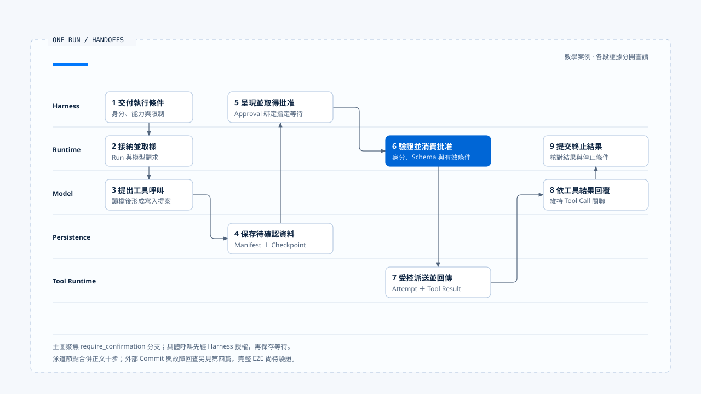

# 一次 Run 的完整走法

[English](./06-one-run-walkthrough.md) | [繁體中文](./06-one-run-walkthrough-zh-TW.md)

> 以下內容所提到的
> CCB 為 [claude-code-best](https://github.com/claude-code-best/claude-code) 的簡稱。
> Chat Gun 為 [chat-gun](https://github.com/HsienW/chat-gun)。

使用者要求把一份報告寫入工作區。模型先讀取現有檔案，再提出 `write_file`；產品規則要求這類修改先經人工確認。畫面上只會看到一個確認問題和最後回覆，Runtime 內部則要保存 Tool Call、停止派送、恢復指定等待，最後才能判斷這次 Run 是否完成。

本篇沿著一個教學案例，串起前五篇的執行責任。各段參照來源如下：

- 確認流程：Chat Gun `confirmation-graph` 的 `write_file` 測試與 MCP Agent 接線。
- 模型與工具迴圈：CCB 的 query 與工具執行路徑。
- 副作用故障分支：Chat Gun 的 governed outcome 與 Ledger 模組。

上述來源是分開查讀的證據；本文按各段的觀察範圍說明，完整 E2E 仍需另行驗證。

## 場景與識別

假設 Harness 已辨認工作區、使用者與檔案範圍，交付以下要求：

「把報告內容寫入 `reports/summary.md`。先顯示將寫入的路徑與摘要，取得我的確認後再執行。」

本例使用以下概念識別：

| Identity | 範例 | 用途 |
|---|---|---|
| Thread ID | `thread-report` | 對話與 Graph 容器 |
| Task ID | `task-publish-report` | 寫入報告的產品目標 |
| Run ID | `run-01` | 本次 Runtime 執行 |
| Generation | `7` | 此 Task 目前可見 owner |
| Tool Call ID | `call-write-01` | 模型提出的具體 `write_file` |
| Interrupt ID | `interrupt-confirm-01` | 待確認項目 |
| Attempt ID | `attempt-write-01` | 實際派送嘗試 |
| Effect Key | `effect-report-summary` | 同一寫入效果的重播關聯 |

表中的值是教學用設定，用來說明各識別之間的關係。若工具只修改本機檔案，外部 Operation ID 可能不存在；Runtime 仍要保存 Tool Call 與 Attempt，才能區分「尚未執行」「已寫入」與「結果不明」。

- 圖中九個節點合併下文十個步驟，聚焦需要確認的分支。外部提交與故障回查由第四篇的圖解展開；各段來源仍屬分開查讀的證據，完整 E2E 尚待驗證。
- [開啟泳道圖與步驟對照](../../assets/agent-runtime/foundations/06-one-run-walkthrough/06-one-run-swimlane.html)。

## 1. Harness 交付 Execution Request

Harness 在 Runtime 開始前完成輸入、Context、能力與政策選擇。概念要求包含：

~~~ts
{
  context: {
    threadId: "thread-report",
    taskId: "task-publish-report",
    runId: "run-01",
    generation: 7,
    principal: trustedPrincipal,
    scope: workspaceScope
  },
  input: normalizedUserInput,
  contextPack: governedContext,
  capabilities: [readFile, writeFile],
  limits: runLimits,
  manifest: executionManifest,
  decisionPorts: { authorizeAction, requestHumanApproval }
}
~~~

Runtime 不從 Prompt 文字建立 `principal`，也不接受模型替自己增加 `write_file`。若 manifest version 不支援、Run 已被 supersede，或必要 Decision Port 不存在，admission 應在任何模型與工具呼叫前失敗。

### 這一步需要的證據

- Execution Request 與 canonical identity。
- Capability、limits 與 manifest 的實際版本。
- Ownership claim 或 Agent Server Run 建立結果。
- Admission rejection 的 reason code。

Harness 應依 admission 結果更新畫面，讓顯示狀態能對回這組執行證據。

## 2. Runtime 接納 Run

Runtime 驗證請求後，建立或取得 `run-01`，確認它是 `task-publish-report` generation 7 的 owner，再提交 Run started state 與事件。此時系統可以呼叫模型，尚未執行任何工具。

如果同一 Task 已由另一個 Run 持有，處理方式取決於 Harness 交付的 interaction policy：拒絕、排隊或 supersede。Runtime 不能私下啟動第二個可見 owner；supersede 成功也只表示 ownership 改變，舊 Run 的 Provider request 或 Tool I/O 還需要取消。

### 可能停止的地方

- Ownership version 衝突。
- Deadline 已過。
- Budget 為零或不合法。
- Checkpoint／Run Store 無法建立必要狀態。

這些失敗都發生在工具之前，可以明確說明沒有派送 `write_file`。

## 3. Runtime 呼叫模型

### 讀檔與結果回灌

Runtime 以受治理 Context 與 `read_file`／`write_file` descriptors 建立 Model Request，保存 request identity，再接收並處理 Provider stream。模型可能先產生文字，接著提出讀檔 Tool Call；Runtime 只有在完整 tool use block 與參數通過解碼後，才進入工具路徑。

讀檔屬於本例已允許的能力。Runtime 驗證路徑仍在 workspace scope，交給 Tool Runtime 執行，再將包含 call ID 的 Tool Result 接回 messages。模型取得檔案內容後形成修改摘要，提出：

~~~json
{
  "name": "write_file",
  "callId": "call-write-01",
  "input": {
    "path": "reports/summary.md",
    "content": "..."
  }
}
~~~

### 模型參數與可信執行資料

JSON 是教學資料。Principal、Scope 與 policy version 應由可信入口提供，與模型可控制的 input 分開傳遞。

## 4. 保存 Tool Call，請求授權

Runtime 先把 assistant tool use 與 `call-write-01` 保存到 Run／Graph State，再把具體 action、resource、input digest 與 canonical execution context 交給 Authorization Port。Harness 根據檔案範圍與風險政策回覆 `require_confirmation`。

這個結果表示操作尚未獲准派送。Runtime 不能先寫檔、再顯示確認，也不能讓模型自行把「使用者一開始要求修改」解讀成對所有具體內容的批准。

Chat Gun 的 `mcp-agent.ts` 會把 Tool Call 從模型節點導向 authorization gate；confirmation graph 測試則以 `write_file` mock 驗證等待批准前底層工具呼叫次數為零。測試工具回傳文字，不代表它真的改寫檔案，這項限制要保留。

## 5. 建立 Interrupt 並停止派送

Runtime／Harness 形成待確認 descriptor，至少綁定：

- Interrupt、Thread、Run 與 Tool Call。
- Principal、Tenant、Scope 與 Resource。
- Action、input digest 或能判斷輸入未變的資料。
- Authorization decision／policy version。
- 到期時間、Resume Schema 與 manifest version。

系統先保存 pending confirmation 與 checkpoint，再發出 Waiting for Human 事件。Runtime 此時停止新 Tool dispatch；API 可以結束這次 stream，Task 仍處於可恢復等待，不能標成 Completed。

固定版本的 Chat Gun confirmation descriptor 具備多項綁定與一次性消費條件。本文以原始碼與處理端實際檢查的欄位為準；完整參數 hash、資源版本與最新 policy 的重新判定，仍需另外找到實作證據。

## 6. Harness 顯示確認內容

Harness 將 descriptor 轉成使用者可理解的問題，例如路徑、摘要與風險，不暴露 secret 或無關 Context。使用者可以批准、拒絕，或讓等待過期。

這一步屬產品互動。Runtime 只接收結構化 Approval／Deny command，不應直接讀 UI 元件狀態。Browser 關閉、stream 中斷或按鈕消失，也不等於 pending confirmation 已被取消；產品需另送出 cancel 或 expiry transition。

若使用者在一般對話中輸入「可以」，Input Harness 要先辨認它是否是 Resume，並附上可信關聯。單憑文字內容，Runtime 無法知道使用者批准哪一個 Tool Call。

## 7. 恢復前核對批准

使用者批准後，Harness 建立可信 Resume Command。恢復處理端依序核對 pending state、Interrupt ID、Run／Thread、批准者、Scope、Resource、Schema、期限與相容版本，再以原子操作消費這次批准。

核對失敗時不派送工具：

| 失敗 | Runtime 結果 |
|---|---|
| 已過期 | 回傳 expired，維持或結束等待 |
| 已消費 | 拒絕 replay，不再執行 |
| Principal／Scope 不符 | 拒絕批准，留下 Audit Evidence |
| Resource／Tool Call 不符 | 視為錯綁，不套用到其他呼叫 |
| Manifest 不相容 | 回傳 incompatible resume |
| Task 已取消或被 supersede | 不復活舊 Run |

### 批准後沿用的授權結果

Chat Gun 的 confirmation 路徑在成功消費後沿用先前已評估的 authorization result，再進 `executeAuthorizedTyped()`。若產品要求每次批准後重查最新政策，還需要另行接入政策檢查；固定版本的這條路徑只支持上述沿用行為。

## 8. Tool Runtime 建立 Attempt 並派送

批准有效後，Runtime 建立 `attempt-write-01` 與 effect identity，進入 Tool Dispatch Pipeline。完整路徑可能包含：

1. Tool registration 與 input Schema。
2. 必要 dependency 與 canonical execution context。
3. Scheduler、rate limiter、circuit breaker 與 step lock。
4. ExecutionProfile、secret reference 與 egress policy。
5. Runner 執行與 structured outcome。

### 正式接線與隔離範圍

這些控制是否全部啟用，要查 Registry、工具來源與組裝設定。Chat Gun 固定版本的 pipeline 依工具來源與設定決定是否接入；安全文件也明列沒有 production `SandboxRunnerPort` 實作。Authorization 通過後，OS isolation 仍需由執行 profile、runner 與部署環境提供證據。

本例的 `write_file` 若由 mock runner 執行，能證明 Graph 在批准後呼叫一次底層工具，不能證明真實檔案內容、檔案鎖與 crash durability。正式環境仍需核對 workspace adapter 與資源狀態。

## 9. Tool Result 回到模型

工具成功時，Runtime 建立與 `call-write-01` 對應的 Tool Result，保存 structured outcome，再將模型可讀內容接回 messages。模型根據結果產生最後說明，Runtime 同時累積 usage、attempt 與 evidence refs。

外層函式 resolved 不能直接判定業務成功。Structured result 可能在 transport 層成功送達，內層 outcome 卻是 `ambiguous_after_dispatch` 或 `rejected`；Runtime 與模型 adapter 都要讀取內層語意。

若 Tool Result malformed 或遺失 call ID，Runtime 應停止下一次模型請求或先修復訊息契約。把結果當成一般 user message 附上，可能使 Provider 拒絕後續對話，也會失去 Tool Call correlation。

## 10. Runtime 提交 Terminal Result

模型產生完成內容後，Runtime 還要確認：

- 沒有未完成 Tool Call 或 pending Interrupt。
- Attempt 已得到可判讀 outcome。
- 必要 Checkpoint 與 Run state 已寫入。
- Cancel、Deadline 與 Budget 沒有要求另一種終止狀態。

條件成立後，Runtime 以 CAS 或相應狀態權威提交 Completed，保存 Terminal Result，再送出 terminal event。Harness 根據 Run state、Tool Result 與資源證據，向使用者顯示「已更新報告」。

Terminal event 投遞失敗時，系統應重送事件或讓 Client 重新讀取權威狀態。它不能因此重跑 `write_file`。

## Commit 後崩潰的分支

把 `write_file` 換成會呼叫外部系統的工具，或假設檔案系統寫入後程序立刻崩潰，便會出現另一條路：

~~~text
Attempt 已派送
  → 外部操作 Commit
  → 程序崩潰
  → Tool Result／Checkpoint 尚未保存
~~~

重啟後，Graph 只看到 Tool Call，不能推論操作未執行。Runtime 先讀 Ledger，再以 effect key 或 external Operation ID 查詢：

- 若證明已 Commit，重用結果並補寫 Tool Result。
- 若證明未提交，且 policy／budget 允許，才建立下一個 Attempt。
- 若下游仍無法判讀，保留 ambiguous，停止自動重試。
- 若業務支援補償且政策允許，建立新的 compensation action，並保留原事件與補償紀錄。

Chat Gun 的 side-effect 模組提供 governed outcome、Ledger、runner、reconciler 與 saga 接點。它們與 confirmation graph 的測試是不同證據線，本文只用來說明完整 Runtime 應如何接合，不宣稱固定版本已有一條正式 `write_file` E2E 覆蓋全部步驟。

## 取消發生在不同位置

| 取消時點 | 可以安全承諾的事 |
|---|---|
| Model Request 前 | 模型尚未呼叫，Tool 也未派送。 |
| Waiting for Human | 不消費後續批准，關閉或失效 pending manifest。 |
| Tool dispatch 前 | 底層 runner 呼叫次數應為零。 |
| Tool execution 中 | 已傳遞 abort；外部效果仍需判讀。 |
| Commit 後 | 原效果已存在，取消只停止後續工作。 |
| Terminal 後 | Cancel Command 應拒絕或成為另一項 corrective request。 |

取消的完成回覆應說明已停止哪個範圍。若外部結果不明，只寫「已取消」會讓使用者誤以為操作沒有發生。

## Runtime Event 序列

一條概念事件序列可能如下：

| Sequence | Event | 說明 |
|---:|---|---|
| 1 | `run.started` | `run-01` 取得 generation 7 |
| 2 | `model.started` | 建立第一個 Model Request |
| 3 | `tool.requested` | 模型提出讀檔 |
| 4 | `tool.completed` | 讀檔結果保存 |
| 5 | `tool.requested` | 提出 `call-write-01` |
| 6 | `run.waiting` | 等待 `interrupt-confirm-01` |
| 7 | `run.resumed` | Approval 已驗證並消費 |
| 8 | `tool.dispatched` | 建立 `attempt-write-01` |
| 9 | `tool.completed` | 寫入結果保存 |
| 10 | `run.completed` | Terminal Result 提交 |

實際系統可能有更多事件或不同名稱。Sequence 只在定義的 scope 內排序，UI 事件處理端還要核對 runId 與 generation。若 event 10 之後收到舊 Run 的 event 4，應依執行歸屬與 terminal guard 保留目前狀態。

## CCB 的對照路徑

CCB 的外層輸入處理準備 messages、tools、`canUseTool`、Abort 與 budgets，再交給 `query()`。`queryLoop()` 呼叫模型，`runTools`／tool execution 在具體 Tool Call 上請求 Permission，執行後把 Tool Result 加回 messages，直到模型不再要求工具或停止條件成立。

這條 imperative path 可以對照本例的 3、4、8、9、10 步。CCB Interactive Permission 透過使用者確認或調整輸入取得決策；Chat Gun 則以 tenant、scope、confirmation descriptor 與 Graph Resume 等契約交接。兩者需要分別核對各自的授權、等待與恢復證據。

## 這個案例能證明什麼

| 主張 | 可用證據 | 本文保留的限制 |
|---|---|---|
| 確認前不派送測試工具 | Confirmation Graph state 與 mock 呼叫次數 | Mock 不證明真實檔案未改變 |
| 批准後執行一次 | Same-thread resume 與 mock 呼叫次數 | 不等於跨程序 durable resume |
| MCP Agent 有授權與派送節點 | 正式 Graph 原始碼與 edge | 仍需查實際配置與依賴 |
| Tool pipeline 可回傳 typed outcome | Pipeline／structured result 原始碼 | 依工具來源與 feature flag 啟用 |
| Effect ambiguous 可進 reconciliation | Runner、Ledger 與 reconciler 接點 | 未執行真實外部 operation |
| 部分事件處理端可過濾 late event | Generation-aware reducer 與測試 | 其他 event 類型須逐項核對 |

多個單元測試可以支持分段判斷，不能合稱一次完整 E2E。若要把本例升格成正式驗證，需從 Browser／SDK 入口送出請求，經真實 Agent Server、持久化 Store、Approval consumer、Tool adapter 與外部資源，再注入 crash、restart 與 late event。

## 本篇的工程判斷

檢查一次 Run 是否完整，要把 admission、Tool Call、Decision、Attempt、Effect 與 Terminal Result 串回同一組 Identity。每個可能故障的位置，都應留下足以決定下一步的資料，最後回覆也要符合這些證據。

拒絕、過期、取消與效果不明都需要正式狀態。Runtime 保留原因與關聯識別後，Harness 才能交代任務停在哪裡，恢復流程也能找到可接手的位置。

## 實作參照與適用範圍

### [Chat Gun](https://github.com/HsienW/chat-gun)

- `backend/src/agents/mcp-agent.ts`
- `backend/src/runtime/authorization/confirmation.ts`
- `backend/src/runtime/authorization/confirmation-graph.ts`
- `backend/src/runtime/authorization/confirmation-graph.test.ts`
- `backend/src/runtime/tool-dispatch/pipeline.ts`
- `backend/src/runtime/tool-dispatch/structured-tool-result.ts`
- `backend/src/runtime/side-effect/governed-outcome.ts`
- `backend/src/runtime/side-effect/tool-execution-runner.ts`
- `backend/src/runtime/side-effect/business-effect-ledger.ts`
- `backend/src/runtime/recovery/clarification-resume-authorization.ts`

### [Claude Code Best](https://github.com/claude-code-best/claude-code)

- `src/query.ts`
- `src/services/tools/toolExecution.ts`
- `src/services/tools/toolOrchestration.ts`
- `src/hooks/toolPermission/handlers/interactiveHandler.ts`

本文沒有執行教學情境，也沒有重新執行來源庫測試。`write_file` 確認案例、正式 MCP Agent、side-effect runner 與 CCB query loop 是分開查讀的證據；部署 durability、真實檔案效果與外部系統 idempotency 仍需另外驗證。

## 接續閱讀

- [Agent Runtime Foundations 導覽](./README-zh-TW.md)
- [一次 Harness 任務的完整走法](../../agent-harness/foundations/05-one-turn-walkthrough-zh-TW.md)
- 後續分類：Execution Lifecycle、Model and Tool Execution、Effects and Recovery、Events and Operations。
