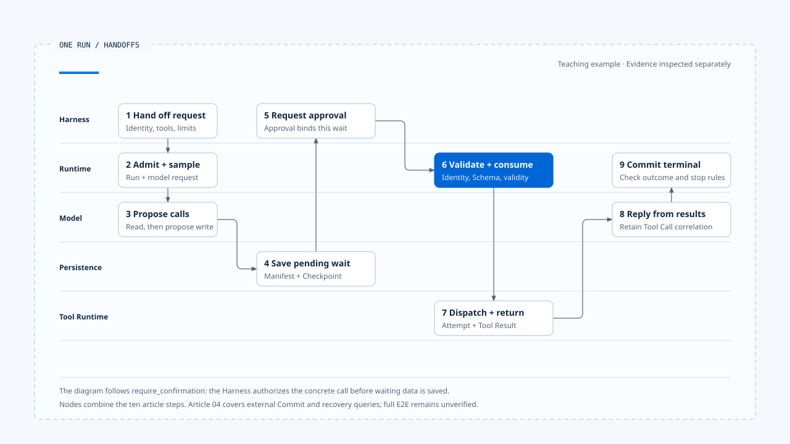

# A complete Run walkthrough

[English](./06-one-run-walkthrough.md) | [繁體中文](./06-one-run-walkthrough-zh-TW.md)

> In the following content:
> CCB is short for [claude-code-best](https://github.com/claude-code-best/claude-code).
> Chat Gun refers to [chat-gun](https://github.com/HsienW/chat-gun).

A user asks to write a report into the workspace. The model first reads existing files, then proposes `write_file`; product policy requires human confirmation before this kind of change. The screen shows only a confirmation question and a final response, while the Runtime must save the Tool Call, stop dispatch, resume the specified wait, and finally determine whether the Run is complete.

This article follows a teaching example through the execution responsibilities introduced in the first five articles. Each segment draws on these sources:

- Confirmation flow: Chat Gun `confirmation-graph` tests for `write_file` and MCP Agent wiring.
- Model and tool loop: CCB query and tool execution paths.
- Side-effect failure branches: Chat Gun governed outcome and Ledger modules.

These sources provide evidence inspected separately; each segment stays within its observed scope, and complete E2E behavior still requires verification.

## Scenario and identities

Assume the Harness has identified the workspace, user, and file scope and delivers this request:

"Write the report content to `reports/summary.md`. Show the target path and summary first, and execute only after I confirm."

This example uses the following conceptual identities:

| Identity | Example | Purpose |
|---|---|---|
| Thread ID | `thread-report` | Conversation and Graph container |
| Task ID | `task-publish-report` | Product goal of writing the report |
| Run ID | `run-01` | This Runtime execution |
| Generation | `7` | Current visible owner of this Task |
| Tool Call ID | `call-write-01` | The specific `write_file` proposed by the model |
| Interrupt ID | `interrupt-confirm-01` | Pending confirmation item |
| Attempt ID | `attempt-write-01` | Actual dispatch attempt |
| Effect Key | `effect-report-summary` | Replay correlation for the same write effect |

These values are teaching examples used to explain identity relationships. If the tool edits only local files, an external Operation ID may not exist; the Runtime still needs Tool Call and Attempt records to distinguish not executed, written, and unknown outcomes.

- The diagram combines the ten steps below into nine nodes and focuses on the confirmation branch. The fourth article's diagram expands external commit and failure reconciliation; sources for each segment remain separately inspected evidence, and complete E2E behavior is still unverified.
- [Open the swimlane diagram and step mapping](../../assets/agent-runtime/foundations/06-one-run-walkthrough/06-one-run-swimlane-en.html).

## 1. Harness delivers the Execution Request

Before the Runtime starts, the Harness selects input, Context, capabilities, and policies. The conceptual request contains:

~~~ts
{
  context: {
    threadId: "thread-report",
    taskId: "task-publish-report",
    runId: "run-01",
    generation: 7,
    principal: trustedPrincipal,
    scope: workspaceScope
  },
  input: normalizedUserInput,
  contextPack: governedContext,
  capabilities: [readFile, writeFile],
  limits: runLimits,
  manifest: executionManifest,
  decisionPorts: { authorizeAction, requestHumanApproval }
}
~~~

The Runtime does not construct `principal` from Prompt text or let the model grant itself `write_file`. An unsupported manifest version, a superseded Run, or a missing required Decision Port should fail admission before any model or tool call.

### Evidence needed at this step

- Execution Request and canonical identity.
- Actual capability, limits, and manifest versions.
- Ownership claim or Agent Server Run creation result.
- Reason code for admission rejection.

The Harness should update the display from the admission result so visible state maps back to this execution evidence.

## 2. Runtime admits the Run

After validating the request, the Runtime creates or retrieves `run-01`, confirms it owns generation 7 of `task-publish-report`, and commits the Run started state and event. The system may now call the model; no tools have executed yet.

If another Run already owns the Task, the interaction policy supplied by the Harness determines whether to reject, queue, or supersede. The Runtime cannot silently start a second visible owner; successful supersede changes ownership only, and the old Run's Provider requests or Tool I/O still need cancellation.

### Possible stopping points

- Ownership version conflict.
- Deadline already passed.
- Zero or invalid Budget.
- Checkpoint/Run Store cannot create required state.

These failures occur before tools and support an explicit statement that `write_file` was not dispatched.

## 3. Runtime calls the model

### Reading files and feeding results back

The Runtime builds a Model Request from governed Context and `read_file`/`write_file` descriptors, saves the request identity, and receives and processes the Provider stream. The model may emit text before proposing a file read Tool Call; the Runtime enters the tool path only after the complete tool use block and arguments pass decoding.

File reading is an allowed capability in this example. The Runtime verifies that the path remains within workspace scope, delegates execution to the Tool Runtime, and returns a Tool Result with the call ID to messages. With the file content available, the model prepares an edit summary and proposes:

~~~json
{
  "name": "write_file",
  "callId": "call-write-01",
  "input": {
    "path": "reports/summary.md",
    "content": "..."
  }
}
~~~

### Model arguments and trusted execution data

The JSON is teaching data. A trusted entry point should supply Principal, Scope, and policy version separately from input controlled by the model.

## 4. Save the Tool Call and request authorization

The Runtime first saves assistant tool use and `call-write-01` in Run/Graph State, then sends the concrete action, resource, input digest, and canonical execution context to the Authorization Port. The Harness returns `require_confirmation` based on file scope and risk policy.

This result means dispatch is not yet authorized. The Runtime cannot write the file before displaying confirmation or let the model interpret the user's initial edit request as approval of all concrete content.

Chat Gun's `mcp-agent.ts` routes Tool Calls from the model node to an authorization gate; confirmation graph tests use a `write_file` mock to verify that the underlying tool call count stays at zero before approval. The test tool returns text without establishing an actual file write, and that limitation must remain explicit.

## 5. Create an Interrupt and stop dispatch

Runtime/Harness creates a pending confirmation descriptor bound at least to:

- Interrupt, Thread, Run, and Tool Call.
- Principal, Tenant, Scope, and Resource.
- Action, input digest, or data that establishes input has not changed.
- Authorization decision/policy version.
- Expiry, Resume Schema, and manifest version.

The system saves pending confirmation and a checkpoint before emitting a Waiting for Human event. The Runtime stops new Tool dispatches; the API may end this stream, but the Task remains in recoverable waiting and must not be marked Completed.

The pinned Chat Gun confirmation descriptor includes several bindings and conditions for consumption exactly once. This article relies on fields actually checked by source code and handlers; full argument hashes, resource versions, and reevaluation against the latest policy still require separate implementation evidence.

## 6. Harness displays the confirmation request

The Harness turns the descriptor into a question the user can understand, including the path, summary, and risk, without exposing secrets or unrelated Context. The user may approve, deny, or let the wait expire.

This step belongs to product interaction. The Runtime receives structured Approval/Deny commands and should not read UI component state directly. Closing the Browser, breaking the stream, or removing a button does not cancel pending confirmation; the product must submit a separate cancel or expiry transition.

If the user enters "yes" in ordinary conversation, the Input Harness must first determine whether it is a Resume and attach trusted correlation. Text alone cannot tell the Runtime which Tool Call the user approved.

## 7. Check approval before recovery

After user approval, the Harness creates a trusted Resume Command. The recovery handler checks pending state, Interrupt ID, Run/Thread, approver, Scope, Resource, Schema, expiry, and compatible versions in order, then atomically consumes this approval.

Failed checks prevent tool dispatch:

| Failure | Runtime result |
|---|---|
| Expired | Return expired and retain or end the wait |
| Already consumed | Reject replay without executing again |
| Principal/Scope mismatch | Reject approval and retain Audit Evidence |
| Resource/Tool Call mismatch | Treat as an incorrect binding; do not apply to another call |
| Incompatible Manifest | Return incompatible resume |
| Task cancelled or superseded | Do not revive the old Run |

### Authorization result retained after approval

After successful consumption, Chat Gun's confirmation path retains the previously evaluated authorization result and enters `executeAuthorizedTyped()`. If the product requires the latest policy to be checked after every approval, that check needs separate integration; this path in the pinned version supports the reuse described above only.

## 8. Tool Runtime creates an Attempt and dispatches

Once approval is valid, the Runtime creates `attempt-write-01` and an effect identity, then enters the Tool Dispatch Pipeline. A complete path may include:

1. Tool registration and input Schema.
2. Required dependencies and canonical execution context.
3. Scheduler, rate limiter, circuit breaker, and step lock.
4. ExecutionProfile, secret references, and egress policy.
5. Runner execution and structured outcome.

### Production wiring and isolation scope

Whether all these controls are active requires checking the Registry, tool source, and composition settings. The pinned Chat Gun pipeline integrates according to tool source and configuration; security documentation also explicitly states that no production `SandboxRunnerPort` implementation exists. After Authorization succeeds, OS isolation still needs evidence from the execution profile, runner, and deployment environment.

If a mock runner executes this example's `write_file`, it can establish that the Graph calls the underlying tool once after approval, but cannot establish actual file contents, file locks, or crash durability. Production still needs checks of the workspace adapter and resource state.

## 9. Tool Result returns to the model

When the tool succeeds, the Runtime creates a Tool Result corresponding to `call-write-01`, saves the structured outcome, and adds model-readable content back to messages. The model produces a final explanation from the result while the Runtime accumulates usage, attempts, and evidence refs.

A resolved outer function does not establish business success. A structured result may arrive successfully at the transport layer while its inner outcome is `ambiguous_after_dispatch` or `rejected`; both the Runtime and model adapter must interpret the inner meaning.

If the Tool Result is malformed or lacks a call ID, the Runtime should stop the next model request or first repair the message contract. Appending the result as an ordinary user message may cause the Provider to reject subsequent conversation and loses Tool Call correlation.

## 10. Runtime commits the Terminal Result

After the model produces completion content, the Runtime still checks:

- No unfinished Tool Calls or pending Interrupts remain.
- The Attempt has an interpretable outcome.
- Required Checkpoints and Run state have been written.
- Cancel, Deadline, and Budget do not require a different terminal state.

Once these conditions hold, the Runtime commits Completed through CAS or the corresponding state authority, saves the Terminal Result, and emits a terminal event. Based on Run state, Tool Result, and resource evidence, the Harness tells the user "the report has been updated."

If terminal event delivery fails, the system should redeliver the event or let the Client reread authoritative state. It must not rerun `write_file` for that reason.

## The branch where a crash follows Commit

Replacing `write_file` with a tool that calls an external system, or assuming the process crashes immediately after a filesystem write, introduces another path:

~~~text
Attempt 已派送
  → 外部操作 Commit
  → 程序崩潰
  → Tool Result／Checkpoint 尚未保存
~~~

After restart, the Graph sees only a Tool Call and cannot infer that the operation never ran. The Runtime first reads the Ledger, then queries using the effect key or external Operation ID:

- If Commit is proven, reuse the result and fill in the Tool Result.
- If noncommit is proven and policy/budget permit, create the next Attempt.
- If the downstream system still cannot determine the outcome, retain ambiguous and stop automatic retries.
- If the business supports compensation and policy permits it, create a new compensation action and preserve the original event and compensation records.

Chat Gun's side-effect modules provide governed outcomes, Ledger, runner, reconciler, and saga integration points. They form a different line of evidence from confirmation graph tests; this article uses them to explain how a complete Runtime should connect, without claiming the pinned version has a production `write_file` E2E path covering every step.

## Cancellation at different points

| Cancellation point | What can safely be promised |
|---|---|
| Before Model Request | The model has not been called and the Tool has not been dispatched. |
| Waiting for Human | Do not consume later approvals; close or invalidate the pending manifest. |
| Before Tool dispatch | The underlying runner call count should be zero. |
| During Tool execution | Abort has been propagated; external effects still need assessment. |
| After Commit | The original effect exists; cancellation stops subsequent work only. |
| After Terminal | Reject the Cancel Command or treat it as a separate corrective request. |

A cancellation completion response should explain which scope has stopped. If the external outcome is unknown, saying only "cancelled" may lead the user to believe the operation never occurred.

## Runtime Event sequence

A conceptual event sequence might look like this:

| Sequence | Event | Description |
|---:|---|---|
| 1 | `run.started` | `run-01` acquires generation 7 |
| 2 | `model.started` | First Model Request created |
| 3 | `tool.requested` | Model proposes a file read |
| 4 | `tool.completed` | File read result saved |
| 5 | `tool.requested` | `call-write-01` proposed |
| 6 | `run.waiting` | Waiting for `interrupt-confirm-01` |
| 7 | `run.resumed` | Approval validated and consumed |
| 8 | `tool.dispatched` | `attempt-write-01` created |
| 9 | `tool.completed` | Write result saved |
| 10 | `run.completed` | Terminal Result committed |

A real system may have more events or different names. Sequence orders events only within its defined scope; UI event handlers must also check runId and generation. If event 4 from an old Run arrives after event 10, execution ownership and terminal guards should preserve current state.

## The corresponding CCB path

CCB's outer input handling prepares messages, tools, `canUseTool`, Abort, and budgets before calling `query()`. `queryLoop()` calls the model; `runTools`/tool execution requests Permission for concrete Tool Calls, adds Tool Results back to messages after execution, and continues until the model stops requesting tools or stopping conditions hold.

This imperative path maps to steps 3, 4, 8, 9, and 10 of the example. CCB Interactive Permission obtains decisions through user confirmation or adjusted input; Chat Gun uses tenant, scope, confirmation descriptors, and Graph Resume contracts. Each needs separate inspection of its authorization, waiting, and recovery evidence.

## What this example can establish

| Claim | Available evidence | Limits retained in this article |
|---|---|---|
| Test tools are not dispatched before confirmation | Confirmation Graph state and mock call counts | Mocks do not prove real files remained unchanged |
| Execution occurs once after approval | Same-thread resume and mock call counts | Does not establish durable resume across processes |
| MCP Agent has authorization and dispatch nodes | Production Graph source and edges | Actual configuration and dependencies still need inspection |
| Tool pipeline can return typed outcomes | Pipeline/structured result source | Enabled according to tool source and feature flags |
| Ambiguous effects can enter reconciliation | Runner, Ledger, and reconciler integration points | No real external operation was exercised |
| Some event handlers can filter late events | Reducers that check generation and corresponding tests | Other event types require individual checks |

Multiple unit tests can support judgments about separate segments but cannot be called one complete E2E test. Formal verification of this example needs a request from a Browser/SDK entry point through a real Agent Server, persistent Store, Approval consumer, Tool adapter, and external resource, followed by injected crashes, restarts, and late events.

## Engineering judgment

Checking whether a Run is complete requires linking admission, Tool Call, Decision, Attempt, Effect, and Terminal Result back to the same set of Identities. Each possible failure point should retain enough data to determine the next action, and the final response must agree with that evidence.

Rejection, expiry, cancellation, and unknown effects all need explicit states. Once the Runtime retains reasons and correlation identities, the Harness can explain where the task stopped, and recovery can identify where to take over.

## Implementation references and scope

### [Chat Gun](https://github.com/HsienW/chat-gun)

- `backend/src/agents/mcp-agent.ts`
- `backend/src/runtime/authorization/confirmation.ts`
- `backend/src/runtime/authorization/confirmation-graph.ts`
- `backend/src/runtime/authorization/confirmation-graph.test.ts`
- `backend/src/runtime/tool-dispatch/pipeline.ts`
- `backend/src/runtime/tool-dispatch/structured-tool-result.ts`
- `backend/src/runtime/side-effect/governed-outcome.ts`
- `backend/src/runtime/side-effect/tool-execution-runner.ts`
- `backend/src/runtime/side-effect/business-effect-ledger.ts`
- `backend/src/runtime/recovery/clarification-resume-authorization.ts`

### [Claude Code Best](https://github.com/claude-code-best/claude-code)

- `src/query.ts`
- `src/services/tools/toolExecution.ts`
- `src/services/tools/toolOrchestration.ts`
- `src/hooks/toolPermission/handlers/interactiveHandler.ts`

This article does not execute the teaching scenario or rerun source repository tests. The `write_file` confirmation case, production MCP Agent, side-effect runner, and CCB query loop are separately inspected evidence; deployment durability, real file effects, and external system idempotency still need independent verification.

## Further reading

- [Agent Runtime Foundations guide](./README-zh-TW.md)
- [A complete Harness task walkthrough](../../agent-harness/foundations/05-one-turn-walkthrough-zh-TW.md)
- Upcoming categories: Execution Lifecycle, Model and Tool Execution, Effects and Recovery, Events and Operations.
