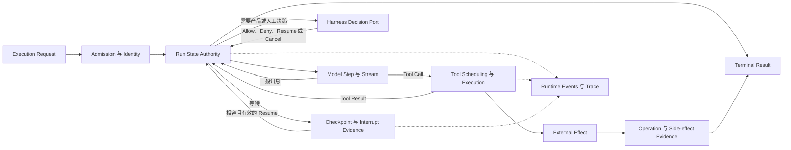

# Agent Runtime Foundations

[English](./README.md) | [繁體中文](./README-zh-TW.md) | [简体中文](./README-zh-CN.md)

> 以下内容所提到的
> CCB 为 [claude-code-best](https://github.com/claude-code-best/claude-code) 的简称。
> Chat Gun 为 [chat-gun](https://github.com/HsienW/chat-gun)。

本篇章从 [Harness 与 Runtime 的交接边界](../../agent-harness/foundations/03-harness-runtime-boundary-zh-CN.md) 往执行端移动。Harness 已交付 Normalized Input、Context、Capabilities、Limits 与 Decision Ports 之后，Runtime 必须把一次执行推进到合法终点，并保留足以回答「执行到哪里、做过什么、能否安全继续」的证据。

## 阅读顺序

| 篇次 | 文章 | 要回答的问题 | 文件名 |
|---|---|---|---|
| 01 | [实际落地的 Agent Runtime 是什么](./01-what-is-agent-runtime-zh-CN.md) | Runtime 从哪一刻接手，又应交付什么结果？ | `01-what-is-agent-runtime-zh-CN.md` |
| 02 | [Execution Identity 与状态权威](./02-execution-identity-and-state-authority-zh-CN.md) | Request、Thread、Task、Run、Step 与 Tool Call 如何保持可追踪，又由谁持有真实状态？ | `02-execution-identity-and-state-authority-zh-CN.md` |
| 03 | [Run Loop 与状态转移](./03-run-loop-and-state-transitions-zh-CN.md) | 模型、工具、等待、取消与终止如何形成合法的执行路径？ | `03-run-loop-and-state-transitions-zh-CN.md` |
| 04 | [持久化、Interrupt 与 Resume](./04-persistence-interrupt-and-resume-zh-CN.md) | 程序停止或等待外部输入后，Runtime 凭什么判断能否继续？ | `04-persistence-interrupt-and-resume-zh-CN.md` |
| 05 | [Agent Runtime 设计原则](./05-runtime-design-principles-zh-CN.md) | 哪些不变条件可以避免重复执行、状态分裂与错误完成？ | `05-runtime-design-principles-zh-CN.md` |
| 06 | [一次 Run 的完整走法](./06-one-run-walkthrough-zh-CN.md) | 一个需要确认的工具调用，如何从 admission 走到结果、等待或恢复？ | `06-one-run-walkthrough-zh-CN.md` |

## 架构与责任范围

下图是六篇文章共用的概念模型。它用来标示责任与证据流，不代表 Chat Gun 与 Claude Code Best 共用这组类型，也不默认每个 Runtime 都有相同节点。

六篇只建立后续分类会共同使用的名词与不变条件，细节分工如下：

- **Foundations** 定义 Runtime 的责任、识别、状态权威、耐久性语义与基本失败模型。
- **Execution Lifecycle** 再展开 admission、Run／Task／Thread、deadline、cancel、waiting、terminal 与竞态。
- **Model and Tool Execution** 再展开 streaming、Tool Call 循环、调度、并行、backpressure、模型 fallback 与错误回灌。
- **Effects and Recovery** 再展开 retry、idempotency、checkpoint、reconciliation、compensation 与外部提交真相。
- **Events and Operations** 再展开事件封套、Trace、Metrics、Audit、SLO、故障演练与 release gate。

### Runtime 拥有什么

| 责任 | Foundations 要建立的判断 |
|---|---|
| Admission | 必要契约、版本或依赖缺少时，在执行前拒绝。 |
| Execution Identity | 每个 Run、Step、模型请求、Tool Call、Attempt 与外部 Operation 可被关联。 |
| State Transition | 只有合法事件能改变 Run 状态，Terminal State 不被晚到事件逆转。 |
| Execution Loop | 依 limits 推进模型与工具，遇到等待、取消、超时或预算耗尽时停止。 |
| Persistence | 明确区分 transcript、checkpoint、interrupt manifest、ownership 与 side-effect evidence。 |
| Recovery | 先核对兼容性与外部效果，再 Resume、重试、回查或交给人工处理。 |
| Output | 产生有关联的 Runtime Event、Terminal Result 与执行证据。 |

### Foundations 不接管什么

- Input 的产品语义、Context 权威、能力配置、Authorization Policy 与 Human Approval 规则仍属 Harness。
- Provider 的模型能力与训练行为属 Infra；Runtime 只处理调用、流式传输、错误与已允许的 fallback。
- 外部系统是否 Commit 一次退款、寄信或资源建立，不能由 Runtime 自行宣告；它需要下游 Operation ID、查询结果或 Ledger 证据。
- UI 的显示状态是 Projection。它可以消费 Runtime Event，不能反向成为 Run 的权威数据。

## 01. 什么是 Agent Runtime

### 文章范围

Runtime 不以框架名称、背景 Worker 或单一 `query()` 函数定义，而以它必须持有的执行责任来界定。文章会先从 Execution Request 接手点开始，再追到 Terminal Result、事件与恢复证据。

预定段落：

1. Runtime 的最小责任：接受执行契约、建立 Run、推进 Step、调用模型与工具、处理停止条件。
2. Agent Loop、Workflow／Graph、Agent Server 与 Tool Runtime 的关系；它们可以分层，也可能位于同一程序。
3. Harness 决策与 Runtime 执行的双向交接，尤其是 Authorization、Human Approval、Clarification 与 Cancel。
4. Imperative loop 与 StateGraph 的两种形状：CCB `query()`／`queryLoop()` 和 Chat Gun Graph 的对照。
5. Runtime 的输出：streaming event、tool result、terminal result、checkpoint 与 effect evidence 不能混为同一份数据。
6. 何时不能开始：Execution Context、capability、version、limit 或必要 Port 不完整。

### 查证与失败分支

- 查明 Chat Gun 哪些能力由 LangGraph native Runtime 持有，哪些由 Chat Gun 的 composition、interaction、tool dispatch 与 side-effect 模块补足。
- CCB 的 Interactive 入口与 Headless／SDK 入口不完全相同；不能把 `QueryEngine` 写成所有模式唯一的 Runtime。
- Runtime 接受 `canUseTool` 或其他 Decision Port，不表示它拥有 Permission Policy。
- 图解候选：Harness、Runtime、Provider、Tool Adapter 与外部系统之间的责任位置。

主要来源：[G1][g-boundary]、[G2][g-langgraph]、[G3][g-mcp-agent]、[G5][g-composition]、[C1][c-query]、[C2][c-query-engine]。

## 02. Execution Identity 与状态权威

### 文章范围

一个用户要求可能跨越多次模型请求、工具尝试、等待与恢复。文章要建立识别关系，并回答同一个 Task 产生新 Run、旧事件晚到或工具回应重播时，哪份状态可以改变结果。

预定段落：

1. Request、Thread、Task 与 Run 的用途，以及「同一对话」「同一目标」「同一次执行」不能互换。
2. Run Generation、Step、Model Request、Tool Call、Execution Attempt 与 External Operation 的关联。
3. Event ID、Run-scoped Sequence 与 Correlation 如何支持去重、排序、Trace 及 Audit。
4. Runtime State、Task Repository、Graph Checkpoint、UI Projection 与 Effect Ledger 各自的权威范围。
5. Supersede、Retry、Resume 与 Replay 是否沿用 Identity，必须由具体契约决定。
6. CCB Session／query／tool use 的识别方式，与 Chat Gun 的 Task／Run／generation 对照时只比较责任，不硬套字段。

### 查证与失败分支

- 检查 stale finalizer、低 generation event、重复 tool result 与跨租户错绑；不能只验证正常完成路径。
- 一个 Task 建立新 Run，不表示旧 Run 的 I/O 已停止；ownership 与 cancellation 要分开查。
- Correlation 字段存在不等于所有 producer 与 consumer 都有传递，正文要沿正式入口逐段核对。
- 图解候选：Task、Run、Step、Tool Call、Attempt 与 Operation 的识别树，加上旧 generation 被拒绝的旁路。

主要来源：[G6][g-ownership]、[G7][g-query-guard]、[G8][g-runtime-events]、[G15][g-effect-identity]、[C1][c-query]、[C2][c-query-engine]。

## 03. Run Loop 与状态转移

### 文章范围

文章从 Runtime 的控制循环说明模型输出如何变成下一个 Step：一般内容可以走向完成，Tool Call 进入派送与 Tool Result 回灌，Decision Request 或 Interrupt 则让 Run 进入可辨识的等待状态。状态名称会以概念模型呈现，不宣称两个来源共用 enum。

预定段落：

1. Admission、Running、Waiting、Cancelling、Reconciling 与 Terminal 的基本关系。
2. 模型流式传输、完整 assistant message、tool use block 与 tool result 的顺序要求。
3. Turn、Token、时间、成本与工具尝试预算，如何共同形成停止条件。
4. Tool 的序列／并行调度，与模型层再次提案的不同层次。
5. AbortSignal、Deadline 与 Business Cancel 的差别；取消已送出的外部 I/O 不保证效果消失。
6. Completed、Cancelled、Failed、Rejected、Waiting 与 Parked 的机器可读语义。
7. 晚到 stream chunk、tool result 或 progress event 为何不能让 Terminal Run 回到 Running。

### 查证与失败分支

- CCB `queryLoop()` 的 while-loop、tool batching、abort 与 message repair 分开查；Chat Gun 则追 Graph edge、interrupt、tool dispatch 与 terminal consumer。
- `Promise` resolved、工具 wrapper 成功返回、模型输出完成与业务效果成功是不同观察点。
- 模型 timeout、工具 timeout、取消、预算耗尽与 malformed tool input 应保留不同结果，不收敛成一段通用错误文字。
- 图解候选：Run 状态机，标出 Tool Result 循环、等待出口、取消与 terminal 单向收敛。

主要来源：[G3][g-mcp-agent]、[G4][g-deep-researcher]、[G9][g-pipeline]、[G10][g-outcome]、[C1][c-query]、[C3][c-orchestration]、[C4][c-tool-execution]。

## 04. 持久化、Interrupt 与 Resume

### 文章范围

Runtime 要恢复的不是一段聊天文字，而是一个带版本、等待原因与外部效果状态的执行。文章会拆开不同存储物，说明程序崩溃、人工等待及兼容性变更时，各自能证明什么。

预定段落：

1. Transcript、Graph Checkpoint、Task／Ownership、Interrupt Manifest 与 Side-effect Ledger 的不同用途。
2. Memory、Context Compression 与 Checkpoint 的差别；摘要可以帮助下一次取样，不能代替 Run 恢复状态。
3. Interrupt 建立前后的持久化顺序，以及等待对象、Schema、期限与一次性消费条件。
4. Resume 前核对 Thread／Run／Task、Principal、Scope、Resource、Policy／Manifest Version 与 payload Schema。
5. 程序崩溃的几个窗口：派送前、外部 Commit 前、Commit 后但 Tool Result 尚未持久化、Terminal 已写入但事件尚未送达。
6. `MemorySaver`、mock Store、PostgreSQL Checkpointer 与正式 Agent Server 的证据不能互相代替。
7. 不兼容 Resume、效果不明与缺少 durable evidence 时，如何停止、回查或交给人工处理。

### 查证与失败分支

- Chat Gun 的 Clarification 与 Confirmation 使用不同 manifest／consumer，正文不把其中一条测试扩大成所有 Interrupt 的通用保证。
- CCB 的 compaction 保护 Context 预算，不等于 durable checkpoint 或跨进程 resume。
- Checkpoint 有 Tool Result，不一定证明外部系统 Commit；Checkpoint 没有结果，也不能推论外部操作未发生。
- 图解候选：五种持久化数据的责任图，以及外部已 Commit、Checkpoint 尚未写入时的 crash window。

主要来源：[G1][g-boundary]、[G4][g-deep-researcher]、[G11][g-ledger]、[G13][g-resume]、[G14][g-confirmation-graph]、[C5][c-auto-compact]、[C6][c-compact]。

## 05. Agent Runtime 设计原则

### 文章范围

前四篇建立名词后，本篇把它们收敛成工程上可检查的不变条件。原则要能对应到状态、consumer 或故障注入位置，不以「可靠」「可观测」等形容词代替做法。

预定段落：

1. 每种状态只有一个权威来源，Projection 与 Cache 不能反向改写 Runtime truth。
2. 状态转移由类型化 Command、Event 或 Decision 驱动，非法转移与未知版本直接拒绝。
3. Terminal 单向收敛；晚到事件、旧 generation 与重复 finalizer 不得复活 Run。
4. Budget 与 Deadline 在开始前具体化，Retry、model fallback 与 tool retry 各有独立条件及上限。
5. Interrupt 先留下可恢复证据，再向外显示等待；Resume 只消费对到指定等待的输入。
6. 副作用的 `unknown` 是正式状态。缺少外部证据时先 reconcile，不能用盲目重试填补不确定性。
7. Event 描述已发生的事，Command 表达希望发生的事；UI 文案不能充当 Terminal Result。
8. Durability、idempotency、isolation 与 exactly-once 都必须由部署与外部系统证据支持。
9. Failure Drill 要覆盖模型请求、工具派送、外部 Commit、checkpoint write、event delivery 与 resume validation。

### 查证与失败分支

- 每项原则至少配一个来源 consumer、一个拒绝或停止分支，以及目前尚未取得的部署证据。
- 将框架内建能力、产品扩展、可选 feature flag 与正式入口接线分开，避免用模块存在推论全路径已启用。
- 测试程序定义的案例只能证明测试安排；若本轮未执行，正文会写「测试涵盖」，不写「测试通过」。
- 图解候选：Runtime invariants 检查表，对回 admission、running、waiting、recovery 与 terminal 五个阶段。

主要来源：[G1][g-boundary]、[G5][g-composition]、[G6][g-ownership]、[G8][g-runtime-events]、[G10][g-outcome]、[G12][g-runner]、[C1][c-query]、[C3][c-orchestration]。

## 06. 一次 Run 的完整走法

### 主案例与对照

案例采用「模型提出一个需要人工确认、可能产生外部副作用的工具调用」。它会把多条已观察的程序路径组成教学用追踪框架，但不宣称 Chat Gun 现有测试已将所有步骤串成一次 E2E，也不把 CCB 的 Permission UI 与 Chat Gun 的授权类型混成同一套实现。

预定段落：

1. Harness 交付 Execution Request；Runtime 验证版本、limits、Decision Ports 与 canonical identity。
2. Runtime 建立或取得 Run，发出开始事件，调用模型并接收 tool use。
3. Runtime 保存具体 Tool Call 与关联，向 Harness 请求授权；需要人工确认时，先留下 interrupt／pending evidence 再停止派送。
4. Resume consumer 核对等待对象、可信身份、Scope、Schema、期限与一次性使用，然后让 Runtime 继续合法转移。
5. Tool Runtime 建立 attempt／effect identity，经 scheduler、lock、execution profile 与 runner 派送，将 structured result 回灌模型。
6. 模型产生完成内容；Runtime 写入 Terminal Result，事件与 UI projection 依 correlation 更新。
7. 对照拒绝、确认超时、Resume 错绑、取消、模型 timeout、Tool Result malformed 与 late event。
8. 故障注入：外部操作已 Commit、Ledger 或 Checkpoint 尚未写完时，恢复流程先回查 effect evidence。

### 所需证据

| 主张 | 预计核对的数据 | 不能用来替代的证据 |
|---|---|---|
| Run 已被正式接纳 | Execution Request、identity、版本、limits 与 admission result。 | UI 显示「执行中」。 |
| 确认前工具未执行 | Pending／interrupt 状态与底层 runner 调用次数。 | 画面仍停在确认窗口。 |
| Resume 对到原等待 | Manifest、consumer、可信关联、Schema、期限与 consume 结果。 | 一段内容为「同意」的消息。 |
| 工具产生外部效果 | Attempt、operation ID、Ledger 与下游查询结果。 | Tool wrapper 或 Promise 成功返回。 |
| Run 已完成 | Terminal Result、权威 Run 状态与 sequence。 | 最后一段 assistant 文字。 |
| 崩溃后可以安全继续 | Durable checkpoint、兼容 manifest、effect evidence 与 replay policy。 | MemorySaver 或单元测试中的 mock Store。 |

图解候选：Product／Harness、Runtime、Model、Tool Runtime、External System 与 Persistence 的泳道。正常完成与 Commit 后崩溃分成两条路，避免把 recovery 画成一般成功流程必经步骤。

主要来源：[G3][g-mcp-agent]、[G4][g-deep-researcher]、[G9][g-pipeline]、[G11][g-ledger]、[G12][g-runner]、[G13][g-resume]、[G14][g-confirmation-graph]、[C1][c-query]、[C4][c-tool-execution]。

## 来源与查证状态

GUN-ATLAS v1.0 提供 Chat Gun 与 Claude Code Best 的起始索引；指定的 session 文件在原路径及用户目录下的 `.codex` 修正版路径都未找到，因此不列为已读证据。用户所称的 claude-code-base，依附件内容对应到 Claude Code Best。

本规划沿用库内既有文章固定的版本，避免将浮动分支内容混入同一组判断：

| 来源 | 固定 commit | 在 Foundations 的用途 |
|---|---|---|
| [Chat Gun](https://github.com/HsienW/chat-gun) | `92a5673003e4ac4ec09be8b1b350f42dbf4a5e69` | LangGraph 边界、execution composition、interaction ownership、tool dispatch、interrupt／resume、side-effect evidence 与事件。 |
| [Claude Code Best](https://github.com/claude-code-best/claude-code) | `77a7934e15d69da13879112ed7db695c9ee7a52a` | 第三方 Coding Agent 的 query loop、session orchestration、tool execution、并行调度、abort 与 compaction 对照。 |

CCB 是第三方项目，不代表 Anthropic 官方现行产品的唯一实现。GUN-ATLAS、既有文章与来源索引用来界定查读入口；六篇正文依 source、consumer、设置开关、测试与部署条件限制主张。本轮没有重新执行来源库的 unit、integration、E2E、真实 Provider、外部 MCP、数据库竞态或故障演练。

### 主要来源索引

| 索引 | 路径 | 规划用途 |
|---|---|---|
| [G1][g-boundary] | `docs/decisions/current-langgraph-runtime-boundary.md` | LangGraph native authority、Chat Gun extension 与正式部署证据缺口。 |
| [G2][g-langgraph] | `backend/langgraph.json` | Graph 注册入口；注册本身不代表治理与恢复能力全数启用。 |
| [G3][g-mcp-agent] | `backend/src/agents/mcp-agent.ts` | Model、authorization、confirmation、physical dispatch 与 loop edge。 |
| [G4][g-deep-researcher] | `backend/src/agents/deep-researcher.ts` | StateGraph、clarification interrupt、resume 与 MemorySaver 组装。 |
| [G5][g-composition] | `backend/src/operations/execution-composition-root.ts` | Runtime 扩展的共同组装入口与可选依赖。 |
| [G6][g-ownership] | `backend/src/runtime/interaction/ownership.ts` | Task／Run／generation ownership 与 transactional supersede。 |
| [G7][g-query-guard] | `backend/src/runtime/input/query-guard.ts` | Reservation、durable owner lookup 与 generation-aware release。 |
| [G8][g-runtime-events] | `backend/src/platform/agent-runtime-events.ts` | Runtime event 的关联与对外封套。 |
| [G9][g-pipeline] | `backend/src/runtime/tool-dispatch/pipeline.ts` | Tool admission、调度、执行 Context 与 structured outcome。 |
| [G10][g-outcome] | `backend/src/runtime/side-effect/governed-outcome.ts` | 成功、拒绝、未提交、效果不明与取消的结果类型。 |
| [G11][g-ledger] | `backend/src/runtime/side-effect/business-effect-ledger.ts` | Attempt 与 business effect 的状态及外部证据边界。 |
| [G12][g-runner] | `backend/src/runtime/side-effect/tool-execution-runner.ts` | 执行、retry eligibility、result reuse 与 reconciliation 交接。 |
| [G13][g-resume] | `backend/src/runtime/recovery/clarification-resume-authorization.ts` | Clarification resume 的关联、期限、Schema、兼容性与 consume。 |
| [G14][g-confirmation-graph] | `backend/src/runtime/authorization/confirmation-graph.ts` | Confirmation gate、interrupt、resume 与 authorized dispatch。 |
| [G15][g-effect-identity] | `backend/src/runtime/side-effect/identity.ts` | Tool Call、attempt、replay 与 effect identity 的 host 接点。 |
| [C1][c-query] | `src/query.ts` | QueryParams、query／queryLoop、turn、budget、abort、tool result 与 compaction。 |
| [C2][c-query-engine] | `src/QueryEngine.ts` | Headless／SDK session、messages、usage、abort 与 permission denial。 |
| [C3][c-orchestration] | `src/services/tools/toolOrchestration.ts` | Tool batching、并行安全分类、concurrency cap 与 Context 更新。 |
| [C4][c-tool-execution] | `src/services/tools/toolExecution.ts` | Tool input、Permission 往返、progress 与实际执行。 |
| [C5][c-auto-compact] | `src/services/compact/autoCompact.ts` | Context threshold、递归防护与连续失败保护。 |
| [C6][c-compact] | `src/services/compact/compact.ts` | Compaction 内容与 session-memory 路径；不作为 durable resume 证据。 |

## 正文写作与验证方式

六篇正文依 01 → 02 → 03 → 04 → 05 → 06 阅读。各篇先建立概念，再落到固定版本来源与失败分支；第六篇只把分开查读的证据组成教学追踪，不宣称来源库已存在相同的完整 E2E。

1. 各篇先列出责任边界与实现状态，再追 source 到正式 consumer；不从类型名称推论全路径行为。
2. 每个成功流程至少保留一个拒绝、取消、超时、不兼容或效果不明分支。
3. 把源代码已确认、测试案例已定义、本轮测试已执行与正式部署已验证分开书写。
4. 图解使用与 `agent-harness/foundations` 相同的色系与版面，保留 SVG／HTML 原档，英文版另用 `-en` 文件名。
5. 第六篇只在证据确实连通时称为 E2E；若引用多个独立测试，正文会逐段标示，不把它们拼成一次已执行的完整 Run。
6. 完成 Foundations 后，再将细节分流到四个 Runtime 分类，避免同一套 retry、checkpoint 或 event 说明在各篇重复扩写。

[g-boundary]: https://github.com/HsienW/chat-gun/blob/92a5673003e4ac4ec09be8b1b350f42dbf4a5e69/docs/decisions/current-langgraph-runtime-boundary.md
[g-langgraph]: https://github.com/HsienW/chat-gun/blob/92a5673003e4ac4ec09be8b1b350f42dbf4a5e69/backend/langgraph.json
[g-mcp-agent]: https://github.com/HsienW/chat-gun/blob/92a5673003e4ac4ec09be8b1b350f42dbf4a5e69/backend/src/agents/mcp-agent.ts
[g-deep-researcher]: https://github.com/HsienW/chat-gun/blob/92a5673003e4ac4ec09be8b1b350f42dbf4a5e69/backend/src/agents/deep-researcher.ts
[g-composition]: https://github.com/HsienW/chat-gun/blob/92a5673003e4ac4ec09be8b1b350f42dbf4a5e69/backend/src/operations/execution-composition-root.ts
[g-ownership]: https://github.com/HsienW/chat-gun/blob/92a5673003e4ac4ec09be8b1b350f42dbf4a5e69/backend/src/runtime/interaction/ownership.ts
[g-query-guard]: https://github.com/HsienW/chat-gun/blob/92a5673003e4ac4ec09be8b1b350f42dbf4a5e69/backend/src/runtime/input/query-guard.ts
[g-runtime-events]: https://github.com/HsienW/chat-gun/blob/92a5673003e4ac4ec09be8b1b350f42dbf4a5e69/backend/src/platform/agent-runtime-events.ts
[g-pipeline]: https://github.com/HsienW/chat-gun/blob/92a5673003e4ac4ec09be8b1b350f42dbf4a5e69/backend/src/runtime/tool-dispatch/pipeline.ts
[g-outcome]: https://github.com/HsienW/chat-gun/blob/92a5673003e4ac4ec09be8b1b350f42dbf4a5e69/backend/src/runtime/side-effect/governed-outcome.ts
[g-ledger]: https://github.com/HsienW/chat-gun/blob/92a5673003e4ac4ec09be8b1b350f42dbf4a5e69/backend/src/runtime/side-effect/business-effect-ledger.ts
[g-runner]: https://github.com/HsienW/chat-gun/blob/92a5673003e4ac4ec09be8b1b350f42dbf4a5e69/backend/src/runtime/side-effect/tool-execution-runner.ts
[g-resume]: https://github.com/HsienW/chat-gun/blob/92a5673003e4ac4ec09be8b1b350f42dbf4a5e69/backend/src/runtime/recovery/clarification-resume-authorization.ts
[g-confirmation-graph]: https://github.com/HsienW/chat-gun/blob/92a5673003e4ac4ec09be8b1b350f42dbf4a5e69/backend/src/runtime/authorization/confirmation-graph.ts
[g-effect-identity]: https://github.com/HsienW/chat-gun/blob/92a5673003e4ac4ec09be8b1b350f42dbf4a5e69/backend/src/runtime/side-effect/identity.ts
[c-query]: https://github.com/claude-code-best/claude-code/blob/77a7934e15d69da13879112ed7db695c9ee7a52a/src/query.ts
[c-query-engine]: https://github.com/claude-code-best/claude-code/blob/77a7934e15d69da13879112ed7db695c9ee7a52a/src/QueryEngine.ts
[c-orchestration]: https://github.com/claude-code-best/claude-code/blob/77a7934e15d69da13879112ed7db695c9ee7a52a/src/services/tools/toolOrchestration.ts
[c-tool-execution]: https://github.com/claude-code-best/claude-code/blob/77a7934e15d69da13879112ed7db695c9ee7a52a/src/services/tools/toolExecution.ts
[c-auto-compact]: https://github.com/claude-code-best/claude-code/blob/77a7934e15d69da13879112ed7db695c9ee7a52a/src/services/compact/autoCompact.ts
[c-compact]: https://github.com/claude-code-best/claude-code/blob/77a7934e15d69da13879112ed7db695c9ee7a52a/src/services/compact/compact.ts
