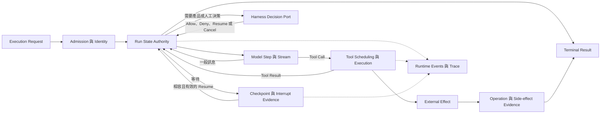

# Agent Runtime Foundations

[English](./README.md) | [繁體中文](./README-zh-TW.md)

> 以下內容所提到的
> CCB 為 [claude-code-best](https://github.com/claude-code-best/claude-code) 的簡稱。
> Chat Gun 為 [chat-gun](https://github.com/HsienW/chat-gun)。

本篇章從 [Harness 與 Runtime 的交接邊界](../../agent-harness/foundations/03-harness-runtime-boundary-zh-TW.md) 往執行端移動。Harness 已交付 Normalized Input、Context、Capabilities、Limits 與 Decision Ports 之後，Runtime 必須把一次執行推進到合法終點，並保留足以回答「執行到哪裡、做過什麼、能否安全繼續」的證據。

## 閱讀順序

| 篇次 | 文章 | 要回答的問題 | 檔名 |
|---|---|---|---|
| 01 | [實際落地的 Agent Runtime 是什麼](./01-what-is-agent-runtime-zh-TW.md) | Runtime 從哪一刻接手，又應交付什麼結果？ | `01-what-is-agent-runtime-zh-TW.md` |
| 02 | [Execution Identity 與狀態權威](./02-execution-identity-and-state-authority-zh-TW.md) | Request、Thread、Task、Run、Step 與 Tool Call 如何保持可追蹤，又由誰持有真實狀態？ | `02-execution-identity-and-state-authority-zh-TW.md` |
| 03 | [Run Loop 與狀態轉移](./03-run-loop-and-state-transitions-zh-TW.md) | 模型、工具、等待、取消與終止如何形成合法的執行路徑？ | `03-run-loop-and-state-transitions-zh-TW.md` |
| 04 | [持久化、Interrupt 與 Resume](./04-persistence-interrupt-and-resume-zh-TW.md) | 程序停止或等待外部輸入後，Runtime 憑什麼判斷能否繼續？ | `04-persistence-interrupt-and-resume-zh-TW.md` |
| 05 | [Agent Runtime 設計原則](./05-runtime-design-principles-zh-TW.md) | 哪些不變條件可以避免重複執行、狀態分裂與錯誤完成？ | `05-runtime-design-principles-zh-TW.md` |
| 06 | [一次 Run 的完整走法](./06-one-run-walkthrough-zh-TW.md) | 一個需要確認的工具呼叫，如何從 admission 走到結果、等待或恢復？ | `06-one-run-walkthrough-zh-TW.md` |

## 架構與責任範圍

下圖是六篇文章共用的概念模型。它用來標示責任與證據流，不代表 Chat Gun 與 Claude Code Best 共用這組型別，也不預設每個 Runtime 都有相同節點。

六篇只建立後續分類會共同使用的名詞與不變條件，細節分工如下：

- **Foundations** 定義 Runtime 的責任、識別、狀態權威、耐久性語意與基本失敗模型。
- **Execution Lifecycle** 再展開 admission、Run／Task／Thread、deadline、cancel、waiting、terminal 與競態。
- **Model and Tool Execution** 再展開 streaming、Tool Call 迴圈、排程、並行、backpressure、模型 fallback 與錯誤回灌。
- **Effects and Recovery** 再展開 retry、idempotency、checkpoint、reconciliation、compensation 與外部提交真相。
- **Events and Operations** 再展開事件封套、Trace、Metrics、Audit、SLO、故障演練與 release gate。

### Runtime 擁有什麼

| 責任 | Foundations 要建立的判斷 |
|---|---|
| Admission | 必要契約、版本或依賴缺少時，在執行前拒絕。 |
| Execution Identity | 每個 Run、Step、模型請求、Tool Call、Attempt 與外部 Operation 可被關聯。 |
| State Transition | 只有合法事件能改變 Run 狀態，Terminal State 不被晚到事件逆轉。 |
| Execution Loop | 依 limits 推進模型與工具，遇到等待、取消、逾時或預算耗盡時停止。 |
| Persistence | 明確區分 transcript、checkpoint、interrupt manifest、ownership 與 side-effect evidence。 |
| Recovery | 先核對相容性與外部效果，再 Resume、重試、回查或交給人工處理。 |
| Output | 產生有關聯的 Runtime Event、Terminal Result 與執行證據。 |

### Foundations 不接管什麼

- Input 的產品語意、Context 權威、能力配置、Authorization Policy 與 Human Approval 規則仍屬 Harness。
- Provider 的模型能力與訓練行為屬 Infra；Runtime 只處理呼叫、串流、錯誤與已允許的 fallback。
- 外部系統是否 Commit 一次退款、寄信或資源建立，不能由 Runtime 自行宣告；它需要下游 Operation ID、查詢結果或 Ledger 證據。
- UI 的顯示狀態是 Projection。它可以消費 Runtime Event，不能反向成為 Run 的權威資料。

## 01. 什麼是 Agent Runtime

### 文章範圍

Runtime 不以框架名稱、背景 Worker 或單一 `query()` 函式定義，而以它必須持有的執行責任來界定。文章會先從 Execution Request 接手點開始，再追到 Terminal Result、事件與恢復證據。

預定段落：

1. Runtime 的最小責任：接受執行契約、建立 Run、推進 Step、呼叫模型與工具、處理停止條件。
2. Agent Loop、Workflow／Graph、Agent Server 與 Tool Runtime 的關係；它們可以分層，也可能位於同一程序。
3. Harness 決策與 Runtime 執行的雙向交接，尤其是 Authorization、Human Approval、Clarification 與 Cancel。
4. Imperative loop 與 StateGraph 的兩種形狀：CCB `query()`／`queryLoop()` 和 Chat Gun Graph 的對照。
5. Runtime 的輸出：streaming event、tool result、terminal result、checkpoint 與 effect evidence 不能混為同一份資料。
6. 何時不能開始：Execution Context、capability、version、limit 或必要 Port 不完整。

### 查證與失敗分支

- 查明 Chat Gun 哪些能力由 LangGraph native Runtime 持有，哪些由 Chat Gun 的 composition、interaction、tool dispatch 與 side-effect 模組補足。
- CCB 的 Interactive 入口與 Headless／SDK 入口不完全相同；不能把 `QueryEngine` 寫成所有模式唯一的 Runtime。
- Runtime 接受 `canUseTool` 或其他 Decision Port，不表示它擁有 Permission Policy。
- 圖解候選：Harness、Runtime、Provider、Tool Adapter 與外部系統之間的責任位置。

主要來源：[G1][g-boundary]、[G2][g-langgraph]、[G3][g-mcp-agent]、[G5][g-composition]、[C1][c-query]、[C2][c-query-engine]。

## 02. Execution Identity 與狀態權威

### 文章範圍

一個使用者要求可能跨越多次模型請求、工具嘗試、等待與恢復。文章要建立識別關係，並回答同一個 Task 產生新 Run、舊事件晚到或工具回應重播時，哪份狀態可以改變結果。

預定段落：

1. Request、Thread、Task 與 Run 的用途，以及「同一對話」「同一目標」「同一次執行」不能互換。
2. Run Generation、Step、Model Request、Tool Call、Execution Attempt 與 External Operation 的關聯。
3. Event ID、Run-scoped Sequence 與 Correlation 如何支援去重、排序、Trace 及 Audit。
4. Runtime State、Task Repository、Graph Checkpoint、UI Projection 與 Effect Ledger 各自的權威範圍。
5. Supersede、Retry、Resume 與 Replay 是否沿用 Identity，必須由具體契約決定。
6. CCB Session／query／tool use 的識別方式，與 Chat Gun 的 Task／Run／generation 對照時只比較責任，不硬套欄位。

### 查證與失敗分支

- 檢查 stale finalizer、低 generation event、重複 tool result 與跨租戶錯綁；不能只驗證正常完成路徑。
- 一個 Task 建立新 Run，不表示舊 Run 的 I/O 已停止；ownership 與 cancellation 要分開查。
- Correlation 欄位存在不等於所有 producer 與 consumer 都有傳遞，正文要沿正式入口逐段核對。
- 圖解候選：Task、Run、Step、Tool Call、Attempt 與 Operation 的識別樹，加上舊 generation 被拒絕的旁路。

主要來源：[G6][g-ownership]、[G7][g-query-guard]、[G8][g-runtime-events]、[G15][g-effect-identity]、[C1][c-query]、[C2][c-query-engine]。

## 03. Run Loop 與狀態轉移

### 文章範圍

文章從 Runtime 的控制迴圈說明模型輸出如何變成下一個 Step：一般內容可以走向完成，Tool Call 進入派送與 Tool Result 回灌，Decision Request 或 Interrupt 則讓 Run 進入可辨識的等待狀態。狀態名稱會以概念模型呈現，不宣稱兩個來源共用 enum。

預定段落：

1. Admission、Running、Waiting、Cancelling、Reconciling 與 Terminal 的基本關係。
2. 模型串流、完整 assistant message、tool use block 與 tool result 的順序要求。
3. Turn、Token、時間、成本與工具嘗試預算，如何共同形成停止條件。
4. Tool 的序列／並行排程，與模型層再次提案的不同層次。
5. AbortSignal、Deadline 與 Business Cancel 的差別；取消已送出的外部 I/O 不保證效果消失。
6. Completed、Cancelled、Failed、Rejected、Waiting 與 Parked 的機器可讀語意。
7. 晚到 stream chunk、tool result 或 progress event 為何不能讓 Terminal Run 回到 Running。

### 查證與失敗分支

- CCB `queryLoop()` 的 while-loop、tool batching、abort 與 message repair 分開查；Chat Gun 則追 Graph edge、interrupt、tool dispatch 與 terminal consumer。
- `Promise` resolved、工具 wrapper 成功返回、模型輸出完成與業務效果成功是不同觀察點。
- 模型 timeout、工具 timeout、取消、預算耗盡與 malformed tool input 應保留不同結果，不收斂成一段通用錯誤文字。
- 圖解候選：Run 狀態機，標出 Tool Result 回圈、等待出口、取消與 terminal 單向收斂。

主要來源：[G3][g-mcp-agent]、[G4][g-deep-researcher]、[G9][g-pipeline]、[G10][g-outcome]、[C1][c-query]、[C3][c-orchestration]、[C4][c-tool-execution]。

## 04. 持久化、Interrupt 與 Resume

### 文章範圍

Runtime 要恢復的不是一段聊天文字，而是一個帶版本、等待原因與外部效果狀態的執行。文章會拆開不同儲存物，說明程序崩潰、人工等待及相容性變更時，各自能證明什麼。

預定段落：

1. Transcript、Graph Checkpoint、Task／Ownership、Interrupt Manifest 與 Side-effect Ledger 的不同用途。
2. Memory、Context Compression 與 Checkpoint 的差別；摘要可以幫助下一次取樣，不能代替 Run 恢復狀態。
3. Interrupt 建立前後的持久化順序，以及等待對象、Schema、期限與一次性消費條件。
4. Resume 前核對 Thread／Run／Task、Principal、Scope、Resource、Policy／Manifest Version 與 payload Schema。
5. 程序崩潰的幾個窗口：派送前、外部 Commit 前、Commit 後但 Tool Result 尚未持久化、Terminal 已寫入但事件尚未送達。
6. `MemorySaver`、mock Store、PostgreSQL Checkpointer 與正式 Agent Server 的證據不能互相代替。
7. 不相容 Resume、效果不明與缺少 durable evidence 時，如何停止、回查或交給人工處理。

### 查證與失敗分支

- Chat Gun 的 Clarification 與 Confirmation 使用不同 manifest／consumer，正文不把其中一條測試擴大成所有 Interrupt 的通用保證。
- CCB 的 compaction 保護 Context 預算，不等於 durable checkpoint 或跨程序 resume。
- Checkpoint 有 Tool Result，不一定證明外部系統 Commit；Checkpoint 沒有結果，也不能推論外部操作未發生。
- 圖解候選：五種持久化資料的責任圖，以及外部已 Commit、Checkpoint 尚未寫入時的 crash window。

主要來源：[G1][g-boundary]、[G4][g-deep-researcher]、[G11][g-ledger]、[G13][g-resume]、[G14][g-confirmation-graph]、[C5][c-auto-compact]、[C6][c-compact]。

## 05. Agent Runtime 設計原則

### 文章範圍

前四篇建立名詞後，本篇把它們收斂成工程上可檢查的不變條件。原則要能對應到狀態、consumer 或故障注入位置，不以「可靠」「可觀測」等形容詞代替做法。

預定段落：

1. 每種狀態只有一個權威來源，Projection 與 Cache 不能反向改寫 Runtime truth。
2. 狀態轉移由型別化 Command、Event 或 Decision 驅動，非法轉移與未知版本直接拒絕。
3. Terminal 單向收斂；晚到事件、舊 generation 與重複 finalizer 不得復活 Run。
4. Budget 與 Deadline 在開始前具體化，Retry、model fallback 與 tool retry 各有獨立條件及上限。
5. Interrupt 先留下可恢復證據，再向外顯示等待；Resume 只消費對到指定等待的輸入。
6. 副作用的 `unknown` 是正式狀態。缺少外部證據時先 reconcile，不能用盲目重試填補不確定性。
7. Event 描述已發生的事，Command 表達希望發生的事；UI 文案不能充當 Terminal Result。
8. Durability、idempotency、isolation 與 exactly-once 都必須由部署與外部系統證據支持。
9. Failure Drill 要覆蓋模型請求、工具派送、外部 Commit、checkpoint write、event delivery 與 resume validation。

### 查證與失敗分支

- 每項原則至少配一個來源 consumer、一個拒絕或停止分支，以及目前尚未取得的部署證據。
- 將框架內建能力、產品擴充、可選 feature flag 與正式入口接線分開，避免用模組存在推論全路徑已啟用。
- 測試程式定義的案例只能證明測試安排；若本輪未執行，正文會寫「測試涵蓋」，不寫「測試通過」。
- 圖解候選：Runtime invariants 檢查表，對回 admission、running、waiting、recovery 與 terminal 五個階段。

主要來源：[G1][g-boundary]、[G5][g-composition]、[G6][g-ownership]、[G8][g-runtime-events]、[G10][g-outcome]、[G12][g-runner]、[C1][c-query]、[C3][c-orchestration]。

## 06. 一次 Run 的完整走法

### 主案例與對照

案例採用「模型提出一個需要人工確認、可能產生外部副作用的工具呼叫」。它會把多條已觀察的程式路徑組成教學用追蹤框架，但不宣稱 Chat Gun 現有測試已將所有步驟串成一次 E2E，也不把 CCB 的 Permission UI 與 Chat Gun 的授權型別混成同一套實作。

預定段落：

1. Harness 交付 Execution Request；Runtime 驗證版本、limits、Decision Ports 與 canonical identity。
2. Runtime 建立或取得 Run，發出開始事件，呼叫模型並接收 tool use。
3. Runtime 保存具體 Tool Call 與關聯，向 Harness 請求授權；需要人工確認時，先留下 interrupt／pending evidence 再停止派送。
4. Resume consumer 核對等待對象、可信身分、Scope、Schema、期限與一次性使用，然後讓 Runtime 繼續合法轉移。
5. Tool Runtime 建立 attempt／effect identity，經 scheduler、lock、execution profile 與 runner 派送，將 structured result 回灌模型。
6. 模型產生完成內容；Runtime 寫入 Terminal Result，事件與 UI projection 依 correlation 更新。
7. 對照拒絕、確認逾時、Resume 錯綁、取消、模型 timeout、Tool Result malformed 與 late event。
8. 故障注入：外部操作已 Commit、Ledger 或 Checkpoint 尚未寫完時，恢復流程先回查 effect evidence。

### 所需證據

| 主張 | 預計核對的資料 | 不能用來替代的證據 |
|---|---|---|
| Run 已被正式接納 | Execution Request、identity、版本、limits 與 admission result。 | UI 顯示「執行中」。 |
| 確認前工具未執行 | Pending／interrupt 狀態與底層 runner 呼叫次數。 | 畫面仍停在確認視窗。 |
| Resume 對到原等待 | Manifest、consumer、可信關聯、Schema、期限與 consume 結果。 | 一段內容為「同意」的訊息。 |
| 工具產生外部效果 | Attempt、operation ID、Ledger 與下游查詢結果。 | Tool wrapper 或 Promise 成功返回。 |
| Run 已完成 | Terminal Result、權威 Run 狀態與 sequence。 | 最後一段 assistant 文字。 |
| 崩潰後可以安全繼續 | Durable checkpoint、相容 manifest、effect evidence 與 replay policy。 | MemorySaver 或單元測試中的 mock Store。 |

圖解候選：Product／Harness、Runtime、Model、Tool Runtime、External System 與 Persistence 的泳道。正常完成與 Commit 後崩潰分成兩條路，避免把 recovery 畫成一般成功流程必經步驟。

主要來源：[G3][g-mcp-agent]、[G4][g-deep-researcher]、[G9][g-pipeline]、[G11][g-ledger]、[G12][g-runner]、[G13][g-resume]、[G14][g-confirmation-graph]、[C1][c-query]、[C4][c-tool-execution]。

## 來源與查證狀態

GUN-ATLAS v1.0 提供 Chat Gun 與 Claude Code Best 的起始索引；指定的 session 檔案在原路徑及使用者目錄下的 `.codex` 修正版路徑都未找到，因此不列為已讀證據。使用者所稱的 claude-code-base，依附件內容對應到 Claude Code Best。

本規劃沿用庫內既有文章固定的版本，避免將浮動分支內容混入同一組判斷：

| 來源 | 固定 commit | 在 Foundations 的用途 |
|---|---|---|
| [Chat Gun](https://github.com/HsienW/chat-gun) | `92a5673003e4ac4ec09be8b1b350f42dbf4a5e69` | LangGraph 邊界、execution composition、interaction ownership、tool dispatch、interrupt／resume、side-effect evidence 與事件。 |
| [Claude Code Best](https://github.com/claude-code-best/claude-code) | `77a7934e15d69da13879112ed7db695c9ee7a52a` | 第三方 Coding Agent 的 query loop、session orchestration、tool execution、並行排程、abort 與 compaction 對照。 |

CCB 是第三方專案，不代表 Anthropic 官方現行產品的唯一實作。GUN-ATLAS、既有文章與來源索引用來界定查讀入口；六篇正文依 source、consumer、設定開關、測試與部署條件限制主張。本輪沒有重新執行來源庫的 unit、integration、E2E、真實 Provider、外部 MCP、資料庫競態或故障演練。

### 主要來源索引

| 索引 | 路徑 | 規劃用途 |
|---|---|---|
| [G1][g-boundary] | `docs/decisions/current-langgraph-runtime-boundary.md` | LangGraph native authority、Chat Gun extension 與正式部署證據缺口。 |
| [G2][g-langgraph] | `backend/langgraph.json` | Graph 註冊入口；註冊本身不代表治理與恢復能力全數啟用。 |
| [G3][g-mcp-agent] | `backend/src/agents/mcp-agent.ts` | Model、authorization、confirmation、physical dispatch 與 loop edge。 |
| [G4][g-deep-researcher] | `backend/src/agents/deep-researcher.ts` | StateGraph、clarification interrupt、resume 與 MemorySaver 組裝。 |
| [G5][g-composition] | `backend/src/operations/execution-composition-root.ts` | Runtime 擴充的共同組裝入口與可選依賴。 |
| [G6][g-ownership] | `backend/src/runtime/interaction/ownership.ts` | Task／Run／generation ownership 與 transactional supersede。 |
| [G7][g-query-guard] | `backend/src/runtime/input/query-guard.ts` | Reservation、durable owner lookup 與 generation-aware release。 |
| [G8][g-runtime-events] | `backend/src/platform/agent-runtime-events.ts` | Runtime event 的關聯與對外封套。 |
| [G9][g-pipeline] | `backend/src/runtime/tool-dispatch/pipeline.ts` | Tool admission、排程、執行 Context 與 structured outcome。 |
| [G10][g-outcome] | `backend/src/runtime/side-effect/governed-outcome.ts` | 成功、拒絕、未提交、效果不明與取消的結果型別。 |
| [G11][g-ledger] | `backend/src/runtime/side-effect/business-effect-ledger.ts` | Attempt 與 business effect 的狀態及外部證據邊界。 |
| [G12][g-runner] | `backend/src/runtime/side-effect/tool-execution-runner.ts` | 執行、retry eligibility、result reuse 與 reconciliation 交接。 |
| [G13][g-resume] | `backend/src/runtime/recovery/clarification-resume-authorization.ts` | Clarification resume 的關聯、期限、Schema、相容性與 consume。 |
| [G14][g-confirmation-graph] | `backend/src/runtime/authorization/confirmation-graph.ts` | Confirmation gate、interrupt、resume 與 authorized dispatch。 |
| [G15][g-effect-identity] | `backend/src/runtime/side-effect/identity.ts` | Tool Call、attempt、replay 與 effect identity 的 host 接點。 |
| [C1][c-query] | `src/query.ts` | QueryParams、query／queryLoop、turn、budget、abort、tool result 與 compaction。 |
| [C2][c-query-engine] | `src/QueryEngine.ts` | Headless／SDK session、messages、usage、abort 與 permission denial。 |
| [C3][c-orchestration] | `src/services/tools/toolOrchestration.ts` | Tool batching、並行安全分類、concurrency cap 與 Context 更新。 |
| [C4][c-tool-execution] | `src/services/tools/toolExecution.ts` | Tool input、Permission 往返、progress 與實際執行。 |
| [C5][c-auto-compact] | `src/services/compact/autoCompact.ts` | Context threshold、遞迴防護與連續失敗保護。 |
| [C6][c-compact] | `src/services/compact/compact.ts` | Compaction 內容與 session-memory 路徑；不作為 durable resume 證據。 |

## 正文寫作與驗證方式

六篇正文依 01 → 02 → 03 → 04 → 05 → 06 閱讀。各篇先建立概念，再落到固定版本來源與失敗分支；第六篇只把分開查讀的證據組成教學追蹤，不宣稱來源庫已存在相同的完整 E2E。

1. 各篇先列出責任邊界與實作狀態，再追 source 到正式 consumer；不從型別名稱推論全路徑行為。
2. 每個成功流程至少保留一個拒絕、取消、逾時、不相容或效果不明分支。
3. 把原始碼已確認、測試案例已定義、本輪測試已執行與正式部署已驗證分開書寫。
4. 圖解使用與 `agent-harness/foundations` 相同的色系與版面，保留 SVG／HTML 原檔，英文版另用 `-en` 檔名。
5. 第六篇只在證據確實連通時稱為 E2E；若引用多個獨立測試，正文會逐段標示，不把它們拼成一次已執行的完整 Run。
6. 完成 Foundations 後，再將細節分流到四個 Runtime 分類，避免同一套 retry、checkpoint 或 event 說明在各篇重複擴寫。

[g-boundary]: https://github.com/HsienW/chat-gun/blob/92a5673003e4ac4ec09be8b1b350f42dbf4a5e69/docs/decisions/current-langgraph-runtime-boundary.md
[g-langgraph]: https://github.com/HsienW/chat-gun/blob/92a5673003e4ac4ec09be8b1b350f42dbf4a5e69/backend/langgraph.json
[g-mcp-agent]: https://github.com/HsienW/chat-gun/blob/92a5673003e4ac4ec09be8b1b350f42dbf4a5e69/backend/src/agents/mcp-agent.ts
[g-deep-researcher]: https://github.com/HsienW/chat-gun/blob/92a5673003e4ac4ec09be8b1b350f42dbf4a5e69/backend/src/agents/deep-researcher.ts
[g-composition]: https://github.com/HsienW/chat-gun/blob/92a5673003e4ac4ec09be8b1b350f42dbf4a5e69/backend/src/operations/execution-composition-root.ts
[g-ownership]: https://github.com/HsienW/chat-gun/blob/92a5673003e4ac4ec09be8b1b350f42dbf4a5e69/backend/src/runtime/interaction/ownership.ts
[g-query-guard]: https://github.com/HsienW/chat-gun/blob/92a5673003e4ac4ec09be8b1b350f42dbf4a5e69/backend/src/runtime/input/query-guard.ts
[g-runtime-events]: https://github.com/HsienW/chat-gun/blob/92a5673003e4ac4ec09be8b1b350f42dbf4a5e69/backend/src/platform/agent-runtime-events.ts
[g-pipeline]: https://github.com/HsienW/chat-gun/blob/92a5673003e4ac4ec09be8b1b350f42dbf4a5e69/backend/src/runtime/tool-dispatch/pipeline.ts
[g-outcome]: https://github.com/HsienW/chat-gun/blob/92a5673003e4ac4ec09be8b1b350f42dbf4a5e69/backend/src/runtime/side-effect/governed-outcome.ts
[g-ledger]: https://github.com/HsienW/chat-gun/blob/92a5673003e4ac4ec09be8b1b350f42dbf4a5e69/backend/src/runtime/side-effect/business-effect-ledger.ts
[g-runner]: https://github.com/HsienW/chat-gun/blob/92a5673003e4ac4ec09be8b1b350f42dbf4a5e69/backend/src/runtime/side-effect/tool-execution-runner.ts
[g-resume]: https://github.com/HsienW/chat-gun/blob/92a5673003e4ac4ec09be8b1b350f42dbf4a5e69/backend/src/runtime/recovery/clarification-resume-authorization.ts
[g-confirmation-graph]: https://github.com/HsienW/chat-gun/blob/92a5673003e4ac4ec09be8b1b350f42dbf4a5e69/backend/src/runtime/authorization/confirmation-graph.ts
[g-effect-identity]: https://github.com/HsienW/chat-gun/blob/92a5673003e4ac4ec09be8b1b350f42dbf4a5e69/backend/src/runtime/side-effect/identity.ts
[c-query]: https://github.com/claude-code-best/claude-code/blob/77a7934e15d69da13879112ed7db695c9ee7a52a/src/query.ts
[c-query-engine]: https://github.com/claude-code-best/claude-code/blob/77a7934e15d69da13879112ed7db695c9ee7a52a/src/QueryEngine.ts
[c-orchestration]: https://github.com/claude-code-best/claude-code/blob/77a7934e15d69da13879112ed7db695c9ee7a52a/src/services/tools/toolOrchestration.ts
[c-tool-execution]: https://github.com/claude-code-best/claude-code/blob/77a7934e15d69da13879112ed7db695c9ee7a52a/src/services/tools/toolExecution.ts
[c-auto-compact]: https://github.com/claude-code-best/claude-code/blob/77a7934e15d69da13879112ed7db695c9ee7a52a/src/services/compact/autoCompact.ts
[c-compact]: https://github.com/claude-code-best/claude-code/blob/77a7934e15d69da13879112ed7db695c9ee7a52a/src/services/compact/compact.ts
