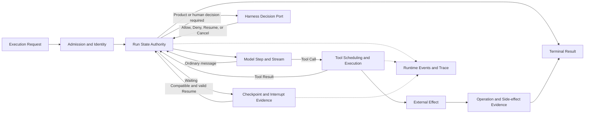

# Agent Runtime Foundations

[English](./README.md) | [繁體中文](./README-zh-TW.md) | [简体中文](./README-zh-CN.md)

> In the following content:
> CCB is short for [claude-code-best](https://github.com/claude-code-best/claude-code).
> Chat Gun refers to [chat-gun](https://github.com/HsienW/chat-gun).

This section moves toward execution from the [Harness–Runtime handoff boundary](../../agent-harness/foundations/03-harness-runtime-boundary.md). Once the Harness delivers Normalized Input, Context, Capabilities, Limits, and Decision Ports, the Runtime must advance execution to a legal endpoint and retain enough evidence to establish where execution stopped, what it did, and whether it can safely continue.

## Reading order

| Part | Article | Question to answer | Filename |
|---|---|---|---|
| 01 | [What an Agent Runtime does in practice](./01-what-is-agent-runtime.md) | When does the Runtime take over, and what results must it deliver? | `01-what-is-agent-runtime.md` |
| 02 | [Execution Identity and state authority](./02-execution-identity-and-state-authority.md) | How do Request, Thread, Task, Run, Step, and Tool Call remain traceable, and who holds authoritative state? | `02-execution-identity-and-state-authority.md` |
| 03 | [Run Loop and state transitions](./03-run-loop-and-state-transitions.md) | How do models, tools, waiting, cancellation, and termination form legal execution paths? | `03-run-loop-and-state-transitions.md` |
| 04 | [Persistence, Interrupt, and Resume](./04-persistence-interrupt-and-resume.md) | What lets the Runtime decide whether execution can continue after a process stops or waits for external input? | `04-persistence-interrupt-and-resume.md` |
| 05 | [Agent Runtime design principles](./05-runtime-design-principles.md) | Which invariants prevent duplicate execution, split state, and incorrect completion? | `05-runtime-design-principles.md` |
| 06 | [One complete Run walkthrough](./06-one-run-walkthrough.md) | How does a tool call requiring confirmation move from admission to a result, waiting, or recovery? | `06-one-run-walkthrough.md` |

## Architecture and responsibilities

The diagram below is a conceptual model shared by the six articles. It marks responsibilities and evidence flows. It does not claim that Chat Gun and Claude Code Best share these types or that every Runtime has the same nodes.

These six articles establish the terms and invariants used by later sections. The detailed responsibilities are divided as follows:

- **Foundations** defines Runtime responsibilities, identity, state authority, durability semantics, and the basic failure model.
- **Execution Lifecycle** expands admission, Run/Task/Thread, deadline, cancel, waiting, terminal, and races.
- **Model and Tool Execution** expands streaming, Tool Call loops, scheduling, concurrency, backpressure, model fallback, and error feedback.
- **Effects and Recovery** expands retry, idempotency, checkpoint, reconciliation, compensation, and the truth of external commits.
- **Events and Operations** expands event envelopes, Trace, Metrics, Audit, SLO, failure drills, and release gates.

### What the Runtime owns

| Responsibility | Judgment established in Foundations |
|---|---|
| Admission | Reject before execution when required contracts, versions, or dependencies are missing. |
| Execution Identity | Correlate each Run, Step, model request, Tool Call, Attempt, and external Operation. |
| State Transition | Allow only legal events to change Run state; late events cannot reverse a Terminal State. |
| Execution Loop | Advance models and tools within limits, stopping for waiting, cancellation, timeout, or exhausted budgets. |
| Persistence | Distinguish transcript, checkpoint, interrupt manifest, ownership, and side-effect evidence. |
| Recovery | Check compatibility and external effects before Resume, retry, reconciliation, or manual handling. |
| Output | Produce correlated Runtime Events, Terminal Results, and execution evidence. |

### Responsibilities outside Foundations

- The Harness retains product semantics for Input, Context authority, capability configuration, Authorization Policy, and Human Approval rules.
- Infra owns Provider model capabilities and training behavior; the Runtime handles calls, streams, errors, and permitted fallback.
- The Runtime needs downstream Operation IDs, query results, or Ledger evidence to establish whether an external system committed a refund, email, or resource creation.
- UI display state is a Projection. It can consume Runtime Events but cannot become the authoritative source for a Run.

## 01. What is an Agent Runtime?

### Article scope

Execution responsibilities define the Runtime's boundary. A framework name, background Worker, or single `query()` function cannot establish that boundary on its own. The article starts at the Execution Request handoff and follows it through Terminal Results, events, and recovery evidence.

Planned sections:

1. Minimum Runtime responsibilities: accept an execution contract, create a Run, advance Steps, call models and tools, and handle stopping conditions.
2. Relationships among Agent Loop, Workflow/Graph, Agent Server, and Tool Runtime; they may occupy separate layers or the same process.
3. The two-way handoff between Harness decisions and Runtime execution, especially Authorization, Human Approval, Clarification, and Cancel.
4. Two execution shapes, imperative loops and StateGraph: compare CCB `query()`/`queryLoop()` with Chat Gun Graphs.
5. Runtime outputs: streaming events, tool results, terminal results, checkpoints, and effect evidence are distinct records.
6. Conditions that prevent a start: incomplete Execution Context, capability, version, limit, or required Port.

### Verification and failure branches

- Identify which Chat Gun capabilities belong to the LangGraph native Runtime and which its composition, interaction, tool dispatch, and side-effect modules add.
- CCB's Interactive and Headless/SDK entry points differ; `QueryEngine` cannot be described as the sole Runtime for every mode.
- Accepting `canUseTool` or another Decision Port does not give the Runtime ownership of Permission Policy.
- Diagram candidate: responsibility boundaries among Harness, Runtime, Provider, Tool Adapter, and external systems.

Primary sources: [G1][g-boundary], [G2][g-langgraph], [G3][g-mcp-agent], [G5][g-composition], [C1][c-query], and [C2][c-query-engine].

## 02. Execution Identity and state authority

### Article scope

A user request may span multiple model requests, tool attempts, waits, and resumptions. The article establishes identity relationships and identifies which state may change the result when a Task creates a new Run, old events arrive late, or tool responses replay.

Planned sections:

1. Uses of Request, Thread, Task, and Run, and the distinction among the same conversation, the same goal, and the same execution.
2. Relationships among Run Generation, Step, Model Request, Tool Call, Execution Attempt, and External Operation.
3. How Event ID, Run-scoped Sequence, and Correlation support deduplication, ordering, Trace, and Audit.
4. Authority scopes of Runtime State, Task Repository, Graph Checkpoint, UI Projection, and Effect Ledger.
5. Concrete contracts determine whether Supersede, Retry, Resume, and Replay reuse an Identity.
6. Compare the responsibilities of CCB Session/query/tool-use identifiers with Chat Gun Task/Run/generation, without imposing matching fields.

### Verification and failure branches

- Check stale finalizers, lower-generation events, duplicate tool results, and cross-tenant misbinding alongside normal completion.
- A new Run for a Task does not establish that the old Run's I/O has stopped; inspect ownership and cancellation separately.
- Correlation fields alone do not show that every producer and consumer passes them through. Follow the production entry point through each stage.
- Diagram candidate: an identity tree for Task, Run, Step, Tool Call, Attempt, and Operation, with a side path rejecting an old generation.

Primary sources: [G6][g-ownership], [G7][g-query-guard], [G8][g-runtime-events], [G15][g-effect-identity], [C1][c-query], and [C2][c-query-engine].

## 03. Run Loop and state transitions

### Article scope

The article follows the Runtime control loop to explain how model output becomes the next Step. Ordinary content can lead to completion, a Tool Call enters dispatch and Tool Result feedback, and a Decision Request or Interrupt puts the Run into an identifiable waiting state. State names form a conceptual model; the two sources are not claimed to share an enum.

Planned sections:

1. Basic relationships among Admission, Running, Waiting, Cancelling, Reconciling, and Terminal.
2. Ordering requirements for model streams, complete assistant messages, tool use blocks, and tool results.
3. How Turn, Token, time, cost, and tool-attempt budgets jointly define stopping conditions.
4. Serial/concurrent tool scheduling and the separate layer of subsequent model proposals.
5. Differences among AbortSignal, Deadline, and Business Cancel; cancelling external I/O already sent does not guarantee that its effects disappear.
6. Machine-readable semantics of Completed, Cancelled, Failed, Rejected, Waiting, and Parked.
7. Why late stream chunks, tool results, or progress events cannot return a Terminal Run to Running.

### Verification and failure branches

- Inspect CCB `queryLoop()` while-loops, tool batching, abort, and message repair separately; for Chat Gun, follow Graph edges, interrupts, tool dispatch, and terminal consumers.
- A resolved `Promise`, successful tool-wrapper return, completed model output, and successful business effect are separate observations.
- Keep distinct outcomes for model timeout, tool timeout, cancellation, budget exhaustion, and malformed tool input instead of collapsing them into generic error text.
- Diagram candidate: a Run state machine showing the Tool Result loop, waiting exits, cancellation, and one-way terminal convergence.

Primary sources: [G3][g-mcp-agent], [G4][g-deep-researcher], [G9][g-pipeline], [G10][g-outcome], [C1][c-query], [C3][c-orchestration], and [C4][c-tool-execution].

## 04. Persistence, Interrupt, and Resume

### Article scope

The Runtime recovers an execution with a version, waiting reason, and external-effect state. Chat text alone cannot represent it. The article separates stored records and explains what each can prove after a process crash, a wait for human input, or a compatibility change.

Planned sections:

1. Distinct uses of Transcript, Graph Checkpoint, Task/Ownership, Interrupt Manifest, and Side-effect Ledger.
2. Differences among Memory, Context Compression, and Checkpoint; a summary can help the next sampling step but cannot replace Run recovery state.
3. Persistence order around Interrupt creation, plus the waiting target, Schema, deadline, and single-use consumption conditions.
4. Before Resume, validate Thread/Run/Task, Principal, Scope, Resource, Policy/Manifest Version, and payload Schema.
5. Crash windows: before dispatch, before external Commit, after Commit but before Tool Result persistence, and after Terminal is written but before event delivery.
6. Evidence from `MemorySaver`, mock Stores, PostgreSQL Checkpointers, and production Agent Servers is not interchangeable.
7. How to stop, reconcile, or hand off to a human for incompatible Resume, ambiguous effects, or missing durable evidence.

### Verification and failure branches

- Chat Gun Clarification and Confirmation use different manifests/consumers. A test of one path does not establish a guarantee for all Interrupts.
- CCB compaction protects the Context budget; it does not establish durable checkpoints or cross-process resume.
- A Tool Result in a Checkpoint does not necessarily prove external Commit. A missing result does not prove that the external operation never occurred.
- Diagram candidate: responsibilities of five persisted record types and the crash window after external Commit but before Checkpoint write.

Primary sources: [G1][g-boundary], [G4][g-deep-researcher], [G11][g-ledger], [G13][g-resume], [G14][g-confirmation-graph], [C5][c-auto-compact], and [C6][c-compact].

## 05. Agent Runtime design principles

### Article scope

After the first four articles establish the terms, this article turns them into engineering invariants that can be checked. Each principle must map to state, a consumer, or a fault-injection point; adjectives such as reliable or observable cannot substitute for an implementation.

Planned sections:

1. Each kind of state has one authority; Projections and Caches cannot rewrite Runtime truth.
2. Typed Commands, Events, or Decisions drive transitions; reject illegal transitions and unknown versions.
3. Terminal converges in one direction; late events, old generations, and duplicate finalizers cannot revive a Run.
4. Make Budget and Deadline concrete before starting. Retry, model fallback, and tool retry each need separate conditions and limits.
5. Persist recoverable Interrupt evidence before exposing waiting; Resume consumes only input matching the specified wait.
6. Side-effect `unknown` is a formal state. Reconcile when external evidence is missing; blind retry cannot resolve uncertainty.
7. Events describe what happened, Commands express what should happen, and UI copy cannot serve as a Terminal Result.
8. Durability, idempotency, isolation, and exactly-once claims require deployment and external-system evidence.
9. Failure Drills must cover model requests, tool dispatch, external Commit, checkpoint write, event delivery, and resume validation.

### Verification and failure branches

- Pair each principle with at least one source consumer, a rejection or stopping branch, and the deployment evidence still missing.
- Separate framework-native capabilities, product extensions, optional feature flags, and production-entry wiring. A module's presence does not prove that every path enables it.
- Test definitions establish test arrangements. If tests were not run in this round, describe coverage rather than claiming a pass.
- Diagram candidate: a Runtime-invariant checklist mapped to admission, running, waiting, recovery, and terminal stages.

Primary sources: [G1][g-boundary], [G5][g-composition], [G6][g-ownership], [G8][g-runtime-events], [G10][g-outcome], [G12][g-runner], [C1][c-query], and [C3][c-orchestration].

## 06. One complete Run walkthrough

### Main case and comparison

The case follows a model proposing a tool call that requires human confirmation and may produce an external side effect. It combines observed code paths into a teaching trace. It does not claim that existing Chat Gun tests connect every step into one E2E run or combine CCB Permission UI and Chat Gun authorization types into one implementation.

Planned sections:

1. The Harness delivers an Execution Request; the Runtime validates versions, limits, Decision Ports, and canonical identity.
2. The Runtime creates or retrieves a Run, emits a started event, calls the model, and receives tool use.
3. The Runtime saves the concrete Tool Call and its correlation, then asks the Harness for authorization. When human confirmation is required, it records interrupt/pending evidence before stopping dispatch.
4. The Resume consumer checks the waiting target, trusted identity, Scope, Schema, expiry, and single use, then allows legal Runtime transitions to continue.
5. The Tool Runtime creates attempt/effect identity, dispatches through the scheduler, lock, execution profile, and runner, and feeds the structured result back to the model.
6. The model produces completion content; the Runtime writes a Terminal Result, and events and UI projections update through correlation.
7. Compare rejection, confirmation expiry, misbound Resume, cancellation, model timeout, malformed Tool Result, and late events.
8. Fault injection: when an external operation commits before the Ledger or Checkpoint write finishes, recovery first queries effect evidence.

### Required evidence

| Claim | Data to inspect | Evidence that cannot substitute |
|---|---|---|
| The Run was formally admitted | Execution Request, identity, version, limits, and admission result. | A UI showing running. |
| The tool did not execute before confirmation | Pending/interrupt state and the underlying runner call count. | A confirmation dialog still on screen. |
| Resume matches the original wait | Manifest, consumer, trusted correlation, Schema, expiry, and consume result. | A message saying agree. |
| The tool produced an external effect | Attempt, operation ID, Ledger, and downstream query results. | A successful tool-wrapper or Promise return. |
| The Run completed | Terminal Result, authoritative Run state, and sequence. | The final assistant text. |
| Execution can safely continue after a crash | Durable checkpoint, compatible manifest, effect evidence, and replay policy. | MemorySaver or a unit-test mock Store. |

Diagram candidate: lanes for Product/Harness, Runtime, Model, Tool Runtime, External System, and Persistence. Show normal completion and a crash after Commit as separate paths, so recovery is not presented as a mandatory step in ordinary success.

Primary sources: [G3][g-mcp-agent], [G4][g-deep-researcher], [G9][g-pipeline], [G11][g-ledger], [G12][g-runner], [G13][g-resume], [G14][g-confirmation-graph], [C1][c-query], and [C4][c-tool-execution].

## Sources and verification status

GUN-ATLAS v1.0 provides the starting index for Chat Gun and Claude Code Best. The specified session file was found at neither its original path nor the corrected `.codex` path under the user directory, so it is not counted as evidence read. The attachment identifies the user's claude-code-base as Claude Code Best.

This plan keeps the versions pinned by existing repository articles so that moving-branch content does not enter the same set of judgments:

| Source | Pinned commit | Use in Foundations |
|---|---|---|
| [Chat Gun](https://github.com/HsienW/chat-gun) | `92a5673003e4ac4ec09be8b1b350f42dbf4a5e69` | LangGraph boundaries, execution composition, interaction ownership, tool dispatch, interrupt/resume, side-effect evidence, and events. |
| [Claude Code Best](https://github.com/claude-code-best/claude-code) | `77a7934e15d69da13879112ed7db695c9ee7a52a` | Comparison with a third-party Coding Agent's query loop, session orchestration, tool execution, concurrent scheduling, abort, and compaction. |

CCB is a third-party project and does not represent the sole implementation of Anthropic's current official product. GUN-ATLAS, existing articles, and source indexes identify reading entry points. Claims in the six articles are bounded by source, consumers, configuration switches, tests, and deployment conditions. This round did not rerun source-repository unit, integration, or E2E tests, real Providers, external MCP, database races, or failure drills.

### Primary source index

| Index | Path | Planned use |
|---|---|---|
| [G1][g-boundary] | `docs/decisions/current-langgraph-runtime-boundary.md` | LangGraph native authority, Chat Gun extensions, and production-deployment evidence gaps. |
| [G2][g-langgraph] | `backend/langgraph.json` | Graph registration entry point; registration alone does not establish that all governance and recovery capabilities are enabled. |
| [G3][g-mcp-agent] | `backend/src/agents/mcp-agent.ts` | Model, authorization, confirmation, physical dispatch, and loop edges. |
| [G4][g-deep-researcher] | `backend/src/agents/deep-researcher.ts` | StateGraph, clarification interrupts, resume, and MemorySaver composition. |
| [G5][g-composition] | `backend/src/operations/execution-composition-root.ts` | Shared composition entry point and optional dependencies for Runtime extensions. |
| [G6][g-ownership] | `backend/src/runtime/interaction/ownership.ts` | Task/Run/generation ownership and transactional supersede. |
| [G7][g-query-guard] | `backend/src/runtime/input/query-guard.ts` | Reservation, durable owner lookup, and generation-aware release. |
| [G8][g-runtime-events] | `backend/src/platform/agent-runtime-events.ts` | Runtime-event correlation and external envelopes. |
| [G9][g-pipeline] | `backend/src/runtime/tool-dispatch/pipeline.ts` | Tool admission, scheduling, execution Context, and structured outcomes. |
| [G10][g-outcome] | `backend/src/runtime/side-effect/governed-outcome.ts` | Outcome types for success, rejection, non-commit, ambiguous effects, and cancellation. |
| [G11][g-ledger] | `backend/src/runtime/side-effect/business-effect-ledger.ts` | Attempt and business-effect states and external-evidence boundaries. |
| [G12][g-runner] | `backend/src/runtime/side-effect/tool-execution-runner.ts` | Execution, retry eligibility, result reuse, and reconciliation handoffs. |
| [G13][g-resume] | `backend/src/runtime/recovery/clarification-resume-authorization.ts` | Clarification-resume correlation, expiry, Schema, compatibility, and consume. |
| [G14][g-confirmation-graph] | `backend/src/runtime/authorization/confirmation-graph.ts` | Confirmation gates, interrupts, resume, and authorized dispatch. |
| [G15][g-effect-identity] | `backend/src/runtime/side-effect/identity.ts` | Host boundaries for Tool Call, attempt, replay, and effect identity. |
| [C1][c-query] | `src/query.ts` | QueryParams, query/queryLoop, turn, budget, abort, tool results, and compaction. |
| [C2][c-query-engine] | `src/QueryEngine.ts` | Headless/SDK sessions, messages, usage, abort, and permission denial. |
| [C3][c-orchestration] | `src/services/tools/toolOrchestration.ts` | Tool batching, concurrency-safety classification, concurrency caps, and Context updates. |
| [C4][c-tool-execution] | `src/services/tools/toolExecution.ts` | Tool input, Permission round trips, progress, and actual execution. |
| [C5][c-auto-compact] | `src/services/compact/autoCompact.ts` | Context thresholds, recursion guards, and consecutive-failure protection. |
| [C6][c-compact] | `src/services/compact/compact.ts` | Compaction content and session-memory paths; not evidence of durable resume. |

## Article writing and validation

Read the six articles in order, 01 → 02 → 03 → 04 → 05 → 06. Each establishes concepts before following pinned sources and failure branches. The sixth assembles separately inspected evidence into a teaching trace without claiming that the source repositories already contain the same complete E2E run.

1. State responsibility boundaries and implementation status before tracing source to production consumers; type names alone do not establish behavior across every path.
2. Keep at least one rejection, cancellation, timeout, incompatibility, or ambiguous-effect branch for each success flow.
3. Distinguish source-code confirmation, defined test cases, tests executed in this round, and verified production deployment.
4. Use the palette and layout of `agent-harness/foundations`, retain SVG/HTML originals, and use `-en` filenames for English diagrams.
5. Call the sixth article E2E only when the evidence connects. If it cites independent tests, mark their boundaries rather than presenting them as one executed Run.
6. After Foundations, move details into the four Runtime categories to avoid repeatedly expanding retry, checkpoint, and event explanations in every article.

[g-boundary]: https://github.com/HsienW/chat-gun/blob/92a5673003e4ac4ec09be8b1b350f42dbf4a5e69/docs/decisions/current-langgraph-runtime-boundary.md
[g-langgraph]: https://github.com/HsienW/chat-gun/blob/92a5673003e4ac4ec09be8b1b350f42dbf4a5e69/backend/langgraph.json
[g-mcp-agent]: https://github.com/HsienW/chat-gun/blob/92a5673003e4ac4ec09be8b1b350f42dbf4a5e69/backend/src/agents/mcp-agent.ts
[g-deep-researcher]: https://github.com/HsienW/chat-gun/blob/92a5673003e4ac4ec09be8b1b350f42dbf4a5e69/backend/src/agents/deep-researcher.ts
[g-composition]: https://github.com/HsienW/chat-gun/blob/92a5673003e4ac4ec09be8b1b350f42dbf4a5e69/backend/src/operations/execution-composition-root.ts
[g-ownership]: https://github.com/HsienW/chat-gun/blob/92a5673003e4ac4ec09be8b1b350f42dbf4a5e69/backend/src/runtime/interaction/ownership.ts
[g-query-guard]: https://github.com/HsienW/chat-gun/blob/92a5673003e4ac4ec09be8b1b350f42dbf4a5e69/backend/src/runtime/input/query-guard.ts
[g-runtime-events]: https://github.com/HsienW/chat-gun/blob/92a5673003e4ac4ec09be8b1b350f42dbf4a5e69/backend/src/platform/agent-runtime-events.ts
[g-pipeline]: https://github.com/HsienW/chat-gun/blob/92a5673003e4ac4ec09be8b1b350f42dbf4a5e69/backend/src/runtime/tool-dispatch/pipeline.ts
[g-outcome]: https://github.com/HsienW/chat-gun/blob/92a5673003e4ac4ec09be8b1b350f42dbf4a5e69/backend/src/runtime/side-effect/governed-outcome.ts
[g-ledger]: https://github.com/HsienW/chat-gun/blob/92a5673003e4ac4ec09be8b1b350f42dbf4a5e69/backend/src/runtime/side-effect/business-effect-ledger.ts
[g-runner]: https://github.com/HsienW/chat-gun/blob/92a5673003e4ac4ec09be8b1b350f42dbf4a5e69/backend/src/runtime/side-effect/tool-execution-runner.ts
[g-resume]: https://github.com/HsienW/chat-gun/blob/92a5673003e4ac4ec09be8b1b350f42dbf4a5e69/backend/src/runtime/recovery/clarification-resume-authorization.ts
[g-confirmation-graph]: https://github.com/HsienW/chat-gun/blob/92a5673003e4ac4ec09be8b1b350f42dbf4a5e69/backend/src/runtime/authorization/confirmation-graph.ts
[g-effect-identity]: https://github.com/HsienW/chat-gun/blob/92a5673003e4ac4ec09be8b1b350f42dbf4a5e69/backend/src/runtime/side-effect/identity.ts
[c-query]: https://github.com/claude-code-best/claude-code/blob/77a7934e15d69da13879112ed7db695c9ee7a52a/src/query.ts
[c-query-engine]: https://github.com/claude-code-best/claude-code/blob/77a7934e15d69da13879112ed7db695c9ee7a52a/src/QueryEngine.ts
[c-orchestration]: https://github.com/claude-code-best/claude-code/blob/77a7934e15d69da13879112ed7db695c9ee7a52a/src/services/tools/toolOrchestration.ts
[c-tool-execution]: https://github.com/claude-code-best/claude-code/blob/77a7934e15d69da13879112ed7db695c9ee7a52a/src/services/tools/toolExecution.ts
[c-auto-compact]: https://github.com/claude-code-best/claude-code/blob/77a7934e15d69da13879112ed7db695c9ee7a52a/src/services/compact/autoCompact.ts
[c-compact]: https://github.com/claude-code-best/claude-code/blob/77a7934e15d69da13879112ed7db695c9ee7a52a/src/services/compact/compact.ts
