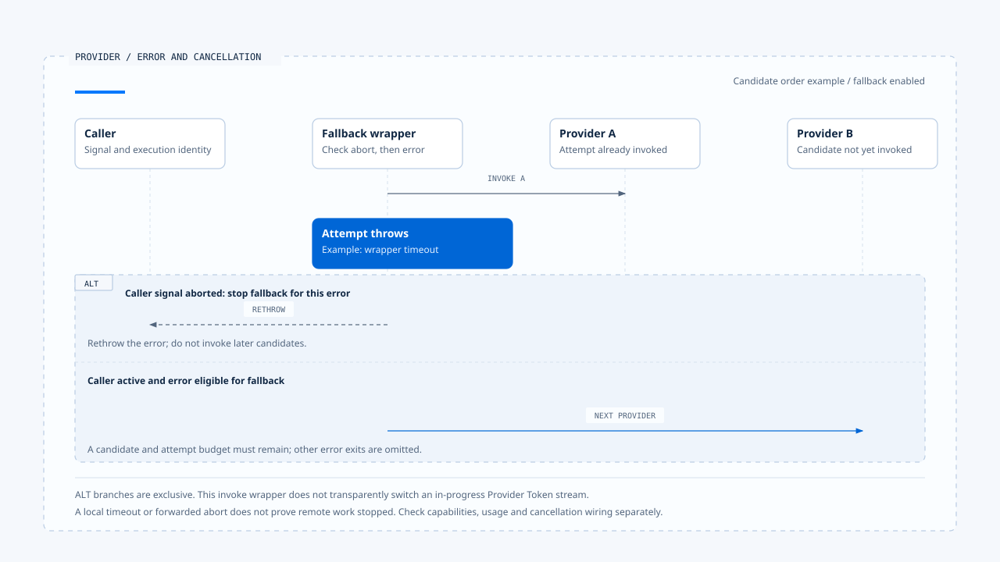

# 模型调用与 Provider 切换

[English](./01-model-calls-and-provider-fallback.md) | [繁體中文](./01-model-calls-and-provider-fallback-zh-TW.md) | [简体中文](./01-model-calls-and-provider-fallback-zh-CN.md)

> 以下内容所提到的
> CCB 为 [claude-code-best](https://github.com/claude-code-best/claude-code) 的简称。
> Chat Gun 为 [chat-gun](https://github.com/HsienW/chat-gun)。

[回到导览](./README-zh-CN.md) · 下一篇：[流式传输组装与工具调用](./02-stream-assembly-and-tool-calls-zh-CN.md)

> 第一个 Provider 超时，Runtime 换到第二个 Provider。新模型能产生文字，却不接受本次工具绑定；另一种情况是模型响应已经引发工具执行，重送要求又提出相同操作。画面上的「换模型」其实跨过了两种不同的失败边界。

**一次模型调用需要保存输入契约、尝试身份与停止条件。** Provider 切换发生时，Runtime 还要知道已经产生什么数据，以及后续是否有人开始执行工具。

## Model Step 与 Attempt

Model Step 表达这一次推理要取得的结果，Provider Attempt 则是为此送出的一次尝试。相同 Step 可以因为允许的错误改用其他 Provider，但每次请求的用量、错误与回应仍要能分辨。

| 关联 | 用途 | 需要分开的事实 |
|---|---|---|
| Run／Step | 指向本次执行与推理位置。 | 整个 Run 的完成与单次模型返回。 |
| Provider Attempt | 辨认送往哪个 Provider 的尝试。 | 同一输入的重送与其他模型切换。 |
| Tool Call | 辨认模型提出的行动。 | 参数完整、授权通过与实际派送。 |
| Tool Attempt／Operation | 关联工具执行及外部操作。 | 模型重新取样与已提交效果。 |

这些是阅读时使用的概念关联。两个来源库采用不同类型，不能直接假设每个 API 都接受同一组字段。

模型调用至少应知道输入消息、可见工具、模型能力、输出格式与有效限制来自哪里。若换了模型却没有核对这些条件，原本合法的请求可能在下一个 adapter 才失败。

## Chat Gun 的调用契约

本区版本的 `ChatModelInvoker` 提供 `invoke()`，另外有可选的 `bindTools()`。Options 包含用途、模型、temperature、重试设置、response format 与 tool choice；invoke options 则可以携带 signal 及部分执行关联。

### 契约与调用端要一起看

MCP Agent 的 `callModel()` 先组装 Context，再调用 `createChatModel()`，确认 `bindTools` 存在后执行 `bindTools(tools).invoke(modelInput)`。这段入口没有使用 `createChatModelWithFallback()`。

该次 invoke 也没有在这段调用中传入第二个 options 参数。因此接口能接收 signal，与这个入口是否把 Run 的取消信号传入，是两项需要分开核对的事实。其他入口仍需逐一查读。

### invoke 与流式传输的范围

这份 Gateway 接口交付完成的模型消息，没有在同一契约中宣告逐 Token 的流式传输方法。Graph event stream、BFF 传输与画面更新仍可能存在，需沿各自 consumer 查证。

UI 持续显示内容不足以证明这个 invoke 已具备部分 Tool Call 的增量交付。串流区块的另一种实现见[下一篇](./02-stream-assembly-and-tool-calls-zh-CN.md)。

## Fallback 在哪里启用

Chat Gun 的 `createChatModelWithFallback()` 先读取 runtime config。当全局设置未启用、调用端也没有明确提供非空 fallback provider 清单时，方法直接回到一般 `createChatModel()`。合成 policy 后若清单为空，同样不建立切换链。

候选 Provider 会先去掉重复及与 primary 相同的项目。`FallbackChatModelInvoker.invoke()` 再依 `maxTotalAttempts` 限制选取范围，逐一尝试，不将它描述成无限制重送。

这个上限作用于该 wrapper 的 Provider 尝试。Adapter 内部 retry、structured output repair 与其他 consumer 若另有重送，仍需另外计算实际请求数与用量。

## 哪些错误允许切换

本区 `classifyProviderError()` 先将错误归类，再由 `isFallbackEligibleCategory()` 判断。分类结果与切换白名单分开定义。

| 本区分类 | 例子或判断来源 | 此白名单允许 fallback |
|---|---|---|
| `provider_unavailable` | HTTP 5xx。 | 是。 |
| `provider_timeout` | 指定 timeout code、AbortError 或 HTTP 408。 | 是，仍需先核对 caller cancel。 |
| `provider_response_invalid` | Envelope、回应解析或指定格式错误。 | 是。 |
| `provider_rate_limited` | HTTP 429。 | 否。 |
| `provider_decode_failure` | 工具参数解码失败。 | 否。 |
| `structured_output_invalid` | Zod 验证错误。 | 否。 |
| `content_filter_refusal` | 指定 refusal code 或拒绝类型。 | 否。 |
| `unknown_error` | 其他未分类错误。 | 否。 |

表格只描述这个固定版本的 wrapper。429 在其他系统可能有不同策略；不能把常见做法补写成此处已启用的行为。

拒绝与格式失败也要分清楚。前者不应只因换一个 Provider 就被当成可绕过的暂时故障，实际处置仍由既定政策决定。

## Timeout 与 caller Abort

`invokeWithTimeout()` 建立子 AbortController，设置单一 Provider 的 timer，并转送 caller 的 abort。它以 `Promise.race()` 等待 invoke 与 abort promise；finally 清除 timer 与 caller listener。

当 invoke 抛错，外层先检查 caller signal 是否已 aborted。若是，直接抛出，不再依 timeout 分类换 Provider；只有其余允许的错误才继续下一个候选。

> 本地停止等待与远端运算停止需要分开验证。即使 wrapper 已收到 timeout，Provider adapter 是否配合 signal、远端是否仍计费，都要有各自的证据。

若多个 Provider 依序用尽自己的时限，总等待还会包含每段时间与内部工作。整个 Run 的 Deadline 与 Budget 需要在相应执行 consumer 保持有效，不能以单一 per-provider timeout 代替。

- 图中的 ALT 分支互斥，并假设 fallback 已启用；本地 timeout 或 abort 没有证明远端运算已停止。
- [开启 Provider 分流时序与适用范围](../../assets/agent-runtime/model-and-tool-execution/01-model-calls-and-provider-fallback/01-provider-timeout-and-caller-abort-en.html)。

## 切换前先核对能力

`FallbackChatModelInvoker.bindTools()` 会走过候选 invoker，缺少 `bindTools` 时直接抛错，再对各候选绑定工具。它提供了一个明确的能力检查点，但不能证明工具 Schema、tool choice 或输出格式在所有 Provider 都具有完全相同的语义。

- 能力检查需要涵盖本次请求实际使用的功能。
- Structured output repair 要保留原始错误与修复尝试，避免与 Provider 切换混成一次成功。
- 绑定成功后，仍需验证回应 envelope、工具参数与产品契约。

Harness 决定哪些能力与模型路径可用，Runtime 在执行时维持这些条件。换模型不能扩张工具集合或 Resource 权限。

## CCB 的不同切换层次

CCB `claude.ts` 有 API 流式传输及非流式传输 fallback 路径；`query.ts` 另处理 `FallbackTriggeredError` 的 model 切换。前者改变如何取得回应，后者涉及 query loop 的模型与消息状态，阅读时要先指出错误由哪一层接住。

Query 在相关 fallback 分支会清理 assistant messages、tool results 或 tool-use 收集，并丢弃旧 StreamingToolExecutor，避免旧 ID 的结果接到新回应。这是 transcript 与执行器交接的处理，不能单凭数据被清除便认定先前外部效果已撤销。

工具已经开始时，需要查回它的派送与效果，再决定能否继续。具体交错在[第六篇](./06-case-model-tool-roundtrip-zh-CN.md) 另设分支，不放进单纯 Provider timeout 的成功切换主线。

## 如何验证模型调用

### 启用与错误分类

- 分别关闭设置、提供空清单及明确 policy，记录实际 Provider 调用次数。
- 注入 5xx、429、refusal、解码失败与无效 envelope，核对真正切换的类别。
- 让候选缺少工具绑定能力，确认错误没有被降级成一般文字成功。

### 时限与已开始的工作

- Provider 不回应时，记录 timer、signal 与下一个候选的开始位置。
- 在等待期间送入 caller Abort，确认后续 Provider 不再调用。
- 在工具已开始的独立分支触发模型重试，核对外部调用次数与旧结果归属。

来源的 fallback 测试安排包含 5xx、总尝试限制、timeout、refusal、解码失败与 envelope。本文只查读安排，没有执行真实 Provider、费用或故障测试。

## 本篇的工程判断

我会先找正式入口使用哪个 Gateway 方法，再看错误白名单与 signal 如何传入。介面存在、测试存在与部署启用各自提供不同证据，这些证据必须对回同一次调用。

Fallback 的可恢复范围取决于目前已产生的数据与执行。只有模型尝试失败，和工具已经造成外部效果，应留下不同的后续责任。

## 实现参照与适用范围

- [Chat Gun Gateway][g-gateway]、[fallback wrapper][g-fallback]、[错误分类][g-category] 与 [MCP Agent consumer][g-mcp]。
- CCB `src/query.ts`、`src/services/api/claude.ts`；其 fallback、消息及工具交接分别查读。
- 固定版本、CCB 副本指纹与验证限制见[本区来源](./README-zh-CN.md#来源与查证状态)。本文没有建立两个来源共用的模型切换接口。

## 接续阅读

- [流式传输组装与工具调用](./02-stream-assembly-and-tool-calls-zh-CN.md)
- [Execution Identity 与状态权威](../foundations/02-execution-identity-and-state-authority-zh-CN.md)

[g-gateway]: https://github.com/HsienW/chat-gun/blob/f83a38fd67a021904e597c60543708ee0c206076/backend/src/platform/llm-gateway.ts
[g-fallback]: https://github.com/HsienW/chat-gun/blob/f83a38fd67a021904e597c60543708ee0c206076/backend/src/platform/llm-fallback.ts
[g-category]: https://github.com/HsienW/chat-gun/blob/f83a38fd67a021904e597c60543708ee0c206076/backend/src/platform/provider-error-category.ts
[g-mcp]: https://github.com/HsienW/chat-gun/blob/f83a38fd67a021904e597c60543708ee0c206076/backend/src/agents/mcp-agent.ts
