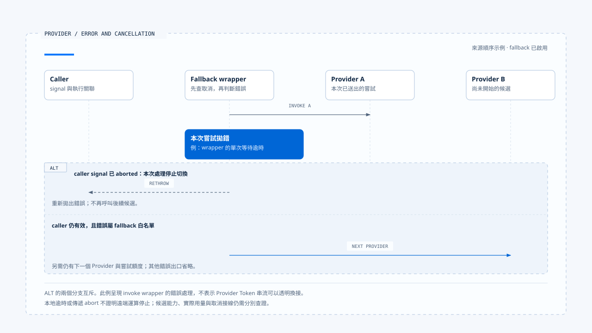

# 模型呼叫與 Provider 切換

[English](./01-model-calls-and-provider-fallback.md) | [繁體中文](./01-model-calls-and-provider-fallback-zh-TW.md)

> 以下內容所提到的
> CCB 為 [claude-code-best](https://github.com/claude-code-best/claude-code) 的簡稱。
> Chat Gun 為 [chat-gun](https://github.com/HsienW/chat-gun)。

[回到導覽](./README-zh-TW.md) · 下一篇：[串流組裝與工具呼叫](./02-stream-assembly-and-tool-calls-zh-TW.md)

> 第一個 Provider 逾時，Runtime 換到第二個 Provider。新模型能產生文字，卻不接受本次工具繫結；另一種情況是模型回應已經引發工具執行，重送要求又提出相同操作。畫面上的「換模型」其實跨過了兩種不同的失敗邊界。

**一次模型呼叫需要保存輸入契約、嘗試身分與停止條件。** Provider 切換發生時，Runtime 還要知道已經產生什麼資料，以及後續是否有人開始執行工具。

## Model Step 與 Attempt

Model Step 表達這一次推理要取得的結果，Provider Attempt 則是為此送出的一次嘗試。相同 Step 可以因為允許的錯誤改用其他 Provider，但每次請求的用量、錯誤與回應仍要能分辨。

| 關聯 | 用途 | 需要分開的事實 |
|---|---|---|
| Run／Step | 指向本次執行與推理位置。 | 整個 Run 的完成與單次模型返回。 |
| Provider Attempt | 辨認送往哪個 Provider 的嘗試。 | 同一輸入的重送與其他模型切換。 |
| Tool Call | 辨認模型提出的行動。 | 參數完整、授權通過與實際派送。 |
| Tool Attempt／Operation | 關聯工具執行及外部操作。 | 模型重新取樣與已提交效果。 |

這些是閱讀時使用的概念關聯。兩個來源庫採用不同型別，不能直接假設每個 API 都接受同一組欄位。

模型呼叫至少應知道輸入訊息、可見工具、模型能力、輸出格式與有效限制來自哪裡。若換了模型卻沒有核對這些條件，原本合法的請求可能在下一個 adapter 才失敗。

## Chat Gun 的呼叫契約

本區版本的 `ChatModelInvoker` 提供 `invoke()`，另外有可選的 `bindTools()`。Options 包含用途、模型、temperature、重試設定、response format 與 tool choice；invoke options 則可以攜帶 signal 及部分執行關聯。

### 契約與呼叫端要一起看

MCP Agent 的 `callModel()` 先組裝 Context，再呼叫 `createChatModel()`，確認 `bindTools` 存在後執行 `bindTools(tools).invoke(modelInput)`。這段入口沒有使用 `createChatModelWithFallback()`。

該次 invoke 也沒有在這段呼叫中傳入第二個 options 參數。因此介面能接收 signal，與這個入口是否把 Run 的取消訊號傳入，是兩項需要分開核對的事實。其他入口仍需逐一查讀。

### invoke 與串流的範圍

這份 Gateway 介面交付完成的模型訊息，沒有在同一契約中宣告逐 Token 的串流方法。Graph event stream、BFF 傳輸與畫面更新仍可能存在，需沿各自 consumer 查證。

正文不從 UI 持續顯示內容，推論這個 invoke 已具備部分 Tool Call 的增量交付。串流區塊的另一種實作見[下一篇](./02-stream-assembly-and-tool-calls-zh-TW.md)。

## Fallback 在哪裡啟用

Chat Gun 的 `createChatModelWithFallback()` 先讀取 runtime config。當全域設定未啟用、呼叫端也沒有明確提供非空 fallback provider 清單時，方法直接回到一般 `createChatModel()`。合成 policy 後若清單為空，同樣不建立切換鏈。

候選 Provider 會先去掉重複及與 primary 相同的項目。`FallbackChatModelInvoker.invoke()` 再依 `maxTotalAttempts` 限制選取範圍，逐一嘗試，不將它描述成無限制重送。

這個上限作用於該 wrapper 的 Provider 嘗試。Adapter 內部 retry、structured output repair 與其他 consumer 若另有重送，仍需另外計算實際請求數與用量。

## 哪些錯誤允許切換

本區 `classifyProviderError()` 先將錯誤歸類，再由 `isFallbackEligibleCategory()` 判斷。分類結果與切換白名單分開定義。

| 本區分類 | 例子或判斷來源 | 此白名單允許 fallback |
|---|---|---|
| `provider_unavailable` | HTTP 5xx。 | 是。 |
| `provider_timeout` | 指定 timeout code、AbortError 或 HTTP 408。 | 是，仍需先核對 caller cancel。 |
| `provider_response_invalid` | Envelope、回應解析或指定格式錯誤。 | 是。 |
| `provider_rate_limited` | HTTP 429。 | 否。 |
| `provider_decode_failure` | 工具參數解碼失敗。 | 否。 |
| `structured_output_invalid` | Zod 驗證錯誤。 | 否。 |
| `content_filter_refusal` | 指定 refusal code 或拒絕型別。 | 否。 |
| `unknown_error` | 其他未分類錯誤。 | 否。 |

表格只描述這個固定版本的 wrapper。429 在其他系統可能有不同策略；不能把常見做法補寫成此處已啟用的行為。

拒絕與格式失敗也要分清楚。前者不應只因換一個 Provider 就被當成可繞過的暫時故障，實際處置仍由既定政策決定。

## Timeout 與 caller Abort

`invokeWithTimeout()` 建立子 AbortController，設定單一 Provider 的 timer，並轉送 caller 的 abort。它以 `Promise.race()` 等待 invoke 與 abort promise；finally 清除 timer 與 caller listener。

當 invoke 拋錯，外層先檢查 caller signal 是否已 aborted。若是，直接拋出，不再依 timeout 分類換 Provider；只有其餘允許的錯誤才繼續下一個候選。

> 本地停止等待與遠端運算停止需要分開驗證。即使 wrapper 已收到 timeout，Provider adapter 是否配合 signal、遠端是否仍計費，都要有各自的證據。

若多個 Provider 依序用盡自己的時限，總等待還會包含每段時間與內部工作。整個 Run 的 Deadline 與 Budget 需要在相應執行 consumer 保持有效，不能以單一 per-provider timeout 代替。

- 圖中的 ALT 分支互斥，並假設 fallback 已啟用；本地 timeout 或 abort 沒有證明遠端運算已停止。
- [開啟 Provider 分流時序與適用範圍](../../assets/agent-runtime/model-and-tool-execution/01-model-calls-and-provider-fallback/01-provider-timeout-and-caller-abort.html)。

## 切換前先核對能力

`FallbackChatModelInvoker.bindTools()` 會走過候選 invoker，缺少 `bindTools` 時直接拋錯，再對各候選繫結工具。它提供了一個明確的能力檢查點，但不能證明工具 Schema、tool choice 或輸出格式在所有 Provider 都具有完全相同的語意。

- 能力檢查需要涵蓋本次請求實際使用的功能。
- Structured output repair 要保留原始錯誤與修復嘗試，避免與 Provider 切換混成一次成功。
- 綁定成功後，仍需驗證回應 envelope、工具參數與產品契約。

Harness 決定哪些能力與模型路徑可用，Runtime 在執行時維持這些條件。換模型不能擴張工具集合或 Resource 權限。

## CCB 的不同切換層次

CCB `claude.ts` 有 API 串流及非串流 fallback 路徑；`query.ts` 另處理 `FallbackTriggeredError` 的 model 切換。前者改變如何取得回應，後者涉及 query loop 的模型與訊息狀態，閱讀時要先指出錯誤由哪一層接住。

Query 在相關 fallback 分支會清理 assistant messages、tool results 或 tool-use 收集，並丟棄舊 StreamingToolExecutor，避免舊 ID 的結果接到新回應。這是 transcript 與執行器交接的處理，不能單憑資料被清除便認定先前外部效果已撤銷。

工具已經開始時，需要查回它的派送與效果，再決定能否繼續。具體交錯在[第六篇](./06-case-model-tool-roundtrip-zh-TW.md) 另設分支，不放進單純 Provider timeout 的成功切換主線。

## 如何驗證模型呼叫

### 啟用與錯誤分類

- 分別關閉設定、提供空清單及明確 policy，記錄實際 Provider 呼叫次數。
- 注入 5xx、429、refusal、解碼失敗與無效 envelope，核對真正切換的類別。
- 讓候選缺少工具繫結能力，確認錯誤沒有被降級成一般文字成功。

### 時限與已開始的工作

- Provider 不回應時，記錄 timer、signal 與下一個候選的開始位置。
- 在等待期間送入 caller Abort，確認後續 Provider 不再呼叫。
- 在工具已開始的獨立分支觸發模型重試，核對外部呼叫次數與舊結果歸屬。

來源的 fallback 測試安排包含 5xx、總嘗試限制、timeout、refusal、解碼失敗與 envelope。本文只查讀安排，沒有執行真實 Provider、費用或故障測試。

## 本篇的工程判斷

我會先找正式入口使用哪個 Gateway 方法，再看錯誤白名單與 signal 如何傳入。介面存在、測試存在與部署啟用各自提供不同證據，文章需要把它們對回同一次呼叫。

Fallback 的可恢復範圍取決於目前已產生的資料與執行。只有模型嘗試失敗，和工具已經造成外部效果，應留下不同的後續責任。

## 實作參照與適用範圍

- [Chat Gun Gateway][g-gateway]、[fallback wrapper][g-fallback]、[錯誤分類][g-category] 與 [MCP Agent consumer][g-mcp]。
- CCB `src/query.ts`、`src/services/api/claude.ts`；其 fallback、訊息及工具交接分別查讀。
- 固定版本、CCB 副本指紋與驗證限制見[本區來源](./README-zh-TW.md#來源與查證狀態)。本文沒有建立兩個來源共用的模型切換介面。

## 接續閱讀

- [串流組裝與工具呼叫](./02-stream-assembly-and-tool-calls-zh-TW.md)
- [Execution Identity 與狀態權威](../foundations/02-execution-identity-and-state-authority-zh-TW.md)

[g-gateway]: https://github.com/HsienW/chat-gun/blob/f83a38fd67a021904e597c60543708ee0c206076/backend/src/platform/llm-gateway.ts
[g-fallback]: https://github.com/HsienW/chat-gun/blob/f83a38fd67a021904e597c60543708ee0c206076/backend/src/platform/llm-fallback.ts
[g-category]: https://github.com/HsienW/chat-gun/blob/f83a38fd67a021904e597c60543708ee0c206076/backend/src/platform/provider-error-category.ts
[g-mcp]: https://github.com/HsienW/chat-gun/blob/f83a38fd67a021904e597c60543708ee0c206076/backend/src/agents/mcp-agent.ts
