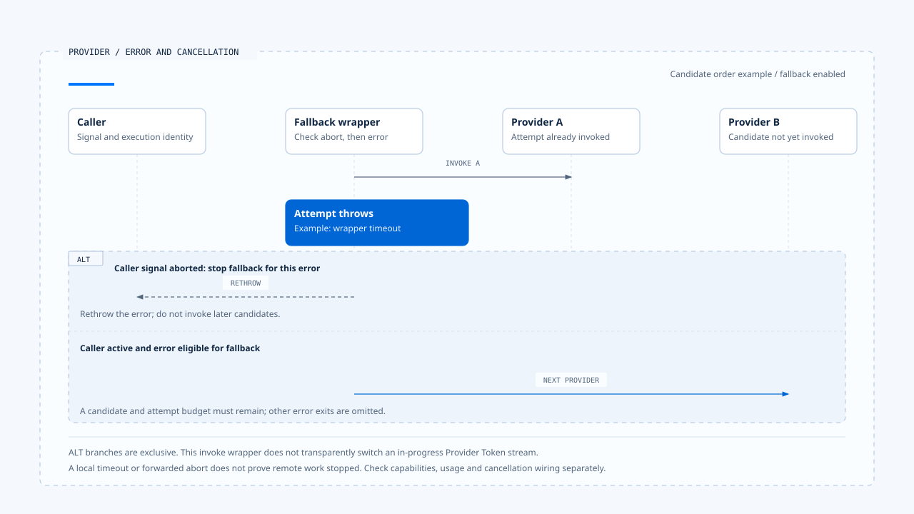

# Model calls and Provider fallback

[English](./01-model-calls-and-provider-fallback.md) | [繁體中文](./01-model-calls-and-provider-fallback-zh-TW.md)

> In the following content:
> CCB is short for [claude-code-best](https://github.com/claude-code-best/claude-code).
> Chat Gun refers to [chat-gun](https://github.com/HsienW/chat-gun).

[Back to guide](./README-zh-TW.md) · Next: [Stream assembly and tool calls](./02-stream-assembly-and-tool-calls.md)

> The first Provider times out, and the Runtime switches to a second. The new model can generate text but does not accept the tool binding required by this request. In another case, the model response has already triggered tool execution, and a retried request proposes the same operation again. What appears on screen as "switching models" crosses two different failure boundaries.

**A model call needs to retain its input contract, attempt identity, and stopping conditions.** When switching Providers, the Runtime also needs to know what data already exists and whether anyone has started executing tools.

## Model Step and Attempt

A Model Step expresses the result this reasoning step seeks. A Provider Attempt is one request sent to obtain it. The same Step may use another Provider after an eligible error, but each request's usage, error, and response still need to be distinguishable.

| Correlation | Purpose | Facts to keep separate |
|---|---|---|
| Run/Step | Identify this execution and reasoning position. | Completion of the entire Run and return from one model call. |
| Provider Attempt | Identify an attempt sent to a Provider. | Retrying the same input and switching to another model. |
| Tool Call | Identify an action the model proposes. | Complete arguments, authorization, and actual dispatch. |
| Tool Attempt/Operation | Relate tool execution and external operations. | Model resampling and effects already committed. |

These are conceptual correlations for reading the implementation. The two source repositories use different types; their APIs cannot be assumed to accept the same fields.

A model call should at least know where its input messages, visible tools, model capabilities, output format, and effective limits come from. Switching models without checking these conditions can leave a previously valid request failing only at the next adapter.

## Chat Gun's call contract

The `ChatModelInvoker` version examined here provides `invoke()` and an optional `bindTools()`. Options include purpose, model, temperature, retry settings, response format, and tool choice. Invoke options can carry a signal and some execution correlations.

### Read the contract alongside its caller

The MCP Agent's `callModel()` assembles Context, calls `createChatModel()`, confirms that `bindTools` exists, and executes `bindTools(tools).invoke(modelInput)`. This entry point does not use `createChatModelWithFallback()`.

That invoke call also omits the second options argument in the examined code. An interface accepting a signal and an entry point passing the Run's cancellation signal are separate facts to verify. Other entry points still need individual inspection.

### The scope of invoke and streaming

This Gateway interface delivers a completed model message. It does not declare a Token streaming method in the same contract. Graph event streams, BFF transport, and screen updates may still exist and need to be traced through their own consumers.

Continuous UI updates do not establish incremental delivery of partial Tool Calls through this invoke. For another implementation of streaming blocks, see the [next article](./02-stream-assembly-and-tool-calls.md).

## Where fallback is enabled

Chat Gun's `createChatModelWithFallback()` first reads runtime config. If the global setting is disabled and the caller supplies no explicit nonempty fallback Provider list, it returns a regular `createChatModel()`. An empty list after policy composition also produces no fallback chain.

Candidate Providers are deduplicated, with entries matching the primary removed. `FallbackChatModelInvoker.invoke()` then limits the selected candidates through `maxTotalAttempts` and tries them in sequence. This is not unlimited resubmission.

The cap applies to Provider attempts within that wrapper. Adapter retries, structured output repair, and retries by other consumers still require separate accounting of actual requests and usage.

## Which errors permit fallback

The examined `classifyProviderError()` categorizes errors, and `isFallbackEligibleCategory()` decides eligibility. Error categories and the fallback allowlist are defined separately.

| Category in this version | Example or classification source | Fallback allowed by this list |
|---|---|---|
| `provider_unavailable` | HTTP 5xx. | Yes. |
| `provider_timeout` | A designated timeout code, AbortError, or HTTP 408. | Yes, after checking caller cancellation. |
| `provider_response_invalid` | Envelope, response parsing, or designated format errors. | Yes. |
| `provider_rate_limited` | HTTP 429. | No. |
| `provider_decode_failure` | Tool argument decoding failure. | No. |
| `structured_output_invalid` | Zod validation errors. | No. |
| `content_filter_refusal` | A designated refusal code or refusal type. | No. |
| `unknown_error` | Other unclassified errors. | No. |

The table describes only this fixed version of the wrapper. Other systems may handle 429 differently; common practice cannot be added as behavior enabled here.

Refusal also needs to remain distinct from format failure. Switching Providers should not by itself turn a refusal into a transient fault to bypass. The configured policy still determines handling.

## Timeout and caller Abort

`invokeWithTimeout()` creates a child AbortController, sets a timer for one Provider, and forwards caller abort. It uses `Promise.race()` to await invoke and the abort promise. Finally clears the timer and caller listener.

If invoke throws, the outer layer first checks whether the caller signal is aborted. If so, it rethrows without switching Providers based on timeout classification. Only other eligible errors continue to the next candidate.

> Stopping a local wait and stopping remote computation need separate verification. Even after the wrapper receives a timeout, the Provider adapter's signal handling and continued remote billing each need evidence.

If several Providers use their full time allowances in sequence, total waiting includes each interval and internal work. The Run's Deadline and Budget need to remain effective in their execution consumers. A single per-provider timeout cannot replace them.

An aborted caller stops fallback. A next Provider is tried only for an eligible error while candidates and attempt budget remain.

[Open the editable HTML diagram](../../assets/agent-runtime/model-and-tool-execution/01-model-calls-and-provider-fallback/01-provider-timeout-and-caller-abort-en.html).

## Check capabilities before switching

`FallbackChatModelInvoker.bindTools()` visits the candidate invokers, throws if one lacks `bindTools`, and binds tools for each candidate. This is an explicit capability check, but does not establish identical tool Schema, tool choice, or output-format semantics across Providers.

- Capability checks need to cover the features this request actually uses.
- Structured output repair needs to retain the original error and repair attempts so they remain distinguishable from Provider fallback.
- Successful binding still requires validation of the response envelope, tool arguments, and product contract.

The Harness decides which capabilities and model paths are available. The Runtime maintains those conditions during execution. Switching models cannot expand the tool set or Resource permissions.

## Different fallback layers in CCB

CCB's `claude.ts` has API streaming and non-streaming fallback paths. `query.ts` separately handles model switching through `FallbackTriggeredError`. The former changes how a response is obtained; the latter involves the query loop's model and message state. Reading the code requires identifying which layer catches the error.

In relevant fallback branches, query clears assistant messages, tool results, or collected tool uses and discards the old StreamingToolExecutor to avoid attaching results with old IDs to a new response. This handles transcript and executor handoff. Clearing data alone does not establish reversal of earlier external effects.

When tools have started, their dispatch and effects need to be retrieved before deciding whether execution may continue. The [sixth article](./06-case-model-tool-roundtrip.md) treats that interleaving as a separate branch from successful fallback after a simple Provider timeout.

## How to verify model calls

### Enablement and error classification

- Disable the setting, supply an empty list, and supply an explicit policy separately, recording actual Provider call counts.
- Inject 5xx, 429, refusal, decoding failure, and an invalid envelope, and check which categories actually trigger fallback.
- Remove tool-binding support from a candidate and confirm that the error is not downgraded to ordinary text success.

### Time limits and work already started

- Leave a Provider unresponsive, recording the timer, signal, and next candidate's start point.
- Send caller Abort during the wait and confirm that no further Provider is called.
- Trigger a model retry in a separate branch after tools have started, checking external call counts and ownership of old results.

Source fallback test arrangements include 5xx, total attempt limits, timeout, refusal, decoding failure, and envelopes. This article inspected the arrangements without running real Provider, cost, or failure tests.

## Engineering judgment

I would first identify which Gateway method the production entry point uses, then inspect the error allowlist and signal propagation. An interface, a test, and deployment enablement provide different evidence. The article needs to relate them to the same call.

The recoverable scope of fallback depends on data and execution already produced. A failed model attempt and a tool that has caused external effects need different follow-up responsibilities.

## Implementation references and scope

- [Chat Gun Gateway][g-gateway], [fallback wrapper][g-fallback], [error classification][g-category], and [MCP Agent consumer][g-mcp].
- CCB `src/query.ts` and `src/services/api/claude.ts`; fallback, message, and tool handoffs are inspected separately.
- See this section's [sources](./README-zh-TW.md#來源與查證狀態) for the fixed version, CCB copy fingerprints, and verification limits. This article establishes no shared model-fallback interface across the two sources.

## Further reading

- [Stream assembly and tool calls](./02-stream-assembly-and-tool-calls.md)
- [Execution Identity and state authority](../foundations/02-execution-identity-and-state-authority.md)

[g-gateway]: https://github.com/HsienW/chat-gun/blob/f83a38fd67a021904e597c60543708ee0c206076/backend/src/platform/llm-gateway.ts
[g-fallback]: https://github.com/HsienW/chat-gun/blob/f83a38fd67a021904e597c60543708ee0c206076/backend/src/platform/llm-fallback.ts
[g-category]: https://github.com/HsienW/chat-gun/blob/f83a38fd67a021904e597c60543708ee0c206076/backend/src/platform/provider-error-category.ts
[g-mcp]: https://github.com/HsienW/chat-gun/blob/f83a38fd67a021904e597c60543708ee0c206076/backend/src/agents/mcp-agent.ts
