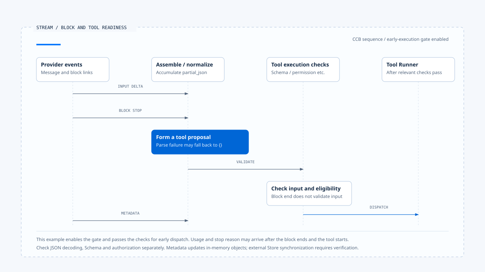
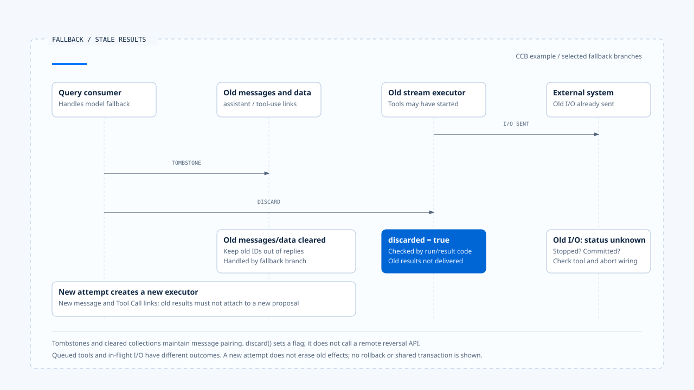

# 流式传输组装与工具调用

[English](./02-stream-assembly-and-tool-calls.md) | [繁體中文](./02-stream-assembly-and-tool-calls-zh-TW.md) | [简体中文](./02-stream-assembly-and-tool-calls-zh-CN.md)

> 以下内容所提到的
> CCB 为 [claude-code-best](https://github.com/claude-code-best/claude-code) 的简称。
> Chat Gun 为 [chat-gun](https://github.com/HsienW/chat-gun)。

[回到导览](./README-zh-CN.md) · 前一篇：[模型调用与 Provider 切换](./01-model-calls-and-provider-fallback-zh-CN.md) · 下一篇：[工具派送与并行调度](./03-tool-dispatch-and-concurrency-zh-CN.md)

> 画面已显示模型准备读取文件，工具名称也已抵达，参数却停在半段路径。若 consumer 看见名称便开始执行，它可能读取错误位置；若一定等整条连接关闭，又可能错过来源支持的安全提前执行位置。

**流式传输组装需要分别判断片段完整、提案可解读与行动可执行。** 每一项都有自己的数据与检查点，Runtime 不能只用「还在 stream」或「stream 结束」概括。

## 流式传输传递的是哪些数据

Provider 可能把一份回应分成 message start、文字或工具区块、delta、区块结束及消息层 metadata。这些事件的名称依协议而异，组装器需要保留来源顺序与区块关联。

| 层次 | 常见数据 | 能支持的观察 |
|---|---|---|
| Transport | 连接、event、断线。 | 数据有无抵达此 consumer。 |
| Content block | index、kind、text 或工具参数。 | 某个区块的累积与结束。 |
| Tool Call | ID、名称、规范化参数。 | 可交付检查的一份提案。 |
| Message metadata | usage、stop reason、request ID。 | 该次模型响应的描述。 |
| Product event | progress、显示文字、状态投影。 | 用户当时看见的内容。 |

同一个 Provider index 可以在其他消息重新出现，不能直接当成跨 Run 的 Tool Call ID。模型提出的 ID 也需要与目前 request、assistant message 及 Run 关联，才知道结果应回到哪一轮。

## CCB 如何累积工具参数

本区 CCB `claude.ts` 在 `content_block_start` 建立区块，收到 `input_json_delta` 时累加 `partial_json`。它检查区块存在、类型及 input 表示是否符合预期，错配时抛出对应错误。

到了 `content_block_stop`，consumer 调用 `normalizeContentFromAPI()`，建立 Assistant Message 并 yield。这份消息可以只包含刚结束的区块；整次模型响应此时仍可能继续产生其他内容。

概念顺序可表示为：

~~~text
開始工具區塊
  → 累積參數片段
  → 區塊結束與正規化
  → 交付工具提案
  → Schema、授權及排程檢查
~~~

这个阅读模型省略 Provider 细节，没有将区块结束直接画成工具已派送。

## JSON 规范化之后仍要验证

### 本区 CCB 的解析回退

`normalizeContentFromAPI()` 接受字符串或对象形式的 tool input。字符串经 `safeParseJSON()` 处理；非空字符串解析失败时会记录诊断事件，并使用 `parsed ?? {}` 形成规范化输入，再进行工具特定修正。

因此这个函数返回一份工具区块，不能证明原始 JSON 已成功解析。下游 Schema 若要求必要字段，可能拒绝空对象；若接受空输入或提供默认值，则要继续核对具体工具会做什么。

### 语法、Schema 与行动条件

- 语法检查回答输入是否能解码成指定数据形式。
- Schema 检查回答字段、类型与限制是否符合工具契约。
- 授权及执行检查再判断目前身份、Resource 与 Run 是否可做这次操作。

如果产品要求「参数解码失败必须拒绝」，需要把解析失败证据带到实际拒绝点。只在图上写完整 JSON，无法补回已在 adapter 中被转成空对象的来源状态。

## 提前执行的条件

CCB `query.ts` 依 `config.gates.streamingToolExecution` 决定是否建立 StreamingToolExecutor。工具区块经相应处理后，query 可以在模型流式传输仍进行时调用 `addTool()`，并取得已完成结果。

这条路径还有工具解析、Schema、安全分类及 permission 等检查。它与等回应收集后调用 `runTools()` 的批次路径不同，时序、结果累积与取消行为需分开阅读。

提前执行的设计代价，是 Provider 后段失败时，工具可能已经开始。此时重新产生一份 assistant message，还需处理先前提案的身份与实际效果。

> 能开始执行某个完整工具区块，只表示该提案抵达了相应检查点。整份消息是否完成、工具是否成功，以及 Task 是否完成仍有其他权威。

## Usage 与 stop reason 可能晚到

CCB 在区块结束时建立的消息，使用当时可得的 partial message metadata。后续 `message_delta` 到达后，还会更新 usage 与 stop reason 到已交付的相关消息。

Consumer 若在第一次收到 Assistant Message 时便把 usage 固定为最终值，可能漏掉后段信息。实际保存端需要说明更新、补记与序列化的时点；读取内存对象后来会改变，不等于外部 Store 自动同步。

成本与限制的 consumer 也要对回这个时差。已开始工具执行与最终 usage 抵达，可能不是同一时刻，不能由一段局部检查推论所有费用都已预留。

- 本例选取提前执行 gate 启用的时序。区块结束不证明原始 JSON 解析成功，metadata 补回也不表示外部 Store 自动更新。
- [开启流式传输区块、工具就绪与晚到 metadata 时序](../../assets/agent-runtime/model-and-tool-execution/02-stream-assembly-and-tool-calls/02-stream-blocks-and-tool-readiness-en.html)。

## 流式传输失败后如何处理旧区块

CCB query 的部分 fallback 分支会为旧 Assistant Message 发出 tombstone，清空当次工具与结果收集，并 `discard()` 旧 StreamingToolExecutor，再建立新的 executor。这些动作避免旧 tool-use ID 的结果混入新回应。

### discard 的作用范围

本区 `discard()` 本身设置 discarded flag。后续执行与取结果路径会读取它，等待中的工具可以取得 synthetic error，而结果 consumer 不再交付旧结果。

这项标志本身没有调用远端撤销 API。已开始的工具是否停止、外部是否提交，以及合成错误能否描述真实效果，仍需查工具与取消接线。Transcript 清理不能作为业务 rollback 的证据。

- 图中假设旧工具已送出 I/O。Tombstone 与 discarded flag 处理消息和结果交付，不代表外部操作已取消或 rollback。
- [开启旧消息、结果与外部效果的分工说明](../../assets/agent-runtime/model-and-tool-execution/02-stream-assembly-and-tool-calls/02-fallback-stale-results-and-effects-en.html)。

## Chat Gun 的对照边界

Chat Gun 本区的 `ChatModelInvoker` 主要暴露完成消息的 invoke 契约，MCP Agent 在模型返回后检查 tool calls，再转到 authorization graph。这条观察支持完整回应到工具交接的流程。

Provider chunk、Graph event 与 BFF stream 若采其他 consumer，需要另外取得来源证据。本文没有将 CCB 的 content block 时序直接套到 Chat Gun，也未确认两个系统共用逐 Token parser。

## 如何验证组装与派送

### 区块及输入

- 在参数中途断线，记录是否产生提案、规范化输入为何，以及 runner 是否调用。
- 送入不存在的 index、错误区块类型与重复 Tool Call ID，检查拒绝与关联。
- 对接受 `{}` 与要求必要字段的两种工具，分别测试解码失败的后续结果。

### 时序与 fallback

- 工具区块先结束、message metadata 后到，核对保存的 usage 与 stop reason。
- 分别开启与关闭 streaming execution gate，记录工具开始相对于 stream 结束的位置。
- 在工具已开始后触发 fallback，查回旧工具结果、外部效果与新 transcript 的配对。

这些是验证方案。本文未向真实 Provider 发送畸形流式传输，也未执行外部工具故障注入。

## 本篇的工程判断

我会沿着原始片段、规范化输入、Schema 结果与派送位置读一遍。任何一次回退都要保留足以解释后续行为的证据，否则完整的工具区块也可能藏着解析失败。

提前执行让完整提案提早取得处理机会，同时把 Provider 故障与工具结果拉进同一段交错时序。文件应指出这项耦合发生在哪里，让恢复处理能查回实际已做的工作。

## 实现参照与适用范围

- CCB `src/services/api/claude.ts`、`src/utils/messages.ts`：区块累积、规范化、usage 与 stop reason。
- CCB `src/query.ts`、`src/services/tools/StreamingToolExecutor.ts`：gate、提前执行、tombstone 与 discarded flag。
- [Chat Gun Gateway][g-gateway] 与 [MCP Agent][g-mcp]：完成消息及工具交接的对照。
- 来源副本、固定版本与未执行的验证见[本区导览](./README-zh-CN.md#来源与查证状态)。

## 接续阅读

- [工具派送与并行调度](./03-tool-dispatch-and-concurrency-zh-CN.md)
- [Run Loop 与状态转移](../foundations/03-run-loop-and-state-transitions-zh-CN.md)

[g-gateway]: https://github.com/HsienW/chat-gun/blob/f83a38fd67a021904e597c60543708ee0c206076/backend/src/platform/llm-gateway.ts
[g-mcp]: https://github.com/HsienW/chat-gun/blob/f83a38fd67a021904e597c60543708ee0c206076/backend/src/agents/mcp-agent.ts
