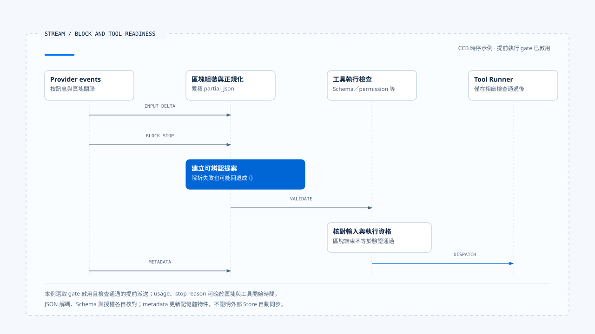
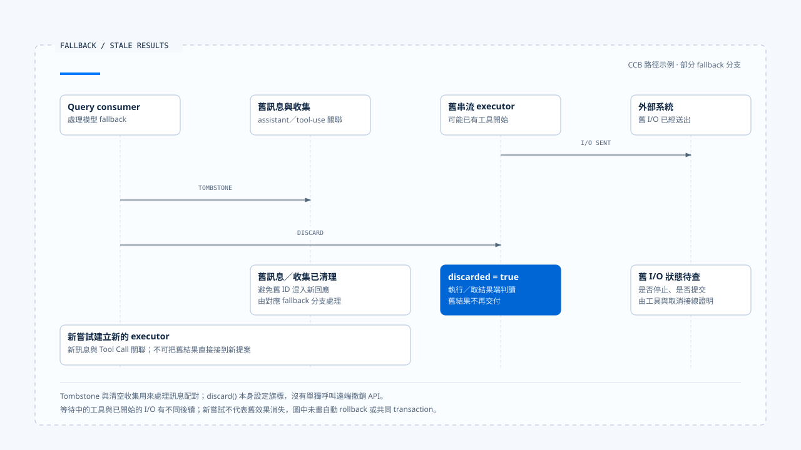

# 串流組裝與工具呼叫

[English](./02-stream-assembly-and-tool-calls.md) | [繁體中文](./02-stream-assembly-and-tool-calls-zh-TW.md)

> 以下內容所提到的
> CCB 為 [claude-code-best](https://github.com/claude-code-best/claude-code) 的簡稱。
> Chat Gun 為 [chat-gun](https://github.com/HsienW/chat-gun)。

[回到導覽](./README-zh-TW.md) · 前一篇：[模型呼叫與 Provider 切換](./01-model-calls-and-provider-fallback-zh-TW.md) · 下一篇：[工具派送與並行排程](./03-tool-dispatch-and-concurrency-zh-TW.md)

> 畫面已顯示模型準備讀取檔案，工具名稱也已抵達，參數卻停在半段路徑。若 consumer 看見名稱便開始執行，它可能讀取錯誤位置；若一定等整條連線關閉，又可能錯過來源支援的安全提前執行位置。

**串流組裝需要分別判斷片段完整、提案可解讀與行動可執行。** 每一項都有自己的資料與檢查點，Runtime 不能只用「還在 stream」或「stream 結束」概括。

## 串流傳遞的是哪些資料

Provider 可能把一份回應分成 message start、文字或工具區塊、delta、區塊結束及訊息層 metadata。這些事件的名稱依協定而異，組裝器需要保留來源順序與區塊關聯。

| 層次 | 常見資料 | 能支持的觀察 |
|---|---|---|
| Transport | 連線、event、斷線。 | 資料有無抵達此 consumer。 |
| Content block | index、kind、text 或工具參數。 | 某個區塊的累積與結束。 |
| Tool Call | ID、名稱、正規化參數。 | 可交付檢查的一份提案。 |
| Message metadata | usage、stop reason、request ID。 | 該次模型回應的描述。 |
| Product event | progress、顯示文字、狀態投影。 | 使用者當時看見的內容。 |

同一個 Provider index 可以在其他訊息重新出現，不能直接當成跨 Run 的 Tool Call ID。模型提出的 ID 也需要與目前 request、assistant message 及 Run 關聯，才知道結果應回到哪一輪。

## CCB 如何累積工具參數

本區 CCB `claude.ts` 在 `content_block_start` 建立區塊，收到 `input_json_delta` 時累加 `partial_json`。它檢查區塊存在、型別及 input 表示是否符合預期，錯配時拋出對應錯誤。

到了 `content_block_stop`，consumer 呼叫 `normalizeContentFromAPI()`，建立 Assistant Message 並 yield。這份訊息可以只包含剛結束的區塊；整次模型回應此時仍可能繼續產生其他內容。

概念順序可表示為：

~~~text
開始工具區塊
  → 累積參數片段
  → 區塊結束與正規化
  → 交付工具提案
  → Schema、授權及排程檢查
~~~

這個閱讀模型省略 Provider 細節，沒有將區塊結束直接畫成工具已派送。

## JSON 正規化之後仍要驗證

### 本區 CCB 的解析回退

`normalizeContentFromAPI()` 接受字串或物件形式的 tool input。字串經 `safeParseJSON()` 處理；非空字串解析失敗時會記錄診斷事件，並使用 `parsed ?? {}` 形成正規化輸入，再進行工具特定修正。

因此這個函式返回一份工具區塊，不能證明原始 JSON 已成功解析。下游 Schema 若要求必要欄位，可能拒絕空物件；若接受空輸入或提供預設值，則要繼續核對具體工具會做什麼。

### 語法、Schema 與行動條件

- 語法檢查回答輸入是否能解碼成指定資料形式。
- Schema 檢查回答欄位、型別與限制是否符合工具契約。
- 授權及執行檢查再判斷目前身分、Resource 與 Run 是否可做這次操作。

如果產品要求「參數解碼失敗必須拒絕」，需要把解析失敗證據帶到實際拒絕點。只在圖上寫完整 JSON，無法補回已在 adapter 中被轉成空物件的來源狀態。

## 提前執行的條件

CCB `query.ts` 依 `config.gates.streamingToolExecution` 決定是否建立 StreamingToolExecutor。工具區塊經相應處理後，query 可以在模型串流仍進行時呼叫 `addTool()`，並取得已完成結果。

這條路徑還有工具解析、Schema、安全分類及 permission 等檢查。它與等回應收集後呼叫 `runTools()` 的批次路徑不同，時序、結果累積與取消行為需分開閱讀。

提前執行的設計代價，是 Provider 後段失敗時，工具可能已經開始。此時重新產生一份 assistant message，還需處理先前提案的身分與實際效果。

> 能開始執行某個完整工具區塊，只表示該提案抵達了相應檢查點。整份訊息是否完成、工具是否成功，以及 Task 是否完成仍有其他權威。

## Usage 與 stop reason 可能晚到

CCB 在區塊結束時建立的訊息，使用當時可得的 partial message metadata。後續 `message_delta` 到達後，還會更新 usage 與 stop reason 到已交付的相關訊息。

Consumer 若在第一次收到 Assistant Message 時便把 usage 固定為最終值，可能漏掉後段資訊。實際保存端需要說明更新、補記與序列化的時點；讀取記憶體物件後來會改變，不等於外部 Store 自動同步。

成本與限制的 consumer 也要對回這個時差。已開始工具執行與最終 usage 抵達，可能不是同一時刻，不能由一段局部檢查推論所有費用都已預留。

- 本例選取提前執行 gate 啟用的時序。區塊結束不證明原始 JSON 解析成功，metadata 補回也不表示外部 Store 自動更新。
- [開啟串流區塊、工具就緒與晚到 metadata 時序](../../assets/agent-runtime/model-and-tool-execution/02-stream-assembly-and-tool-calls/02-stream-blocks-and-tool-readiness.html)。

## 串流失敗後如何處理舊區塊

CCB query 的部分 fallback 分支會為舊 Assistant Message 發出 tombstone，清空當次工具與結果收集，並 `discard()` 舊 StreamingToolExecutor，再建立新的 executor。這些動作避免舊 tool-use ID 的結果混入新回應。

### discard 的作用範圍

本區 `discard()` 本身設定 discarded flag。後續執行與取結果路徑會讀取它，等待中的工具可以取得 synthetic error，而結果 consumer 不再交付舊結果。

這項旗標本身沒有呼叫遠端撤銷 API。已開始的工具是否停止、外部是否提交，以及合成錯誤能否描述真實效果，仍需查工具與取消接線。Transcript 清理不能作為業務 rollback 的證據。

- 圖中假設舊工具已送出 I/O。Tombstone 與 discarded flag 處理訊息和結果交付，不代表外部操作已取消或 rollback。
- [開啟舊訊息、結果與外部效果的分工說明](../../assets/agent-runtime/model-and-tool-execution/02-stream-assembly-and-tool-calls/02-fallback-stale-results-and-effects.html)。

## Chat Gun 的對照邊界

Chat Gun 本區的 `ChatModelInvoker` 主要暴露完成訊息的 invoke 契約，MCP Agent 在模型返回後檢查 tool calls，再轉到 authorization graph。這條觀察支持完整回應到工具交接的流程。

Provider chunk、Graph event 與 BFF stream 若採其他 consumer，需要另外取得來源證據。本文沒有將 CCB 的 content block 時序直接套到 Chat Gun，也未確認兩個系統共用逐 Token parser。

## 如何驗證組裝與派送

### 區塊及輸入

- 在參數中途斷線，記錄是否產生提案、正規化輸入為何，以及 runner 是否呼叫。
- 送入不存在的 index、錯誤區塊型別與重複 Tool Call ID，檢查拒絕與關聯。
- 對接受 `{}` 與要求必要欄位的兩種工具，分別測試解碼失敗的後續結果。

### 時序與 fallback

- 工具區塊先結束、message metadata 後到，核對保存的 usage 與 stop reason。
- 分別開啟與關閉 streaming execution gate，記錄工具開始相對於 stream 結束的位置。
- 在工具已開始後觸發 fallback，查回舊工具結果、外部效果與新 transcript 的配對。

這些是驗證方案。本文未向真實 Provider 發送畸形串流，也未執行外部工具故障注入。

## 本篇的工程判斷

我會沿著原始片段、正規化輸入、Schema 結果與派送位置讀一遍。任何一次回退都要保留足以解釋後續行為的證據，否則完整的工具區塊也可能藏著解析失敗。

提前執行讓完整提案提早取得處理機會，同時把 Provider 故障與工具結果拉進同一段交錯時序。文件應指出這項耦合發生在哪裡，讓恢復處理能查回實際已做的工作。

## 實作參照與適用範圍

- CCB `src/services/api/claude.ts`、`src/utils/messages.ts`：區塊累積、正規化、usage 與 stop reason。
- CCB `src/query.ts`、`src/services/tools/StreamingToolExecutor.ts`：gate、提前執行、tombstone 與 discarded flag。
- [Chat Gun Gateway][g-gateway] 與 [MCP Agent][g-mcp]：完成訊息及工具交接的對照。
- 來源副本、固定版本與未執行的驗證見[本區導覽](./README-zh-TW.md#來源與查證狀態)。

## 接續閱讀

- [工具派送與並行排程](./03-tool-dispatch-and-concurrency-zh-TW.md)
- [Run Loop 與狀態轉移](../foundations/03-run-loop-and-state-transitions-zh-TW.md)

[g-gateway]: https://github.com/HsienW/chat-gun/blob/f83a38fd67a021904e597c60543708ee0c206076/backend/src/platform/llm-gateway.ts
[g-mcp]: https://github.com/HsienW/chat-gun/blob/f83a38fd67a021904e597c60543708ee0c206076/backend/src/agents/mcp-agent.ts
