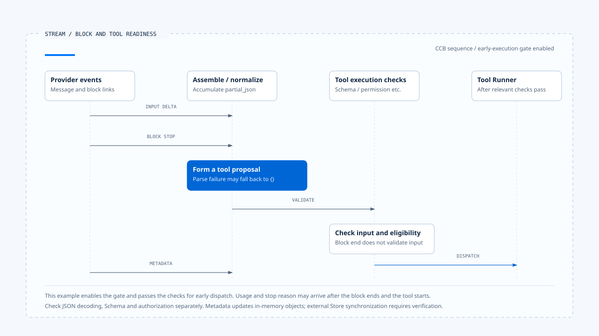
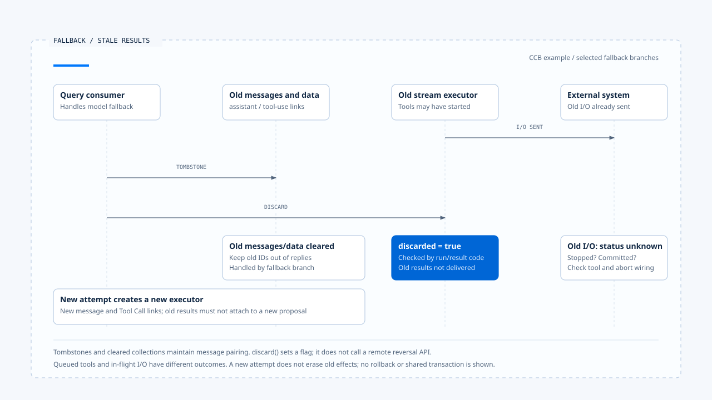

# Stream assembly and tool calls

[English](./02-stream-assembly-and-tool-calls.md) | [繁體中文](./02-stream-assembly-and-tool-calls-zh-TW.md)

> In the following content:
> CCB is short for [claude-code-best](https://github.com/claude-code-best/claude-code).
> Chat Gun refers to [chat-gun](https://github.com/HsienW/chat-gun).

[Back to guide](./README-zh-TW.md) · Previous: [Model calls and Provider fallback](./01-model-calls-and-provider-fallback.md) · Next: [Tool dispatch and concurrency](./03-tool-dispatch-and-concurrency.md)

> The screen already shows the model preparing to read a file, and the tool name has arrived, but its arguments stop halfway through a path. A consumer that executes as soon as it sees the name may read the wrong location. Requiring the entire connection to close, however, may miss a safe early execution point supported by the source.

**Stream assembly needs separate judgments about fragment completeness, proposal interpretability, and action eligibility.** Each has its own data and checks. The Runtime cannot summarize them all as "still streaming" or "stream ended."

## What data does the stream carry?

A Provider may split a response into message start, text or tool blocks, deltas, block endings, and message metadata. Event names vary by protocol. The assembler needs to preserve source order and block correlations.

| Layer | Typical data | Observation it supports |
|---|---|---|
| Transport | Connection, events, disconnection. | Whether data reached this consumer. |
| Content block | Index, kind, text, or tool arguments. | Accumulation and completion of one block. |
| Tool Call | ID, name, normalized arguments. | A proposal ready for inspection. |
| Message metadata | Usage, stop reason, request ID. | Description of this model response. |
| Product event | Progress, display text, state projection. | What the user saw at that moment. |

The same Provider index may reappear in another message and cannot directly serve as a Tool Call ID across Runs. A model-provided ID also needs correlation with the current request, assistant message, and Run so the result returns to the correct turn.

## How CCB accumulates tool arguments

In the CCB version examined here, `claude.ts` creates a block at `content_block_start` and accumulates `partial_json` from `input_json_delta`. It checks block existence, type, and the expected input representation, throwing corresponding errors for mismatches.

At `content_block_stop`, the consumer calls `normalizeContentFromAPI()`, creates an Assistant Message, and yields it. That message may contain only the block that just ended. The overall model response may still produce more content.

The conceptual order is:

~~~text
開始工具區塊
  → 累積參數片段
  → 區塊結束與正規化
  → 交付工具提案
  → Schema、授權及排程檢查
~~~

This reading model omits Provider details and does not equate block completion with tool dispatch.

## Validation still follows JSON normalization

### The parsing fallback in this CCB copy

`normalizeContentFromAPI()` accepts tool input as a string or object. It processes strings through `safeParseJSON()`. A failed parse of a nonempty string records a diagnostic event and uses `parsed ?? {}` as normalized input before tool-specific corrections.

Returning a tool block from this function therefore does not establish successful parsing of the original JSON. A downstream Schema requiring fields may reject the empty object. If it accepts empty input or supplies defaults, the specific tool's behavior still needs inspection.

### Syntax, Schema, and action conditions

- Syntax checks determine whether input decodes into the designated representation.
- Schema checks determine whether fields, types, and constraints satisfy the tool contract.
- Authorization and execution checks determine whether the current identity, Resource, and Run may perform this operation.

If a product requires rejection on argument decoding failure, evidence of that failure must reach the actual rejection point. Labeling a diagram "complete JSON" cannot restore source state already converted to an empty object in an adapter.

## Conditions for early execution

CCB's `query.ts` uses `config.gates.streamingToolExecution` to decide whether to create a StreamingToolExecutor. After processing a tool block, query can call `addTool()` while the model stream is still active and retrieve completed results.

This path also includes tool lookup, Schema, safety classification, and permission checks. It differs from collecting the response before calling batch `runTools()`. Timing, result accumulation, and cancellation behavior need separate inspection.

The cost of early execution is that tools may already have started when the Provider fails later. Generating a new assistant message then also requires handling the earlier proposals' identities and actual effects.

> Starting execution of a complete tool block only establishes that the proposal reached its corresponding checks. Completion of the whole message, tool success, and Task completion still have other authorities.

## Usage and stop reason may arrive later

Messages CCB creates at block completion use the partial message metadata available then. A later `message_delta` updates usage and stop reason on the relevant messages already yielded.

A consumer that fixes usage as final when it first receives an Assistant Message may miss later information. The persistence consumer needs to define update, amendment, and serialization points. A later change to an in-memory object does not automatically synchronize an external Store.

Cost and limit consumers also need to account for this gap. Tool execution may start before final usage arrives. A local check cannot establish that all costs have already been reserved.

A complete block still requires input and execution checks. With early execution enabled, a tool may start before usage and stop reason arrive.

[Open the editable HTML diagram](../../assets/agent-runtime/model-and-tool-execution/02-stream-assembly-and-tool-calls/02-stream-blocks-and-tool-readiness-en.html).

## Handling old blocks after stream failure

In some fallback branches, CCB query emits tombstones for old Assistant Messages, clears the current tool and result collections, calls `discard()` on the old StreamingToolExecutor, and creates a new executor. These actions prevent results with old tool-use IDs from entering the new response.

### The scope of discard

In this copy, `discard()` itself sets a discarded flag. Later execution and result-retrieval paths read it. Queued tools can receive synthetic errors, and the result consumer stops delivering old results.

The flag itself calls no remote reversal API. Whether started tools stop, external effects commit, and synthetic errors describe actual effects still requires inspection of tools and cancellation wiring. Transcript cleanup is not evidence of business rollback.

Clearing old messages and discarding an executor stops stale-result delivery. The status of I/O already sent still requires separate evidence.

[Open the editable HTML diagram](../../assets/agent-runtime/model-and-tool-execution/02-stream-assembly-and-tool-calls/02-fallback-stale-results-and-effects-en.html).

## The boundary of the Chat Gun comparison

The `ChatModelInvoker` examined here mainly exposes an invoke contract for completed messages. The MCP Agent checks tool calls after the model returns and routes to the authorization graph. This supports an observation of completed-response handoff to tools.

Other consumers for Provider chunks, Graph events, or BFF streams require separate source evidence. This article does not apply CCB's content-block sequence directly to Chat Gun or establish a shared Token parser.

## How to verify assembly and dispatch

### Blocks and input

- Disconnect midway through arguments, recording whether a proposal forms, what normalized input it contains, and whether the runner is called.
- Supply a nonexistent index, incorrect block type, or duplicate Tool Call ID, and check rejection and correlation.
- Test decoding failure separately with a tool accepting `{}` and a tool requiring fields.

### Timing and fallback

- Complete a tool block before message metadata arrives, and check persisted usage and stop reason.
- Enable and disable the streaming execution gate separately, recording tool start relative to stream completion.
- Trigger fallback after a tool starts, and retrieve old tool results, external effects, and pairing in the new transcript.

These are verification plans. This article did not send malformed streams to a real Provider or perform external tool fault injection.

## Engineering judgment

I would trace raw fragments, normalized input, Schema results, and dispatch points in order. Each fallback needs enough evidence to explain subsequent behavior; otherwise, a complete tool block may conceal a parsing failure.

Early execution gives complete proposals an earlier processing opportunity while bringing Provider failures and tool results into the same interleaving. Documentation should locate that coupling so recovery can retrieve the work actually performed.

## Implementation references and scope

- CCB `src/services/api/claude.ts` and `src/utils/messages.ts`: block accumulation, normalization, usage, and stop reason.
- CCB `src/query.ts` and `src/services/tools/StreamingToolExecutor.ts`: gate, early execution, tombstones, and the discarded flag.
- [Chat Gun Gateway][g-gateway] and [MCP Agent][g-mcp]: comparison of completed messages and tool handoff.
- See the [section guide](./README-zh-TW.md#來源與查證狀態) for source copies, the fixed version, and verification not performed.

## Further reading

- [Tool dispatch and concurrency](./03-tool-dispatch-and-concurrency.md)
- [Run Loop and state transitions](../foundations/03-run-loop-and-state-transitions.md)

[g-gateway]: https://github.com/HsienW/chat-gun/blob/f83a38fd67a021904e597c60543708ee0c206076/backend/src/platform/llm-gateway.ts
[g-mcp]: https://github.com/HsienW/chat-gun/blob/f83a38fd67a021904e597c60543708ee0c206076/backend/src/agents/mcp-agent.ts
