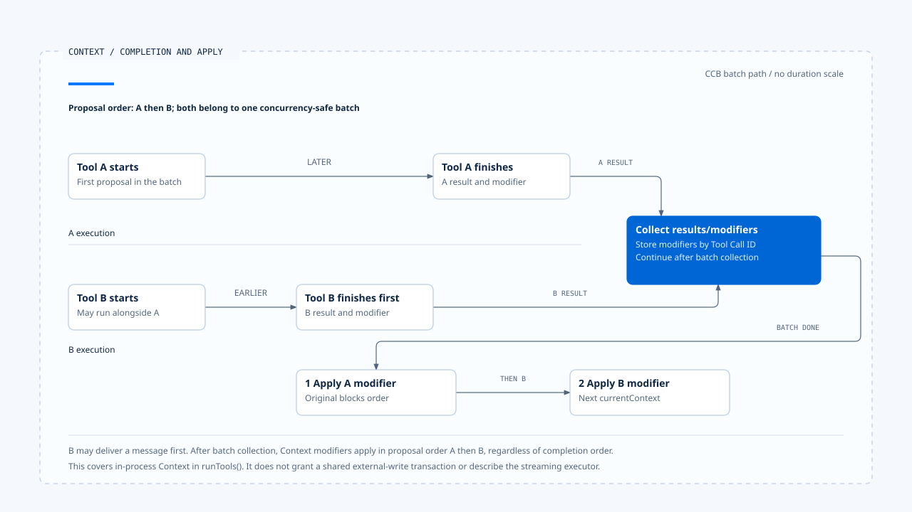
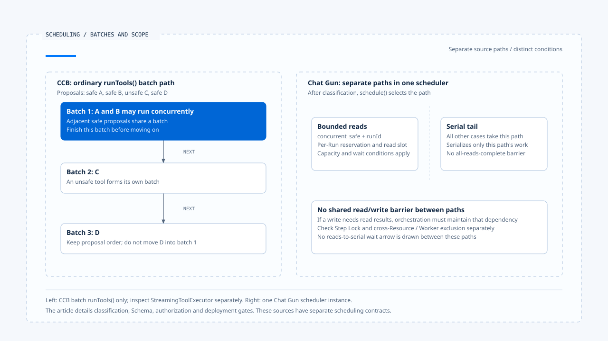

# 工具派送与并行调度

[English](./03-tool-dispatch-and-concurrency.md) | [繁體中文](./03-tool-dispatch-and-concurrency-zh-TW.md) | [简体中文](./03-tool-dispatch-and-concurrency-zh-CN.md)

> 以下内容所提到的
> CCB 为 [claude-code-best](https://github.com/claude-code-best/claude-code) 的简称。
> Chat Gun 为 [chat-gun](https://github.com/HsienW/chat-gun)。

[回到导览](./README-zh-CN.md) · 前一篇：[流式传输组装与工具调用](./02-stream-assembly-and-tool-calls-zh-CN.md) · 下一篇：[背压与容量控制](./04-backpressure-and-capacity-zh-CN.md)

> 模型一次提出两个读取与一个写入。程序把读取送进 concurrent queue，把写入送进 serial queue，便以为写入会等待所有读取。实际上两条 queue 没有共用 barrier，写入可能读到尚未准备好的数据。

**工具调度需要同时交代提案是否可执行，以及操作之间的依赖由谁维持。** 并行分类、序列化、容量限制与资源锁各自限制一段范围，文件应写出它们真正核对的数据。

## 从完整提案到 runner

工具名称与参数抵达后，Runtime 仍需解析工具、验证输入、取得可信 Context，并将授权结果交到执行端。工具可见性由 Harness 配置，单次行动的资格则要对回这次参数与 Resource。

| 接点 | 需要取得的结果 | 失败时应辨认 |
|---|---|---|
| 工具解析 | 目前可用的 descriptor 或工具定义。 | 未知工具、版本或别名。 |
| Schema／依赖 | 可接受的输入与必要执行依赖。 | 输入不符、必要 Port 缺少。 |
| 身份与授权 | 可信执行关联、允许或其他决策。 | 拒绝、待确认、权威不可用。 |
| 并行分类 | 该次操作的调度类别。 | 分类失败或无法证明安全。 |
| 调度与 runner | 取得资格后的实际执行。 | 容量拒绝、等待取消、执行错误。 |

表格整理责任，未指定所有来源都依相同顺序实现。阅读时要找出哪个 await 前后会留下 reservation、Step 或其他资源。

## Chat Gun 的派送前检查

本区 `createRuntimeToolDispatchPipeline()` 的 dispatch 先解析 registry，对输入 safeParse，检查必要 dependencies 及授权接口，再计算并行分类。其后核对 canonical Execution Context，要求 Step ID 与 Tool Call ID，才进入授权及可选的 execution profile enforcement。

这些检查有不同拒绝原因，例如 `UNREGISTERED_TOOL_DENIED`、`TOOL_INPUT_VALIDATION_FAILED` 或 `TOOL_EXECUTION_CONTEXT_UNAVAILABLE`。它们让 consumer 可以辨认工具尚未进入底层 runner 的原因。

### 一般入口与已授权入口

Pipeline 产生的 executor 有一般 `executeTyped()` 与 `executeAuthorizedTyped()`。后者表示授权已在先前接点处理，dispatch 会以 authorized 结果接续；来源仍要求授权接口存在，其他必要检查也各自执行。

这个入口需要由可信 consumer 持有。一般 Client 或模型不能只以参数宣称「已授权」，便取得相同执行路径。批准、版本及参数如何绑定，连回 [Action Governance](../../agent-harness/action-governance/README-zh-CN.md) 查证。

本区另可看到，已授权的非只读操作会把 retry policy 的 `maxAttempts` 限为 1。这是该路径避免未取得新授权便重复操作的限制，不能延伸成所有入口都不重试。

## 并行安全要对回本次输入

Chat Gun pipeline 的判断同时要求 `descriptor.isReadOnly` 与 `descriptor.isConcurrencySafe(parsedInput.data)`。若分类函数抛错，返回 `TOOL_CONCURRENCY_CLASSIFICATION_FAILED`，不直接派送。

CCB 批次分类则先找工具、解析输入，再调用工具自己的 `isConcurrencySafe()`。解析失败或函数抛错时归为不安全，后续工具执行路径仍会做自己的验证。注解使用 read-only 说明批次，实际判断仍以函数及 descriptor 为准。

| 来源接点 | 并行条件 | 无法完成分类时 |
|---|---|---|
| Chat Gun pipeline | 只读标记及当次输入判定都成立。 | 抛错会拒绝派送。 |
| CCB `partitionToolCalls()` | 工具存在、输入可解析且判定成立。 | 以不安全批次接续后续检查。 |
| CCB StreamingToolExecutor | 有自己的输入与并行判断。 | 需沿该 executor 读取时序。 |

只读本身也有一致性问题。若某个读取依赖另一操作刚写入的数据，仍需 orchestration、版本或下游一致性契约支持。

## CCB 的连续批次

`runTools()` 依原始提案顺序形成批次：相邻的安全工具可以合成一批，不安全工具则各自成批。它依序处理批次，安全批次透过 `all()` 并行，其他批次走串行路径。

概念上，分类结果可以是：

~~~text
safe A、safe B、unsafe C、safe D
  → 批次 1：A 與 B
  → 批次 2：C
  → 批次 3：D
~~~

这表示批次边界保留原顺序，没有任意把 D 移到前面与 A、B 同跑。工具真的执行什么，仍需看各自安全判定与 permission 路径。

### 完成次序与 Context modifier

并行工具可以先后返回消息；`runTools()` 暂存其 Context modifiers，待该批结果收集完成后，依原始 tool-use blocks 的顺序套用。串行路径则随各工具 update 更新 current Context。

这项顺序控制作用在进程内 Context。外部数据库、文件或 API 的写入不会因为 modifiers 有固定顺序而自动取得 transaction 语义。

- 图中水平位置只示意先后，不表示实测耗时比例。这是批次 `runTools()` 的进程内 Context 行为，未涵盖 streaming executor 或外部交易。
- [开启完成次序与 Context 更新顺序说明](../../assets/agent-runtime/model-and-tool-execution/03-tool-dispatch-and-concurrency/03-completion-order-and-context-modifiers-en.html)。

## Chat Gun 的两条本地调度路径

`BoundedToolDispatchScheduler.schedule()` 只有在分类为 `concurrent_safe` 且提供 runId 时走 bounded read 路径；其余进入 serial tail。

Serial tail 使用 Promise 顺序处理送入该路径的操作。Bounded reads 另用 activeReads、waiters 与 per-Run capacity 管理，它们没有共用一个等待全部读取结束的 barrier。

因此「先提出两个读取，接着提出写入」需要由上层保留依赖。若要求写入等待读取结果，应先完成必要读取交接，再提出写入，或使用真正能表达依赖的 orchestration。

- 左右分别对应来源实现，未视为共同调度契约；必要数据依赖仍需 orchestration 明确维持，跨 Worker 与 Resource 互斥另查。
- [开启批次与分离调度路径对照](../../assets/agent-runtime/model-and-tool-execution/03-tool-dispatch-and-concurrency/03-batches-and-scheduler-scope-en.html)。

## Step Lock 保护哪个位置

Pipeline 进入 scheduler 之前会取得 Step Lock lease，owner 带有 Run 与 Tool Call 关联，再启动 Task Step。Runner 执行使用 lease signal，finally 尝试释放 lease；续租失败后的结果会被转成效果不明的 outcome。

这条顺序表示工作等待调度槽位时，可能已持有 Step lease。等待时间与租约维持因此需要一起验证，不能只测 runner 真正开始之后的状况。

Step Lock 的取得 key 是 stepId。两个不同 Step 若操作同一 Resource，是否冲突仍由下游版本、Resource Lock 或交易契约决定。本篇不把它描述成任意文件、订单或跨 Worker 操作的共同互斥。

## 正式入口是否接上 pipeline

Chat Gun registry 的组装以 `isToolDispatchPipelineEnabled(source)` 决定是否建立 pipeline，再透过 `createExecutor()` 包住 default executor。Execution profile enforcement 也有自己的启用设置。

所以 pipeline 文件中有检查，与某一来源、部署或 Agent 实际使用这条路径，仍需分别举证。MCP Graph 中的 authorization gate、physical dispatch 与工具 registry 也各有接点。

CCB 方面，query gate 选择一般批次或 streaming executor。本文的批次顺序主张限于 `runTools()`，不把其中的 concurrency cap 与 Context 更新方式直接套到 streaming 路径。

## 如何验证派送与并行

### 分类及拒绝

- 对未知工具、错误 Schema、缺少 Context 与分类抛错，核对 runner 调用次数。
- 混合安全与非安全提案，记录批次、开始与结束顺序。
- 让一般入口与已授权入口各自执行，确认授权交接及 mutation retry 限制。

### 依赖与作用范围

- 让两条 scheduler 路径同时有工作，确认 serial 的实际互斥范围。
- 对不同 Step 操作相同 Resource，核对下游冲突处理，而非只看本地 queue。
- 等待槽位期间取消或续租失败，查回 lease、Step 状态与实际外部调用。

本区 pipeline 与 scheduler 测试已有若干对应案例。本文未执行正式多 Worker、Resource 冲突或租约故障测试。

## 本篇的工程判断

我会把「能同时执行」与「必须等待谁」分开查。安全分类回答前者，批次边界、Graph 依赖或 Resource 契约回答后者；缺少任何一项，都可能让正确的单一工具在组合后出错。

调度器的保证应以实例、路径及 key 说明。读者知道这些限制后，才能判断需要在哪个接点补上更大的协调范围。

## 实现参照与适用范围

- [Chat Gun pipeline][g-pipeline]、[scheduler][g-scheduler]、[registry 组装][g-registry]。
- CCB `src/services/tools/toolOrchestration.ts`、`src/utils/generators.ts`、`src/services/tools/StreamingToolExecutor.ts`。
- 来源版本、指纹及未验证范围见[本区导览](./README-zh-CN.md#来源与查证状态)。批次例子是概念说明，没有宣称两个来源共用调度模型。

## 接续阅读

- [背压与容量控制](./04-backpressure-and-capacity-zh-CN.md)
- [工具风险与契约](../../agent-harness/action-governance/01-tool-risk-and-contracts-zh-CN.md)

[g-pipeline]: https://github.com/HsienW/chat-gun/blob/f83a38fd67a021904e597c60543708ee0c206076/backend/src/runtime/tool-dispatch/pipeline.ts
[g-scheduler]: https://github.com/HsienW/chat-gun/blob/f83a38fd67a021904e597c60543708ee0c206076/backend/src/runtime/tool-dispatch/scheduler.ts
[g-registry]: https://github.com/HsienW/chat-gun/blob/f83a38fd67a021904e597c60543708ee0c206076/backend/src/tools/registry.ts
