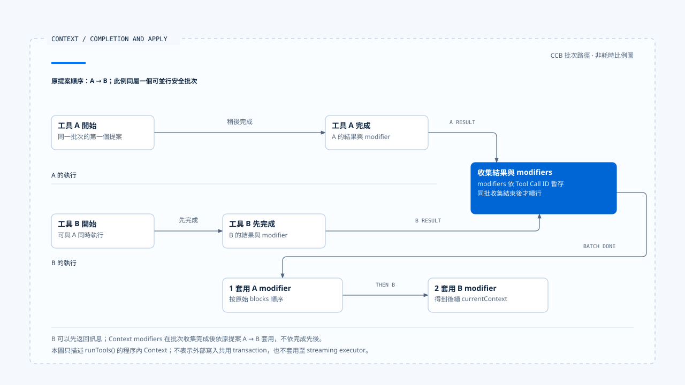
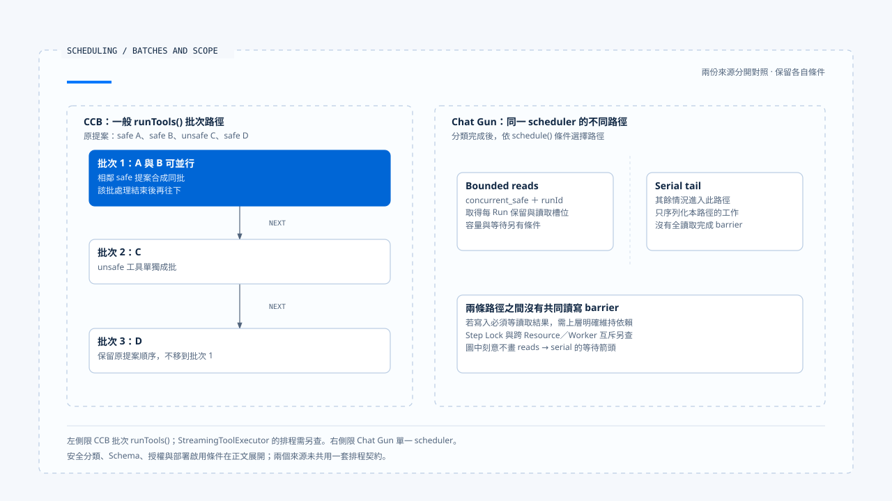

# 工具派送與並行排程

[English](./03-tool-dispatch-and-concurrency.md) | [繁體中文](./03-tool-dispatch-and-concurrency-zh-TW.md)

> 以下內容所提到的
> CCB 為 [claude-code-best](https://github.com/claude-code-best/claude-code) 的簡稱。
> Chat Gun 為 [chat-gun](https://github.com/HsienW/chat-gun)。

[回到導覽](./README-zh-TW.md) · 前一篇：[串流組裝與工具呼叫](./02-stream-assembly-and-tool-calls-zh-TW.md) · 下一篇：[背壓與容量控制](./04-backpressure-and-capacity-zh-TW.md)

> 模型一次提出兩個讀取與一個寫入。程式把讀取送進 concurrent queue，把寫入送進 serial queue，便以為寫入會等待所有讀取。實際上兩條 queue 沒有共用 barrier，寫入可能讀到尚未準備好的資料。

**工具排程需要同時交代提案是否可執行，以及操作之間的依賴由誰維持。** 並行分類、序列化、容量限制與資源鎖各自限制一段範圍，文件應寫出它們真正核對的資料。

## 從完整提案到 runner

工具名稱與參數抵達後，Runtime 仍需解析工具、驗證輸入、取得可信 Context，並將授權結果交到執行端。工具可見性由 Harness 配置，單次行動的資格則要對回這次參數與 Resource。

| 接點 | 需要取得的結果 | 失敗時應辨認 |
|---|---|---|
| 工具解析 | 目前可用的 descriptor 或工具定義。 | 未知工具、版本或別名。 |
| Schema／依賴 | 可接受的輸入與必要執行依賴。 | 輸入不符、必要 Port 缺少。 |
| 身分與授權 | 可信執行關聯、允許或其他決策。 | 拒絕、待確認、權威不可用。 |
| 並行分類 | 該次操作的排程類別。 | 分類失敗或無法證明安全。 |
| 排程與 runner | 取得資格後的實際執行。 | 容量拒絕、等待取消、執行錯誤。 |

表格整理責任，未指定所有來源都依相同順序實作。閱讀時要找出哪個 await 前後會留下 reservation、Step 或其他資源。

## Chat Gun 的派送前檢查

本區 `createRuntimeToolDispatchPipeline()` 的 dispatch 先解析 registry，對輸入 safeParse，檢查必要 dependencies 及授權介面，再計算並行分類。其後核對 canonical Execution Context，要求 Step ID 與 Tool Call ID，才進入授權及可選的 execution profile enforcement。

這些檢查有不同拒絕原因，例如 `UNREGISTERED_TOOL_DENIED`、`TOOL_INPUT_VALIDATION_FAILED` 或 `TOOL_EXECUTION_CONTEXT_UNAVAILABLE`。它們讓 consumer 可以辨認工具尚未進入底層 runner 的原因。

### 一般入口與已授權入口

Pipeline 產生的 executor 有一般 `executeTyped()` 與 `executeAuthorizedTyped()`。後者表示授權已在先前接點處理，dispatch 會以 authorized 結果接續；來源仍要求授權介面存在，其他必要檢查也各自執行。

這個入口需要由可信 consumer 持有。一般 Client 或模型不能只以參數宣稱「已授權」，便取得相同執行路徑。批准、版本及參數如何綁定，連回 [Action Governance](../../agent-harness/action-governance/README-zh-TW.md) 查證。

本區另可看到，已授權的非唯讀操作會把 retry policy 的 `maxAttempts` 限為 1。這是該路徑避免未取得新授權便重複操作的限制，不能延伸成所有入口都不重試。

## 並行安全要對回本次輸入

Chat Gun pipeline 的判斷同時要求 `descriptor.isReadOnly` 與 `descriptor.isConcurrencySafe(parsedInput.data)`。若分類函式拋錯，回傳 `TOOL_CONCURRENCY_CLASSIFICATION_FAILED`，不直接派送。

CCB 批次分類則先找工具、解析輸入，再呼叫工具自己的 `isConcurrencySafe()`。解析失敗或函式拋錯時歸為不安全，後續工具執行路徑仍會做自己的驗證。註解使用 read-only 說明批次，實際判斷仍以函式及 descriptor 為準。

| 來源接點 | 並行條件 | 無法完成分類時 |
|---|---|---|
| Chat Gun pipeline | 唯讀標記及當次輸入判定都成立。 | 拋錯會拒絕派送。 |
| CCB `partitionToolCalls()` | 工具存在、輸入可解析且判定成立。 | 以不安全批次接續後續檢查。 |
| CCB StreamingToolExecutor | 有自己的輸入與並行判斷。 | 需沿該 executor 讀取時序。 |

唯讀本身也有一致性問題。若某個讀取依賴另一操作剛寫入的資料，仍需 orchestration、版本或下游一致性契約支持。

## CCB 的連續批次

`runTools()` 依原始提案順序形成批次：相鄰的安全工具可以合成一批，不安全工具則各自成批。它依序處理批次，安全批次透過 `all()` 並行，其他批次走串行路徑。

概念上，分類結果可以是：

~~~text
safe A、safe B、unsafe C、safe D
  → 批次 1：A 與 B
  → 批次 2：C
  → 批次 3：D
~~~

這表示批次邊界保留原順序，沒有任意把 D 移到前面與 A、B 同跑。工具真的執行什麼，仍需看各自安全判定與 permission 路徑。

### 完成次序與 Context modifier

並行工具可以先後回傳訊息；`runTools()` 暫存其 Context modifiers，待該批結果收集完成後，依原始 tool-use blocks 的順序套用。串行路徑則隨各工具 update 更新 current Context。

這項順序控制作用在程序內 Context。外部資料庫、檔案或 API 的寫入不會因為 modifiers 有固定順序而自動取得 transaction 語意。

- 圖中水平位置只示意先後，不表示實測耗時比例。這是批次 `runTools()` 的程序內 Context 行為，未涵蓋 streaming executor 或外部交易。
- [開啟完成次序與 Context 更新順序說明](../../assets/agent-runtime/model-and-tool-execution/03-tool-dispatch-and-concurrency/03-completion-order-and-context-modifiers.html)。

## Chat Gun 的兩條本地排程路徑

`BoundedToolDispatchScheduler.schedule()` 只有在分類為 `concurrent_safe` 且提供 runId 時走 bounded read 路徑；其餘進入 serial tail。

Serial tail 使用 Promise 順序處理送入該路徑的操作。Bounded reads 另用 activeReads、waiters 與 per-Run capacity 管理，它們沒有共用一個等待全部讀取結束的 barrier。

因此「先提出兩個讀取，接著提出寫入」需要由上層保留依賴。若要求寫入等待讀取結果，應先完成必要讀取交接，再提出寫入，或使用真正能表達依賴的 orchestration。

- 左右分別對應來源實作，未視為共同排程契約；必要資料依賴仍需 orchestration 明確維持，跨 Worker 與 Resource 互斥另查。
- [開啟批次與分離排程路徑對照](../../assets/agent-runtime/model-and-tool-execution/03-tool-dispatch-and-concurrency/03-batches-and-scheduler-scope.html)。

## Step Lock 保護哪個位置

Pipeline 進入 scheduler 之前會取得 Step Lock lease，owner 帶有 Run 與 Tool Call 關聯，再啟動 Task Step。Runner 執行使用 lease signal，finally 嘗試釋放 lease；續租失敗後的結果會被轉成效果不明的 outcome。

這條順序表示工作等待排程槽位時，可能已持有 Step lease。等待時間與租約維持因此需要一起驗證，不能只測 runner 真正開始之後的狀況。

Step Lock 的取得 key 是 stepId。兩個不同 Step 若操作同一 Resource，是否衝突仍由下游版本、Resource Lock 或交易契約決定。本篇不把它描述成任意檔案、訂單或跨 Worker 操作的共同互斥。

## 正式入口是否接上 pipeline

Chat Gun registry 的組裝以 `isToolDispatchPipelineEnabled(source)` 決定是否建立 pipeline，再透過 `createExecutor()` 包住 default executor。Execution profile enforcement 也有自己的啟用設定。

所以 pipeline 檔案中有檢查，與某一來源、部署或 Agent 實際使用這條路徑，仍需分別舉證。MCP Graph 中的 authorization gate、physical dispatch 與工具 registry 也各有接點。

CCB 方面，query gate 選擇一般批次或 streaming executor。本文的批次順序主張限於 `runTools()`，不把其中的 concurrency cap 與 Context 更新方式直接套到 streaming 路徑。

## 如何驗證派送與並行

### 分類及拒絕

- 對未知工具、錯誤 Schema、缺少 Context 與分類拋錯，核對 runner 呼叫次數。
- 混合安全與非安全提案，記錄批次、開始與結束順序。
- 讓一般入口與已授權入口各自執行，確認授權交接及 mutation retry 限制。

### 依賴與作用範圍

- 讓兩條 scheduler 路徑同時有工作，確認 serial 的實際互斥範圍。
- 對不同 Step 操作相同 Resource，核對下游衝突處理，而非只看本地 queue。
- 等待槽位期間取消或續租失敗，查回 lease、Step 狀態與實際外部呼叫。

本區 pipeline 與 scheduler 測試已有若干對應案例。本文未執行正式多 Worker、Resource 衝突或租約故障測試。

## 本篇的工程判斷

我會把「能同時執行」與「必須等待誰」分開查。安全分類回答前者，批次邊界、Graph 依賴或 Resource 契約回答後者；缺少任何一項，都可能讓正確的單一工具在組合後出錯。

排程器的保證應以實例、路徑及 key 說明。讀者知道這些限制後，才能判斷需要在哪個接點補上更大的協調範圍。

## 實作參照與適用範圍

- [Chat Gun pipeline][g-pipeline]、[scheduler][g-scheduler]、[registry 組裝][g-registry]。
- CCB `src/services/tools/toolOrchestration.ts`、`src/utils/generators.ts`、`src/services/tools/StreamingToolExecutor.ts`。
- 來源版本、指紋及未驗證範圍見[本區導覽](./README-zh-TW.md#來源與查證狀態)。批次例子是概念說明，沒有宣稱兩個來源共用排程模型。

## 接續閱讀

- [背壓與容量控制](./04-backpressure-and-capacity-zh-TW.md)
- [工具風險與契約](../../agent-harness/action-governance/01-tool-risk-and-contracts-zh-TW.md)

[g-pipeline]: https://github.com/HsienW/chat-gun/blob/f83a38fd67a021904e597c60543708ee0c206076/backend/src/runtime/tool-dispatch/pipeline.ts
[g-scheduler]: https://github.com/HsienW/chat-gun/blob/f83a38fd67a021904e597c60543708ee0c206076/backend/src/runtime/tool-dispatch/scheduler.ts
[g-registry]: https://github.com/HsienW/chat-gun/blob/f83a38fd67a021904e597c60543708ee0c206076/backend/src/tools/registry.ts
