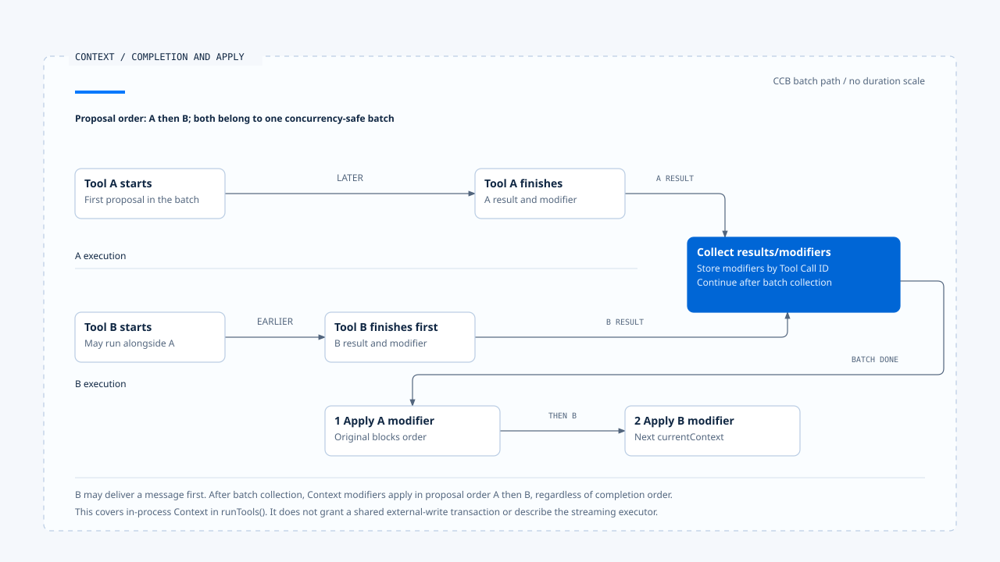
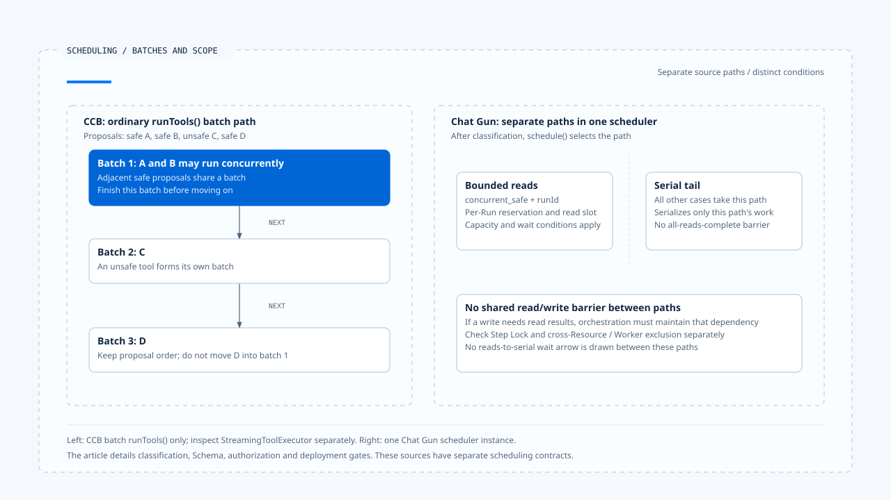

# Tool dispatch and concurrency

[English](./03-tool-dispatch-and-concurrency.md) | [繁體中文](./03-tool-dispatch-and-concurrency-zh-TW.md)

> In the following content:
> CCB is short for [claude-code-best](https://github.com/claude-code-best/claude-code).
> Chat Gun refers to [chat-gun](https://github.com/HsienW/chat-gun).

[Back to guide](./README-zh-TW.md) · Previous: [Stream assembly and tool calls](./02-stream-assembly-and-tool-calls.md) · Next: [Backpressure and capacity](./04-backpressure-and-capacity.md)

> A model proposes two reads and one write together. The code sends reads to a concurrent queue and the write to a serial queue, assuming the write will wait for every read. The queues actually share no barrier, so the write may encounter data that is not ready.

**Tool scheduling needs to establish both whether a proposal may execute and who maintains dependencies between operations.** Concurrency classification, serialization, capacity limits, and resource locks each constrain a particular scope. Documentation should state what they actually check.

## From complete proposal to runner

After the tool name and arguments arrive, the Runtime still needs to resolve the tool, validate input, obtain trusted Context, and hand authorization results to execution. The Harness configures tool visibility. Eligibility for an individual action must match its arguments and Resource.

| Boundary | Required result | Failure to distinguish |
|---|---|---|
| Tool resolution | An available descriptor or tool definition. | Unknown tool, version, or alias. |
| Schema/dependencies | Acceptable input and required execution dependencies. | Invalid input or a missing required Port. |
| Identity and authorization | Trusted execution correlation and an allow or other decision. | Rejection, pending confirmation, or unavailable authority. |
| Concurrency classification | A scheduling class for this operation. | Failed classification or safety not established. |
| Scheduling and runner | Actual execution after eligibility is obtained. | Capacity rejection, cancellation while waiting, or execution errors. |

The table organizes responsibilities without prescribing one implementation order for every source. Reading the code requires identifying which await points leave reservations, Steps, or other resources behind.

## Chat Gun's checks before dispatch

In this version, dispatch inside `createRuntimeToolDispatchPipeline()` resolves the registry, applies safeParse to input, checks required dependencies and the authorization interface, and calculates concurrency classification. It then validates canonical Execution Context, requiring Step ID and Tool Call ID, before authorization and optional execution profile enforcement.

These checks have distinct rejection reasons, such as `UNREGISTERED_TOOL_DENIED`, `TOOL_INPUT_VALIDATION_FAILED`, and `TOOL_EXECUTION_CONTEXT_UNAVAILABLE`. They let consumers identify why the underlying runner has not started.

### Ordinary and pre-authorized entry points

The executor produced by the Pipeline has ordinary `executeTyped()` and `executeAuthorizedTyped()`. The latter indicates that an earlier boundary handled authorization, so dispatch continues with an authorized result. The source still requires an authorization interface, and other required checks run separately.

A trusted consumer needs to hold this entry point. A Client or model cannot gain the same execution path merely by declaring "already authorized" in arguments. For approval, version, and argument binding, see [Action Governance](../../agent-harness/action-governance/README.md).

The examined code also caps retry policy `maxAttempts` at 1 for pre-authorized operations that are not read-only. This restricts repeated operations without fresh authorization on that path; it does not establish that every entry point avoids retries.

## Concurrency safety must match the current input

Chat Gun's Pipeline requires both `descriptor.isReadOnly` and `descriptor.isConcurrencySafe(parsedInput.data)`. If classification throws, it returns `TOOL_CONCURRENCY_CLASSIFICATION_FAILED` without dispatching directly.

CCB's batch classification first finds the tool and parses input, then calls the tool's own `isConcurrencySafe()`. Parsing failure or an exception classifies it as unsafe, while the subsequent tool execution path still performs its own validation. Comments describe read-only batches; the actual function and descriptor determine classification.

| Source boundary | Concurrency condition | If classification cannot complete |
|---|---|---|
| Chat Gun Pipeline | Read-only flag and current-input classification both hold. | An exception rejects dispatch. |
| CCB `partitionToolCalls()` | Tool exists, input parses, and classification holds. | Continue subsequent checks in an unsafe batch. |
| CCB StreamingToolExecutor | Uses its own input and concurrency checks. | Trace timing through that executor. |

Read-only operations also have consistency requirements. A read that depends on data another operation just wrote still needs orchestration, versioning, or a downstream consistency contract.

## CCB's consecutive batches

`runTools()` forms batches in proposal order. Adjacent safe tools can share a batch; unsafe tools each form a separate one. It processes batches sequentially, using `all()` for safe batches and serial execution for the others.

A conceptual classification can look like:

~~~text
safe A、safe B、unsafe C、safe D
  → 批次 1：A 與 B
  → 批次 2：C
  → 批次 3：D
~~~

Batch boundaries preserve the original order. D is not arbitrarily moved forward to run with A and B. Actual tool behavior still depends on each safety classification and permission path.

### Completion order and Context modifiers

Concurrent tools can return messages in different orders. `runTools()` queues their Context modifiers and applies them in the original tool-use block order after collecting the batch results. The serial path updates current Context as each tool produces updates.

This ordering applies to Context within the process. A fixed modifier order does not automatically give external database, file, or API writes transaction semantics.

B may return first. After batch collection, Context modifiers apply in the original proposal order A, B.

[Open the editable HTML diagram](../../assets/agent-runtime/model-and-tool-execution/03-tool-dispatch-and-concurrency/03-completion-order-and-context-modifiers-en.html).

## Chat Gun's two local scheduling paths

`BoundedToolDispatchScheduler.schedule()` uses the bounded read path only for `concurrent_safe` classification with a runId. Everything else enters the serial tail.

The serial tail orders operations submitted to it through Promises. Bounded reads separately use activeReads, waiters, and per-Run capacity. The two paths share no barrier that waits for all reads to finish.

The upper layer therefore needs to maintain dependencies when proposing two reads followed by a write. If the write must wait for read results, complete the required read handoff before proposing it, or use orchestration that actually expresses those dependencies.

CCB processes consecutive batches in order. Chat Gun's bounded reads and serial tail have separate waits; orchestration must maintain required dependencies.

[Open the editable HTML diagram](../../assets/agent-runtime/model-and-tool-execution/03-tool-dispatch-and-concurrency/03-batches-and-scheduler-scope-en.html).

## What the Step Lock protects

Before entering the scheduler, the Pipeline acquires a Step Lock lease whose owner carries Run and Tool Call correlations, then starts the Task Step. Runner execution uses the lease signal. Finally attempts lease release; renewal failure changes the outcome to an unresolved-effect state.

This order means work can already hold a Step lease while waiting for a scheduling slot. Queue waiting and lease maintenance therefore need joint verification, beyond testing after the runner starts.

The Step Lock acquisition key is stepId. If two different Steps operate on the same Resource, downstream versions, a Resource Lock, or transaction contracts still determine conflicts. This article does not describe it as shared exclusion for arbitrary files, orders, or operations across Workers.

## Whether production entry points use the Pipeline

Chat Gun's registry composition uses `isToolDispatchPipelineEnabled(source)` to decide whether to create the Pipeline, then wraps the default executor through `createExecutor()`. Execution profile enforcement has its own enablement setting.

Checks existing in the Pipeline file and a particular source, deployment, or Agent using that path need separate evidence. The MCP Graph's authorization gate, physical dispatch, and tool registry also have distinct boundaries.

In CCB, the query gate selects ordinary batches or the streaming executor. This article's batch-order claims apply to `runTools()`. Its concurrency cap and Context update behavior are not applied directly to the streaming path.

## How to verify dispatch and concurrency

### Classification and rejection

- Check runner call counts for unknown tools, invalid Schema, missing Context, and classification exceptions.
- Mix safe and unsafe proposals, recording batch, start, and completion order.
- Exercise ordinary and pre-authorized entry points separately, confirming authorization handoff and mutation retry limits.

### Dependencies and scope

- Put work on both scheduler paths concurrently and check the serial path's actual exclusion scope.
- Operate on the same Resource from different Steps and check downstream conflict handling beyond the local queue.
- Cancel or fail renewal while waiting for a slot, and retrieve lease, Step state, and actual external calls.

The Pipeline and scheduler tests include some corresponding cases. This article did not run production multi-Worker, Resource conflict, or lease failure tests.

## Engineering judgment

I would inspect what may execute together separately from what must wait for something else. Safety classification answers the former. Batch boundaries, Graph dependencies, or Resource contracts answer the latter. Missing either can make individually correct tools fail in combination.

Scheduler guarantees should name their instance, path, and key. Those limits let readers identify where broader coordination is needed.

## Implementation references and scope

- [Chat Gun Pipeline][g-pipeline], [scheduler][g-scheduler], and [registry composition][g-registry].
- CCB `src/services/tools/toolOrchestration.ts`, `src/utils/generators.ts`, and `src/services/tools/StreamingToolExecutor.ts`.
- See the [section guide](./README-zh-TW.md#來源與查證狀態) for source versions, fingerprints, and unverified scope. The batch example is conceptual and does not claim a shared scheduling model across the two sources.

## Further reading

- [Backpressure and capacity](./04-backpressure-and-capacity.md)
- [Tool risk and contracts](../../agent-harness/action-governance/01-tool-risk-and-contracts.md)

[g-pipeline]: https://github.com/HsienW/chat-gun/blob/f83a38fd67a021904e597c60543708ee0c206076/backend/src/runtime/tool-dispatch/pipeline.ts
[g-scheduler]: https://github.com/HsienW/chat-gun/blob/f83a38fd67a021904e597c60543708ee0c206076/backend/src/runtime/tool-dispatch/scheduler.ts
[g-registry]: https://github.com/HsienW/chat-gun/blob/f83a38fd67a021904e597c60543708ee0c206076/backend/src/tools/registry.ts
