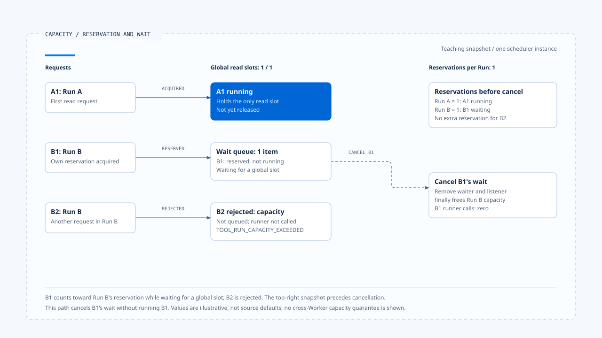

# 背压与容量控制

[English](./04-backpressure-and-capacity.md) | [繁體中文](./04-backpressure-and-capacity-zh-TW.md) | [简体中文](./04-backpressure-and-capacity-zh-CN.md)

> 以下内容所提到的
> CCB 为 [claude-code-best](https://github.com/claude-code-best/claude-code) 的简称。
> Chat Gun 为 [chat-gun](https://github.com/HsienW/chat-gun)。

[回到导览](./README-zh-CN.md) · 前一篇：[工具派送与并行调度](./03-tool-dispatch-and-concurrency-zh-CN.md) · 下一篇：[工具结果与错误回灌](./05-tool-results-and-error-feedback-zh-CN.md)

> 工具最多只能同时跑几个，内存却持续增加。排队要求、已完成结果与 progress 都在累积，慢速 consumer 还没读完前面的数据。限制执行数量，只处理了这条数据流的一个位置。

**容量控制需要说明计算单位、取得位置、超额行为与释放条件。** 背压若要传回上游，还得找到下游速度如何影响新工作产生，不能只看一个 queue 或 async generator。

## 哪些量需要分开计算

模型与工具往返有多种有限资源：执行槽位、等待项目、结果大小、输出频率及费用。它们的限制通常落在不同 consumer。

| 数量或额度 | 计算对象 | 达上限时可能的处置 |
|---|---|---|
| Active concurrency | 已进入指定执行范围的操作。 | 等待槽位或拒绝。 |
| Queue length | 尚未开始的工作项目。 | 限制入列、过期或取消。 |
| Per-Run reservation | 同一 Run 已保留的资格。 | 拒绝该 Run 新要求。 |
| Buffered output | 尚未消费的结果或 bytes。 | 停止拉取、截断、落盘或中止。 |
| Rate limit | 指定时间窗口内的使用。 | 延迟或拒绝。 |
| Cost／Token budget | 已计价、使用或预留的额度。 | 阻止后续模型或工具尝试。 |

表中的处置是设计选项，是否存在要回到来源查证。单位写成 bytes、工具数或费用后，才知道「剩余量」实际限制什么。

## Chat Gun 的两层读取容量

`BoundedToolDispatchScheduler` 以 `maxConcurrentReads` 限制本实例的全局读取槽位，以 `maxConcurrentReadsPerRun` 限制每个 Run 的保留。安全分类且有 runId 的工作才进入这条路径。

`runBoundedRead()` 的顺序是先 reserve per-Run capacity，再等待全局槽位，取得后才执行 operation。Finally 依取得情况释放读取槽位，并释放 Run reservation。

### Per-Run 计数包含等待中的保留

程序中的 per-Run `active` 在全局槽位取得前就增加。因此该值包含等待全局容量的工作，不能直接解读成目前正在执行的工具数。

假设教学配置的全局读取上限为 1、每 Run 保留上限也为 1：

~~~text
A1 取得全域槽位并执行
B1 取得 Run B 保留，等待全域槽位
B2 再要求 Run B 保留 → 超额拒绝
A1 结束 → B1 可取得槽位
~~~

数字只用来说明程序顺序，没有表示来源默认或实测容量。若 B1 被取消，还要确认它的 waiter 与 Run reservation 都已释放。

### 等待与拒绝是两个出口

全局槽位不足时，读取可以进入 readWaiters。Per-Run 保留不足时，`reserveRunCapacity()` 直接抛出 `TOOL_RUN_CAPACITY_EXCEEDED`，没有先替该项工作排队。

Scheduler 测试有一个名称使用 defers 的案例，但内文实际断言同 Run 第二个操作被拒绝，另一个 Run 仍可执行。正文以程序与 assertion 为依据，不把名称当成延迟重试的证据。

- 数字是单一 scheduler 的教学配置；右上为取消前快照。图中选取等待取消分支，没有把 B2 的拒绝画成排队。
- [开启容量、保留与等待取消说明](../../assets/agent-runtime/model-and-tool-execution/04-backpressure-and-capacity/04-reservation-capacity-and-cancellation-en.html)。

## 等待取消与清理

读取 waiter 会监听 signal。取消时从数组移除、清理 listener 并拒绝等待；取得槽位后还会再检查 signal。这些位置让取消有机会在 runner 开始前生效。

Serial 路径另用 `waitForTurn()` 等前一段 Promise，finally 释放自己的 slot。两种路径的清理条件不同，需要分别测试排队取消与 operation 抛错。

> 此处的 finally 只说明本地调度资源如何释放。工具已送到外部之后，仍要由取消、效果回查与结果契约回答后续状态。

若 pipeline 在调度前已取得 Step lease，排队期间也可能需要维持租约。队列等待、锁占用与实际执行时间要分开观察，否则只看到工具本体很快，仍可能忽略长时间占住的保留。

## 有界执行尚未涵盖哪些量

本区 scheduler 的字段与数组作用于同一实例。全局 activeReads 有上限，不等于 waiter 总数、Run 数量或整个产品的内存都有共同上限。

- 多个 scheduler 实例可能各自接受工作，部署总量要另外计算。
- 多个 Run 可以各自取得保留，总等待量需有自己的 admission 或 queue 契约。
- FIFO 取出 waiter 只描述这个数组的顺序，未建立所有 Run 的公平性目标。
- 跨 Worker 的配额需要共享 consumer、原子更新或其他协调机制支持。

这些是设计与验证要求，本文未证明来源已完成跨进程容量控制。

## Rate limit 与 circuit breaker 在不同接点

Chat Gun pipeline 先做 rate limiter check。Deny 时拒绝；defer 时以 signal 等待指定延迟，然后继续后段处理。等待失败及取消也有各自 outcome。

Circuit breaker 另在执行前判断 open 或可尝试。它处理近期失败与是否允许新尝试，没有替代 scheduler 的槽位。Per-Run capacity rejection 也不应被当成 Provider 或工具的业务故障计入同一种健康信号。

工具调度、rate limit、circuit breaker 与成本预算可以同时存在。正文需把各自等待及计数位置写出来，不能把 `queue_wait` 这类量测名称直接视为单纯的 scheduler 数组停留时间。

## CCB 的批次容量与结果拉取

CCB `runToolsConcurrently()` 把设置的并行上限传给 `all()`。该 helper 先从 waiting generators 启动一批，透过 `Promise.race()` 交付先抵达的 update；一个 generator 完成后才补进下一个。

这限制了该 helper 同时推进的 generators。它没有将全部上游输入变成固定 bytes 的 queue，也没有定义每个 tool result 的大小，不能据此计算整条模型工具往返的内存上限。

### StreamingToolExecutor 的另一套累积

StreamingToolExecutor 的工具记录保存 results 与 pending progress。`getCompletedResults()` 会取出 progress、交付已完成结果，并在特定非安全工具仍执行时维持交付顺序。

这里有与 consumer 速度相关的累积位置。Query 何时拉取、单项结果能多大，以及慢 UI 是否返回压力，都需要沿实际 consumer 补证；批次 helper 的 concurrency cap 不能直接套到这条路径。

## 背压要查到哪里

若产品宣称结果缓冲有界，至少要说明超额时停止哪个 producer、是否允许丢弃 progress、完整结果如何保存，以及 consumer 消失时谁取消工作。

截断也需要保留语义。工具成功结果因太大而只交付 reference，与工具执行失败不同；Context assembler 若压缩结果，还需保留 Tool Call 配对、必要限制与错误分类。

目前查读范围未覆盖整条 Provider → Runtime → BFF → UI 的 buffer，因此本文将端到端 bounded backpressure 列为待验证能力。

## 如何验证容量与背压

### 槽位、保留与取消

- 固定全局槽位，让不同 Run 竞争，分别记录 reserved、waiting 与 executing。
- 在全局等待及 serial 等待时取消，确认 operation 未调用、保留不残留。
- 让 operation 抛错，再送下一项工作，核对容量确实恢复。

### 缓冲与部署

- 使用慢 consumer 与大量 progress，记录各层项目数、bytes 与 producer 开始次数。
- 同时启动多个 scheduler 实例，核对宣称的上限到底属哪个范围。
- 检查输出截断或 reference 交付后，下一轮仍可分辨成功、失败与效果不明。

上述是验证方案。本轮没有执行慢 consumer、内存负载或多 Worker 压测。

## 本篇的工程判断

我会先把 reserved、waiting、executing 与 buffered output 画成不同数量，再找各自的增加与释放位置。这样才能看出拒绝发生在哪里，以及压力是否只是被移到另一个容器。

有界背压需要一条能查证的传递路径。局部槽位控制很有用，但整体保证仍需把 Producer、consumer、缓冲与部署实例串起来观察。

## 实现参照与适用范围

- [Chat Gun scheduler][g-scheduler]、[scheduler 测试安排][g-tests] 与 [pipeline][g-pipeline]。
- CCB `src/utils/generators.ts`、`src/services/tools/toolOrchestration.ts`、`src/services/tools/StreamingToolExecutor.ts`。
- 本区固定来源与指纹见[来源与查证状态](./README-zh-CN.md#来源与查证状态)。数字案例属概念推演，没有表示已验收的容量。

## 接续阅读

- [工具结果与错误回灌](./05-tool-results-and-error-feedback-zh-CN.md)
- [Agent Runtime 设计原则](../foundations/05-runtime-design-principles-zh-CN.md)

[g-scheduler]: https://github.com/HsienW/chat-gun/blob/f83a38fd67a021904e597c60543708ee0c206076/backend/src/runtime/tool-dispatch/scheduler.ts
[g-tests]: https://github.com/HsienW/chat-gun/blob/f83a38fd67a021904e597c60543708ee0c206076/backend/src/runtime/tool-dispatch/scheduler.test.ts
[g-pipeline]: https://github.com/HsienW/chat-gun/blob/f83a38fd67a021904e597c60543708ee0c206076/backend/src/runtime/tool-dispatch/pipeline.ts
