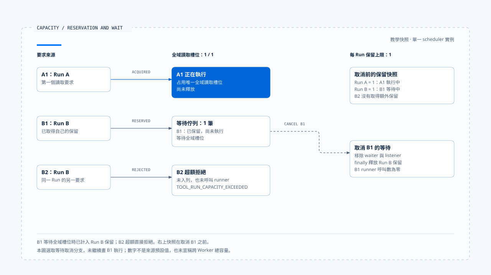

# 背壓與容量控制

[English](./04-backpressure-and-capacity.md) | [繁體中文](./04-backpressure-and-capacity-zh-TW.md)

> 以下內容所提到的
> CCB 為 [claude-code-best](https://github.com/claude-code-best/claude-code) 的簡稱。
> Chat Gun 為 [chat-gun](https://github.com/HsienW/chat-gun)。

[回到導覽](./README-zh-TW.md) · 前一篇：[工具派送與並行排程](./03-tool-dispatch-and-concurrency-zh-TW.md) · 下一篇：[工具結果與錯誤回灌](./05-tool-results-and-error-feedback-zh-TW.md)

> 工具最多只能同時跑幾個，記憶體卻持續增加。排隊要求、已完成結果與 progress 都在累積，慢速 consumer 還沒讀完前面的資料。限制執行數量，只處理了這條資料流的一個位置。

**容量控制需要說明計算單位、取得位置、超額行為與釋放條件。** 背壓若要傳回上游，還得找到下游速度如何影響新工作產生，不能只看一個 queue 或 async generator。

## 哪些量需要分開計算

模型與工具往返有多種有限資源：執行槽位、等待項目、結果大小、輸出頻率及費用。它們的限制通常落在不同 consumer。

| 數量或額度 | 計算對象 | 達上限時可能的處置 |
|---|---|---|
| Active concurrency | 已進入指定執行範圍的操作。 | 等待槽位或拒絕。 |
| Queue length | 尚未開始的工作項目。 | 限制入列、過期或取消。 |
| Per-Run reservation | 同一 Run 已保留的資格。 | 拒絕該 Run 新要求。 |
| Buffered output | 尚未消費的結果或 bytes。 | 停止拉取、截斷、落盤或中止。 |
| Rate limit | 指定時間窗口內的使用。 | 延遲或拒絕。 |
| Cost／Token budget | 已計價、使用或預留的額度。 | 阻止後續模型或工具嘗試。 |

表中的處置是設計選項，是否存在要回到來源查證。單位寫成 bytes、工具數或費用後，才知道「剩餘量」實際限制什麼。

## Chat Gun 的兩層讀取容量

`BoundedToolDispatchScheduler` 以 `maxConcurrentReads` 限制本實例的全域讀取槽位，以 `maxConcurrentReadsPerRun` 限制每個 Run 的保留。安全分類且有 runId 的工作才進入這條路徑。

`runBoundedRead()` 的順序是先 reserve per-Run capacity，再等待全域槽位，取得後才執行 operation。Finally 依取得情況釋放讀取槽位，並釋放 Run reservation。

### Per-Run 計數包含等待中的保留

程式中的 per-Run `active` 在全域槽位取得前就增加。因此該值包含等待全域容量的工作，不能直接解讀成目前正在執行的工具數。

假設教學配置的全域讀取上限為 1、每 Run 保留上限也為 1：

~~~text
A1 取得全域槽位並執行
B1 取得 Run B 保留，等待全域槽位
B2 再要求 Run B 保留 → 超額拒絕
A1 結束 → B1 可取得槽位
~~~

數字只用來說明程式順序，沒有表示來源預設或實測容量。若 B1 被取消，還要確認它的 waiter 與 Run reservation 都已釋放。

### 等待與拒絕是兩個出口

全域槽位不足時，讀取可以進入 readWaiters。Per-Run 保留不足時，`reserveRunCapacity()` 直接拋出 `TOOL_RUN_CAPACITY_EXCEEDED`，沒有先替該項工作排隊。

Scheduler 測試有一個名稱使用 defers 的案例，但內文實際斷言同 Run 第二個操作被拒絕，另一個 Run 仍可執行。正文以程式與 assertion 為依據，不把名稱當成延遲重試的證據。

- 數字是單一 scheduler 的教學配置；右上為取消前快照。圖中選取等待取消分支，沒有把 B2 的拒絕畫成排隊。
- [開啟容量、保留與等待取消說明](../../assets/agent-runtime/model-and-tool-execution/04-backpressure-and-capacity/04-reservation-capacity-and-cancellation.html)。

## 等待取消與清理

讀取 waiter 會監聽 signal。取消時從陣列移除、清理 listener 並拒絕等待；取得槽位後還會再檢查 signal。這些位置讓取消有機會在 runner 開始前生效。

Serial 路徑另用 `waitForTurn()` 等前一段 Promise，finally 釋放自己的 slot。兩種路徑的清理條件不同，需要分別測試排隊取消與 operation 拋錯。

> 此處的 finally 只說明本地排程資源如何釋放。工具已送到外部之後，仍要由取消、效果回查與結果契約回答後續狀態。

若 pipeline 在排程前已取得 Step lease，排隊期間也可能需要維持租約。隊列等待、鎖占用與實際執行時間要分開觀察，否則只看到工具本體很快，仍可能忽略長時間占住的保留。

## 有界執行尚未涵蓋哪些量

本區 scheduler 的欄位與陣列作用於同一實例。全域 activeReads 有上限，不等於 waiter 總數、Run 數量或整個產品的記憶體都有共同上限。

- 多個 scheduler 實例可能各自接受工作，部署總量要另外計算。
- 多個 Run 可以各自取得保留，總等待量需有自己的 admission 或 queue 契約。
- FIFO 取出 waiter 只描述這個陣列的順序，未建立所有 Run 的公平性目標。
- 跨 Worker 的配額需要共享 consumer、原子更新或其他協調機制支持。

這些是設計與驗證要求，本文未證明來源已完成跨程序容量控制。

## Rate limit 與 circuit breaker 在不同接點

Chat Gun pipeline 先做 rate limiter check。Deny 時拒絕；defer 時以 signal 等待指定延遲，然後繼續後段處理。等待失敗及取消也有各自 outcome。

Circuit breaker 另在執行前判斷 open 或可嘗試。它處理近期失敗與是否允許新嘗試，沒有替代 scheduler 的槽位。Per-Run capacity rejection 也不應被當成 Provider 或工具的業務故障計入同一種健康訊號。

工具排程、rate limit、circuit breaker 與成本預算可以同時存在。正文需把各自等待及計數位置寫出來，不能把 `queue_wait` 這類量測名稱直接視為單純的 scheduler 陣列停留時間。

## CCB 的批次容量與結果拉取

CCB `runToolsConcurrently()` 把設定的並行上限傳給 `all()`。該 helper 先從 waiting generators 啟動一批，透過 `Promise.race()` 交付先抵達的 update；一個 generator 完成後才補進下一個。

這限制了該 helper 同時推進的 generators。它沒有將全部上游輸入變成固定 bytes 的 queue，也沒有定義每個 tool result 的大小，不能據此計算整條模型工具往返的記憶體上限。

### StreamingToolExecutor 的另一套累積

StreamingToolExecutor 的工具紀錄保存 results 與 pending progress。`getCompletedResults()` 會取出 progress、交付已完成結果，並在特定非安全工具仍執行時維持交付順序。

這裡有與 consumer 速度相關的累積位置。Query 何時拉取、單項結果能多大，以及慢 UI 是否回傳壓力，都需要沿實際 consumer 補證；批次 helper 的 concurrency cap 不能直接套到這條路徑。

## 背壓要查到哪裡

若產品宣稱結果緩衝有界，至少要說明超額時停止哪個 producer、是否允許丟棄 progress、完整結果如何保存，以及 consumer 消失時誰取消工作。

截斷也需要保留語意。工具成功結果因太大而只交付 reference，與工具執行失敗不同；Context assembler 若壓縮結果，還需保留 Tool Call 配對、必要限制與錯誤分類。

目前查讀範圍未覆蓋整條 Provider → Runtime → BFF → UI 的 buffer，因此本文將端到端 bounded backpressure 列為待驗證能力。

## 如何驗證容量與背壓

### 槽位、保留與取消

- 固定全域槽位，讓不同 Run 競爭，分別記錄 reserved、waiting 與 executing。
- 在全域等待及 serial 等待時取消，確認 operation 未呼叫、保留不殘留。
- 讓 operation 拋錯，再送下一項工作，核對容量確實恢復。

### 緩衝與部署

- 使用慢 consumer 與大量 progress，記錄各層項目數、bytes 與 producer 開始次數。
- 同時啟動多個 scheduler 實例，核對宣稱的上限到底屬哪個範圍。
- 檢查輸出截斷或 reference 交付後，下一輪仍可分辨成功、失敗與效果不明。

上述是驗證方案。本輪沒有執行慢 consumer、記憶體負載或多 Worker 壓測。

## 本篇的工程判斷

我會先把 reserved、waiting、executing 與 buffered output 畫成不同數量，再找各自的增加與釋放位置。這樣才能看出拒絕發生在哪裡，以及壓力是否只是被移到另一個容器。

有界背壓需要一條能查證的傳遞路徑。局部槽位控制很有用，但整體保證仍需把 Producer、consumer、緩衝與部署實例串起來觀察。

## 實作參照與適用範圍

- [Chat Gun scheduler][g-scheduler]、[scheduler 測試安排][g-tests] 與 [pipeline][g-pipeline]。
- CCB `src/utils/generators.ts`、`src/services/tools/toolOrchestration.ts`、`src/services/tools/StreamingToolExecutor.ts`。
- 本區固定來源與指紋見[來源與查證狀態](./README-zh-TW.md#來源與查證狀態)。數字案例屬概念推演，沒有表示已驗收的容量。

## 接續閱讀

- [工具結果與錯誤回灌](./05-tool-results-and-error-feedback-zh-TW.md)
- [Agent Runtime 設計原則](../foundations/05-runtime-design-principles-zh-TW.md)

[g-scheduler]: https://github.com/HsienW/chat-gun/blob/f83a38fd67a021904e597c60543708ee0c206076/backend/src/runtime/tool-dispatch/scheduler.ts
[g-tests]: https://github.com/HsienW/chat-gun/blob/f83a38fd67a021904e597c60543708ee0c206076/backend/src/runtime/tool-dispatch/scheduler.test.ts
[g-pipeline]: https://github.com/HsienW/chat-gun/blob/f83a38fd67a021904e597c60543708ee0c206076/backend/src/runtime/tool-dispatch/pipeline.ts
