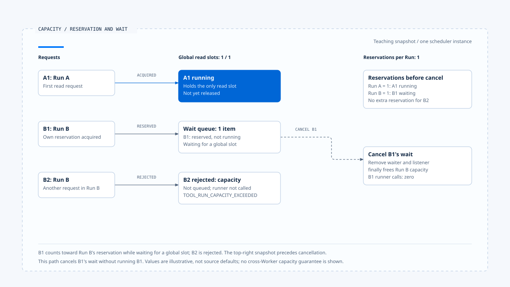

# Backpressure and capacity

[English](./04-backpressure-and-capacity.md) | [繁體中文](./04-backpressure-and-capacity-zh-TW.md)

> In the following content:
> CCB is short for [claude-code-best](https://github.com/claude-code-best/claude-code).
> Chat Gun refers to [chat-gun](https://github.com/HsienW/chat-gun).

[Back to guide](./README-zh-TW.md) · Previous: [Tool dispatch and concurrency](./03-tool-dispatch-and-concurrency.md) · Next: [Tool results and error feedback](./05-tool-results-and-error-feedback.md)

> Only a few tools can run concurrently, yet memory keeps growing. Queued requests, completed results, and progress accumulate while a slow consumer has not finished earlier data. Limiting execution count handles only one point in this data flow.

**Capacity control needs to define its unit, acquisition point, behavior at the limit, and release conditions.** Propagating backpressure upstream also requires finding how downstream speed affects production of new work. A queue or async generator alone is insufficient evidence.

## Which quantities need separate accounting?

Model and tool round trips consume several finite resources: execution slots, queued items, result size, output rate, and cost. Their limits usually belong to different consumers.

| Quantity or allowance | What it counts | Possible handling at the limit |
|---|---|---|
| Active concurrency | Operations within the designated execution scope. | Wait for a slot or reject. |
| Queue length | Work items not yet started. | Limit admission, expire, or cancel. |
| Per-Run reservation | Eligibility already reserved by one Run. | Reject new requests from that Run. |
| Buffered output | Results or bytes not yet consumed. | Stop pulling, truncate, persist to disk, or abort. |
| Rate limit | Usage within a specified time window. | Delay or reject. |
| Cost/Token budget | Cost or usage accounted for, consumed, or reserved. | Prevent subsequent model or tool attempts. |

The handling options are design choices whose implementation needs source verification. Naming the unit as bytes, tool count, or cost makes clear what the remaining allowance actually constrains.

## Chat Gun's two levels of read capacity

`BoundedToolDispatchScheduler` uses `maxConcurrentReads` to limit global read slots within this instance and `maxConcurrentReadsPerRun` to limit reservations for each Run. Only safely classified work with a runId enters this path.

`runBoundedRead()` reserves per-Run capacity first, waits for a global slot, and executes the operation after acquisition. Finally releases an acquired read slot and the Run reservation.

### Per-Run counts include reservations waiting for a slot

The per-Run `active` count increases before global slot acquisition. It therefore includes work waiting for global capacity and cannot directly mean tools currently executing.

Suppose an illustrative configuration allows one global read slot and one reservation per Run:

~~~text
A1 取得全域槽位並執行
B1 取得 Run B 保留，等待全域槽位
B2 再要求 Run B 保留 → 超額拒絕
A1 結束 → B1 可取得槽位
~~~

The numbers explain code order; they are neither source defaults nor measured capacity. If B1 is cancelled, its waiter and Run reservation must both be checked for release.

### Waiting and rejection are separate exits

A read can enter readWaiters when global slots are unavailable. When per-Run reservations are exhausted, `reserveRunCapacity()` throws `TOOL_RUN_CAPACITY_EXCEEDED` directly, without first queueing that work item.

One scheduler test uses defers in its name, but its assertions reject the second operation from the same Run while allowing another Run to execute. The discussion follows code and assertions; the name does not establish delayed retry.

B1 holds a per-Run reservation while waiting for a global slot. Cancelling its wait releases that reservation without calling its runner.

[Open the editable HTML diagram](../../assets/agent-runtime/model-and-tool-execution/04-backpressure-and-capacity/04-reservation-capacity-and-cancellation-en.html).

## Cancellation while waiting and cleanup

A read waiter listens to the signal. Cancellation removes it from the array, cleans up the listener, and rejects the wait. The code checks the signal again after slot acquisition. These checks allow cancellation to take effect before runner startup.

The serial path separately uses `waitForTurn()` to await the preceding Promise, then releases its own slot in finally. The paths have different cleanup conditions and need separate tests for cancellation while queued and exceptions from the operation.

> Finally here explains release of local scheduling resources. After tools send work externally, cancellation, effect reconciliation, and result contracts still need to establish subsequent state.

If the Pipeline acquires a Step lease before scheduling, queue waiting may also require lease maintenance. Queue delay, lock occupancy, and actual execution time need separate observation. A fast tool body can otherwise conceal a reservation held for a long time.

## What bounded execution does not yet cover

The scheduler's fields and arrays belong to one instance. A cap on global activeReads does not establish a shared cap on total waiters, Run count, or product memory.

- Multiple scheduler instances may each accept work; deployment totals need separate accounting.
- Multiple Runs may each reserve capacity; total queued work needs its own admission or queue contract.
- FIFO waiter removal describes this array's order without establishing a fairness target across all Runs.
- Quotas across Workers need shared consumers, atomic updates, or other coordination.

These are design and verification requirements. This article did not establish capacity control across processes in the source.

## Rate limits and circuit breakers act at different points

Chat Gun's Pipeline checks the rate limiter first. Deny rejects the request. Defer waits for the designated delay with a signal, then continues. Wait failure and cancellation have their own outcomes.

The circuit breaker separately evaluates whether it is open or a new attempt is allowed before execution. It handles recent failures and attempt eligibility without replacing scheduler slots. Per-Run capacity rejection also should not count as the same health signal as a Provider or tool business failure.

Tool scheduling, rate limits, circuit breakers, and cost budgets can coexist. Each wait and accounting point needs to be stated. A metric name such as `queue_wait` cannot be assumed to measure only time in the scheduler array.

## CCB's batch capacity and result pulling

CCB's `runToolsConcurrently()` passes the configured concurrency cap to `all()`. That helper starts a batch from waiting generators and uses `Promise.race()` to deliver the next arriving update. It adds the next generator only when one completes.

This limits generators advanced concurrently by that helper. It does not turn all upstream input into a queue with a fixed byte capacity or define each tool result's size. It cannot establish the memory bound of the entire model/tool round trip.

### Separate accumulation in StreamingToolExecutor

StreamingToolExecutor's tool records retain results and pending progress. `getCompletedResults()` drains progress, delivers completed results, and preserves delivery order while certain unsafe tools are still executing.

These are accumulation points affected by consumer speed. When query pulls, how large one result can be, and whether a slow UI propagates pressure still need inspection through actual consumers. The batch helper's concurrency cap cannot be applied directly to this path.

## How far to trace backpressure

A product claiming bounded result buffering needs to state at least which producer stops at the limit, whether progress may be dropped, how complete results are saved, and who cancels work when the consumer disappears.

Truncation also needs to preserve meaning. Delivering only a reference because a successful tool result is too large differs from tool execution failure. Context compression must retain Tool Call pairing, required constraints, and error classification.

The inspected scope does not cover buffering across the entire Provider → Runtime → BFF → UI path. This article therefore lists backpressure bounded across that whole path as unverified.

## How to verify capacity and backpressure

### Slots, reservations, and cancellation

- Fix the global slot count, let different Runs compete, and record reserved, waiting, and executing separately.
- Cancel during global-slot and serial waits, confirming that the operation is not called and reservations do not remain.
- Make the operation throw, submit another item, and check that capacity recovers.

### Buffers and deployment

- Use a slow consumer with many progress updates, recording item counts, bytes, and producer starts at each layer.
- Start multiple scheduler instances concurrently and identify the actual scope of the claimed cap.
- After truncation or reference delivery, check that the next turn can still distinguish success, failure, and unresolved effects.

These are verification plans. Slow-consumer, memory-load, and multi-Worker load tests were not executed for this section.

## Engineering judgment

I would represent reserved, waiting, executing, and buffered output as separate quantities, then locate where each increases and is released. This reveals where rejection occurs and whether pressure simply moves to another container.

Bounded backpressure needs a propagation path that can be verified. Local slot control is useful, but an overall guarantee still requires observing producers, consumers, buffers, and deployment instances together.

## Implementation references and scope

- [Chat Gun scheduler][g-scheduler], [scheduler test arrangements][g-tests], and [Pipeline][g-pipeline].
- CCB `src/utils/generators.ts`, `src/services/tools/toolOrchestration.ts`, and `src/services/tools/StreamingToolExecutor.ts`.
- See [sources and verification status](./README-zh-TW.md#來源與查證狀態) for fixed sources and fingerprints. The numeric example is conceptual and does not represent accepted measured capacity.

## Further reading

- [Tool results and error feedback](./05-tool-results-and-error-feedback.md)
- [Agent Runtime design principles](../foundations/05-runtime-design-principles.md)

[g-scheduler]: https://github.com/HsienW/chat-gun/blob/f83a38fd67a021904e597c60543708ee0c206076/backend/src/runtime/tool-dispatch/scheduler.ts
[g-tests]: https://github.com/HsienW/chat-gun/blob/f83a38fd67a021904e597c60543708ee0c206076/backend/src/runtime/tool-dispatch/scheduler.test.ts
[g-pipeline]: https://github.com/HsienW/chat-gun/blob/f83a38fd67a021904e597c60543708ee0c206076/backend/src/runtime/tool-dispatch/pipeline.ts
