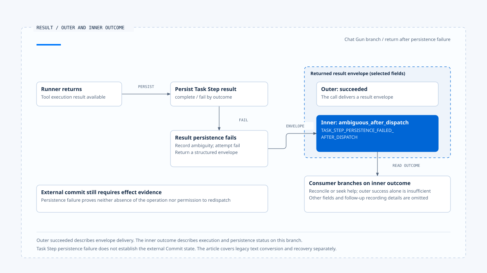

# 工具结果与错误回灌

[English](./05-tool-results-and-error-feedback.md) | [繁體中文](./05-tool-results-and-error-feedback-zh-TW.md) | [简体中文](./05-tool-results-and-error-feedback-zh-CN.md)

> 以下内容所提到的
> CCB 为 [claude-code-best](https://github.com/claude-code-best/claude-code) 的简称。
> Chat Gun 为 [chat-gun](https://github.com/HsienW/chat-gun)。

[回到导览](./README-zh-CN.md) · 前一篇：[背压与容量控制](./04-backpressure-and-capacity-zh-CN.md) · 下一篇：[一次模型与工具的往返](./06-case-model-tool-roundtrip-zh-CN.md)

> 外部工具已返回，Task Step 的结果保存却失败。Pipeline 把效果不明的 envelope 成功交给上层，上层只读外面的 `succeeded`，便向模型说操作完成。模型接着提出另一个写入，原本需要回查的状态就被一句成功消息盖过。

**结果回灌需要保留 Tool Call 关联与内层 outcome。** 消息送达、类型封装成功、工具返回及外部效果成立，各有自己的证据，consumer 需要知道自己读到哪一层。

## 工具结果要回到哪个提案

多个工具可能乱序完成；同名工具也可能在一轮出现多次。回灌应依指定 Tool Call ID 配对，再关联到原 Assistant Message、Run 与 Step，不能只按照名称或抵达次序排列。

| 数据 | 回答的问题 | 缺少时的风险 |
|---|---|---|
| Tool Call ID | 哪一份提案取得这个结果？ | 同名工具或乱序结果错配。 |
| Run／Step／Message | 属于哪次执行与模型响应？ | 旧结果接到新尝试。 |
| Outcome | 执行成功、拒绝、失败或仍不明？ | 错误字符串抹平处理差异。 |
| Result／Evidence reference | 完整内容或查证位置在哪里？ | 截断后无法查回外部结果。 |
| 后续责任 | 可以续行、等待或需要回查？ | 模型自行重做未知操作。 |

这份表格是设计责任，不要求每个来源使用同名字段。协议层有一对 tool use／result，仍需检查业务效果能否沿关联查回。

## CCB 的协议错误反馈

本区 `runToolUse()` 先在可见工具集合解析名称，另有旧工具别名的兼容处理。找不到工具时，会产生带有原 `tool_use_id`、`is_error: true` 的 tool result，并关联来源 Assistant Message。

输入 Schema、工具验证及 permission 的其他分支也有各自错误结果。它们使模型能知道先前提案未正常完成，同时保留协议需要的配对。

### 错误可见与可重试

模型收到输入验证错误后，可能提出修正参数的新调用。新提案仍需经过工具解析、授权及限制，不能因为它是错误后的修正就省略检查。

`is_error` 也没有单独描述外部 Commit。工具在送出 I/O 后才抛错时，该工具的结果契约与恢复路径还需要保留 operation evidence；一般协议错误标记无法代替这项责任。

## Chat Gun 的 structured envelope

`createStructuredToolResultEnvelope()` 解析 Execution Context，要求 canonical Tool Call ID，保存 request、thread、Run、Tool Call 与可选 Step 关联。工具信息包含名称、版本、risk tier 及只读属性，结果则放在 outcome。

Envelope 也可以带 execution profile evidence 与 termination cause，建立后再做 Schema 验证。这让 consumer 能以字段解读，不必从显示文字猜测状态。

### 外层与内层的成功

Pipeline 在 runner 返回后建立 envelope，并依内层 outcome 更新 Task Step。若相应保存失败，会改建一份 `ambiguous_after_dispatch` envelope，尝试补记与记录 outcome，再把它放在外层成功结果中返回。

类型关系可用概念片段表示：

~~~ts
{
  type: "succeeded",
  result: {
    outcome: {
      type: "ambiguous_after_dispatch",
      errorCode: "TASK_STEP_PERSISTENCE_FAILED_AFTER_DISPATCH"
    }
  }
}
~~~

这段省略其他 envelope 字段，只说明内外层关系。外层成功表示这条调用返回了结果封装；内层指出派送后的状态需要进一步查明。不能由外层值向用户宣告工具或业务成功。

- 图中选取派送后保存失败分支，外层成功描述封装交付；外部是否提交仍需效果证据，不由保存失败直接判定。
- [开启结果封套与内外层 outcome 说明](../../assets/agent-runtime/model-and-tool-execution/05-tool-results-and-error-feedback/05-outer-success-and-inner-outcome-en.html)。

## Legacy adapter 保留哪些信息

工具输出也需要契约检查。Chat Gun pipeline 把 descriptor 的 output Schema 验证交给 runner；验证结果如何映射到 outcome，要沿 runner 与结果映射查证。若外部操作已发生，不能只因返回数据不符 Schema 就推论尚未提交。

Chat Gun `toLegacyToolResult()` 对成功 outcome 取出 result，字符串直接返回、其他内容转成 JSON。对非成功 outcome，则依错误 code 组成文字；取消与需确认也有各自转换方式。

这是兼容表示，未携带整份 envelope 的所有结构。使用它的 consumer 若只保存文字，稍后便无法从同一字段取得完整 correlation、安全 evidence 与 typed outcome。

| 表示 | 适合负责的事 | 仍需另存或核对 |
|---|---|---|
| Typed outcome | 程序判断结果及分流。 | 外部提交与必要持久化证据。 |
| Structured envelope | 保存关联、工具信息与结果分类。 | 正式 consumer 是否真的保留。 |
| Legacy text | 兼容既有显示或工具消息。 | 不能从文字反建完整原始结构。 |
| 模型可见结果 | 支持下一轮理解与提案。 | 不得取得状态权威或直接授权重试。 |

从 helper 可以确认转换规则，实际哪个 Graph、adapter 或 UI 使用何种表示，仍要沿正式入口逐一查读。

## 拒绝与效果不明的后续不同

未注册工具、输入不符或派送前取消，可以留下对应的未执行证据。工具已开始之后的 timeout、租约失败或结果保存失败，则需要保留更精确的 dispatch 与 effect 状态。

- 输入可以修正时，模型可以提出新提案，仍走新的验证。
- Permission 拒绝或等待确认时，由政策及等待 consumer 决定后续。
- 已证明未提交的失败，是否重试由既定 retry 契约处理。
- 外部效果不明时，先交付回查或人工处理，不由模型文字自行宣告未执行。

最后两项的 Ledger、Operation key、reconciliation 与 compensation 详细演算法留给 Effects and Recovery。本篇只确保回灌时没有遗失这些分流依据。

## 进度、结果与大小限制

CCB StreamingToolExecutor 把 pending progress 与完整 results 分开保存，consumer 可以先取进度，再取完成结果。画面显示有活动，并不代表该 Tool Call 已有可供下一轮使用的最终 outcome。

工具输出过大时，可以设计保留完整 evidence、另给模型摘要或 reference。这是结果交付策略，需由实际工具与 Context consumer 支持，本文未宣称两个来源都具备同一套外部结果存放机制。

截断时至少保留配对 ID、必要结果分类与取回位置。错误消息若只剩前几个字，可能失去提交状态；结果若包含外部内容，也仍受 Harness 的信任与 Context 政策约束。

## 下一轮模型调用前

Runtime 要确认下一轮所需的工具结果已回到正确提案，并处理 pending work、取消、限制及等待。模型文字可以说明结果，但不负责修改权威 outcome。

CCB query 会收集、规范化工具消息，再沿后续循环处理。Chat Gun MCP Graph 在模型、authorization gate、confirmation 与 physical dispatch 之间有自己的 edge，不能把两者都改写成同一个固定步骤数。

若只完成部分工具，能否继续推理取决於该 orchestration。不能从单一工具先返回，推论整批前置条件都已成立。

## 如何验证结果回灌

### 配对与表示

- 让同名工具以不同 ID 乱序完成，核对下一轮消息仍各自配对。
- 注入未知工具、错误 Schema 与 permission 拒绝，确认保留原 tool-use 关联。
- 对同一 envelope 分别读取 typed outcome 与 legacy text，检查保存端没有依文字误判。

### 保存与恢复责任

- Runner 返回后让 Task Step 保存失败，确认 consumer 读取内层 ambiguous outcome。
- 让外部操作已提交但回应遗失，核对后续停在回查而非模型重做。
- 截断大型结果并交付 reference，确认分类、关联与取回位置仍可查。

Chat Gun pipeline 测试已有 Task Step 保存失败仍回传 ambiguous envelope 的案例。仅读取 assertion，没有执行真实 Store 或外部交易故障测试。

## 本篇的工程判断

我会从最外层返回值一路读到内层 outcome，再追到下一轮模型真正看到的消息。这条路径能找出兼容转换在哪里削掉信息，以及哪个 consumer 必须保留完整结果。

错误反馈让模型有机会修正提案，效果证据则让系统知道什么不能重做。两份责任需要共同存在，才能让下一轮推理有足够数据又不取代执行权威。

## 实现参照与适用范围

- [Chat Gun structured result][g-result]、[pipeline][g-pipeline] 与 [保存失败测试安排][g-tests]。
- CCB `src/services/tools/toolExecution.ts`、`src/services/tools/StreamingToolExecutor.ts`、`src/query.ts`。
- 固定版本、来源副本与验证范围见[本区导览](./README-zh-CN.md#来源与查证状态)。本文的截断与 reference 要求是设计检查，未视为共同部署能力。

## 接续阅读

- [一次模型与工具的往返](./06-case-model-tool-roundtrip-zh-CN.md)
- [持久化、Interrupt 与 Resume](../foundations/04-persistence-interrupt-and-resume-zh-CN.md)

[g-result]: https://github.com/HsienW/chat-gun/blob/f83a38fd67a021904e597c60543708ee0c206076/backend/src/runtime/tool-dispatch/structured-tool-result.ts
[g-pipeline]: https://github.com/HsienW/chat-gun/blob/f83a38fd67a021904e597c60543708ee0c206076/backend/src/runtime/tool-dispatch/pipeline.ts
[g-tests]: https://github.com/HsienW/chat-gun/blob/f83a38fd67a021904e597c60543708ee0c206076/backend/src/runtime/tool-dispatch/pipeline.test.ts
