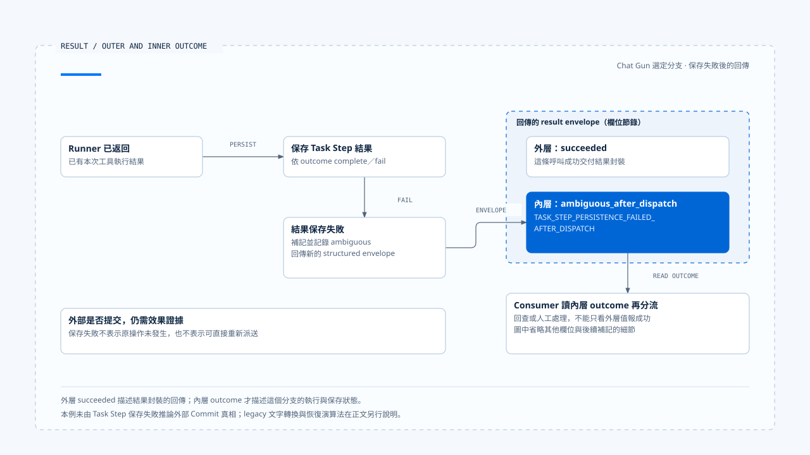

# 工具結果與錯誤回灌

[English](./05-tool-results-and-error-feedback.md) | [繁體中文](./05-tool-results-and-error-feedback-zh-TW.md)

> 以下內容所提到的
> CCB 為 [claude-code-best](https://github.com/claude-code-best/claude-code) 的簡稱。
> Chat Gun 為 [chat-gun](https://github.com/HsienW/chat-gun)。

[回到導覽](./README-zh-TW.md) · 前一篇：[背壓與容量控制](./04-backpressure-and-capacity-zh-TW.md) · 下一篇：[一次模型與工具的往返](./06-case-model-tool-roundtrip-zh-TW.md)

> 外部工具已返回，Task Step 的結果保存卻失敗。Pipeline 把效果不明的 envelope 成功交給上層，上層只讀外面的 `succeeded`，便向模型說操作完成。模型接著提出另一個寫入，原本需要回查的狀態就被一句成功訊息蓋過。

**結果回灌需要保留 Tool Call 關聯與內層 outcome。** 訊息送達、型別封裝成功、工具返回及外部效果成立，各有自己的證據，consumer 需要知道自己讀到哪一層。

## 工具結果要回到哪個提案

多個工具可能亂序完成；同名工具也可能在一輪出現多次。回灌應依指定 Tool Call ID 配對，再關聯到原 Assistant Message、Run 與 Step，不能只按照名稱或抵達次序排列。

| 資料 | 回答的問題 | 缺少時的風險 |
|---|---|---|
| Tool Call ID | 哪一份提案取得這個結果？ | 同名工具或亂序結果錯配。 |
| Run／Step／Message | 屬於哪次執行與模型回應？ | 舊結果接到新嘗試。 |
| Outcome | 執行成功、拒絕、失敗或仍不明？ | 錯誤字串抹平處理差異。 |
| Result／Evidence reference | 完整內容或查證位置在哪裡？ | 截斷後無法查回外部結果。 |
| 後續責任 | 可以續行、等待或需要回查？ | 模型自行重做未知操作。 |

這份表格是設計責任，不要求每個來源使用同名欄位。協定層有一對 tool use／result，仍需檢查業務效果能否沿關聯查回。

## CCB 的協定錯誤回饋

本區 `runToolUse()` 先在可見工具集合解析名稱，另有舊工具別名的相容處理。找不到工具時，會產生帶有原 `tool_use_id`、`is_error: true` 的 tool result，並關聯來源 Assistant Message。

輸入 Schema、工具驗證及 permission 的其他分支也有各自錯誤結果。它們使模型能知道先前提案未正常完成，同時保留協定需要的配對。

### 錯誤可見與可重試

模型收到輸入驗證錯誤後，可能提出修正參數的新呼叫。新提案仍需經過工具解析、授權及限制，不能因為它是錯誤後的修正就省略檢查。

`is_error` 也沒有單獨描述外部 Commit。工具在送出 I/O 後才拋錯時，該工具的結果契約與恢復路徑還需要保留 operation evidence；一般協定錯誤標記無法代替這項責任。

## Chat Gun 的 structured envelope

`createStructuredToolResultEnvelope()` 解析 Execution Context，要求 canonical Tool Call ID，保存 request、thread、Run、Tool Call 與可選 Step 關聯。工具資訊包含名稱、版本、risk tier 及唯讀屬性，結果則放在 outcome。

Envelope 也可以帶 execution profile evidence 與 termination cause，建立後再做 Schema 驗證。這讓 consumer 能以欄位解讀，不必從顯示文字猜測狀態。

### 外層與內層的成功

Pipeline 在 runner 返回後建立 envelope，並依內層 outcome 更新 Task Step。若相應保存失敗，會改建一份 `ambiguous_after_dispatch` envelope，嘗試補記與記錄 outcome，再把它放在外層成功結果中回傳。

型別關係可用概念片段表示：

~~~ts
{
  type: "succeeded",
  result: {
    outcome: {
      type: "ambiguous_after_dispatch",
      errorCode: "TASK_STEP_PERSISTENCE_FAILED_AFTER_DISPATCH"
    }
  }
}
~~~

這段省略其他 envelope 欄位，只說明內外層關係。外層成功表示這條呼叫返回了結果封裝；內層指出派送後的狀態需要進一步查明。不能由外層值向使用者宣告工具或業務成功。

- 圖中選取派送後保存失敗分支，外層成功描述封裝交付；外部是否提交仍需效果證據，不由保存失敗直接判定。
- [開啟結果封套與內外層 outcome 說明](../../assets/agent-runtime/model-and-tool-execution/05-tool-results-and-error-feedback/05-outer-success-and-inner-outcome.html)。

## Legacy adapter 保留哪些資訊

工具輸出也需要契約檢查。Chat Gun pipeline 把 descriptor 的 output Schema 驗證交給 runner；驗證結果如何映射到 outcome，要沿 runner 與結果映射查證。若外部操作已發生，不能只因回傳資料不符 Schema 就推論尚未提交。

Chat Gun `toLegacyToolResult()` 對成功 outcome 取出 result，字串直接返回、其他內容轉成 JSON。對非成功 outcome，則依錯誤 code 組成文字；取消與需確認也有各自轉換方式。

這是相容表示，未攜帶整份 envelope 的所有結構。使用它的 consumer 若只保存文字，稍後便無法從同一欄位取得完整 correlation、安全 evidence 與 typed outcome。

| 表示 | 適合負責的事 | 仍需另存或核對 |
|---|---|---|
| Typed outcome | 程式判斷結果及分流。 | 外部提交與必要持久化證據。 |
| Structured envelope | 保存關聯、工具資訊與結果分類。 | 正式 consumer 是否真的保留。 |
| Legacy text | 相容既有顯示或工具訊息。 | 不能從文字反建完整原始結構。 |
| 模型可見結果 | 支援下一輪理解與提案。 | 不得取得狀態權威或直接授權重試。 |

從 helper 可以確認轉換規則，實際哪個 Graph、adapter 或 UI 使用何種表示，仍要沿正式入口逐一查讀。

## 拒絕與效果不明的後續不同

未註冊工具、輸入不符或派送前取消，可以留下對應的未執行證據。工具已開始之後的 timeout、租約失敗或結果保存失敗，則需要保留更精確的 dispatch 與 effect 狀態。

- 輸入可以修正時，模型可以提出新提案，仍走新的驗證。
- Permission 拒絕或等待確認時，由政策及等待 consumer 決定後續。
- 已證明未提交的失敗，是否重試由既定 retry 契約處理。
- 外部效果不明時，先交付回查或人工處理，不由模型文字自行宣告未執行。

最後兩項的 Ledger、Operation key、reconciliation 與 compensation 詳細演算法留給 Effects and Recovery。本篇只確保回灌時沒有遺失這些分流依據。

## 進度、結果與大小限制

CCB StreamingToolExecutor 把 pending progress 與完整 results 分開保存，consumer 可以先取進度，再取完成結果。畫面顯示有活動，並不代表該 Tool Call 已有可供下一輪使用的最終 outcome。

工具輸出過大時，可以設計保留完整 evidence、另給模型摘要或 reference。這是結果交付策略，需由實際工具與 Context consumer 支持，本文未宣稱兩個來源都具備同一套外部結果存放機制。

截斷時至少保留配對 ID、必要結果分類與取回位置。錯誤訊息若只剩前幾個字，可能失去提交狀態；結果若包含外部內容，也仍受 Harness 的信任與 Context 政策約束。

## 下一輪模型呼叫前

Runtime 要確認下一輪所需的工具結果已回到正確提案，並處理 pending work、取消、限制及等待。模型文字可以說明結果，但不負責修改權威 outcome。

CCB query 會收集、正規化工具訊息，再沿後續循環處理。Chat Gun MCP Graph 在模型、authorization gate、confirmation 與 physical dispatch 之間有自己的 edge，不能把兩者都改寫成同一個固定步驟數。

若只完成部分工具，能否繼續推理取決於該 orchestration。本文不從單一工具先返回，推論整批前置條件都已成立。

## 如何驗證結果回灌

### 配對與表示

- 讓同名工具以不同 ID 亂序完成，核對下一輪訊息仍各自配對。
- 注入未知工具、錯誤 Schema 與 permission 拒絕，確認保留原 tool-use 關聯。
- 對同一 envelope 分別讀取 typed outcome 與 legacy text，檢查保存端沒有依文字誤判。

### 保存與恢復責任

- Runner 返回後讓 Task Step 保存失敗，確認 consumer 讀取內層 ambiguous outcome。
- 讓外部操作已提交但回應遺失，核對後續停在回查而非模型重做。
- 截斷大型結果並交付 reference，確認分類、關聯與取回位置仍可查。

Chat Gun pipeline 測試已有 Task Step 保存失敗仍回傳 ambiguous envelope 的案例。本輪只讀取 assertion，沒有執行真實 Store 或外部交易故障測試。

## 本篇的工程判斷

我會從最外層回傳值一路讀到內層 outcome，再追到下一輪模型真正看到的訊息。這條路徑能找出相容轉換在哪裡削掉資訊，以及哪個 consumer 必須保留完整結果。

錯誤回饋讓模型有機會修正提案，效果證據則讓系統知道什麼不能重做。兩份責任需要共同存在，才能讓下一輪推理有足夠資料又不取代執行權威。

## 實作參照與適用範圍

- [Chat Gun structured result][g-result]、[pipeline][g-pipeline] 與 [保存失敗測試安排][g-tests]。
- CCB `src/services/tools/toolExecution.ts`、`src/services/tools/StreamingToolExecutor.ts`、`src/query.ts`。
- 固定版本、來源副本與驗證範圍見[本區導覽](./README-zh-TW.md#來源與查證狀態)。本文的截斷與 reference 要求是設計檢查，未視為共同部署能力。

## 接續閱讀

- [一次模型與工具的往返](./06-case-model-tool-roundtrip-zh-TW.md)
- [持久化、Interrupt 與 Resume](../foundations/04-persistence-interrupt-and-resume-zh-TW.md)

[g-result]: https://github.com/HsienW/chat-gun/blob/f83a38fd67a021904e597c60543708ee0c206076/backend/src/runtime/tool-dispatch/structured-tool-result.ts
[g-pipeline]: https://github.com/HsienW/chat-gun/blob/f83a38fd67a021904e597c60543708ee0c206076/backend/src/runtime/tool-dispatch/pipeline.ts
[g-tests]: https://github.com/HsienW/chat-gun/blob/f83a38fd67a021904e597c60543708ee0c206076/backend/src/runtime/tool-dispatch/pipeline.test.ts
