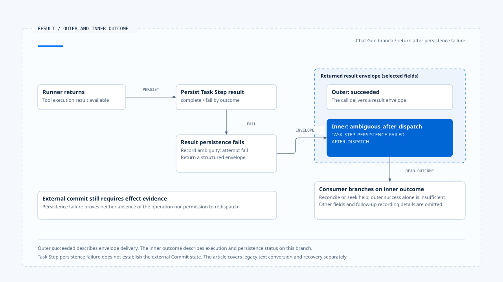

# Tool results and error feedback

[English](./05-tool-results-and-error-feedback.md) | [繁體中文](./05-tool-results-and-error-feedback-zh-TW.md)

> In the following content:
> CCB is short for [claude-code-best](https://github.com/claude-code-best/claude-code).
> Chat Gun refers to [chat-gun](https://github.com/HsienW/chat-gun).

[Back to guide](./README-zh-TW.md) · Previous: [Backpressure and capacity](./04-backpressure-and-capacity.md) · Next: [A model and tool round trip](./06-case-model-tool-roundtrip.md)

> An external tool returns, but saving the Task Step result fails. The Pipeline successfully delivers an envelope with an unresolved effect to the upper layer. That layer reads only the outer `succeeded` and tells the model the operation completed. The model proposes another write, and a success message conceals state that needed reconciliation.

**Result feedback needs to preserve Tool Call correlation and the inner outcome.** Message delivery, successful typed packaging, tool return, and established external effects each have their own evidence. Consumers need to know which layer they are reading.

## Which proposal should receive the tool result?

Tools may complete out of order, and the same tool name may appear several times in one turn. Feedback should pair results by the specified Tool Call ID, then correlate them with the original Assistant Message, Run, and Step. Name or arrival order alone is insufficient.

| Data | Question it answers | Risk when missing |
|---|---|---|
| Tool Call ID | Which proposal receives this result? | Mispaired same-name tools or results arriving out of order. |
| Run/Step/Message | Which execution and model response does it belong to? | Old results attached to a new attempt. |
| Outcome | Did execution succeed, reject, fail, or remain unresolved? | Error strings erase handling distinctions. |
| Result/Evidence reference | Where is the full content or verification data? | External results cannot be retrieved after truncation. |
| Follow-up responsibility | May execution continue, wait, or require reconciliation? | The model repeats an operation with unknown effects. |

The table describes design responsibilities without requiring identical fields in every source. A tool use/result pair at the protocol layer still requires checking whether business effects can be retrieved through its correlation.

## CCB's protocol error feedback

The examined `runToolUse()` first resolves names in the visible tool set and has compatibility handling for old tool aliases. If no tool is found, it creates a tool result with the original `tool_use_id` and `is_error: true`, correlated with the source Assistant Message.

Input Schema, tool validation, and permission branches have their own error results. These let the model recognize that the earlier proposal did not complete normally while preserving protocol pairing.

### Error visibility and retry eligibility

After receiving an input-validation error, the model may propose a new call with corrected arguments. The new proposal still needs tool resolution, authorization, and limits. Being a correction after an error does not exempt it from checks.

`is_error` also does not describe external Commit on its own. If a tool throws after sending I/O, its result contract and recovery path still need operation evidence. A general protocol error flag cannot replace that responsibility.

## Chat Gun's structured envelope

`createStructuredToolResultEnvelope()` parses Execution Context, requires a canonical Tool Call ID, and saves request, thread, Run, Tool Call, and optional Step correlations. Tool information includes name, version, risk tier, and read-only status; the result resides in outcome.

The envelope may also carry execution profile evidence and termination cause, and undergoes Schema validation after creation. Consumers can interpret fields directly instead of inferring state from display text.

### Outer and inner success

After the runner returns, the Pipeline creates an envelope and updates the Task Step according to the inner outcome. If the corresponding persistence fails, it creates an `ambiguous_after_dispatch` envelope, attempts supplementary persistence and outcome recording, and returns the envelope inside an outer success result.

A conceptual fragment shows the type relationship:

~~~ts
{
  type: "succeeded",
  result: {
    outcome: {
      type: "ambiguous_after_dispatch",
      errorCode: "TASK_STEP_PERSISTENCE_FAILED_AFTER_DISPATCH"
    }
  }
}
~~~

This omits other envelope fields to show the relationship between layers. Outer success means the call returned a result package. The inner layer says state after dispatch needs investigation. The outer value cannot justify reporting tool or business success to the user.

Successful envelope delivery can carry ambiguous_after_dispatch. Inspect the inner outcome and effect evidence before reporting success or considering redispatch.

[Open the editable HTML diagram](../../assets/agent-runtime/model-and-tool-execution/05-tool-results-and-error-feedback/05-outer-success-and-inner-outcome-en.html).

## What the legacy adapter retains

Tool output also needs contract checks. Chat Gun's Pipeline delegates validation against the descriptor's output Schema to the runner. How validation maps to an outcome requires tracing the runner and result mapping. If an external operation occurred, invalid returned data alone does not establish that nothing committed.

Chat Gun's `toLegacyToolResult()` extracts result from a successful outcome, returning strings directly and converting other content to JSON. For other outcomes, it constructs text from an error code. Cancellation and confirmation-required outcomes have their own conversions.

This is a compatibility representation without the envelope's full structure. If a consumer saves only that text, the same field cannot later supply complete correlation, security evidence, and typed outcome.

| Representation | Appropriate responsibility | What still needs separate retention or verification |
|---|---|---|
| Typed outcome | Programmatic result evaluation and branching. | External commit and required persistence evidence. |
| Structured envelope | Retain correlation, tool information, and outcome classification. | Whether the production consumer actually preserves it. |
| Legacy text | Compatibility with existing display or tool messages. | The full original structure cannot be reconstructed from text. |
| Model-visible result | Support the next turn's interpretation and proposals. | It must not gain state authority or directly authorize retries. |

The helper establishes conversion rules. Which Graph, adapter, or UI actually uses each representation still needs inspection through production entry points.

## Rejection and unresolved effects require different follow-up

An unregistered tool, invalid input, or cancellation before dispatch can leave corresponding evidence of non-execution. A timeout, lease failure, or result-persistence failure after a tool starts needs more precise dispatch and effect state.

- When input can be corrected, the model may propose again, subject to fresh validation.
- For permission rejection or pending confirmation, policy and waiting consumers determine continuation.
- Retry of a failure proven uncommitted follows the configured retry contract.
- An unresolved external effect goes to reconciliation or manual handling before model text can declare non-execution.

Ledger, Operation keys, reconciliation, and compensation algorithms for the final two cases belong to Effects and Recovery. This article preserves the information needed to distinguish them during feedback.

## Progress, results, and size limits

CCB StreamingToolExecutor stores pending progress separately from complete results. Consumers can obtain progress first and completed results later. Activity displayed on screen does not establish a final outcome for that Tool Call that the next model turn can use.

For oversized tool output, a design can retain full evidence while giving the model a summary or reference. This delivery policy requires support from actual tools and Context consumers. This article does not claim that both sources share an external result-storage mechanism.

Truncation should preserve at least the pairing ID, required result classification, and retrieval location. Keeping only the first few words of an error may lose commit state. External content in a result also remains subject to Harness trust and Context policies.

## Before the next model call

The Runtime needs to confirm that required tool results match the correct proposals and handle pending work, cancellation, limits, and waiting. Model text may explain results, but does not modify authoritative outcomes.

CCB query collects and normalizes tool messages before continuing its loop. Chat Gun's MCP Graph has its own edges among the model, authorization gate, confirmation, and physical dispatch. The two cannot both be rewritten into one fixed step count.

Whether reasoning can continue after only some tools complete depends on the orchestration. One tool returning first does not establish that all batch prerequisites hold.

## How to verify result feedback

### Pairing and representation

- Complete same-name tools with different IDs out of order, and check that the next turn still pairs them correctly.
- Inject an unknown tool, invalid Schema, and permission rejection, confirming retention of the original tool-use correlation.
- Read typed outcome and legacy text from the same envelope separately, checking that persistence consumers do not infer the wrong state from text.

### Persistence and recovery responsibilities

- Fail Task Step persistence after the runner returns, and confirm that the consumer reads the inner ambiguous outcome.
- Commit an external operation but lose its response, checking that continuation enters reconciliation instead of model-driven repetition.
- Truncate a large result and deliver a reference, confirming that classification, correlation, and retrieval location remain queryable.

Chat Gun's Pipeline tests include Task Step persistence failure returning an ambiguous envelope. This section inspected the assertion without running real Store or external transaction failure tests.

## Engineering judgment

I would read from the outermost return value to the inner outcome, then trace the message the next model turn actually sees. This reveals where compatibility conversion removes information and which consumer must retain the complete result.

Error feedback lets the model correct proposals, while effect evidence tells the system what cannot be repeated. Both responsibilities need to coexist so subsequent reasoning has enough information without replacing execution authority.

## Implementation references and scope

- [Chat Gun structured result][g-result], [Pipeline][g-pipeline], and [persistence-failure test arrangements][g-tests].
- CCB `src/services/tools/toolExecution.ts`, `src/services/tools/StreamingToolExecutor.ts`, and `src/query.ts`.
- See the [section guide](./README-zh-TW.md#來源與查證狀態) for fixed versions, source copies, and verification scope. Truncation and reference requirements here are design checks, not jointly deployed capabilities.

## Further reading

- [A model and tool round trip](./06-case-model-tool-roundtrip.md)
- [Persistence, Interrupt, and Resume](../foundations/04-persistence-interrupt-and-resume.md)

[g-result]: https://github.com/HsienW/chat-gun/blob/f83a38fd67a021904e597c60543708ee0c206076/backend/src/runtime/tool-dispatch/structured-tool-result.ts
[g-pipeline]: https://github.com/HsienW/chat-gun/blob/f83a38fd67a021904e597c60543708ee0c206076/backend/src/runtime/tool-dispatch/pipeline.ts
[g-tests]: https://github.com/HsienW/chat-gun/blob/f83a38fd67a021904e597c60543708ee0c206076/backend/src/runtime/tool-dispatch/pipeline.test.ts
