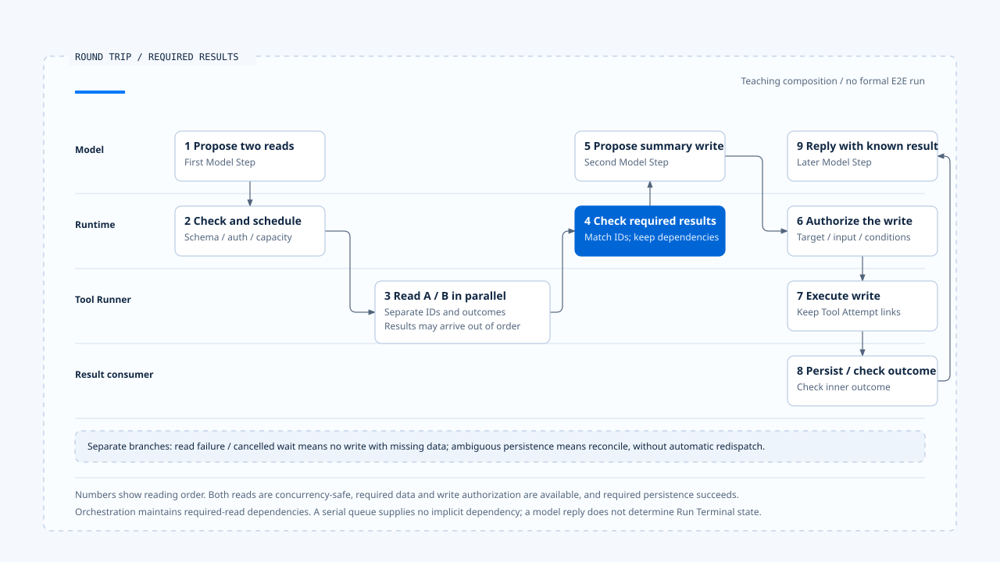

# 一次模型与工具的往返

[English](./06-case-model-tool-roundtrip.md) | [繁體中文](./06-case-model-tool-roundtrip-zh-TW.md) | [简体中文](./06-case-model-tool-roundtrip-zh-CN.md)

> 以下内容所提到的
> CCB 为 [claude-code-best](https://github.com/claude-code-best/claude-code) 的简称。
> Chat Gun 为 [chat-gun](https://github.com/HsienW/chat-gun)。

[回到导览](./README-zh-CN.md) · 前一篇：[工具结果与错误回灌](./05-tool-results-and-error-feedback-zh-CN.md)

> 用户要求读取两份数据，再产出一份摘要文件。两个读取先后返回，模型才提出写入。若第二个读取失败、结果 ID 错配，或写入后保存失败，画面仍可能看起来像一次普通工具往返，后端却需要选择不同的后续路径。

本篇用一段教学时序串起模型调用、提案组装、调度、容量与结果回灌。主线先等待两份必要读取，再向模型取得后续写入提案；Provider 中断、排队取消与效果不明各自放在独立分支。

**这是一份阅读与验证框架。** Chat Gun 与 CCB 的证据分开标示，本轮没有把来源模块串成一条正式 E2E，也没有宣称两个系统都实现了这个摘要工具案例。

## 场景与执行关联

假设 Harness 已提供可信 workspace Scope、允许的数据与工具。两个读取被具体 descriptor 判定为可并行，写入则有独立授权条件。以下识别只是教学值。

| 位置 | 关联 | 用途 |
|---|---|---|
| 整次工作 | `run-summary` | 关联本次 Run。 |
| 第一次推理 | `model-step-1`、`provider-attempt-1` | 取得两个读取提案。 |
| 读取工具 | `call-read-a`、`call-read-b` | 分别关联数据与结果。 |
| 第二次推理 | `model-step-2` | 使用必要读取结果，提出摘要写入。 |
| 写入工具 | `call-write-summary` | 绑定实际路径、内容与授权。 |
| 后续推理 | `model-step-3` | 依已确认的写入结果整理回复。 |

如果某个实现让模型改用其他工具，仍需重新验证提案。本例不以文字任务相似度判定相同 Operation，也不将每次模型取样自动当成可以重试的同一工具调用。

## 1. 第一个 Model Step 发出要求

Runtime 取得 Harness 准备的 Context 与工具集合，记录此次模型、用途、输出契约及 Run 关联。正常主线只有一次可用 Provider 回应；fallback 另外验证。

Chat Gun 可由 MCP Agent 的 `createChatModel().bindTools().invoke()` 查到模型交接。CCB 则沿 `query.ts` 进入 API consumer。这两份观察支持不同的调用形状，不能直接替它们共用同一个流式传输时序。

若产品要求本次 Deadline、Budget 与取消都在模型调用生效，还需找到实际传参与 enforcement。接口可接收 signal，不足以证明每个入口都已传入。

## 2. 两个读取提案形成

CCB 流式传输路径可以分别累积两个工具区块，在各自 `content_block_stop` 规范化。工具名称与 ID 需要对回本次消息，规范化参数仍要接受 Schema 验证。

本例的正常主线假设两份参数都有效。若原始字符串解析失败后转为 `{}`，要改走[第二篇](./02-stream-assembly-and-tool-calls-zh-CN.md) 的验证分支，不直接把它视为读取成功。

一般批次与 StreamingToolExecutor 的开始时点不同。主线只要求每个实际派送都已具备完整可辨认提案及必要检查，不假设所有工具一定等到整个 message 结束才开始。

## 3. 读取取得执行资格

每个工具都需要工具定义、合法输入、可信执行关联与授权结果，再按实际分类调度。读取名称本身不能保证 concurrency safe。

| 接点 | CCB 对照 | Chat Gun 对照 |
|---|---|---|
| 并行分类 | safeParse 后调用 `isConcurrencySafe()`。 | `isReadOnly` 与当次 `isConcurrencySafe()` 都成立。 |
| 调度 | 批次 `runTools()` 或另行启用的 streaming executor。 | 符合条件及有 runId 才走 bounded reads。 |
| 容量 | 批次 helper 的 concurrency cap。 | Per-Run reservation 与全局读取槽位。 |
| 执行资格 | Tool execution 及 permission 路径。 | Pipeline、授权交接与其他已配置检查。 |

表格只比较接点。批次 helper 的数字限制不套到另一个 streaming executor，Chat Gun pipeline 也需先确认对应 source 已启用。

## 4. 结果乱序抵达

假设 `call-read-b` 先返回，`call-read-a` 稍后完成。Runtime 以 ID 保存与组装结果，模型消息不因抵达顺序改成 A 的内容来自 B。

CCB 批次路径另外暂存 Context modifiers，批次完成后按原工具顺序套用。这与工具完成先后及外部读取的 snapshot 一致性是不同问题。

本例需要两份结果才可产出摘要，因此 orchestration 必须明确等到必要结果都可用。若某个工具失败，不能只是保留另一份成功结果便无条件往写入主线走。

## 5. 第二轮提出写入

模型收到配对正确的结果与本次限制，提出摘要文件的写入提案。Harness／治理层依可信目标路径、参数、权限及必要批准处置，Runtime 再依结果继续、拒绝或等待。

此处的依赖来自前一步已完成的 orchestration。Chat Gun serial tail 没有自动等待所有 bounded reads，不能把把写入送进 serial queue 当成这项前置条件的证据。

如果等待人工确认，批准需对回具体 Tool Call，后续恢复另查权威 waiting 与 ownership。这段生命周期不在本篇重新定义。

## 6. 写入返回及必要保存

写入工具返回后，consumer 需要读取 typed outcome 并完成契约要求的保存。正常主线假设结果确定、必要记录成功，才把成功内容交给后续模型整理。

若 Chat Gun pipeline 的 Task Step 保存失败，可能返回外层 `succeeded`、内层 `ambiguous_after_dispatch` 的 envelope。此分支需要先保留状态并交付回查，不能沿正常主线宣告摘要文件一定没有建立或已安全完成。

结果通知遗失与工具执行未成功也要分开。若已有权威成功结果，后续查询或重送通知不应重新执行写入。

## 7. 下一次模型回复

第三个 Model Step 使用已知结果整理用户回复，保留必要取回位置与限制。文字完成后，整个 Run 仍依自己的 Terminal 契约检查 pending work、取消及必要结果。

这里只追到结果回到模型及产品端。Run 的终止写入、owner release 与事件交付有自己的 consumer，不能由模型最后一句话代替。

- 数字表示阅读顺序，主线具有必要数据、授权及保存成功等前提。取消、失败与效果不明另行分流，本图不是已执行的完整 E2E。
- [开启完整往返泳道与故障分支注记](../../assets/agent-runtime/model-and-tool-execution/06-case-model-tool-roundtrip/06-model-tool-roundtrip-swimlane-en.html)。

## 主线的交接表

| 顺序 | 交接 | 应留下的证据 |
|---|---|---|
| 1 | Harness 输入交给 Model Step。 | 模型、工具集合、输入版本与 Attempt 关联。 |
| 2 | 回应成为两个工具提案。 | 区块／消息、Tool Call ID、规范化与 Schema 结果。 |
| 3 | 提案经检查后取得调度。 | 授权、分类、容量与实际 runner 开始。 |
| 4 | 乱序结果返回。 | 各自 ID、outcome、内容与必要 evidence。 |
| 5 | 必要结果交给第二轮。 | 依赖条件已成立的 consumer 证据。 |
| 6 | 写入提案执行并保存。 | 授权交接、Tool Attempt、外部结果与保存结果。 |
| 7 | 已知结果交给后续推理。 | 模型可见结果与权威 outcome 的对照。 |

表格是应验证的顺序，未宣称来源使用同名字段或已完成共同交易。部分读取若可以省略，也要由产品条件明确说明。

## 独立故障分支

### Provider 尚未形成可用提案

注入允许切换的错误，核对是否走已启用的 fallback。Chat Gun 429、refusal 与工具参数解码失败不在本区 wrapper 的白名单；不能为了让教学案例完成便假设一定换下一个 Provider。

### 工具已开始后流式传输失败

CCB 可以清理旧 Assistant Message、结果集合及 executor，避免错配。验证仍需记录真正的工具调用数与外部效果；discarded flag 或 tombstone 没有证明远端操作已被撤销。

### 读取排队被取消

让 `call-read-b` 取得 per-Run reservation 后等待全局槽位，再取消。查明 waiter、Run reservation、Step lease 与 runner 调用数，确认主线不会用缺少的必要数据继续写入。

### 外部结果或保存不明

独立让写入回应遗失，或让 Task Step 保存失败。保留已知 operation evidence 与 ambiguous outcome，后续走回查或人工处理；模型重提相同路径不能自动取得再次写入资格。

## 来源支持到哪一段

| 来源证据 | 支持的观察 | 尚需补证 |
|---|---|---|
| Chat Gun Gateway／fallback | Invoke 契约、启用条件与错误白名单。 | 每个正式 Agent 的相同接线与远端取消效果。 |
| CCB API／messages／query | 区块规范化、metadata、两条工具路径及 fallback 清理。 | 所有工具与 Provider 的完整外部效果保证。 |
| CCB orchestration／generators | 批次次序、并行拉取与 Context modifiers。 | 跨进程调度与端到端有界缓冲。 |
| Chat Gun pipeline／scheduler | 派送检查、本地容量、runner 与结果封装。 | 多 Worker、Resource 互斥与完整部署验收。 |
| Pipeline／scheduler 测试安排 | 部分容量拒绝、取消与保存失败 assertion。 | 本次未执行的正式故障注入及 E2E。 |

要把本篇升格为实测案例，需从同一个产品入口执行，连上真实 Store、Provider、工具与治理 consumer，并记录每个正常与故障分支。本轮保留的是 source reading 与验证方案。

## 本篇的工程判断

我会同时检查提案 ID、实际 runner 次数与最后使用的结果。画面上的工具顺序正确，只能支持一部分观察；必要读取真的完成、旧提案没有重跑、内层 ambiguous 没有被当成功，都需要自己的证据。

把一次往返拆到这些交接之后，才能知道失败应停在模型重试、输入修正、等待、回查或结果重送。它们各自消耗不同资源，也不能由同一个 retry 按钮替代。

## 实现参照与适用范围

- [Chat Gun MCP Graph][g-mcp]、[pipeline][g-pipeline]、[scheduler][g-scheduler] 与 [structured result][g-result]。
- CCB `src/query.ts`、`src/services/api/claude.ts`、`src/services/tools/toolOrchestration.ts`、`src/services/tools/StreamingToolExecutor.ts`。
- 固定来源、CCB 副本指纹及未执行的验证见[本区导览](./README-zh-CN.md#来源与查证状态)。本篇情境、ID 与交错顺序均属教学设置。

## 接续阅读

- [Model and Tool Execution 导览](./README-zh-CN.md)
- [一次 Run 的完整走法](../foundations/06-one-run-walkthrough-zh-CN.md)
- 后续分类：Effects and Recovery、Events and Operations。

[g-mcp]: https://github.com/HsienW/chat-gun/blob/f83a38fd67a021904e597c60543708ee0c206076/backend/src/agents/mcp-agent.ts
[g-pipeline]: https://github.com/HsienW/chat-gun/blob/f83a38fd67a021904e597c60543708ee0c206076/backend/src/runtime/tool-dispatch/pipeline.ts
[g-scheduler]: https://github.com/HsienW/chat-gun/blob/f83a38fd67a021904e597c60543708ee0c206076/backend/src/runtime/tool-dispatch/scheduler.ts
[g-result]: https://github.com/HsienW/chat-gun/blob/f83a38fd67a021904e597c60543708ee0c206076/backend/src/runtime/tool-dispatch/structured-tool-result.ts
