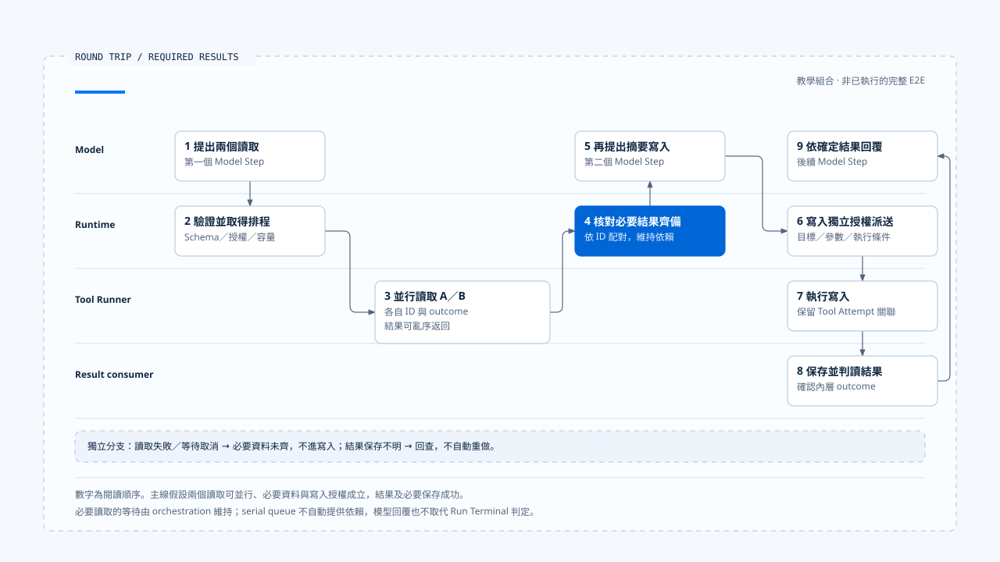

# 一次模型與工具的往返

[English](./06-case-model-tool-roundtrip.md) | [繁體中文](./06-case-model-tool-roundtrip-zh-TW.md)

> 以下內容所提到的
> CCB 為 [claude-code-best](https://github.com/claude-code-best/claude-code) 的簡稱。
> Chat Gun 為 [chat-gun](https://github.com/HsienW/chat-gun)。

[回到導覽](./README-zh-TW.md) · 前一篇：[工具結果與錯誤回灌](./05-tool-results-and-error-feedback-zh-TW.md)

> 使用者要求讀取兩份資料，再產出一份摘要檔。兩個讀取先後返回，模型才提出寫入。若第二個讀取失敗、結果 ID 錯配，或寫入後保存失敗，畫面仍可能看起來像一次普通工具往返，後端卻需要選擇不同的後續路徑。

本篇用一段教學時序串起模型呼叫、提案組裝、排程、容量與結果回灌。主線先等待兩份必要讀取，再向模型取得後續寫入提案；Provider 中斷、排隊取消與效果不明各自放在獨立分支。

**這是一份閱讀與驗證框架。** Chat Gun 與 CCB 的證據分開標示，本輪沒有把來源模組串成一條正式 E2E，也沒有宣稱兩個系統都實作了這個摘要工具案例。

## 場景與執行關聯

假設 Harness 已提供可信 workspace Scope、允許的資料與工具。兩個讀取被具體 descriptor 判定為可並行，寫入則有獨立授權條件。以下識別只是教學值。

| 位置 | 關聯 | 用途 |
|---|---|---|
| 整次工作 | `run-summary` | 關聯本次 Run。 |
| 第一次推理 | `model-step-1`、`provider-attempt-1` | 取得兩個讀取提案。 |
| 讀取工具 | `call-read-a`、`call-read-b` | 分別關聯資料與結果。 |
| 第二次推理 | `model-step-2` | 使用必要讀取結果，提出摘要寫入。 |
| 寫入工具 | `call-write-summary` | 綁定實際路徑、內容與授權。 |
| 後續推理 | `model-step-3` | 依已確認的寫入結果整理回覆。 |

如果某個實作讓模型改用其他工具，仍需重新驗證提案。本例不以文字任務相似度判定相同 Operation，也不將每次模型取樣自動當成可以重試的同一工具呼叫。

## 1. 第一個 Model Step 發出要求

Runtime 取得 Harness 準備的 Context 與工具集合，記錄此次模型、用途、輸出契約及 Run 關聯。正常主線只有一次可用 Provider 回應；fallback 另外驗證。

Chat Gun 可由 MCP Agent 的 `createChatModel().bindTools().invoke()` 查到模型交接。CCB 則沿 `query.ts` 進入 API consumer。這兩份觀察支持不同的呼叫形狀，不能直接替它們共用同一個串流時序。

若產品要求本次 Deadline、Budget 與取消都在模型呼叫生效，還需找到實際傳參與 enforcement。介面可接收 signal，不足以證明每個入口都已傳入。

## 2. 兩個讀取提案形成

CCB 串流路徑可以分別累積兩個工具區塊，在各自 `content_block_stop` 正規化。工具名稱與 ID 需要對回本次訊息，正規化參數仍要接受 Schema 驗證。

本例的正常主線假設兩份參數都有效。若原始字串解析失敗後轉為 `{}`，要改走[第二篇](./02-stream-assembly-and-tool-calls-zh-TW.md) 的驗證分支，不直接把它視為讀取成功。

一般批次與 StreamingToolExecutor 的開始時點不同。主線只要求每個實際派送都已具備完整可辨認提案及必要檢查，不假設所有工具一定等到整個 message 結束才開始。

## 3. 讀取取得執行資格

每個工具都需要工具定義、合法輸入、可信執行關聯與授權結果，再按實際分類排程。讀取名稱本身不能保證 concurrency safe。

| 接點 | CCB 對照 | Chat Gun 對照 |
|---|---|---|
| 並行分類 | safeParse 後呼叫 `isConcurrencySafe()`。 | `isReadOnly` 與當次 `isConcurrencySafe()` 都成立。 |
| 排程 | 批次 `runTools()` 或另行啟用的 streaming executor。 | 符合條件及有 runId 才走 bounded reads。 |
| 容量 | 批次 helper 的 concurrency cap。 | Per-Run reservation 與全域讀取槽位。 |
| 執行資格 | Tool execution 及 permission 路徑。 | Pipeline、授權交接與其他已配置檢查。 |

表格只比較接點。批次 helper 的數字限制不套到另一個 streaming executor，Chat Gun pipeline 也需先確認對應 source 已啟用。

## 4. 結果亂序抵達

假設 `call-read-b` 先返回，`call-read-a` 稍後完成。Runtime 以 ID 保存與組裝結果，模型訊息不因抵達順序改成 A 的內容來自 B。

CCB 批次路徑另外暫存 Context modifiers，批次完成後按原工具順序套用。這與工具完成先後及外部讀取的 snapshot 一致性是不同問題。

本例需要兩份結果才可產出摘要，因此 orchestration 必須明確等到必要結果都可用。若某個工具失敗，不能只是保留另一份成功結果便無條件往寫入主線走。

## 5. 第二輪提出寫入

模型收到配對正確的結果與本次限制，提出摘要檔案的寫入提案。Harness／治理層依可信目標路徑、參數、權限及必要批准處置，Runtime 再依結果繼續、拒絕或等待。

此處的依賴來自前一步已完成的 orchestration。Chat Gun serial tail 沒有自動等待所有 bounded reads，不能把把寫入送進 serial queue 當成這項前置條件的證據。

如果等待人工確認，批准需對回具體 Tool Call，後續恢復另查權威 waiting 與 ownership。這段生命週期不在本篇重新定義。

## 6. 寫入返回及必要保存

寫入工具返回後，consumer 需要讀取 typed outcome 並完成契約要求的保存。正常主線假設結果確定、必要記錄成功，才把成功內容交給後續模型整理。

若 Chat Gun pipeline 的 Task Step 保存失敗，可能回傳外層 `succeeded`、內層 `ambiguous_after_dispatch` 的 envelope。此分支需要先保留狀態並交付回查，不能沿正常主線宣告摘要檔一定沒有建立或已安全完成。

結果通知遺失與工具執行未成功也要分開。若已有權威成功結果，後續查詢或重送通知不應重新執行寫入。

## 7. 下一次模型回覆

第三個 Model Step 使用已知結果整理使用者回覆，保留必要取回位置與限制。文字完成後，整個 Run 仍依自己的 Terminal 契約檢查 pending work、取消及必要結果。

這裡只追到結果回到模型及產品端。Run 的終止寫入、owner release 與事件交付有自己的 consumer，不能由模型最後一句話代替。

- 數字表示閱讀順序，主線具有必要資料、授權及保存成功等前提。取消、失敗與效果不明另行分流，本圖不是已執行的完整 E2E。
- [開啟完整往返泳道與故障分支註記](../../assets/agent-runtime/model-and-tool-execution/06-case-model-tool-roundtrip/06-model-tool-roundtrip-swimlane.html)。

## 主線的交接表

| 順序 | 交接 | 應留下的證據 |
|---|---|---|
| 1 | Harness 輸入交給 Model Step。 | 模型、工具集合、輸入版本與 Attempt 關聯。 |
| 2 | 回應成為兩個工具提案。 | 區塊／訊息、Tool Call ID、正規化與 Schema 結果。 |
| 3 | 提案經檢查後取得排程。 | 授權、分類、容量與實際 runner 開始。 |
| 4 | 亂序結果返回。 | 各自 ID、outcome、內容與必要 evidence。 |
| 5 | 必要結果交給第二輪。 | 依賴條件已成立的 consumer 證據。 |
| 6 | 寫入提案執行並保存。 | 授權交接、Tool Attempt、外部結果與保存結果。 |
| 7 | 已知結果交給後續推理。 | 模型可見結果與權威 outcome 的對照。 |

表格是應驗證的順序，未宣稱來源使用同名欄位或已完成共同交易。部分讀取若可以省略，也要由產品條件明確說明。

## 獨立故障分支

### Provider 尚未形成可用提案

注入允許切換的錯誤，核對是否走已啟用的 fallback。Chat Gun 429、refusal 與工具參數解碼失敗不在本區 wrapper 的白名單；不能為了讓教學案例完成便假設一定換下一個 Provider。

### 工具已開始後串流失敗

CCB 可以清理舊 Assistant Message、結果集合及 executor，避免錯配。驗證仍需記錄真正的工具呼叫數與外部效果；discarded flag 或 tombstone 沒有證明遠端操作已被撤銷。

### 讀取排隊被取消

讓 `call-read-b` 取得 per-Run reservation 後等待全域槽位，再取消。查明 waiter、Run reservation、Step lease 與 runner 呼叫數，確認主線不會用缺少的必要資料繼續寫入。

### 外部結果或保存不明

獨立讓寫入回應遺失，或讓 Task Step 保存失敗。保留已知 operation evidence 與 ambiguous outcome，後續走回查或人工處理；模型重提相同路徑不能自動取得再次寫入資格。

## 來源支持到哪一段

| 來源證據 | 支持的觀察 | 尚需補證 |
|---|---|---|
| Chat Gun Gateway／fallback | Invoke 契約、啟用條件與錯誤白名單。 | 每個正式 Agent 的相同接線與遠端取消效果。 |
| CCB API／messages／query | 區塊正規化、metadata、兩條工具路徑及 fallback 清理。 | 所有工具與 Provider 的完整外部效果保證。 |
| CCB orchestration／generators | 批次次序、並行拉取與 Context modifiers。 | 跨程序排程與端到端有界緩衝。 |
| Chat Gun pipeline／scheduler | 派送檢查、本地容量、runner 與結果封裝。 | 多 Worker、Resource 互斥與完整部署驗收。 |
| Pipeline／scheduler 測試安排 | 部分容量拒絕、取消與保存失敗 assertion。 | 本次未執行的正式故障注入及 E2E。 |

要把本篇升格為實測案例，需從同一個產品入口執行，連上真實 Store、Provider、工具與治理 consumer，並記錄每個正常與故障分支。本輪保留的是 source reading 與驗證方案。

## 本篇的工程判斷

我會同時檢查提案 ID、實際 runner 次數與最後使用的結果。畫面上的工具順序正確，只能支持一部分觀察；必要讀取真的完成、舊提案沒有重跑、內層 ambiguous 沒有被當成功，都需要自己的證據。

把一次往返拆到這些交接之後，才能知道失敗應停在模型重試、輸入修正、等待、回查或結果重送。它們各自消耗不同資源，也不能由同一個 retry 按鈕替代。

## 實作參照與適用範圍

- [Chat Gun MCP Graph][g-mcp]、[pipeline][g-pipeline]、[scheduler][g-scheduler] 與 [structured result][g-result]。
- CCB `src/query.ts`、`src/services/api/claude.ts`、`src/services/tools/toolOrchestration.ts`、`src/services/tools/StreamingToolExecutor.ts`。
- 固定來源、CCB 副本指紋及未執行的驗證見[本區導覽](./README-zh-TW.md#來源與查證狀態)。本篇情境、ID 與交錯順序均屬教學設定。

## 接續閱讀

- [Model and Tool Execution 導覽](./README-zh-TW.md)
- [一次 Run 的完整走法](../foundations/06-one-run-walkthrough-zh-TW.md)
- 後續分類：Effects and Recovery、Events and Operations。

[g-mcp]: https://github.com/HsienW/chat-gun/blob/f83a38fd67a021904e597c60543708ee0c206076/backend/src/agents/mcp-agent.ts
[g-pipeline]: https://github.com/HsienW/chat-gun/blob/f83a38fd67a021904e597c60543708ee0c206076/backend/src/runtime/tool-dispatch/pipeline.ts
[g-scheduler]: https://github.com/HsienW/chat-gun/blob/f83a38fd67a021904e597c60543708ee0c206076/backend/src/runtime/tool-dispatch/scheduler.ts
[g-result]: https://github.com/HsienW/chat-gun/blob/f83a38fd67a021904e597c60543708ee0c206076/backend/src/runtime/tool-dispatch/structured-tool-result.ts
