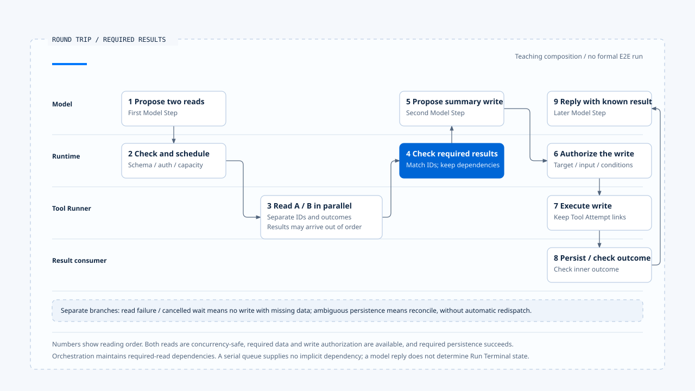

# A model and tool round trip

[English](./06-case-model-tool-roundtrip.md) | [繁體中文](./06-case-model-tool-roundtrip-zh-TW.md)

> In the following content:
> CCB is short for [claude-code-best](https://github.com/claude-code-best/claude-code).
> Chat Gun refers to [chat-gun](https://github.com/HsienW/chat-gun).

[Back to guide](./README-zh-TW.md) · Previous: [Tool results and error feedback](./05-tool-results-and-error-feedback.md)

> A user asks to read two sources and produce a summary file. The reads return separately before the model proposes a write. If the second read fails, result IDs are mismatched, or persistence fails after writing, the screen may still resemble an ordinary tool round trip while the backend needs different follow-up paths.

This article uses a teaching sequence to connect model calls, proposal assembly, scheduling, capacity, and result feedback. The main path waits for both required reads before asking the model for a subsequent write proposal. Provider interruption, queue cancellation, and unresolved effects use separate branches.

**This is a reading and verification framework.** Evidence from Chat Gun and CCB is labeled separately. This section did not connect source modules into a production E2E or claim that both systems implement this summary-tool scenario.

## Scenario and execution correlations

Assume the Harness supplies a trusted workspace Scope, permitted data, and tools. Concrete descriptors classify both reads as safe to run concurrently, while writing has independent authorization conditions. The following identities are illustrative.

| Position | Correlation | Purpose |
|---|---|---|
| Overall work | `run-summary` | Relate this Run. |
| First reasoning step | `model-step-1`, `provider-attempt-1` | Obtain two read proposals. |
| Read tools | `call-read-a`, `call-read-b` | Relate each source and result separately. |
| Second reasoning step | `model-step-2` | Use required read results to propose writing the summary. |
| Write tool | `call-write-summary` | Bind the actual path, content, and authorization. |
| Subsequent reasoning | `model-step-3` | Compose a response from the confirmed write result. |

If an implementation lets the model choose different tools, proposals still need fresh validation. This example does not identify the same Operation from task-text similarity or automatically treat each model sample as the same retryable tool call.

## 1. The first Model Step sends a request

The Runtime obtains Harness-prepared Context and tools, recording the model, purpose, output contract, and Run correlation. The normal main path has one usable Provider response; fallback is verified separately.

Chat Gun's model handoff can be traced through the MCP Agent's `createChatModel().bindTools().invoke()`. CCB enters the API consumer through `query.ts`. These observations support different call structures without establishing one shared streaming sequence.

If the product requires Deadline, Budget, and cancellation enforcement for this model call, actual argument propagation and enforcement still need to be located. A signal-accepting interface does not establish that every entry point passes one.

## 2. Two read proposals form

CCB's streaming path can accumulate two tool blocks separately and normalize each at `content_block_stop`. Tool names and IDs need correlation with this message, and normalized arguments still require Schema validation.

The normal path assumes both inputs are valid. If parsing the original string fails and produces `{}`, follow the validation branch in the [second article](./02-stream-assembly-and-tool-calls.md), rather than treating it as a successful read.

Ordinary batches and StreamingToolExecutor have different start points. The main path requires complete identifiable proposals and necessary checks before each actual dispatch. It does not assume all tools must wait until the whole message ends.

## 3. Reads obtain execution eligibility

Each tool needs a definition, valid input, trusted execution correlation, and authorization before scheduling under its actual classification. A read-like name alone cannot establish concurrency safety.

| Boundary | CCB comparison | Chat Gun comparison |
|---|---|---|
| Concurrency classification | Call `isConcurrencySafe()` after safeParse. | Both `isReadOnly` and current `isConcurrencySafe()` hold. |
| Scheduling | Batch `runTools()` or a separately enabled streaming executor. | Bounded reads require matching conditions and a runId. |
| Capacity | The batch helper's concurrency cap. | Per-Run reservation and global read slots. |
| Execution eligibility | Tool execution and permission paths. | Pipeline, authorization handoff, and other configured checks. |

The table compares boundaries only. The batch helper's numeric cap does not apply to the other streaming executor. Chat Gun's Pipeline also requires verification that the corresponding source enables it.

## 4. Results arrive out of order

Suppose `call-read-b` returns before `call-read-a`. The Runtime saves and assembles results by ID so arrival order does not make the model message attribute B's content to A.

CCB's batch path separately queues Context modifiers and applies them in original tool order after the batch completes. This differs from tool completion order and snapshot consistency of external reads.

This example needs both results to produce the summary, so orchestration must explicitly wait until all required results are available. If one tool fails, retaining the other successful result does not permit unconditional continuation to writing.

## 5. The second turn proposes a write

The model receives correctly paired results and current constraints, then proposes writing the summary file. The Harness/governance layer evaluates the trusted target path, arguments, permissions, and required approval. The Runtime then continues, rejects, or waits according to that result.

The dependency here comes from the completed orchestration in the previous step. Chat Gun's serial tail does not automatically wait for all bounded reads. Submitting the write to a serial queue cannot establish this prerequisite.

If human confirmation is needed, approval must match the concrete Tool Call. Subsequent resume separately checks authoritative waiting and ownership. This article does not redefine that lifecycle.

## 6. The write returns and required persistence follows

After the write tool returns, the consumer needs to read the typed outcome and perform persistence required by the contract. The normal path assumes a definite result and successful required records before giving success content to subsequent reasoning.

If Task Step persistence fails in Chat Gun's Pipeline, it may return an envelope with outer `succeeded` and inner `ambiguous_after_dispatch`. That branch needs to retain state and hand off reconciliation first. It cannot continue on the normal path by declaring the summary file definitely absent or safely completed.

A lost result notification also differs from unsuccessful tool execution. If an authoritative success result exists, subsequent lookup or notification redelivery should not execute the write again.

## 7. The next model response

The third Model Step composes the user response from known results, retaining required retrieval locations and constraints. After text completes, the whole Run still checks pending work, cancellation, and required results under its Terminal contract.

This discussion stops at results returning to the model and product. Terminal writes, owner release, and event delivery have their own consumers. The model's final sentence cannot replace them.

The main path waits for both required reads before proposing a write. Failure, cancellation and ambiguous persistence take separate branches.

[Open the editable HTML diagram](../../assets/agent-runtime/model-and-tool-execution/06-case-model-tool-roundtrip/06-model-tool-roundtrip-swimlane-en.html).

## Handoff table for the main path

| Order | Handoff | Evidence to retain |
|---|---|---|
| 1 | Harness input goes to the Model Step. | Model, tool set, input version, and Attempt correlation. |
| 2 | The response becomes two tool proposals. | Blocks/messages, Tool Call IDs, normalization, and Schema results. |
| 3 | Checked proposals enter scheduling. | Authorization, classification, capacity, and actual runner start. |
| 4 | Results return out of order. | Each ID, outcome, content, and required evidence. |
| 5 | Required results enter the second turn. | Consumer evidence that dependency conditions hold. |
| 6 | The write proposal executes and is recorded. | Authorization handoff, Tool Attempt, external result, and persistence result. |
| 7 | Known results enter subsequent reasoning. | Model-visible results compared with authoritative outcomes. |

The table is an order to verify, without claiming identical source fields or an implemented shared transaction. Product conditions must also explicitly justify any optional read.

## Separate failure branches

### The Provider has not formed a usable proposal

Inject an eligible error and check whether enabled fallback handles it. Chat Gun's 429, refusal, and tool argument decoding failures are outside this wrapper's allowlist. The teaching scenario cannot assume a switch to the next Provider simply to reach completion.

### The stream fails after tools start

CCB can clear old Assistant Messages, result collections, and the executor to prevent mismatches. Verification still needs actual tool call counts and external effects. A discarded flag or tombstone does not establish reversal of remote operations.

### A queued read is cancelled

Let `call-read-b` acquire a per-Run reservation and wait for a global slot, then cancel it. Inspect its waiter, Run reservation, Step lease, and runner call count. Confirm that the main path does not continue writing without required data.

### External results or persistence are unresolved

Lose the write response or fail Task Step persistence in separate cases. Retain known operation evidence and the ambiguous outcome, then reconcile or hand off manually. The model proposing the same path again does not automatically gain permission to write again.

## What each source supports

| Source evidence | Supported observation | Evidence still needed |
|---|---|---|
| Chat Gun Gateway/fallback | Invoke contract, enablement conditions, and error allowlist. | Equivalent wiring in every production Agent and remote cancellation effects. |
| CCB API/messages/query | Block normalization, metadata, two tool paths, and fallback cleanup. | Complete external-effect guarantees for all tools and Providers. |
| CCB orchestration/generators | Batch order, concurrent pulling, and Context modifiers. | Scheduling across processes and buffering bounded across the complete path. |
| Chat Gun Pipeline/scheduler | Dispatch checks, local capacity, runner, and result packaging. | Multiple Workers, Resource exclusion, and full deployment acceptance. |
| Pipeline/scheduler test arrangements | Some assertions for capacity rejection, cancellation, and persistence failure. | Production fault injection and E2E not executed here. |

Turning this into a measured case requires execution from one product entry point through real Stores, Providers, tools, and governance consumers, recording every normal and failure branch. The work here consists of source reading and verification plans.

## Engineering judgment

I would check proposal IDs, actual runner counts, and the results ultimately used together. Correct tool order on screen supports only part of the observation. Required reads completing, old proposals not rerunning, and inner ambiguous outcomes not being interpreted as success each need their own evidence.

Breaking a round trip into these handoffs reveals whether a failure belongs to model retry, input correction, waiting, reconciliation, or result redelivery. They consume different resources and cannot all be replaced by one retry button.

## Implementation references and scope

- [Chat Gun MCP Graph][g-mcp], [Pipeline][g-pipeline], [scheduler][g-scheduler], and [structured result][g-result].
- CCB `src/query.ts`, `src/services/api/claude.ts`, `src/services/tools/toolOrchestration.ts`, and `src/services/tools/StreamingToolExecutor.ts`.
- See the [section guide](./README-zh-TW.md#來源與查證狀態) for fixed sources, CCB copy fingerprints, and verification not performed. The scenario, IDs, and interleaving are illustrative.

## Further reading

- [Model and Tool Execution guide](./README-zh-TW.md)
- [A complete Run walkthrough](../foundations/06-one-run-walkthrough.md)
- Upcoming sections: Effects and Recovery, Events and Operations.

[g-mcp]: https://github.com/HsienW/chat-gun/blob/f83a38fd67a021904e597c60543708ee0c206076/backend/src/agents/mcp-agent.ts
[g-pipeline]: https://github.com/HsienW/chat-gun/blob/f83a38fd67a021904e597c60543708ee0c206076/backend/src/runtime/tool-dispatch/pipeline.ts
[g-scheduler]: https://github.com/HsienW/chat-gun/blob/f83a38fd67a021904e597c60543708ee0c206076/backend/src/runtime/tool-dispatch/scheduler.ts
[g-result]: https://github.com/HsienW/chat-gun/blob/f83a38fd67a021904e597c60543708ee0c206076/backend/src/runtime/tool-dispatch/structured-tool-result.ts
