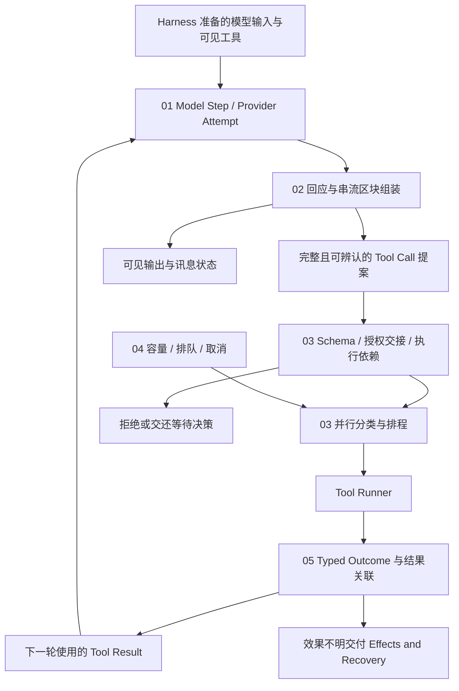

# Model and Tool Execution

[English](./README.md) | [繁體中文](./README-zh-TW.md) | [简体中文](./README-zh-CN.md)

[回到 Runtime 总览](../README-zh-CN.md) · [Foundations 导览](../foundations/README-zh-CN.md)

> 以下内容所提到的
> CCB 为 [claude-code-best](https://github.com/claude-code-best/claude-code) 的简称。
> Chat Gun 为 [chat-gun](https://github.com/HsienW/chat-gun)。

模型的文字还在抵达，第一个工具区块已经完整，另一个工具的参数却只有半段 JSON。两个读取要求可以同时执行，其中一个先失败；接下来的写入则需要等到必要结果与授权都成立。Runtime 必须知道哪些数据可显示、哪个提案已能交付检查，以及何时可以开始下一次模型调用。

## 阅读顺序

| 篇次 | 文章 | 要回答的问题 | 文件名 |
|---|---|---|---|
| 01 | [模型调用与 Provider 切换](./01-model-calls-and-provider-fallback-zh-CN.md) · [English](./01-model-calls-and-provider-fallback.md) | 一次模型尝试需要什么契约，失败后何时能改用另一个 Provider？ | `01-model-calls-and-provider-fallback-zh-CN.md` |
| 02 | [流式传输组装与工具调用](./02-stream-assembly-and-tool-calls-zh-CN.md) · [English](./02-stream-assembly-and-tool-calls.md) | 文字与参数片段何时成为可检查的消息，哪些数据还不能派送？ | `02-stream-assembly-and-tool-calls-zh-CN.md` |
| 03 | [工具派送与并行调度](./03-tool-dispatch-and-concurrency-zh-CN.md) · [English](./03-tool-dispatch-and-concurrency.md) | 工具提案如何通过执行检查，哪些操作能同时进行？ | `03-tool-dispatch-and-concurrency-zh-CN.md` |
| 04 | [背压与容量控制](./04-backpressure-and-capacity-zh-CN.md) · [English](./04-backpressure-and-capacity.md) | 工具与 consumer 变慢时，哪里等待、哪里拒绝，又如何停止排队工作？ | `04-backpressure-and-capacity-zh-CN.md` |
| 05 | [工具结果与错误回灌](./05-tool-results-and-error-feedback-zh-CN.md) · [English](./05-tool-results-and-error-feedback.md) | 成功、拒绝、失败与效果不明如何保留身份，成为下一轮模型可用的结果？ | `05-tool-results-and-error-feedback-zh-CN.md` |
| 06 | [一次模型与工具的往返](./06-case-model-tool-roundtrip-zh-CN.md) · [English](./06-case-model-tool-roundtrip.md) | 能否用一段含并行读取与后续操作的时序，查明每个交接的证据？ | `06-case-model-tool-roundtrip-zh-CN.md` |

## 架构与责任范围

下图是阅读模型。工具提案通过的边界、Provider 数据形式与调度能力，都需对回各来源的实际 consumer；图中的箭头没有指定一套共同接口。

### 与其他分类的分工

| 分类 | 本区承接的内容 | 细节交回的位置 |
|---|---|---|
| Foundations | 将 Model Step、Tool Call 与 Tool Result 展开成具体交接。 | Runtime 定义、Execution Identity 与基本持久化名词沿用前区。 |
| Execution Lifecycle | 在模型或工具派送处消费目前 Run、取消及限制条件。 | Run 接纳、ownership 替换、Deadline、Waiting 与 Terminal 的权威转移留在该分类。 |
| Harness Input and Context | 使用已准备好的输入与 Context，把结果送回下一轮组装。 | 来源权威、记忆选取、压缩政策与 Context 分配由 Harness 决定。 |
| Harness Behavior and Capabilities | 接收可见工具及其 descriptor，执行模型提出的具体提案。 | 工具集合如何组成、如何选取及指令优先序由 Harness 决定。 |
| Harness Action Governance | 在执行边界核对 Schema、可信关联与授权交接结果。 | Policy、Resource 权限、确认内容与隔离政策由治理层定义。 |
| Effects and Recovery | 辨认失败所在阶段，保留外部结果不明与重试交接。 | 工具 retry、Operation idempotency、Checkpoint、reconciliation 与 compensation 演算法另行展开。 |
| Events and Operations | 提供 Step、Attempt、queue wait、Provider 与 Tool Call 的观察位置。 | Event envelope、投递保证、Trace、Metrics、SLO 与压测验收另行展开。 |

### 文章共用的识别与边界

- Run、Step、Model Attempt、Tool Call、Tool Attempt 与外部 Operation 各自保留关联。Provider 重试与重新执行工具具有不同风险，不能共用一个模糊的 retry 次数。
- 模型文字、工具参数片段、完整工具提案、已授权命令与已提交效果需要分开保存。完整 JSON 通过语法解析后，仍需检查 Schema、工具身份及执行资格。
- Provider Token 流式传输、Graph event stream、工具 progress 与对 UI 的传输是不同数据路径。看到画面持续更新，只能支持相应 consumer 的观察。
- 本地调度器、Step Lock 与跨服务 Resource Lock 各有作用范围；调度名称与接口不能代替部署及一致性证据。

## 01. 模型调用与 Provider 切换

### 文章范围

从一份已准备好的模型输入开始，追到 Provider Attempt 返回消息、失败或中止。文章说明模型选择、工具绑定、回应契约及 fallback 接点，并保留模型尝试与整个 Run 的区别。

重点如下：

1. Model Step 与 Provider Attempt 的关联；模型、用途、可见工具、response format 与必要能力从哪里取得。
2. Provider envelope、消息与 Tool Call 的规范化；能力或回应格式不符时如何拒绝。
3. `invoke()`、Provider 原生流式传输与 Graph 流式传输的差异，逐一查明正式入口使用哪种方式。
4. Provider timeout、caller Abort、可切换错误及不可切换错误的出口。
5. fallback 启用条件、Provider 次序、每次尝试限制，以及换模型后的工具与输出兼容性。
6. 部分输出已显示、工具已开始或外部效果不明时，重新请求需要额外判断；重复用量与成本交回既有预算 consumer。

### 已定位的来源与查证要求

Chat Gun `ChatModelInvoker` 目前查读的契约提供 `invoke()` 与可选 `bindTools()`。`createChatModelWithFallback()` 受设置或明确 fallback policy 影响，MCP Agent 查读的入口则使用 `createChatModel().bindTools().invoke()`。文章须逐入口核对，不能将 Gateway 的可选方法描述成所有 Graph 都已使用的行为。

`FallbackChatModelInvoker.invoke()` 依允许的错误类别切换、限制尝试，并在 caller signal 已 aborted 时停止切换。本段没有建立「Provider 流式传输输出到一半可以透明换接」的契约，该情况留作需独立查证的路径。

源代码显示 `provider-error-category.ts`：白名单包含 unavailable、timeout 与 response invalid；429、工具参数解码失败、structured output invalid、refusal 及 unknown 不在其中。MCP 入口的 invoke 在查读段落没有传入第二个 options 参数，signal 的全链传递需另查。

CCB API 的串流与非串流 fallback，以及 query loop 的 model fallback 有各自接点。相同名称可能代表不同重试层，总尝试数取决於调用层次；各层限制不会自动形成单一总上限。

## 02. 流式传输组装与工具调用

### 文章范围

沿 Provider event 到消息区块的组装流程，说明文字增量、工具参数与消息结束如何建立可用数据。重点放在何时形成完整提案，以及在整份回应尚未结束时提前执行工具需要哪些条件。

重点如下：

1. Message、content block、delta、Tool Call ID 与参数的关联；Provider index 与产品 identity 分开处理。
2. 片段累积、JSON 规范化、工具名称核对与 Schema 验证的先后。
3. 完整工具区块可先于整份消息结束；tool-ready 的判断需依该 consumer，不一概等待整条 stream 关闭。
4. Provider usage 与 stop reason 晚于区块抵达时，如何补回最后消息的 metadata。
5. 流式传输中断、缺少区块、错误类型、重复 ID 与不完整参数的处置。
6. 工具已在流式传输期间开始后，Provider fallback 或流式传输重试如何保留既有执行，交回后续恢复判断。

### 已定位的来源与查证要求

CCB `claude.ts` 会累积 `input_json_delta` 的 `partial_json`，在 `content_block_stop` 规范化并交付 Assistant Message；后续 `message_delta` 还会补回 usage 与 stop reason。这些是分开的观察点，不能由某个工具区块完整推论整份模型响应已完成。

查阅 `normalizeContentFromAPI()` 后确认，部分 JSON 解析失败会转成 `{}`，再交给下游 Schema；区块结束不能当成解码成功证据。StreamingToolExecutor 的 `discard()` 配置旗标，由其他执行及结果路径判读，没有单凭该方法证明外部效果撤销。

`query.ts` 另依 `config.gates.streamingToolExecution` 选择 StreamingToolExecutor。这条路径与一般批次 `runTools()` 有各自的时序、取消及容量条件。

Chat Gun 本区查读的 Gateway 主要提供完成消息的 invoke 契约。Graph／BFF 的逐 Token 转送、adapter 是否保留 tool-call chunks，以及 consumer 的结束条件，先列为后续入口，不补造对等流式传输实现。

## 03. 工具派送与并行调度

### 文章范围

完整提案进入 Runtime 后，先核对工具、输入、依赖及可信 Context，再取得可执行的授权结果与调度资格。文章比较批次分组与逐项调度，说清楚 safe、serial 与锁的有效范围。

重点如下：

1. 工具解析与 Schema、dependency、Execution Context 的派送前检查。
2. 授权及确认结果如何交接；`executeTyped()` 与已授权入口的差别，政策内容连回 Action Governance。
3. 并行分类依实际参数与 descriptor 判定；未知工具、解析失败与分类函数抛错的保守出口。
4. CCB 连续安全批次、非安全批次与 Context modifier 的套用顺序；完成次序与 Context 更新次序分开说明。
5. Chat Gun 本地 scheduler、per-Run 身份、Step Lock 与 runner 的接线；工具调用、调度与外部执行各自留下证据。
6. 读取与写入的依赖、Resource 冲突及多 Worker 问题；需要的跨资源互斥先列设计要求。

### 已定位的来源与查证要求

CCB `toolOrchestration.ts` 先 safeParse 再调用 `isConcurrencySafe()`，解析失败或分类抛错时以不安全处理；连续安全工具组成一批，并行批次的 Context modifiers 在批次结束后按原工具顺序套用。程序注解中的 read-only 不能取代实际分类条件。

Chat Gun pipeline 的并行条件同时要求 `descriptor.isReadOnly` 与 `isConcurrencySafe(parsedInput.data)`；分类抛错会拒绝派送。本地 scheduler 的 serial tail 只序列化送入该路径的工作，与 bounded reads 并非同一把全局读写锁。Step Lock 的 key 与租约用途也须另外核对，不能称为任意业务 Resource 的共同锁。

## 04. 背压与容量控制

### 文章范围

模型、工具与显示端速度不同时，Runtime 必须选择等待、拒绝或停止累积。这篇分开说明执行槽位、排队保留、速率限制、buffer 与 consumer 取消，让每个上限都有明确的计算位置。

重点如下：

1. 执行中数量、排队数量、每 Run 保留、buffer bytes 与输出大小使用不同单位。
2. 全局与 per-Run capacity 的取得、等待、拒绝及释放；慢工具是否占住其他 Run 的位置。
3. 等待槽位时取消、serial queue 中止、runner 例外后的资源清理。
4. rate limit、circuit breaker、concurrency cap 与成本预算各自限制哪个接点。
5. 工具 progress、已完成结果与慢 consumer 的 buffering；async generator 或 yield 本身不足以证明完整有界背压。
6. 公平性、最大排队长度、跨 Worker 容量与超载策略的查证及故障测试。

### 已定位的来源与查证要求

Chat Gun `BoundedToolDispatchScheduler` 在等待全局读取槽位之前，先 reserve per-Run capacity；该 Run 超额时抛出 `TOOL_RUN_CAPACITY_EXCEEDED`。因此 per-Run 计数包含已保留但仍在等待的工作，不能仅依变数名把它写成实际执行中工具数。程序也有等待取消与 finally 释放位置。

全域读取槽位有上限，仍需另查 waiter 总量、Run 数量与部署中的共用方式。不能从 FIFO waiter 阵列推论跨 Run 公平性或跨程序总容量已被保证。

CCB 批次路径以 `getMaxToolUseConcurrency()` 传入 `all()`；StreamingToolExecutor 有另一套可执行条件。数字上限与环境配置是否涵盖两条路径，要追各自 consumer。慢 UI 与网路传输的 bounded buffer 未查证，保留为设计与后续定位项目。

## 05. 工具结果与错误回灌

### 文章范围

工具调用返回之后，Runtime 还要判读 typed outcome、保留 Tool Call 关联，并组成下一次模型可接受的结果。这篇追到结果 adapter 与 consumer，避免 transport 成功或一段错误字符串抹掉外部效果的差异。

重点如下：

1. Tool Call 与 Tool Result 的配对；多个工具完成顺序不同时仍依 ID 对应。
2. 工具拒绝、Schema 错误、permission 结果与执行例外如何产生可消费反馈。
3. Typed outcome、structured envelope、legacy text 与模型可见内容的责任分界。
4. 结果验证失败、Task Step 保存失败与外部效果不明的出口；外层成功交付 envelope 与内层业务结果分开读取。
5. 进度消息、完整结果、截断内容及 evidence reference 如何留存；实际 Context 裁切政策交回 Harness。
6. 哪些错误可交给模型修正提案，哪些必须停放或回查；模型重新提出相似调用不自动取得幂等或重试资格。

### 已定位的来源与查证要求

Chat Gun `createStructuredToolResultEnvelope()` 保存 correlation、工具资讯、outcome 与 termination cause；`toLegacyToolResult()` 则转成成功内容或错误字串。正式 consumer 是否保留 envelope 决定了完整状态能否延续；legacy 显示文字不足以证明状态已保存。

Pipeline 在 Task Step 结果保存失败后，可以建立 `ambiguous_after_dispatch` 的 envelope，外层仍以 `succeeded` 回传这份 envelope。此处外层代表交付结果成功，内层 outcome 才描述执行状态；两层型别描述不同事实。

CCB `runToolUse()` 与 permission／validation 分支可用 `tool_use_id` 和 `is_error` 对回原提案。这类协议错误反馈无法单独表达外部交易是否提交，需要在具体工具与恢复路径补证。

## 06. 一次模型与工具的往返

### 主案例与独立分支

主线采模型提出两个已验证可并行的读取，取得必要结果后，再提出一个后续操作。后续操作有独立授权与调度条件；案例明确要求 orchestration 等待前置数据，不能只依 serial 这个名称推论它会等所有读取完成。

重点如下：

1. 为 Model Step、Provider Attempt 与三个 Tool Call 建立不同关联。
2. 区块完整后形成提案；使用一般批次或提前执行路径时，分别说明成立前提。
3. 两个读取经实际分类及容量检查后执行，结果可乱序抵达但仍按 ID 配对。
4. 读取结果先交给模型，后续操作依可信条件授权；拒绝、等待及效果不明各自结束这次自动续行。
5. 结果保存、内层 outcome 判读与下一次模型调用；不足以完成任务时不提前宣告业务成功。
6. 把 Provider 中断、读取失败、排队取消与外部效果不明放在独立测试分支，不画成同一次成功流程必经步骤。

### 所需证据

| 主张 | 预计核对的数据 | 故障或竞态 |
|---|---|---|
| 提案完整才进执行检查 | Provider 区块、规范化结果、Schema 与 tool-ready consumer。 | JSON 中断、未知工具、重复或错配 ID。 |
| 并行范围符合契约 | descriptor、调度分类、同时执行计数。 | 分类抛错、安全与非安全工具混合。 |
| 容量与取消确实影响 runner | reservation、queue、AbortSignal 与 runner 调用数。 | Run 超额、等待取消、清理抛错。 |
| 结果正确回到下一轮 | Tool Call ID、typed outcome、envelope 与模型消息。 | 结果乱序、单项失败、legacy adapter 丢失分类。 |
| fallback 不重复外部操作 | Model Attempt 与 Tool Attempt 分开的派送记录。 | 模型流式传输中断时工具已开始、外部回应遗失。 |

Chat Gun 与 CCB 分别呈现自己的主线；教学用对照图只比较责任，不拼成已执行的共同 Runtime。完整 E2E 需另有同一正式入口、实际 Store、Provider、工具 adapter 与故障时点的证据。

## 来源与查证状态

### 实际使用的本机来源

| 来源 | 版本或位置 | 适用范围 |
|---|---|---|
| Chat Gun | `C:\D\ai-agent\chat-gun`；HEAD `f83a38fd67a021904e597c60543708ee0c206076`。 | 局部查读 Gateway、fallback、tool governance、pipeline、MCP Agent、registry 与部分测试，并读取 Provider 错误分类、scheduler 及 structured result。核对的十一个来源／测试文件未显示工作区修改。 |
| CCB | `C:\D\ai-agent\claude-code-research\claude-code-main`。 | 读取 tool orchestration 与 generator helper，局部查阅 query、API 串流、messages 正规化、tool execution 与 StreamingToolExecutor。副本缺少 Git 版本资讯，以下保留文件指纹。 |

CCB 指纹用来辨识来源副本，列入的文件不代表全文已逐行查证；`QueryEngine.ts` 保留为后续 session 与费用 consumer 的定位入口。

| CCB 副本路径 | SHA-256 |
|---|---|
| `src/query.ts` | `74e0ce0d86cfd453add8dc1d15ccb6311b02964b8321e3721b8e71fbd87252ce` |
| `src/QueryEngine.ts` | `7df34a6a6d106927403d49e3405dfaf70da37cae5b644b658ebaf0b877988af6` |
| `src/services/api/claude.ts` | `6d3fd16e608120d502e70ec461ffb66bcbca12fa86862859606c9118f977a999` |
| `src/services/tools/toolOrchestration.ts` | `6958bcd46006785e241f7226b4f28aeaaec2206ccc93772d4e473aa6dbdd4293` |
| `src/services/tools/toolExecution.ts` | `77aae23a5b8b68aa1ee32b99eb25c6360071d7a4c4c46e6d2c95d584fb6e25e0` |
| `src/services/tools/StreamingToolExecutor.ts` | `ee17dce704af73787c9ed76dbbc638167521e5c1f68c9436149378bb3358601c` |
| `src/utils/messages.ts` | `24e36a51f351df9687cdac084d9b9573549a7bb5b8859b4ff39cc2d02ec7095a` |
| `src/utils/generators.ts` | `11b3774ac8c3e4872dce7e284d49392426d3422ea967e59bbd3abe1703c15d2e` |

### 主要来源索引

Chat Gun 连结固定在源代码查读版本。CCB 使用本地路径与上述指纹，不以无法确认的历史 commit 代替副本内容。

| 来源 | 入口 | 用途 |
|---|---|---|
| Chat Gun | [llm-gateway.ts][g-gateway]、[llm-fallback.ts][g-fallback] | invoke、工具系结、fallback 启用条件、错误分类与尝试限制。 |
| Chat Gun | [provider-error-category.ts][g-category]、[registry.ts][g-registry] | Fallback 白名单与 pipeline 的 source 启用接点。 |
| Chat Gun | [mcp-agent.ts][g-mcp] | 已查读的模型 consumer 与授权 Graph 交接。 |
| Chat Gun | [tool-governance.ts][g-governance]、[pipeline.ts][g-pipeline] | Schema、可信 Context、授权交接、scheduler、runner 与结果保存。 |
| Chat Gun | [scheduler.ts][g-scheduler]、[scheduler.test.ts][g-scheduler-tests] | 程序内容量、serial tail、waiter 取消与测试安排。 |
| Chat Gun | [structured-tool-result.ts][g-result]、[structured-tool-result.test.ts][g-result-tests] | Envelope、内层 outcome、legacy 转换及结果关联。 |
| CCB | `src/query.ts`、`src/QueryEngine.ts` | 模型与工具回圈、两条工具执行路径及 session consumer。 |
| CCB | `src/services/api/claude.ts` | content block、delta、usage、stop reason 与串流／非串流 fallback。 |
| CCB | `src/services/tools/toolOrchestration.ts` | 批次分类、并发上限与 Context modifier 次序。 |
| CCB | `src/services/tools/StreamingToolExecutor.ts` | 提前工具执行、progress、结果交付与取消路径。 |
| CCB | `src/services/tools/toolExecution.ts` | 工具解析、Schema、permission、结果与错误讯息。 |
| CCB | `src/utils/messages.ts`、`src/utils/generators.ts` | 工具输入正规化、JSON 解析回退及有上限的 generator 拉取。 |

仅定位源代码与部分测试案例，没有执行来源库测试、Provider 调用、正式数据库竞态、慢 consumer 压测或完整 E2E。Feature gate、依赖组装与部署启用状态仍需沿正式入口补证。
[g-gateway]: https://github.com/HsienW/chat-gun/blob/f83a38fd67a021904e597c60543708ee0c206076/backend/src/platform/llm-gateway.ts
[g-fallback]: https://github.com/HsienW/chat-gun/blob/f83a38fd67a021904e597c60543708ee0c206076/backend/src/platform/llm-fallback.ts
[g-mcp]: https://github.com/HsienW/chat-gun/blob/f83a38fd67a021904e597c60543708ee0c206076/backend/src/agents/mcp-agent.ts
[g-governance]: https://github.com/HsienW/chat-gun/blob/f83a38fd67a021904e597c60543708ee0c206076/backend/src/platform/tool-governance.ts
[g-pipeline]: https://github.com/HsienW/chat-gun/blob/f83a38fd67a021904e597c60543708ee0c206076/backend/src/runtime/tool-dispatch/pipeline.ts
[g-scheduler]: https://github.com/HsienW/chat-gun/blob/f83a38fd67a021904e597c60543708ee0c206076/backend/src/runtime/tool-dispatch/scheduler.ts
[g-scheduler-tests]: https://github.com/HsienW/chat-gun/blob/f83a38fd67a021904e597c60543708ee0c206076/backend/src/runtime/tool-dispatch/scheduler.test.ts
[g-result]: https://github.com/HsienW/chat-gun/blob/f83a38fd67a021904e597c60543708ee0c206076/backend/src/runtime/tool-dispatch/structured-tool-result.ts
[g-result-tests]: https://github.com/HsienW/chat-gun/blob/f83a38fd67a021904e597c60543708ee0c206076/backend/src/runtime/tool-dispatch/structured-tool-result.test.ts
[g-category]: https://github.com/HsienW/chat-gun/blob/f83a38fd67a021904e597c60543708ee0c206076/backend/src/platform/provider-error-category.ts
[g-registry]: https://github.com/HsienW/chat-gun/blob/f83a38fd67a021904e597c60543708ee0c206076/backend/src/tools/registry.ts
