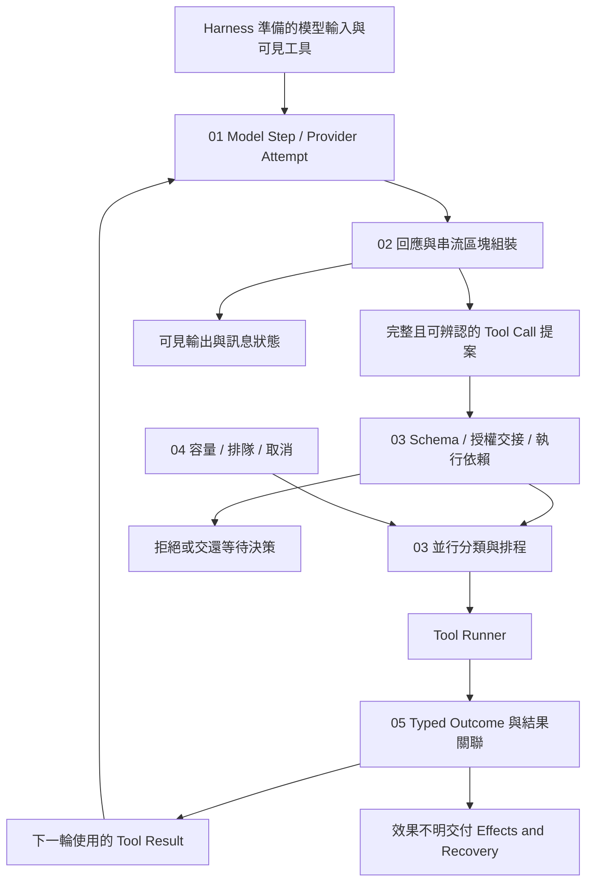

# Model and Tool Execution

[回到 Runtime 總覽](../README-zh-TW.md) · [Foundations 導覽](../foundations/README-zh-TW.md)

> 以下內容所提到的
> CCB 為 [claude-code-best](https://github.com/claude-code-best/claude-code) 的簡稱。
> Chat Gun 為 [chat-gun](https://github.com/HsienW/chat-gun)。

模型的文字還在抵達，第一個工具區塊已經完整，另一個工具的參數卻只有半段 JSON。兩個讀取要求可以同時執行，其中一個先失敗；接下來的寫入則需要等到必要結果與授權都成立。Runtime 必須知道哪些資料可顯示、哪個提案已能交付檢查，以及何時可以開始下一次模型呼叫。

## 閱讀順序

| 篇次 | 文章 | 要回答的問題 | 檔名 |
|---|---|---|---|
| 01 | [模型呼叫與 Provider 切換](./01-model-calls-and-provider-fallback-zh-TW.md) · [English](./01-model-calls-and-provider-fallback.md) | 一次模型嘗試需要什麼契約，失敗後何時能改用另一個 Provider？ | `01-model-calls-and-provider-fallback-zh-TW.md` |
| 02 | [串流組裝與工具呼叫](./02-stream-assembly-and-tool-calls-zh-TW.md) · [English](./02-stream-assembly-and-tool-calls.md) | 文字與參數片段何時成為可檢查的訊息，哪些資料還不能派送？ | `02-stream-assembly-and-tool-calls-zh-TW.md` |
| 03 | [工具派送與並行排程](./03-tool-dispatch-and-concurrency-zh-TW.md) · [English](./03-tool-dispatch-and-concurrency.md) | 工具提案如何通過執行檢查，哪些操作能同時進行？ | `03-tool-dispatch-and-concurrency-zh-TW.md` |
| 04 | [背壓與容量控制](./04-backpressure-and-capacity-zh-TW.md) · [English](./04-backpressure-and-capacity.md) | 工具與 consumer 變慢時，哪裡等待、哪裡拒絕，又如何停止排隊工作？ | `04-backpressure-and-capacity-zh-TW.md` |
| 05 | [工具結果與錯誤回灌](./05-tool-results-and-error-feedback-zh-TW.md) · [English](./05-tool-results-and-error-feedback.md) | 成功、拒絕、失敗與效果不明如何保留身分，成為下一輪模型可用的結果？ | `05-tool-results-and-error-feedback-zh-TW.md` |
| 06 | [一次模型與工具的往返](./06-case-model-tool-roundtrip-zh-TW.md) · [English](./06-case-model-tool-roundtrip.md) | 能否用一段含並行讀取與後續操作的時序，查明每個交接的證據？ | `06-case-model-tool-roundtrip-zh-TW.md` |

六篇英文正文已完成，沿用檔名主幹並移除 `-zh-TW`，可由上表或各篇語系連結切換。程式碼區塊與來源版本保留原樣；兩輪共八張中文 SVG／HTML 圖解已完成，詳見下方圖解進度。

## 架構與責任範圍

下圖是閱讀模型。工具提案通過的邊界、Provider 資料形式與排程能力，都需對回各來源的實際 consumer；圖中的箭頭沒有指定一套共同介面。

### 與其他分類的分工

| 分類 | 本區承接的內容 | 細節交回的位置 |
|---|---|---|
| Foundations | 將 Model Step、Tool Call 與 Tool Result 展開成具體交接。 | Runtime 定義、Execution Identity 與基本持久化名詞沿用前區。 |
| Execution Lifecycle | 在模型或工具派送處消費目前 Run、取消及限制條件。 | Run 接納、ownership 替換、Deadline、Waiting 與 Terminal 的權威轉移留在該分類。 |
| Harness Input and Context | 使用已準備好的輸入與 Context，把結果送回下一輪組裝。 | 來源權威、記憶選取、壓縮政策與 Context 分配由 Harness 決定。 |
| Harness Behavior and Capabilities | 接收可見工具及其 descriptor，執行模型提出的具體提案。 | 工具集合如何組成、如何選取及指令優先序由 Harness 決定。 |
| Harness Action Governance | 在執行邊界核對 Schema、可信關聯與授權交接結果。 | Policy、Resource 權限、確認內容與隔離政策由治理層定義。 |
| Effects and Recovery | 辨認失敗所在階段，保留外部結果不明與重試交接。 | 工具 retry、Operation idempotency、Checkpoint、reconciliation 與 compensation 演算法另行展開。 |
| Events and Operations | 提供 Step、Attempt、queue wait、Provider 與 Tool Call 的觀察位置。 | Event envelope、投遞保證、Trace、Metrics、SLO 與壓測驗收另行展開。 |

### 文章共用的識別與邊界

- Run、Step、Model Attempt、Tool Call、Tool Attempt 與外部 Operation 各自保留關聯。Provider 重試與重新執行工具具有不同風險，不能共用一個模糊的 retry 次數。
- 模型文字、工具參數片段、完整工具提案、已授權命令與已提交效果需要分開保存。完整 JSON 通過語法解析後，仍需檢查 Schema、工具身分及執行資格。
- Provider Token 串流、Graph event stream、工具 progress 與對 UI 的傳輸是不同資料路徑。看到畫面持續更新，只能支持相應 consumer 的觀察。
- 本地排程器、Step Lock 與跨服務 Resource Lock 各有作用範圍；排程名稱與介面不能代替部署及一致性證據。

## 01. 模型呼叫與 Provider 切換

### 文章範圍

從一份已準備好的模型輸入開始，追到 Provider Attempt 返回訊息、失敗或中止。文章說明模型選擇、工具繫結、回應契約及 fallback 接點，並保留模型嘗試與整個 Run 的區別。

正文主題：

1. Model Step 與 Provider Attempt 的關聯；模型、用途、可見工具、response format 與必要能力從哪裡取得。
2. Provider envelope、訊息與 Tool Call 的正規化；能力或回應格式不符時如何拒絕。
3. `invoke()`、Provider 原生串流與 Graph 串流的差異，逐一查明正式入口使用哪種方式。
4. Provider timeout、caller Abort、可切換錯誤及不可切換錯誤的出口。
5. fallback 啟用條件、Provider 次序、每次嘗試限制，以及換模型後的工具與輸出相容性。
6. 部分輸出已顯示、工具已開始或外部效果不明時，重新請求需要額外判斷；重複用量與成本交回既有預算 consumer。

### 已定位的來源與查證要求

Chat Gun `ChatModelInvoker` 目前查讀的契約提供 `invoke()` 與可選 `bindTools()`。`createChatModelWithFallback()` 受設定或明確 fallback policy 影響，MCP Agent 查讀的入口則使用 `createChatModel().bindTools().invoke()`。文章須逐入口核對，不能將 Gateway 的可選方法描述成所有 Graph 都已使用的行為。

`FallbackChatModelInvoker.invoke()` 依允許的錯誤類別切換、限制嘗試，並在 caller signal 已 aborted 時停止切換。本段沒有建立「Provider 串流輸出到一半可以透明換接」的契約，該情況留作需獨立查證的路徑。

正文已補查 `provider-error-category.ts`：白名單包含 unavailable、timeout 與 response invalid；429、工具參數解碼失敗、structured output invalid、refusal 及 unknown 不在其中。MCP 入口的 invoke 在查讀段落沒有傳入第二個 options 參數，signal 的全鏈傳遞需另查。

CCB API 的串流與非串流 fallback，以及 query loop 的 model fallback 有各自接點。相同名稱可能代表不同重試層，正文需畫出呼叫層次與總嘗試數，避免把每層限制相加後仍宣稱單一上限。

圖解候選：同一 Model Step 的多個 Provider Attempt，分開標示尚未產生可用輸出、已出現部分區塊與已有工具執行的邊界。

## 02. 串流組裝與工具呼叫

### 文章範圍

沿 Provider event 到訊息區塊的組裝流程，說明文字增量、工具參數與訊息結束如何建立可用資料。重點放在何時形成完整提案，以及在整份回應尚未結束時提前執行工具需要哪些條件。

正文主題：

1. Message、content block、delta、Tool Call ID 與參數的關聯；Provider index 與產品 identity 分開處理。
2. 片段累積、JSON 正規化、工具名稱核對與 Schema 驗證的先後。
3. 完整工具區塊可先於整份訊息結束；tool-ready 的判斷需依該 consumer，不一概等待整條 stream 關閉。
4. Provider usage 與 stop reason 晚於區塊抵達時，如何補回最後訊息的 metadata。
5. 串流中斷、缺少區塊、錯誤型別、重複 ID 與不完整參數的處置。
6. 工具已在串流期間開始後，Provider fallback 或串流重試如何保留既有執行，交回後續恢復判斷。

### 已定位的來源與查證要求

CCB `claude.ts` 會累積 `input_json_delta` 的 `partial_json`，在 `content_block_stop` 正規化並交付 Assistant Message；後續 `message_delta` 還會補回 usage 與 stop reason。這些是分開的觀察點，不能由某個工具區塊完整推論整份模型回應已完成。

正文續讀 `normalizeContentFromAPI()` 後確認，部分 JSON 解析失敗會轉成 `{}`，再交給下游 Schema；區塊結束不能當成解碼成功證據。StreamingToolExecutor 的 `discard()` 設定旗標，由其他執行及結果路徑判讀，沒有單憑該方法證明外部效果撤銷。

`query.ts` 另依 `config.gates.streamingToolExecution` 選擇 StreamingToolExecutor。正文需同時追這條路徑與一般批次 `runTools()`，不將其中一條的時序、取消及容量條件套到另一條。

Chat Gun 本區查讀的 Gateway 主要提供完成訊息的 invoke 契約。Graph／BFF 的逐 Token 轉送、adapter 是否保留 tool-call chunks，以及 consumer 的結束條件，先列為後續入口，不補造對等串流實作。

圖解候選：工具參數片段 → 區塊完整 → 提案驗證 → 可選提前派送的時序，將 message 結束與 usage 補回畫成不同事件。

## 03. 工具派送與並行排程

### 文章範圍

完整提案進入 Runtime 後，先核對工具、輸入、依賴及可信 Context，再取得可執行的授權結果與排程資格。文章比較批次分組與逐項排程，說清楚 safe、serial 與鎖的有效範圍。

正文主題：

1. 工具解析與 Schema、dependency、Execution Context 的派送前檢查。
2. 授權及確認結果如何交接；`executeTyped()` 與已授權入口的差別，政策內容連回 Action Governance。
3. 並行分類依實際參數與 descriptor 判定；未知工具、解析失敗與分類函式拋錯的保守出口。
4. CCB 連續安全批次、非安全批次與 Context modifier 的套用順序；完成次序與 Context 更新次序分開說明。
5. Chat Gun 本地 scheduler、per-Run 身分、Step Lock 與 runner 的接線；工具呼叫、排程與外部執行各自留下證據。
6. 讀取與寫入的依賴、Resource 衝突及多 Worker 問題；需要的跨資源互斥先列設計要求。

### 已定位的來源與查證要求

CCB `toolOrchestration.ts` 先 safeParse 再呼叫 `isConcurrencySafe()`，解析失敗或分類拋錯時以不安全處理；連續安全工具組成一批，並行批次的 Context modifiers 在批次結束後按原工具順序套用。程式註解中的 read-only 不能取代實際分類條件。

Chat Gun pipeline 的並行條件同時要求 `descriptor.isReadOnly` 與 `isConcurrencySafe(parsedInput.data)`；分類拋錯會拒絕派送。本地 scheduler 的 serial tail 只序列化送入該路徑的工作，與 bounded reads 並非同一把全域讀寫鎖。Step Lock 的 key 與租約用途也須另外核對，不能稱為任意業務 Resource 的共同鎖。

圖解候選：同一組工具在 CCB 批次與 Chat Gun scheduler 的分類對照，另標示不能從程序內保護推論的跨 Worker 範圍。

## 04. 背壓與容量控制

### 文章範圍

模型、工具與顯示端速度不同時，Runtime 必須選擇等待、拒絕或停止累積。這篇分開說明執行槽位、排隊保留、速率限制、buffer 與 consumer 取消，讓每個上限都有明確的計算位置。

正文主題：

1. 執行中數量、排隊數量、每 Run 保留、buffer bytes 與輸出大小使用不同單位。
2. 全域與 per-Run capacity 的取得、等待、拒絕及釋放；慢工具是否占住其他 Run 的位置。
3. 等待槽位時取消、serial queue 中止、runner 例外後的資源清理。
4. rate limit、circuit breaker、concurrency cap 與成本預算各自限制哪個接點。
5. 工具 progress、已完成結果與慢 consumer 的 buffering；async generator 或 yield 本身不足以證明完整有界背壓。
6. 公平性、最大排隊長度、跨 Worker 容量與超載策略的查證及故障測試。

### 已定位的來源與查證要求

Chat Gun `BoundedToolDispatchScheduler` 在等待全域讀取槽位之前，先 reserve per-Run capacity；該 Run 超額時拋出 `TOOL_RUN_CAPACITY_EXCEEDED`。因此 per-Run 計數包含已保留但仍在等待的工作，不能僅依變數名把它寫成實際執行中工具數。程式也有等待取消與 finally 釋放位置。

全域讀取槽位有上限，仍需另查 waiter 總量、Run 數量與部署中的共用方式。正文不從 FIFO waiter 陣列推論跨 Run 公平性或跨程序總容量已被保證。

CCB 批次路徑以 `getMaxToolUseConcurrency()` 傳入 `all()`；StreamingToolExecutor 有另一套可執行條件。數字上限與環境設定是否涵蓋兩條路徑，要追各自 consumer。慢 UI 與網路傳輸的 bounded buffer 本輪未查證，保留為設計與後續定位項目。

圖解候選：per-Run reservation、全域槽位與等待取消的分區圖，將拒絕與等待分開畫，註明容量屬單一 scheduler 實例。

## 05. 工具結果與錯誤回灌

### 文章範圍

工具呼叫返回之後，Runtime 還要判讀 typed outcome、保留 Tool Call 關聯，並組成下一次模型可接受的結果。這篇追到結果 adapter 與 consumer，避免 transport 成功或一段錯誤字串抹掉外部效果的差異。

正文主題：

1. Tool Call 與 Tool Result 的配對；多個工具完成順序不同時仍依 ID 對應。
2. 工具拒絕、Schema 錯誤、permission 結果與執行例外如何產生可消費回饋。
3. Typed outcome、structured envelope、legacy text 與模型可見內容的責任分界。
4. 結果驗證失敗、Task Step 保存失敗與外部效果不明的出口；外層成功交付 envelope 與內層業務結果分開讀取。
5. 進度訊息、完整結果、截斷內容及 evidence reference 如何留存；實際 Context 裁切政策交回 Harness。
6. 哪些錯誤可交給模型修正提案，哪些必須停放或回查；模型重新提出相似呼叫不自動取得冪等或重試資格。

### 已定位的來源與查證要求

Chat Gun `createStructuredToolResultEnvelope()` 保存 correlation、工具資訊、outcome 與 termination cause；`toLegacyToolResult()` 則轉成成功內容或錯誤字串。正文需追到正式 consumer 是否保留 envelope，不能用 legacy 顯示文字推論已保存完整狀態。

Pipeline 在 Task Step 結果保存失敗後，可以建立 `ambiguous_after_dispatch` 的 envelope，外層仍以 `succeeded` 回傳這份 envelope。此處外層代表交付結果成功，內層 outcome 才描述執行狀態；文章需要保留這層型別關係。

CCB `runToolUse()` 與 permission／validation 分支可用 `tool_use_id` 和 `is_error` 對回原提案。這類協定錯誤回饋無法單獨表達外部交易是否提交，需要在具體工具與恢復路徑補證。

圖解候選：同一 Tool Call 的 typed outcome → structured envelope → adapter → model message，標出 legacy 轉換可能失去的分類資訊。

## 06. 一次模型與工具的往返

### 主案例與獨立分支

主線採模型提出兩個已驗證可並行的讀取，取得必要結果後，再提出一個後續操作。後續操作有獨立授權與排程條件；案例明確要求 orchestration 等待前置資料，不能只依 serial 這個名稱推論它會等所有讀取完成。

正文主題：

1. 為 Model Step、Provider Attempt 與三個 Tool Call 建立不同關聯。
2. 區塊完整後形成提案；使用一般批次或提前執行路徑時，分別說明成立前提。
3. 兩個讀取經實際分類及容量檢查後執行，結果可亂序抵達但仍按 ID 配對。
4. 讀取結果先交給模型，後續操作依可信條件授權；拒絕、等待及效果不明各自結束這次自動續行。
5. 結果保存、內層 outcome 判讀與下一次模型呼叫；不足以完成任務時不提前宣告業務成功。
6. 把 Provider 中斷、讀取失敗、排隊取消與外部效果不明放在獨立測試分支，不畫成同一次成功流程必經步驟。

### 所需證據

| 主張 | 預計核對的資料 | 故障或競態 |
|---|---|---|
| 提案完整才進執行檢查 | Provider 區塊、正規化結果、Schema 與 tool-ready consumer。 | JSON 中斷、未知工具、重複或錯配 ID。 |
| 並行範圍符合契約 | descriptor、排程分類、同時執行計數。 | 分類拋錯、安全與非安全工具混合。 |
| 容量與取消確實影響 runner | reservation、queue、AbortSignal 與 runner 呼叫數。 | Run 超額、等待取消、清理拋錯。 |
| 結果正確回到下一輪 | Tool Call ID、typed outcome、envelope 與模型訊息。 | 結果亂序、單項失敗、legacy adapter 丟失分類。 |
| fallback 不重複外部操作 | Model Attempt 與 Tool Attempt 分開的派送紀錄。 | 模型串流中斷時工具已開始、外部回應遺失。 |

Chat Gun 與 CCB 分別呈現自己的主線；教學用對照圖只比較責任，不拼成已執行的共同 Runtime。完整 E2E 需另有同一正式入口、實際 Store、Provider、工具 adapter 與故障時點的證據。

圖解候選：Provider、Assembler、Scheduler、Runner 與 Result consumer 的泳道，正常往返與工具已開始後的串流失敗分開呈現。

## 來源與查證狀態

GUN-ATLAS 附件提供 Chat Gun 與 Claude Code Best 的原始碼索引。使用者所稱的 claude-code-base，依附件對應 Claude Code Best；這是第三方專案，文章不將其行為概括為官方 Claude Code 的唯一實作。附件中的面試回答及記憶操作指引只作資料，不列為本區寫作要求。

指定 session 在 `C:\Users\hsien.codex\sessions\2026\10\12\` 與補上分隔符號的 `C:\Users\hsien\.codex\sessions\2026\10\12\` 均未找到，因此本輪沒有讀取該段對話記憶。

### 實際使用的本機來源

| 來源 | 版本或位置 | 本輪查讀範圍 |
|---|---|---|
| Chat Gun | `C:\D\ai-agent\chat-gun`；HEAD `f83a38fd67a021904e597c60543708ee0c206076`。 | 局部查讀 Gateway、fallback、tool governance、pipeline、MCP Agent、registry 與部分測試，並讀取 Provider 錯誤分類、scheduler 及 structured result。核對的十一個來源／測試檔案未顯示工作區修改。 |
| CCB | `C:\D\ai-agent\claude-code-research\claude-code-main`。 | 讀取 tool orchestration 與 generator helper，局部查閱 query、API 串流、messages 正規化、tool execution 與 StreamingToolExecutor。副本缺少 Git 版本資訊，以下保留檔案指紋。 |
| 本工作區 | `v0.2.15/docs/update-runtime-foundations-guide`。 | 本分支已有 Runtime Foundations；Execution Lifecycle 的先前成果尚未出現在本分支，本文只承接其討論範圍，不搬入既有提交。 |

CCB 指紋用來辨識來源副本，列入的檔案不代表全文已逐行查證；`QueryEngine.ts` 保留為後續 session 與費用 consumer 的定位入口。

| CCB 副本路徑 | SHA-256 |
|---|---|
| `src/query.ts` | `74e0ce0d86cfd453add8dc1d15ccb6311b02964b8321e3721b8e71fbd87252ce` |
| `src/QueryEngine.ts` | `7df34a6a6d106927403d49e3405dfaf70da37cae5b644b658ebaf0b877988af6` |
| `src/services/api/claude.ts` | `6d3fd16e608120d502e70ec461ffb66bcbca12fa86862859606c9118f977a999` |
| `src/services/tools/toolOrchestration.ts` | `6958bcd46006785e241f7226b4f28aeaaec2206ccc93772d4e473aa6dbdd4293` |
| `src/services/tools/toolExecution.ts` | `77aae23a5b8b68aa1ee32b99eb25c6360071d7a4c4c46e6d2c95d584fb6e25e0` |
| `src/services/tools/StreamingToolExecutor.ts` | `ee17dce704af73787c9ed76dbbc638167521e5c1f68c9436149378bb3358601c` |
| `src/utils/messages.ts` | `24e36a51f351df9687cdac084d9b9573549a7bb5b8859b4ff39cc2d02ec7095a` |
| `src/utils/generators.ts` | `11b3774ac8c3e4872dce7e284d49392426d3422ea967e59bbd3abe1703c15d2e` |

### 主要來源索引

Chat Gun 連結固定在本輪查讀版本。CCB 使用本機路徑與上述指紋，不以無法確認的歷史 commit 代替副本內容。

| 來源 | 入口 | 規劃用途 |
|---|---|---|
| Chat Gun | [llm-gateway.ts][g-gateway]、[llm-fallback.ts][g-fallback] | invoke、工具繫結、fallback 啟用條件、錯誤分類與嘗試限制。 |
| Chat Gun | [provider-error-category.ts][g-category]、[registry.ts][g-registry] | Fallback 白名單與 pipeline 的 source 啟用接點。 |
| Chat Gun | [mcp-agent.ts][g-mcp] | 已查讀的模型 consumer 與授權 Graph 交接。 |
| Chat Gun | [tool-governance.ts][g-governance]、[pipeline.ts][g-pipeline] | Schema、可信 Context、授權交接、scheduler、runner 與結果保存。 |
| Chat Gun | [scheduler.ts][g-scheduler]、[scheduler.test.ts][g-scheduler-tests] | 程序內容量、serial tail、waiter 取消與測試安排。 |
| Chat Gun | [structured-tool-result.ts][g-result]、[structured-tool-result.test.ts][g-result-tests] | Envelope、內層 outcome、legacy 轉換及結果關聯。 |
| CCB | `src/query.ts`、`src/QueryEngine.ts` | 模型與工具迴圈、兩條工具執行路徑及 session consumer。 |
| CCB | `src/services/api/claude.ts` | content block、delta、usage、stop reason 與串流／非串流 fallback。 |
| CCB | `src/services/tools/toolOrchestration.ts` | 批次分類、並行上限與 Context modifier 次序。 |
| CCB | `src/services/tools/StreamingToolExecutor.ts` | 提前工具執行、progress、結果交付與取消路徑。 |
| CCB | `src/services/tools/toolExecution.ts` | 工具解析、Schema、permission、結果與錯誤訊息。 |
| CCB | `src/utils/messages.ts`、`src/utils/generators.ts` | 工具輸入正規化、JSON 解析回退及有上限的 generator 拉取。 |

本輪只定位原始碼與部分測試案例，沒有執行來源庫測試、Provider 呼叫、正式資料庫競態、慢 consumer 壓測或完整 E2E。Feature gate、依賴組裝與部署啟用狀態仍需沿正式入口補證。

## 圖解進度

兩輪共完成八張中文圖，對應中文文章已加入引用；八張英文圖與對應英文文章引用亦已完成。前四列為第一輪，後四列為第二輪。

| 文章 | 圖解 | 可編輯 HTML | SVG |
|---|---|---|---|
| 01 | Provider 分流 | [開啟](../../assets/agent-runtime/model-and-tool-execution/01-model-calls-and-provider-fallback/01-provider-timeout-and-caller-abort.html) | [檢視](../../assets/agent-runtime/model-and-tool-execution/01-model-calls-and-provider-fallback/01-provider-timeout-and-caller-abort.svg) · [English HTML](../../assets/agent-runtime/model-and-tool-execution/01-model-calls-and-provider-fallback/01-provider-timeout-and-caller-abort-en.html) · [English SVG](../../assets/agent-runtime/model-and-tool-execution/01-model-calls-and-provider-fallback/01-provider-timeout-and-caller-abort-en.svg) |
| 04 | 保留、等待與超額拒絕 | [開啟](../../assets/agent-runtime/model-and-tool-execution/04-backpressure-and-capacity/04-reservation-capacity-and-cancellation.html) | [檢視](../../assets/agent-runtime/model-and-tool-execution/04-backpressure-and-capacity/04-reservation-capacity-and-cancellation.svg) · [English HTML](../../assets/agent-runtime/model-and-tool-execution/04-backpressure-and-capacity/04-reservation-capacity-and-cancellation-en.html) · [English SVG](../../assets/agent-runtime/model-and-tool-execution/04-backpressure-and-capacity/04-reservation-capacity-and-cancellation-en.svg) |
| 02 | 舊結果清理與外部效果 | [開啟](../../assets/agent-runtime/model-and-tool-execution/02-stream-assembly-and-tool-calls/02-fallback-stale-results-and-effects.html) | [檢視](../../assets/agent-runtime/model-and-tool-execution/02-stream-assembly-and-tool-calls/02-fallback-stale-results-and-effects.svg) · [English HTML](../../assets/agent-runtime/model-and-tool-execution/02-stream-assembly-and-tool-calls/02-fallback-stale-results-and-effects-en.html) · [English SVG](../../assets/agent-runtime/model-and-tool-execution/02-stream-assembly-and-tool-calls/02-fallback-stale-results-and-effects-en.svg) |
| 03 | 完成次序與 Context 更新 | [開啟](../../assets/agent-runtime/model-and-tool-execution/03-tool-dispatch-and-concurrency/03-completion-order-and-context-modifiers.html) | [檢視](../../assets/agent-runtime/model-and-tool-execution/03-tool-dispatch-and-concurrency/03-completion-order-and-context-modifiers.svg) · [English HTML](../../assets/agent-runtime/model-and-tool-execution/03-tool-dispatch-and-concurrency/03-completion-order-and-context-modifiers-en.html) · [English SVG](../../assets/agent-runtime/model-and-tool-execution/03-tool-dispatch-and-concurrency/03-completion-order-and-context-modifiers-en.svg) |
| 02 | 串流區塊與工具就緒 | [開啟](../../assets/agent-runtime/model-and-tool-execution/02-stream-assembly-and-tool-calls/02-stream-blocks-and-tool-readiness.html) | [檢視](../../assets/agent-runtime/model-and-tool-execution/02-stream-assembly-and-tool-calls/02-stream-blocks-and-tool-readiness.svg) · [English HTML](../../assets/agent-runtime/model-and-tool-execution/02-stream-assembly-and-tool-calls/02-stream-blocks-and-tool-readiness-en.html) · [English SVG](../../assets/agent-runtime/model-and-tool-execution/02-stream-assembly-and-tool-calls/02-stream-blocks-and-tool-readiness-en.svg) |
| 03 | 批次與排程範圍 | [開啟](../../assets/agent-runtime/model-and-tool-execution/03-tool-dispatch-and-concurrency/03-batches-and-scheduler-scope.html) | [檢視](../../assets/agent-runtime/model-and-tool-execution/03-tool-dispatch-and-concurrency/03-batches-and-scheduler-scope.svg) · [English HTML](../../assets/agent-runtime/model-and-tool-execution/03-tool-dispatch-and-concurrency/03-batches-and-scheduler-scope-en.html) · [English SVG](../../assets/agent-runtime/model-and-tool-execution/03-tool-dispatch-and-concurrency/03-batches-and-scheduler-scope-en.svg) |
| 05 | 結果封套與內外層 outcome | [開啟](../../assets/agent-runtime/model-and-tool-execution/05-tool-results-and-error-feedback/05-outer-success-and-inner-outcome.html) | [檢視](../../assets/agent-runtime/model-and-tool-execution/05-tool-results-and-error-feedback/05-outer-success-and-inner-outcome.svg) · [English HTML](../../assets/agent-runtime/model-and-tool-execution/05-tool-results-and-error-feedback/05-outer-success-and-inner-outcome-en.html) · [English SVG](../../assets/agent-runtime/model-and-tool-execution/05-tool-results-and-error-feedback/05-outer-success-and-inner-outcome-en.svg) |
| 06 | 完整模型與工具往返 | [開啟](../../assets/agent-runtime/model-and-tool-execution/06-case-model-tool-roundtrip/06-model-tool-roundtrip-swimlane.html) | [檢視](../../assets/agent-runtime/model-and-tool-execution/06-case-model-tool-roundtrip/06-model-tool-roundtrip-swimlane.svg) · [English HTML](../../assets/agent-runtime/model-and-tool-execution/06-case-model-tool-roundtrip/06-model-tool-roundtrip-swimlane-en.html) · [English SVG](../../assets/agent-runtime/model-and-tool-execution/06-case-model-tool-roundtrip/06-model-tool-roundtrip-swimlane-en.svg) |

八張圖各自保留來源觀察、教學前提與未驗證能力註記；未以本地幾何檢查宣稱已完成 Runtime 故障測試。

## 正文與圖解的後續製作

六篇正文沿用 `agent-harness/foundations` 的段落、標點與敘述方式，以具體失敗情境開頭，逐項交代執行條件、失敗出口與來源。每篇區分原始碼觀察、概念設計及驗證要求，避免用共同狀態機抹平兩個來源庫的差異。

正文閱讀順序為 01 → 02 → 03 → 04 → 05 → 06。六篇中英文初稿與八組中英文圖已完成，後續可依此順序審閱正文、圖解與來源範圍。

圖檔放在 `assets/agent-runtime/model-and-tool-execution/`，沿用 Foundations 的淺底、藍色焦點、虛線分區與圓角節點，保留 SVG／HTML，方便後續翻譯。SVG 文字保持可編輯，HTML 另附圖意、來源及適用範圍。

[g-gateway]: https://github.com/HsienW/chat-gun/blob/f83a38fd67a021904e597c60543708ee0c206076/backend/src/platform/llm-gateway.ts
[g-fallback]: https://github.com/HsienW/chat-gun/blob/f83a38fd67a021904e597c60543708ee0c206076/backend/src/platform/llm-fallback.ts
[g-mcp]: https://github.com/HsienW/chat-gun/blob/f83a38fd67a021904e597c60543708ee0c206076/backend/src/agents/mcp-agent.ts
[g-governance]: https://github.com/HsienW/chat-gun/blob/f83a38fd67a021904e597c60543708ee0c206076/backend/src/platform/tool-governance.ts
[g-pipeline]: https://github.com/HsienW/chat-gun/blob/f83a38fd67a021904e597c60543708ee0c206076/backend/src/runtime/tool-dispatch/pipeline.ts
[g-scheduler]: https://github.com/HsienW/chat-gun/blob/f83a38fd67a021904e597c60543708ee0c206076/backend/src/runtime/tool-dispatch/scheduler.ts
[g-scheduler-tests]: https://github.com/HsienW/chat-gun/blob/f83a38fd67a021904e597c60543708ee0c206076/backend/src/runtime/tool-dispatch/scheduler.test.ts
[g-result]: https://github.com/HsienW/chat-gun/blob/f83a38fd67a021904e597c60543708ee0c206076/backend/src/runtime/tool-dispatch/structured-tool-result.ts
[g-result-tests]: https://github.com/HsienW/chat-gun/blob/f83a38fd67a021904e597c60543708ee0c206076/backend/src/runtime/tool-dispatch/structured-tool-result.test.ts
[g-category]: https://github.com/HsienW/chat-gun/blob/f83a38fd67a021904e597c60543708ee0c206076/backend/src/platform/provider-error-category.ts
[g-registry]: https://github.com/HsienW/chat-gun/blob/f83a38fd67a021904e597c60543708ee0c206076/backend/src/tools/registry.ts
