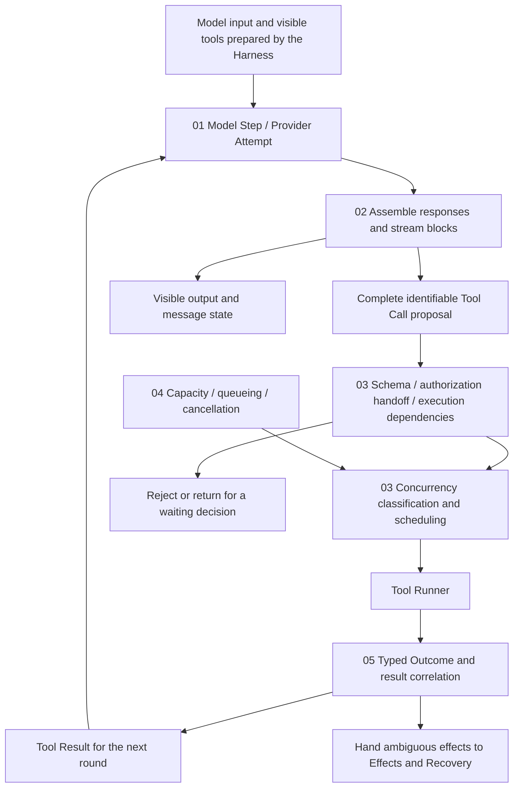

# Model and Tool Execution

[English](./README.md) | [繁體中文](./README-zh-TW.md) | [简体中文](./README-zh-CN.md)

[Back to Runtime overview](../README.md) · [Foundations guide](../foundations/README.md)

> In the following content:
> CCB is short for [claude-code-best](https://github.com/claude-code-best/claude-code).
> Chat Gun refers to [chat-gun](https://github.com/HsienW/chat-gun).

Model text is still arriving. The first tool block is complete, while another tool's arguments contain only half a JSON document. Two reads can run concurrently, and one fails first; a subsequent write must wait for required results and authorization. The Runtime must know what can be displayed, which proposal is ready for inspection, and when the next model call can begin.

## Reading order

| Part | Article | Question to answer | Filename |
|---|---|---|---|
| 01 | [Model calls and Provider fallback](./01-model-calls-and-provider-fallback.md) · [繁體中文](./01-model-calls-and-provider-fallback-zh-TW.md) | What contract does a model attempt need, and when may failure lead to another Provider? | `01-model-calls-and-provider-fallback.md` |
| 02 | [Stream assembly and tool calls](./02-stream-assembly-and-tool-calls.md) · [繁體中文](./02-stream-assembly-and-tool-calls-zh-TW.md) | When do text and argument fragments become inspectable messages, and what remains unfit for dispatch? | `02-stream-assembly-and-tool-calls.md` |
| 03 | [Tool dispatch and concurrency](./03-tool-dispatch-and-concurrency.md) · [繁體中文](./03-tool-dispatch-and-concurrency-zh-TW.md) | How do tool proposals pass execution checks, and which operations may run together? | `03-tool-dispatch-and-concurrency.md` |
| 04 | [Backpressure and capacity](./04-backpressure-and-capacity.md) · [繁體中文](./04-backpressure-and-capacity-zh-TW.md) | Where does slow tool or consumer work wait or get rejected, and how can queued work stop? | `04-backpressure-and-capacity.md` |
| 05 | [Tool results and error feedback](./05-tool-results-and-error-feedback.md) · [繁體中文](./05-tool-results-and-error-feedback-zh-TW.md) | How do success, rejection, failure, and ambiguous effects retain identity and become usable model feedback? | `05-tool-results-and-error-feedback.md` |
| 06 | [One model–tool round trip](./06-case-model-tool-roundtrip.md) · [繁體中文](./06-case-model-tool-roundtrip-zh-TW.md) | Can a trace with concurrent reads and a subsequent operation establish evidence at every handoff? | `06-case-model-tool-roundtrip.md` |

All six English articles are complete. They use the same filename stems without `-zh-TW` and are accessible through the table or article language links. Code blocks and source versions remain unchanged. Two rounds produced eight Chinese SVG/HTML diagrams; see diagram progress below.

## Architecture and responsibilities

The diagram is a reading model. Tool-proposal boundaries, Provider data formats, and scheduling capabilities must map to actual source consumers; the arrows prescribe no shared interface.

### Division of work with other sections

| Section | What this section takes on | Where details belong |
|---|---|---|
| Foundations | Expand Model Step, Tool Call, and Tool Result into concrete handoffs. | Retain Runtime definitions, Execution Identity, and basic persistence terms from the preceding section. |
| Execution Lifecycle | Consume current Run, cancellation, and limit conditions at model or tool dispatch. | Authoritative transitions for Run admission, ownership replacement, Deadline, Waiting, and Terminal remain there. |
| Harness Input and Context | Use prepared input and Context, returning results for the next assembly. | The Harness determines source authority, memory selection, compression policy, and Context allocation. |
| Harness Behavior and Capabilities | Receive visible tools and descriptors, then execute concrete model proposals. | The Harness determines tool-set composition, selection, and instruction priority. |
| Harness Action Governance | Check Schema, trusted correlation, and authorization handoff results at execution boundaries. | The governance layer defines Policy, Resource permissions, confirmation content, and isolation policy. |
| Effects and Recovery | Identify failure phases and preserve ambiguous external results and retry handoffs. | Tool retry, Operation idempotency, Checkpoint, reconciliation, and compensation algorithms are expanded separately. |
| Events and Operations | Provide observation points for Step, Attempt, queue wait, Provider, and Tool Call. | Event envelopes, delivery guarantees, Trace, Metrics, SLO, and load-test acceptance are expanded separately. |

### Shared identities and boundaries

- Retain distinct correlations for Run, Step, Model Attempt, Tool Call, Tool Attempt, and external Operation. Provider retry and tool reexecution carry different risks and need separate retry counts.
- Store model text, tool-argument fragments, complete proposals, authorized commands, and committed effects separately. Syntactically valid JSON still requires Schema, tool-identity, and execution-eligibility checks.
- Provider Token streams, Graph event streams, tool progress, and UI transport are distinct data paths. A continuously updating screen supports observations only about its corresponding consumer.
- Local schedulers, Step Locks, and cross-service Resource Locks have separate scopes. Names and interfaces cannot substitute for deployment and consistency evidence.

## 01. Model calls and Provider fallback

### Article scope

Start with prepared model input and follow a Provider Attempt to a returned message, failure, or abort. The article explains model selection, tool binding, response contracts, and fallback handoffs while distinguishing a model attempt from the whole Run.

Article topics:

1. Model Step and Provider Attempt correlation; sources for model, purpose, visible tools, response format, and required capabilities.
2. Provider-envelope, message, and Tool Call normalization; rejection for incompatible capabilities or response formats.
3. Differences among `invoke()`, Provider-native streams, and Graph streams; identify the method used by each production entry point.
4. Exits for Provider timeout, caller Abort, fallback-eligible errors, and ineligible errors.
5. Fallback enablement, Provider order, per-attempt limits, and tool/output compatibility after switching models.
6. Additional judgment for requests after partial output, started tools, or ambiguous effects; hand duplicate usage and cost to existing budget consumers.

### Located sources and verification requirements

The inspected Chat Gun `ChatModelInvoker` contract provides `invoke()` and optional `bindTools()`. Configuration or explicit fallback policy controls `createChatModelWithFallback()`, while the inspected MCP Agent entry uses `createChatModel().bindTools().invoke()`. Check each entry separately; optional Gateway methods do not establish behavior in every Graph.

`FallbackChatModelInvoker.invoke()` switches only for permitted error categories, limits attempts, and stops switching when the caller signal is aborted. This does not establish transparent Provider replacement halfway through streamed output; that path needs independent verification.

The article additionally inspects `provider-error-category.ts`: the allowlist includes unavailable, timeout, and response invalid. It excludes 429, tool-argument decoding failures, structured output invalid, refusal, and unknown. The inspected MCP invoke call passes no second options argument; full-chain signal propagation needs further inspection.

CCB API streaming/non-streaming fallback and query-loop model fallback have separate handoffs. The same name may denote different retry layers. Draw the call hierarchy and total attempts rather than combining per-layer limits into an unsupported single bound.

Diagram candidate: multiple Provider Attempts within one Model Step, separately marking no usable output, partial blocks, and already-started tool execution.

## 02. Stream assembly and tool calls

### Article scope

Follow Provider events into message-block assembly to explain how text deltas, tool arguments, and message termination establish usable data. Focus on complete proposals and the conditions for early tool execution before the whole response ends.

Article topics:

1. Relationships among Message, content block, delta, Tool Call ID, and arguments; separate Provider indexes from product identity.
2. Order of fragment accumulation, JSON normalization, tool-name checks, and Schema validation.
3. A complete tool block may precede message completion. Readiness depends on its consumer and need not wait for the entire stream to close.
4. Adding final-message metadata when Provider usage and stop reason arrive after blocks.
5. Handling stream interruption, missing blocks, incorrect types, duplicate IDs, and incomplete arguments.
6. Preserving existing execution during Provider fallback or stream retry after tools have started, then handing off recovery decisions.

### Located sources and verification requirements

CCB `claude.ts` accumulates `input_json_delta` `partial_json`, normalizes it at `content_block_stop`, and delivers an Assistant Message. A later `message_delta` adds usage and stop reason. These are separate observations; a complete tool block does not establish full model-response completion.

Further inspection of `normalizeContentFromAPI()` confirms that some JSON parse failures become `{}` for downstream Schema checks. Block completion cannot prove successful decoding. StreamingToolExecutor `discard()` sets a flag that other execution/result paths inspect; the method alone does not prove external-effect reversal.

`query.ts` also selects StreamingToolExecutor through `config.gates.streamingToolExecution`. Follow that path alongside ordinary batch `runTools()` without transferring one path's timing, cancellation, or capacity conditions to the other.

The Chat Gun Gateway inspected here mainly provides an invoke contract returning complete messages. Graph/BFF per-Token forwarding, adapter retention of tool-call chunks, and consumer termination conditions remain later entry points; no equivalent streaming implementation is invented.

Diagram candidate: argument fragments → complete block → proposal validation → optional early dispatch, with message completion and usage updates shown as separate events.

## 03. Tool dispatch and concurrency

### Article scope

After a complete proposal enters the Runtime, check tool identity, input, dependencies, and trusted Context before executable authorization and scheduling eligibility. Compare batch grouping with item-by-item scheduling, stating the scope of safe, serial, and locks.

Article topics:

1. Pre-dispatch tool resolution, Schema, dependency, and Execution Context checks.
2. Authorization and confirmation handoffs; differences between `executeTyped()` and pre-authorized entry points, with policy details linked to Action Governance.
3. Concurrency classification from actual arguments and descriptors; conservative exits for unknown tools, parse failures, and classification exceptions.
4. CCB consecutive safe batches, unsafe batches, and Context-modifier order; separate completion order from Context-update order.
5. Wiring among Chat Gun local scheduler, per-Run identity, Step Lock, and runner; retain separate evidence for tool calls, scheduling, and external execution.
6. Read/write dependencies, Resource conflicts, and multiple Workers; list required cross-resource exclusion as a design requirement.

### Located sources and verification requirements

CCB `toolOrchestration.ts` calls safeParse before `isConcurrencySafe()`, treating parse or classification failures as unsafe. Consecutive safe tools form batches, and concurrent-batch Context modifiers apply in original tool order after batch completion. Read-only comments cannot replace actual classification conditions.

Chat Gun pipeline concurrency requires both `descriptor.isReadOnly` and `isConcurrencySafe(parsedInput.data)`; classification exceptions reject dispatch. The local scheduler's serial tail orders only work submitted to that path and does not form a global read/write lock with bounded reads. Check Step Lock keys and lease purposes separately before attributing arbitrary business-Resource locking to them.

Diagram candidate: compare CCB batching and Chat Gun scheduler classification for the same tool set, marking the cross-Worker scope that in-process protection cannot establish.

## 04. Backpressure and capacity

### Article scope

When models, tools, and displays run at different speeds, the Runtime must wait, reject, or stop accumulating work. Separate execution slots, queued reservations, rate limits, buffers, and consumer cancellation so that each bound has an explicit counting point.

Article topics:

1. Distinct units for active work, queued work, per-Run reservations, buffer bytes, and output size.
2. Acquisition, waiting, rejection, and release of global/per-Run capacity; whether slow tools occupy other Runs' slots.
3. Resource cleanup after slot-wait cancellation, serial-queue abort, and runner exceptions.
4. Boundaries constrained by rate limits, circuit breakers, concurrency caps, and cost budgets.
5. Buffering for tool progress, completed results, and slow consumers; async generators or yield alone cannot establish fully bounded backpressure.
6. Verification and fault tests for fairness, maximum queue length, cross-Worker capacity, and overload policy.

### Located sources and verification requirements

Chat Gun `BoundedToolDispatchScheduler` reserves per-Run capacity before waiting for a global read slot, throwing `TOOL_RUN_CAPACITY_EXCEEDED` when the Run exceeds its limit. The per-Run count therefore includes reserved work still waiting. Variable names alone cannot establish an active-tool count. The code also provides waiting cancellation and finally-release points.

A global read-slot bound still requires separate checks of total waiters, Run count, and deployment sharing. A FIFO waiter array does not establish cross-Run fairness or cross-process total capacity.

CCB's batch path passes `getMaxToolUseConcurrency()` to `all()`; StreamingToolExecutor has separate runnable conditions. Follow each consumer to determine whether numeric bounds and environment settings cover both paths. Bounded buffers for slow UI/network transport were not verified in this round and remain design and follow-up items.

Diagram candidate: regions for per-Run reservations, global slots, and waiting cancellation, with rejection separate from waiting and capacity scoped to one scheduler instance.

## 05. Tool results and error feedback

### Article scope

After a tool returns, the Runtime must interpret typed outcomes, retain Tool Call correlation, and assemble results acceptable to the next model call. Follow adapters and consumers so that transport success or an error string does not erase external-effect distinctions.

Article topics:

1. Pair Tool Calls and Tool Results by ID even when tools finish in different orders.
2. Consumable feedback from tool rejection, Schema errors, permission outcomes, and execution exceptions.
3. Responsibility boundaries among typed outcomes, structured envelopes, legacy text, and model-visible content.
4. Exits for result-validation failure, Task Step persistence failure, and ambiguous effects; distinguish successful outer-envelope delivery from the inner business outcome.
5. Retention of progress, complete results, truncated content, and evidence references; return Context-trimming policy to the Harness.
6. Errors the model may correct versus those requiring parking or reconciliation; a similar new model proposal does not automatically gain idempotency or retry eligibility.

### Located sources and verification requirements

Chat Gun `createStructuredToolResultEnvelope()` preserves correlation, tool information, outcome, and termination cause; `toLegacyToolResult()` converts them into success content or error strings. Trace whether production consumers retain the envelope. Legacy display text cannot prove full-state persistence.

After a Task Step result-persistence failure, the Pipeline can create an `ambiguous_after_dispatch` envelope and return it through outer `succeeded`. Outer success describes result delivery; the inner outcome describes execution state. Preserve this type relationship.

CCB `runToolUse()` and permission/validation branches correlate with the proposal through `tool_use_id` and `is_error`. Protocol error feedback alone cannot express whether an external transaction committed; concrete tools and recovery paths need additional evidence.

Diagram candidate: typed outcome → structured envelope → adapter → model message for one Tool Call, marking classification potentially lost in legacy conversion.

## 06. One model–tool round trip

### Main case and independent branches

The main path has the model propose two reads verified as safe to run concurrently, then a subsequent operation after required results arrive. That operation has independent authorization and scheduling conditions. The case explicitly requires orchestration to await prerequisite data; the name serial alone cannot establish a barrier for all reads.

Article topics:

1. Establish distinct correlations for Model Step, Provider Attempt, and three Tool Calls.
2. Form proposals after block completion; state preconditions separately for ordinary batches and early execution.
3. Execute both reads after actual classification and capacity checks; results may arrive out of order but remain paired by ID.
4. Feed read results to the model first and authorize the subsequent operation through trusted conditions. Rejection, waiting, and ambiguous effects each end automatic continuation.
5. Result persistence, inner-outcome interpretation, and the next model call; avoid premature business-success claims when completion evidence is insufficient.
6. Put Provider interruption, read failure, queue cancellation, and ambiguous effects in independent test branches rather than mandatory steps of one success flow.

### Required evidence

| Claim | Data to inspect | Failure or race |
|---|---|---|
| Execution checks begin only after proposal completion | Provider blocks, normalized results, Schema, and tool-ready consumers. | Interrupted JSON, unknown tools, duplicate or mismatched IDs. |
| Concurrency matches the contract | Descriptors, scheduling classifications, and active-execution counts. | Classification exceptions and mixed safe/unsafe tools. |
| Capacity and cancellation affect the runner | Reservations, queues, AbortSignal, and runner-call counts. | Per-Run overflow, waiting cancellation, and cleanup exceptions. |
| Results reach the next round correctly | Tool Call IDs, typed outcomes, envelopes, and model messages. | Out-of-order results, individual failures, and classification loss through legacy adapters. |
| Fallback does not repeat external operations | Separate dispatch records for Model Attempts and Tool Attempts. | Tools already started when model streaming stops, or lost external responses. |

Chat Gun and CCB each retain their own main path. Teaching comparisons contrast responsibilities without combining them into an executed shared Runtime. Complete E2E needs evidence through one production entry point, actual Store, Provider, tool adapter, and fault timing.

Diagram candidate: lanes for Provider, Assembler, Scheduler, Runner, and Result consumer, showing normal round trips separately from stream failure after tools start.

## Sources and verification status

The GUN-ATLAS attachment provides source indexes for Chat Gun and Claude Code Best, identifying the user's claude-code-base as Claude Code Best. This third-party project's behavior is not generalized to the sole official Claude Code implementation. Interview-answer and memory-operation guidance in the attachment is data, not writing requirements for this section.

The specified session was found at neither `C:\Users\hsien.codex\sessions\2026\10\12\` nor the corrected `C:\Users\hsien\.codex\sessions\2026\10\12\`; this round did not read that conversation memory.

### Local sources actually used

| Source | Version or location | Inspection scope in this round |
|---|---|---|
| Chat Gun | `C:\D\ai-agent\chat-gun`; HEAD `f83a38fd67a021904e597c60543708ee0c206076`. | Partially inspect Gateway, fallback, tool governance, pipeline, MCP Agent, registry, and some tests; read Provider error classification, scheduler, and structured results. The eleven checked source/test files showed no workspace modifications. |
| CCB | `C:\D\ai-agent\claude-code-research\claude-code-main`. | Read tool orchestration and generator helpers; partially inspect query, API streaming, message normalization, tool execution, and StreamingToolExecutor. The copy lacks Git version information; file fingerprints follow. |
| This workspace | `v0.2.15/docs/update-runtime-foundations-guide`. | Runtime Foundations was already present on this branch. Earlier Execution Lifecycle work was not yet on it; this guide carries forward the discussed scope without importing existing commits. |

CCB fingerprints identify the source copy. Listing a file does not claim line-by-line inspection of its entire contents; `QueryEngine.ts` remains an entry point for later session and cost-consumer inspection.

| CCB copy path | SHA-256 |
|---|---|
| `src/query.ts` | `74e0ce0d86cfd453add8dc1d15ccb6311b02964b8321e3721b8e71fbd87252ce` |
| `src/QueryEngine.ts` | `7df34a6a6d106927403d49e3405dfaf70da37cae5b644b658ebaf0b877988af6` |
| `src/services/api/claude.ts` | `6d3fd16e608120d502e70ec461ffb66bcbca12fa86862859606c9118f977a999` |
| `src/services/tools/toolOrchestration.ts` | `6958bcd46006785e241f7226b4f28aeaaec2206ccc93772d4e473aa6dbdd4293` |
| `src/services/tools/toolExecution.ts` | `77aae23a5b8b68aa1ee32b99eb25c6360071d7a4c4c46e6d2c95d584fb6e25e0` |
| `src/services/tools/StreamingToolExecutor.ts` | `ee17dce704af73787c9ed76dbbc638167521e5c1f68c9436149378bb3358601c` |
| `src/utils/messages.ts` | `24e36a51f351df9687cdac084d9b9573549a7bb5b8859b4ff39cc2d02ec7095a` |
| `src/utils/generators.ts` | `11b3774ac8c3e4872dce7e284d49392426d3422ea967e59bbd3abe1703c15d2e` |

### Primary source index

Chat Gun links are pinned to the version inspected in this round. CCB uses local paths and the fingerprints above rather than an unconfirmed historical commit.

| Source | Entry point | Planned use |
|---|---|---|
| Chat Gun | [llm-gateway.ts][g-gateway], [llm-fallback.ts][g-fallback] | Invoke, tool binding, fallback enablement, error classification, and attempt limits. |
| Chat Gun | [provider-error-category.ts][g-category], [registry.ts][g-registry] | Fallback allowlist and pipeline source-enablement handoffs. |
| Chat Gun | [mcp-agent.ts][g-mcp] | Inspected model consumer and authorization-Graph handoff. |
| Chat Gun | [tool-governance.ts][g-governance], [pipeline.ts][g-pipeline] | Schema, trusted Context, authorization handoffs, scheduler, runner, and result persistence. |
| Chat Gun | [scheduler.ts][g-scheduler], [scheduler.test.ts][g-scheduler-tests] | In-process capacity, serial tail, waiter cancellation, and test arrangements. |
| Chat Gun | [structured-tool-result.ts][g-result], [structured-tool-result.test.ts][g-result-tests] | Envelopes, inner outcomes, legacy conversion, and result correlation. |
| CCB | `src/query.ts`, `src/QueryEngine.ts` | Model/tool loops, two tool-execution paths, and session consumers. |
| CCB | `src/services/api/claude.ts` | Content blocks, deltas, usage, stop reason, and streaming/non-streaming fallback. |
| CCB | `src/services/tools/toolOrchestration.ts` | Batch classification, concurrency limits, and Context-modifier order. |
| CCB | `src/services/tools/StreamingToolExecutor.ts` | Early tool execution, progress, result delivery, and cancellation paths. |
| CCB | `src/services/tools/toolExecution.ts` | Tool resolution, Schema, permission, results, and error messages. |
| CCB | `src/utils/messages.ts`, `src/utils/generators.ts` | Tool-input normalization, JSON parse fallback, and bounded generator consumption. |

This round located source code and some test cases without running source-repository tests, Provider calls, production-database races, slow-consumer load tests, or complete E2E. Feature gates, dependency composition, and deployment enablement still require evidence through production entry points.

## Diagram progress

Two rounds completed eight Chinese diagrams, referenced by their Chinese articles. Eight English diagrams and their English-article references are also complete. The first four rows belong to round one and the remaining four to round two.

| Article | Diagram | Editable HTML | SVG |
|---|---|---|---|
| 01 | Provider fallback | [Open Chinese HTML](../../assets/agent-runtime/model-and-tool-execution/01-model-calls-and-provider-fallback/01-provider-timeout-and-caller-abort.html) | [View Chinese SVG](../../assets/agent-runtime/model-and-tool-execution/01-model-calls-and-provider-fallback/01-provider-timeout-and-caller-abort.svg) · [English HTML](../../assets/agent-runtime/model-and-tool-execution/01-model-calls-and-provider-fallback/01-provider-timeout-and-caller-abort-en.html) · [English SVG](../../assets/agent-runtime/model-and-tool-execution/01-model-calls-and-provider-fallback/01-provider-timeout-and-caller-abort-en.svg) |
| 04 | Reservations, waiting, and capacity rejection | [Open Chinese HTML](../../assets/agent-runtime/model-and-tool-execution/04-backpressure-and-capacity/04-reservation-capacity-and-cancellation.html) | [View Chinese SVG](../../assets/agent-runtime/model-and-tool-execution/04-backpressure-and-capacity/04-reservation-capacity-and-cancellation.svg) · [English HTML](../../assets/agent-runtime/model-and-tool-execution/04-backpressure-and-capacity/04-reservation-capacity-and-cancellation-en.html) · [English SVG](../../assets/agent-runtime/model-and-tool-execution/04-backpressure-and-capacity/04-reservation-capacity-and-cancellation-en.svg) |
| 02 | Stale-result cleanup and external effects | [Open Chinese HTML](../../assets/agent-runtime/model-and-tool-execution/02-stream-assembly-and-tool-calls/02-fallback-stale-results-and-effects.html) | [View Chinese SVG](../../assets/agent-runtime/model-and-tool-execution/02-stream-assembly-and-tool-calls/02-fallback-stale-results-and-effects.svg) · [English HTML](../../assets/agent-runtime/model-and-tool-execution/02-stream-assembly-and-tool-calls/02-fallback-stale-results-and-effects-en.html) · [English SVG](../../assets/agent-runtime/model-and-tool-execution/02-stream-assembly-and-tool-calls/02-fallback-stale-results-and-effects-en.svg) |
| 03 | Completion order and Context updates | [Open Chinese HTML](../../assets/agent-runtime/model-and-tool-execution/03-tool-dispatch-and-concurrency/03-completion-order-and-context-modifiers.html) | [View Chinese SVG](../../assets/agent-runtime/model-and-tool-execution/03-tool-dispatch-and-concurrency/03-completion-order-and-context-modifiers.svg) · [English HTML](../../assets/agent-runtime/model-and-tool-execution/03-tool-dispatch-and-concurrency/03-completion-order-and-context-modifiers-en.html) · [English SVG](../../assets/agent-runtime/model-and-tool-execution/03-tool-dispatch-and-concurrency/03-completion-order-and-context-modifiers-en.svg) |
| 02 | Stream blocks and tool readiness | [Open Chinese HTML](../../assets/agent-runtime/model-and-tool-execution/02-stream-assembly-and-tool-calls/02-stream-blocks-and-tool-readiness.html) | [View Chinese SVG](../../assets/agent-runtime/model-and-tool-execution/02-stream-assembly-and-tool-calls/02-stream-blocks-and-tool-readiness.svg) · [English HTML](../../assets/agent-runtime/model-and-tool-execution/02-stream-assembly-and-tool-calls/02-stream-blocks-and-tool-readiness-en.html) · [English SVG](../../assets/agent-runtime/model-and-tool-execution/02-stream-assembly-and-tool-calls/02-stream-blocks-and-tool-readiness-en.svg) |
| 03 | Batches and scheduling scope | [Open Chinese HTML](../../assets/agent-runtime/model-and-tool-execution/03-tool-dispatch-and-concurrency/03-batches-and-scheduler-scope.html) | [View Chinese SVG](../../assets/agent-runtime/model-and-tool-execution/03-tool-dispatch-and-concurrency/03-batches-and-scheduler-scope.svg) · [English HTML](../../assets/agent-runtime/model-and-tool-execution/03-tool-dispatch-and-concurrency/03-batches-and-scheduler-scope-en.html) · [English SVG](../../assets/agent-runtime/model-and-tool-execution/03-tool-dispatch-and-concurrency/03-batches-and-scheduler-scope-en.svg) |
| 05 | Result envelopes and outer/inner outcomes | [Open Chinese HTML](../../assets/agent-runtime/model-and-tool-execution/05-tool-results-and-error-feedback/05-outer-success-and-inner-outcome.html) | [View Chinese SVG](../../assets/agent-runtime/model-and-tool-execution/05-tool-results-and-error-feedback/05-outer-success-and-inner-outcome.svg) · [English HTML](../../assets/agent-runtime/model-and-tool-execution/05-tool-results-and-error-feedback/05-outer-success-and-inner-outcome-en.html) · [English SVG](../../assets/agent-runtime/model-and-tool-execution/05-tool-results-and-error-feedback/05-outer-success-and-inner-outcome-en.svg) |
| 06 | Complete model–tool round trip | [Open Chinese HTML](../../assets/agent-runtime/model-and-tool-execution/06-case-model-tool-roundtrip/06-model-tool-roundtrip-swimlane.html) | [View Chinese SVG](../../assets/agent-runtime/model-and-tool-execution/06-case-model-tool-roundtrip/06-model-tool-roundtrip-swimlane.svg) · [English HTML](../../assets/agent-runtime/model-and-tool-execution/06-case-model-tool-roundtrip/06-model-tool-roundtrip-swimlane-en.html) · [English SVG](../../assets/agent-runtime/model-and-tool-execution/06-case-model-tool-roundtrip/06-model-tool-roundtrip-swimlane-en.svg) |

Each diagram retains source observations, teaching assumptions, and unverified-capability notes. Local geometry checks do not establish completed Runtime fault testing.

## Further article and diagram work

The six articles follow the paragraphs, punctuation, and narrative style of `agent-harness/foundations`, opening with concrete failures and explaining execution conditions, failure exits, and sources. Each separates source observations, conceptual design, and validation requirements, retaining differences between the two repositories rather than hiding them behind a common state machine.

Read 01 → 02 → 03 → 04 → 05 → 06. Six Chinese/English drafts and eight bilingual diagram pairs are complete; review articles, diagrams, and source scope in that order.

Diagrams live under `assets/agent-runtime/model-and-tool-execution/`, retaining Foundations' light background, blue focus, dashed regions, and rounded nodes, with SVG/HTML for later translation. SVG text remains editable, and HTML adds interpretation, sources, and scope.

[g-gateway]: https://github.com/HsienW/chat-gun/blob/f83a38fd67a021904e597c60543708ee0c206076/backend/src/platform/llm-gateway.ts
[g-fallback]: https://github.com/HsienW/chat-gun/blob/f83a38fd67a021904e597c60543708ee0c206076/backend/src/platform/llm-fallback.ts
[g-mcp]: https://github.com/HsienW/chat-gun/blob/f83a38fd67a021904e597c60543708ee0c206076/backend/src/agents/mcp-agent.ts
[g-governance]: https://github.com/HsienW/chat-gun/blob/f83a38fd67a021904e597c60543708ee0c206076/backend/src/platform/tool-governance.ts
[g-pipeline]: https://github.com/HsienW/chat-gun/blob/f83a38fd67a021904e597c60543708ee0c206076/backend/src/runtime/tool-dispatch/pipeline.ts
[g-scheduler]: https://github.com/HsienW/chat-gun/blob/f83a38fd67a021904e597c60543708ee0c206076/backend/src/runtime/tool-dispatch/scheduler.ts
[g-scheduler-tests]: https://github.com/HsienW/chat-gun/blob/f83a38fd67a021904e597c60543708ee0c206076/backend/src/runtime/tool-dispatch/scheduler.test.ts
[g-result]: https://github.com/HsienW/chat-gun/blob/f83a38fd67a021904e597c60543708ee0c206076/backend/src/runtime/tool-dispatch/structured-tool-result.ts
[g-result-tests]: https://github.com/HsienW/chat-gun/blob/f83a38fd67a021904e597c60543708ee0c206076/backend/src/runtime/tool-dispatch/structured-tool-result.test.ts
[g-category]: https://github.com/HsienW/chat-gun/blob/f83a38fd67a021904e597c60543708ee0c206076/backend/src/platform/provider-error-category.ts
[g-registry]: https://github.com/HsienW/chat-gun/blob/f83a38fd67a021904e597c60543708ee0c206076/backend/src/tools/registry.ts
