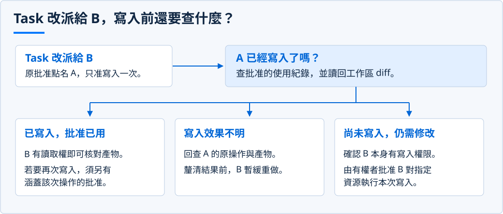

# A 獲准的操作，改派給 B 後還有效嗎？

假設維護者批准「由 Worker A 在指定工作區修改地址驗證函式一次」。A 離開後，協調者把同一筆 Task 指派給 B，交辦信裡附著原本的同意紀錄。B 已有工作可接，但這份批准點名的是 A。平台要在 B 寫入前查明兩件事：B 本身有沒有這項權限，以及原批准是否涵蓋這次操作。

| 交辦改了哪一項 | 寫入前要查什麼 | 本例由誰決定 |
|---|---|---|
| 只把 A 換成 B | 查批准綁定的是具名 Worker、角色或團隊；若可依角色接手，核對 B 的有效角色、批准期限與剩餘次數。 | 本例明列 A，由對該工作區有批准權的維護者確認 B。若原批准明訂同角色可接手，則依既有條件核對。 |
| 把目標從地址函式換成訂單匯入模組 | 查資源識別、實際寫入位置，以及原批准涵蓋的檔案或工作區範圍。 | 新模組超出原批准，由對新資源有批准權的人處理；原維護者是否有權批准，須查新模組的權限。 |
| 保留原目標，另要求交付後部署 | 分開核對寫檔與部署。查部署環境、操作種類，以及 B 是否具備部署資格。 | 寫檔部分可按仍有效的條件進行；部署由有權核准該環境的人決定。 |

## A 已經做過了嗎？

改派時若只看 Task 的負責人，容易漏掉 A 可能已經寫檔。協調者應先查原批准的使用紀錄，並讀回工作區的 diff。若 A 已成功寫入並用掉一次批准，B 可以在具備讀取權限時接手核對產物；若還要再寫一次，就需要能涵蓋下一次寫入的批准。若寫入結果不明，先回查原操作，讓 B 暫緩重做。

接手紀錄應讓審閱者找得到原批准、舊與新執行者、這次的目標和操作，以及誰作出沿用或重新批准的決定。協調者可轉交請求；要替新資源或操作作決定，還得具備對應權限。本篇用具名、一次性的批准說明平台治理取捨，並未驗證 Munder Difflin 的執行入口具有此套檢查。[授權身分與資源範圍](../../agent-harness/action-governance/02-authorization-and-scope-zh-TW.md) · [人工確認與批准有效性](../../agent-harness/action-governance/03-human-confirmation-zh-TW.md)

[回到 Multi-Agent Harness](../README-zh-TW.md)
