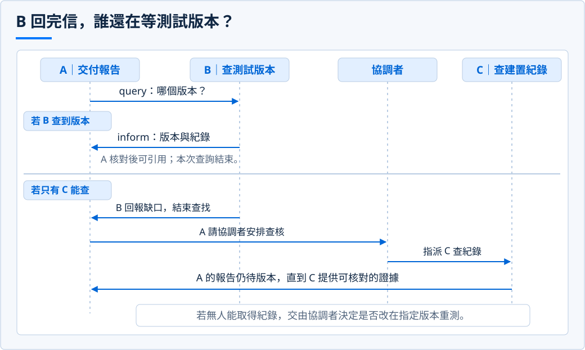

# Worker 遇到阻礙時，該追問、轉交，還是回報？

A 要交付一份測試報告，手上的結果卻少了程式版本。它寄一封 `query` 給執行測試的 B，問「這次台灣地址案例跑在哪個 revision？」此時 B 要回答這個問題，A 仍負責交付報告。收到查詢本身，不會讓 B 接手整份報告。

| B 查到什麼 | 接下來由誰處理 | 這次往返何時可以結束 |
|---|---|---|
| 測試紀錄有 revision，也有對應案例 | B 回覆 A，附版本與紀錄位置，用 `in_reply_to` 指回原查詢。 | A 核對版本與案例後可引用結果。若 B 用 `inform` 提供答案，無須再寄一封致謝來結束往返。 |
| 紀錄裡有兩次測試，B 缺少辨認依據 | B 只追問能分辨兩次測試的資料，例如原案例的輸入。A 補充後，由 B 完成原查詢。 | 能對回其中一次就回報該次證據；若兩次都對不上，B 應說明缺口。 |
| 只有建置 Worker C 能取得紀錄 | B 告知 A 所缺資料與持有人；若需 C 接手查核，由有派工權的協調者指定工作與回報對象。 | B 可以結束自己的查找。A 仍須等 C 的結果，或等協調者決定改用其他證據。 |

## 兩邊都查不到時

若 A 沒保留測試輸入，B 也找不到版本，互相再問一次不會多出證據。A 可以把可取得的紀錄、已查過的位置，以及兩個選項一併交給協調者：請有權讀建置紀錄的人查回版本，或在指定版本重新測試。若重跑需要額外資源且超出協調者的權限，再由協調者請操作人員決定。等待期間，原 Task 應保留「測試版本待確認」。

這些角色與處置是教學案例。Munder Difflin 的 Hive **設計**要求對 `request`、`query`、`propose` 作出回應；單純的 `inform` 或 `done` 可以結束訊息往返。回覆會增加 `hops`，超過上限時交由協調者處理。這些規則回答「誰還需要回信」；任務能否結案，仍要看 A 能否交出有版本依據的報告。[Hive 訊息與往返上限](https://github.com/HarnessMD/munder-difflin/blob/96ae43e3292447f68af6904afb353f6f5bdaa412/HIVE.md#L96-L119) · [信已送達，Worker 何時會處理？](../../multi-agent-runtime/foundations/02-mailbox-and-cli-progress-zh-TW.md)

[回到 Multi-Agent Harness](../README-zh-TW.md)
