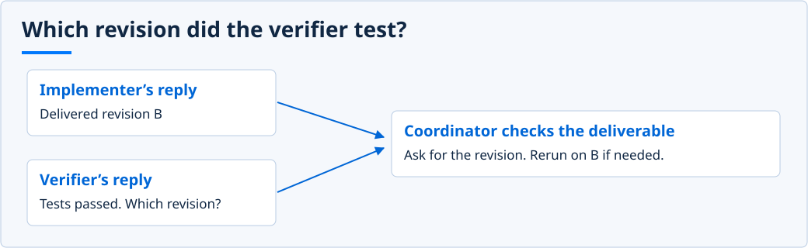

# 收到回信后，谁能判定交付完成？

[English](./02-delivery-and-acceptance.md) | [繁體中文](./02-delivery-and-acceptance-zh-TW.md) | [简体中文](./02-delivery-and-acceptance-zh-CN.md)

协调者请实现者修正地址验证函数，再请另一位 Worker 验证。两封回信都能对应到原 Task。实现者交付了版本 B，验证者只写了“测试通过”。此时可以登记已收到测试报告，但验收还缺一个信息：测试用的是哪个版本。

协调者可以请验证者补充测试时使用的 revision。如果测的是 B，就再核对测试是否覆盖原先失败的输入。如果测的是 A，就把 B 交给验证者重跑。实现者已经交付的修改仍可使用。

## 沿一次委派追查交付物

换一项可以直接核查的工作。请 Claude Worker 找出 README 中一个失效的相对链接，报告行号和目标路径。下表根据进程实现与 Hive 协议整理了教学示例的执行顺序，端到端流程仍待实测。[PTY 创建与退出处理](https://github.com/HarnessMD/munder-difflin/blob/96ae43e3292447f68af6904afb353f6f5bdaa412/src/main/pty.ts#L895-L975) · [Hive 协作协议](https://github.com/HarnessMD/munder-difflin/blob/96ae43e3292447f68af6904afb353f6f5bdaa412/HIVE.md)

| 阶段 | 执行者与操作 | 可核对的证据 |
|---|---|---|
| 创建任务 | Orchestrator 指定 Worker、目标 README 和验收条件。 | Task ID、Agent ID、工作区及指定的文件版本。 |
| 启动 | 主进程准备协作指令、工作目录和环境，再通过 PTY 启动 CLI。 | CLI 实际收到的启动参数、PTY ID 及当前进程。 |
| 收件 | Orchestrator 发送请求，Router 投递，Worker 在可以处理新任务时读信。 | 原 Message ID、收件人、收件记录及后续回复与原消息的关联。 |
| 执行 | CLI 读取 README，按文件所在目录解析相对路径并检查目标。 | 所属 CLI Session、可取得的工具事件或 Transcript。 |
| 报告结果 | Worker 回信，接收方打开同一版本的 README，按行号和路径验收。 | 回信与原消息的关联、文件内容、目标是否存在及 Task 记录。 |
| 退出 | 演练结束后关闭 Worker，主进程处理对应 Session 的退出通知。 | 与当前 Session 匹配的退出事件、exit code、signal 及登记记录的清理结果。 |

假设 Worker 发出回信后立即退出，Task 记录中仍显示“执行中”。接手的人可以按原消息 ID 找到回复，再打开分派时指定的版本，核对 README 的行号、相对路径和目标文件是否存在。三项与报告相符，就有依据补记结果。如果回信没写版本，应先查清它检查的是哪一版 README。此时重启 Worker，只能解决进程已退出的问题。[PTY 创建与退出处理](https://github.com/HarnessMD/munder-difflin/blob/96ae43e3292447f68af6904afb353f6f5bdaa412/src/main/pty.ts#L895-L975)

**待实测**　在投递后重启 Worker，保存重启前后的 CLI Session、收件记录、回信和产物，核对是否恢复了原对话，以及同一项工作是否执行了两次。

[返回本区基础篇](./README-zh-CN.md)
