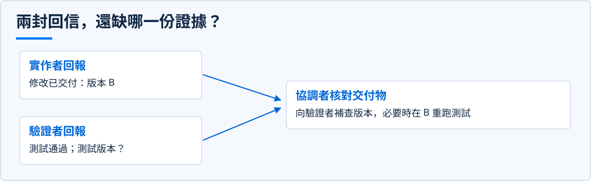

# 收到回信後，誰能判定交付完成？

協調者請實作者修正地址驗證函式，再請另一位 Worker 驗證。兩封回信都對得上原 Task。實作者交付版本 B，驗證者只寫「測試通過」。此時可以登記已收到測試回報，驗收仍缺測試使用的版本。

協調者可以請驗證者補上測試時的 revision。若測的是版本 B，再核對測試是否涵蓋原來失敗的輸入。若測的是版本 A，便將版本 B 交回驗證者重跑。實作者已交出的修改仍可沿用。

## 沿一筆委派查回交付物

換一件能直接查驗的工作。請 Claude Worker 找出 README 中一個失效的相對連結，回報所在行號與目標路徑。下表是依程序實作與 Hive 協定整理的教學時序，端到端執行仍待實測。[PTY 建立與退出處理](https://github.com/HarnessMD/munder-difflin/blob/96ae43e3292447f68af6904afb353f6f5bdaa412/src/main/pty.ts#L895-L975)、[Hive 協作協定](https://github.com/HarnessMD/munder-difflin/blob/96ae43e3292447f68af6904afb353f6f5bdaa412/HIVE.md)

| 時點 | 執行者與動作 | 可核對的證據 |
|---|---|---|
| 建立工作 | Orchestrator 指定 Worker、目標 README 與驗收條件。 | Task ID、Agent ID、工作區及指定的檔案版本。 |
| 啟動 | 主程序準備協作指令、工作目錄與環境，再透過 PTY 啟動 CLI。 | CLI 實際收到的啟動參數、PTY ID 及目前程序。 |
| 收件 | Orchestrator 寄出請求，Router 投遞，Worker 在可處理新工作時讀信。 | 原 Message ID、收件人、收件紀錄與後續回覆關聯。 |
| 執行 | CLI 讀 README，按檔案所在目錄解析相對路徑並檢查目標。 | 所屬 CLI Session、可取得的工具事件或 Transcript。 |
| 回報 | Worker 回信，接收端打開同一版本的 README，依行號與路徑驗收。 | 回信的原件關聯、檔案內容、目標是否存在及 Task 紀錄。 |
| 退出 | 演練結束後關閉 Worker，主程序處理該 Session 的退出通知。 | 與目前 Session 相符的退出事件、exit code、signal 及登錄清理。 |

假設 Worker 寄出回信後立刻退出，Task 帳本仍寫著「執行中」。接手的人可以沿著原信的 ID 找回覆，再到交辦時指定的版本，核對 README 的行號、相對路徑及目標檔是否存在。三項都對得上，就有依據補登結果。若回信漏了版本，應先釐清它檢查的是哪份 README；此時重新啟動 Worker，只能解決程序已退出的問題。[PTY 建立與退出處理](https://github.com/HarnessMD/munder-difflin/blob/96ae43e3292447f68af6904afb353f6f5bdaa412/src/main/pty.ts#L895-L975)

**待實測**　在投遞後重啟 Worker，保存前後的 CLI Session、收件紀錄、回信與產物，核對是否接回原對話，以及同一份工作是否執行了兩次。

[回到本區基礎篇](./README-zh-TW.md)
