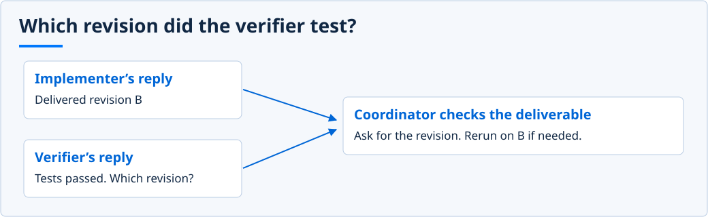

# Who decides whether the work is complete once the replies arrive?

[English](./02-delivery-and-acceptance.md) | [繁體中文](./02-delivery-and-acceptance-zh-TW.md) | [简体中文](./02-delivery-and-acceptance-zh-CN.md)

The coordinator asks one worker to fix an address validation function and another to verify it. Both replies refer to the original task. The implementer delivers revision B, but the verifier writes only “tests passed.” The coordinator can record receipt of the test report. To accept the fix, they still need to know which revision was tested.

The coordinator can ask the verifier for the revision used in the test. If it was B, check whether the tests covered the input that originally failed. If it was A, send B to the verifier for another run. The implementer’s existing change can still be used.

## Trace an assignment back to its deliverable

Consider a result the coordinator can check directly. Ask a Claude worker to find a broken relative link in a README and report the line number and target path. The sequence below is a teaching example based on the process implementation and Hive protocol. An end-to-end run is still pending. [PTY creation and exit handling](https://github.com/HarnessMD/munder-difflin/blob/96ae43e3292447f68af6904afb353f6f5bdaa412/src/main/pty.ts#L895-L975) · [Hive collaboration protocol](https://github.com/HarnessMD/munder-difflin/blob/96ae43e3292447f68af6904afb353f6f5bdaa412/HIVE.md)

| Stage | Who does what | Evidence to check |
|---|---|---|
| Create the task | The orchestrator names the worker, target README, and acceptance criteria. | Task ID, agent ID, workspace, and requested file revision. |
| Start the worker | The main process prepares collaboration instructions, the working directory, and the environment, then starts the CLI through a PTY. | Arguments the CLI actually received, PTY ID, and current process. |
| Receive the assignment | The orchestrator sends the request, the router delivers it, and the worker reads it when ready to take work. | Original message ID, recipient, receipt record, and the reference in the eventual reply. |
| Check the link | The CLI reads the README, resolves the relative path from the file’s directory, and checks the target. | CLI session and any available tool events or transcript. |
| Report the result | The worker replies. The recipient opens the same README revision and checks the reported line and path. | The reply’s reference to the request, file contents, whether the target exists, and the task record. |
| Exit | The worker is shut down after the exercise. The main process handles that session’s exit notification. | Exit event for the current session, exit code, signal, and cleanup of the session entry. |

Suppose the worker exits immediately after replying and the task ledger still says “running.” Whoever takes over can find the reply by the original message ID, open the assigned revision, and check the README line, the relative path, and whether the target exists. If all three agree with the report, they can record the result. If the reply omits the revision, first establish which README the worker checked. Restarting the worker only addresses the process exit. [PTY creation and exit handling](https://github.com/HarnessMD/munder-difflin/blob/96ae43e3292447f68af6904afb353f6f5bdaa412/src/main/pty.ts#L895-L975)

**Pending verification.** Restart the worker after delivery. Keep the CLI session details from before and after the restart, together with receipt records, replies, and artifacts. Check whether the worker resumed the original conversation and whether it performed the same work twice.

[Back to Multi-Agent Harness foundations](./README.md)
