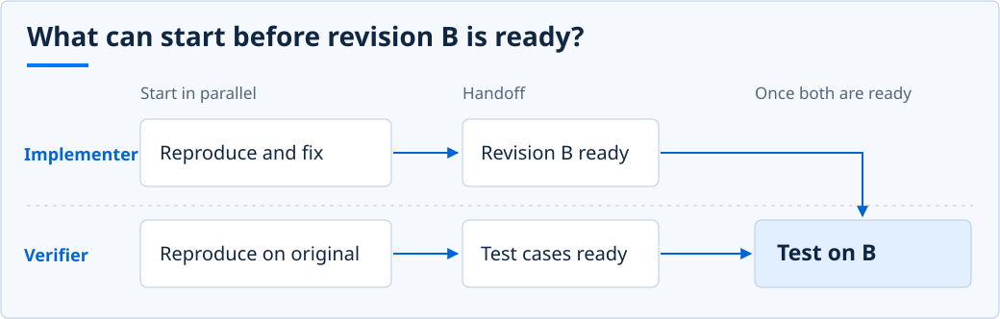

# 一项工作该拆给哪些 Worker？

[English](./03-work-decomposition.md) | [繁體中文](./03-work-decomposition-zh-TW.md) | [简体中文](./03-work-decomposition-zh-CN.md)

地址验证函数拒绝了一个有效地址。协调者手里有原始输入、预期结果和出错的代码版本。分派前可以先问：谁能修好函数，谁能独立判断这个输入现在可以通过？沿用第 02 篇的教学场景，由实现者交付修正，验证者从用户遇到的问题出发，检查交付版本。

| 子任务 | 负责人 | 开始前需要什么 | 交给下一位的是什么 |
|---|---|---|---|
| 复现问题并修正函数 | 实现者 | 出错版本、原始输入、预期结果及允许修改的范围 | 可访问的版本 B，以及相对于出错版本的 diff |
| 准备测试用例 | 验证者 | 同一份原始输入和预期结果 | 能在原版本复现错误的测试，以及本来就应当拒绝的输入示例 |
| 在交付版本上验证 | 验证者 | 实现者已交付版本 B，验证者能够访问它 | 实际测试的版本、使用的用例及各自的结果 |
| 验收原任务 | 协调者 | 修改报告和测试报告 | 核对修改范围、版本和结果后，向用户说明修正了什么 |

前两项可以同时开始。即使修正还没完成，验证者在原版本复现错误后，就已经有了一个能检出问题的测试。要判断修正是否有效，才需要等版本 B。如果验证者拿不到 B，应请实现者提供可访问的版本，并说明目前只验证了原版。协调者可以据此找到工作卡在哪个交接环节。

## 什么时候一个 Worker 就够了？

第 01 篇的任务只要求找出指定版本 README 里的一个失效链接。一个 Worker 就能报告文件名、行号和目标路径，协调者打开同一份文件即可核对。如果拆成“找链接”和“查路径”两项任务，第二个 Worker 还得等第一个提供文件位置，协调者却没有因此多得到一份独立的判断依据。

写任务消息前，协调者可以先补全这句话：“这位 Worker 交付什么，下一位就能开始哪一步？”对于地址修正，可以填入“交付版本 B 后，验证者就能运行事先准备好的测试”。对于 README 检查，则可以直接把结果交给验收者。确定分工后，再为每位收件人写清范围和交付物。[如何把工作交给另一个 Agent？](./01-delegation-contract-zh-CN.md)

[返回本区基础篇](./README-zh-CN.md)
