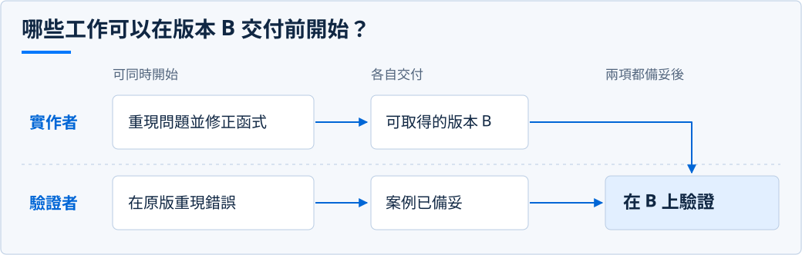

# 一件工作該拆給哪些 Worker？

[English](./03-work-decomposition.md) | [繁體中文](./03-work-decomposition-zh-TW.md) | [简体中文](./03-work-decomposition-zh-CN.md)

一筆有效的地址被驗證函式拒絕了。協調者手上有原始輸入、預期結果和出錯的程式版本。派工前值得先問：誰能改好函式，誰能獨立判斷這筆輸入已經可以通過？沿用第 02 篇的教學情境，這次由實作者交出修正，驗證者從使用者遇到的問題出發，檢查交付版本。

| 子任務 | 負責人 | 開始前需要什麼 | 交給下一位的是什麼 |
|---|---|---|---|
| 重現問題並修正函式 | 實作者 | 出錯版本、原始輸入、預期結果及允許修改的範圍 | 可取用的版本 B、相對於出錯版本的 diff |
| 準備驗證案例 | 驗證者 | 同一份原始輸入與預期結果 | 能在出錯版本重現問題的測試，以及原本就該拒絕的輸入範例 |
| 在交付版本上驗證 | 驗證者 | 實作者已交出版本 B，且驗證者能取得該版本 | 實際測試的版本、使用的案例與各自結果 |
| 驗收原任務 | 協調者 | 修改與測試兩份回報 | 核對修改範圍、版本及結果後，向使用者說明修正了什麼 |

前兩項可以同時開始。驗證者在原版重現錯誤，即使修正尚未完成，也已經有一個能檢出問題的測試。要判斷修正是否有效，才需要等版本 B。如果驗證者拿不到 B，應向實作者索取可取得的版本，並回報目前只驗過原版。協調者可以據此找出卡住的交接點。

## 什麼情況用一位 Worker 就夠？

第 01 篇的任務只要求找出指定版本 README 裡的一個失效連結。一位 Worker 就能回報檔名、行號和目標路徑，協調者打開同一份文件即可核對。若拆成「找連結」與「查路徑」兩份委派，第二位 Worker 還得等待第一位交出文件位置，協調者卻沒有多得到一份獨立的判斷依據。

寫交辦信前，協調者可以先寫下「這位 Worker 交出什麼，下一位就能開始哪一步」。地址修正案能明確填入「交出版本 B，驗證者就能用事先準備的案例測試」。README 查核案則能直接把結果交給驗收者。分工確定後，再為每位收件人寫清楚範圍與交付物。[如何把工作交給另一個 Agent？](./01-delegation-contract-zh-TW.md)

[回到本區基礎篇](./README-zh-TW.md)
