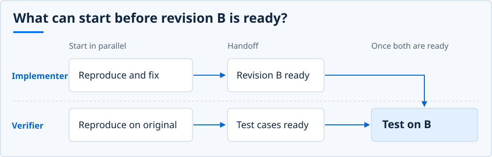

# How should you divide work among workers?

[English](./03-work-decomposition.md) | [繁體中文](./03-work-decomposition-zh-TW.md) | [简体中文](./03-work-decomposition-zh-CN.md)

An address validation function rejects a valid address. The coordinator has the original input, the expected result, and the revision that failed. Before assigning work, consider who can fix the function and who can independently establish that the input now passes. In the example from article 02, the implementer delivers a fix, and the verifier checks that revision against the problem the user encountered.

| Subtask | Owner | What they need to start | What they hand over |
|---|---|---|---|
| Reproduce the issue and fix the function | Implementer | Failing revision, original input, expected result, and permitted scope of edits | An accessible revision B and its diff against the failing revision |
| Prepare test cases | Verifier | The same original input and expected result | A test that reproduces the failure on the original revision, plus examples of inputs the function should reject |
| Verify the delivered revision | Verifier | The implementer has delivered B and the verifier can access it | Revision tested, cases run, and the result for each |
| Accept the original task | Coordinator | Both the change report and the test report | An account for the user of what was fixed, after checking scope, revision, and results |

The first two subtasks can start together. Once the verifier reproduces the error on the original revision, they have a test that detects the problem even while the fix is in progress. They need revision B to check whether the fix works. If B is unavailable, the verifier should ask the implementer for an accessible revision and report that they have tested only the original. The coordinator can then locate the blocked handoff.

## When is one worker enough?

In article 01, the assignment asks only for a broken link in a specific README revision. One worker can report the filename, line number, and target path. The coordinator can open the same file to check. Splitting “find the link” from “check the path” makes the second worker wait for the file location without giving the coordinator any additional independent evidence.

Before writing the assignment, the coordinator can complete the sentence “Once this worker delivers ___, the next one can start ___.” For the address fix, delivering B lets the verifier run the prepared tests. For the README check, the result can go straight to the reviewer. Once the division of work is clear, specify the scope and deliverable for each recipient. [How do you delegate work to another agent?](./01-delegation-contract.md)

[Back to Multi-Agent Harness foundations](./README.md)
