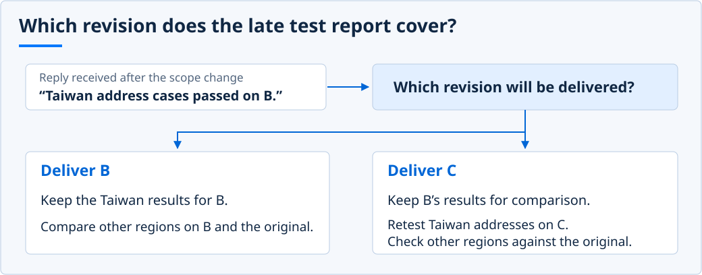

# 要求变了，哪些委派仍然有效？

[English](./04-revising-delegated-work.md) | [繁體中文](./04-revising-delegated-work-zh-TW.md) | [简体中文](./04-revising-delegated-work-zh-CN.md)

实现者已交付地址验证函数的版本 B，验证者正在测试。此时操作人员补充道：“这次只修正台湾地址格式，其他地区保持原有行为。”原 Task、收件人和版本 B 都没变，验收条件却多了一项。即使随后收到“B 的测试通过”，协调者也要先看测了哪些地区，才能判断这封回信能用在哪里。

这个教学场景假设操作人员有权调整范围。协调者更新原 Task，并将修订后的要求发给受影响的 Worker。实现者可以指出哪些修改受影响，验证者可以建议补充用例。如果两人对范围的理解有分歧，协调者需要向操作人员问清楚，再把同一个决定告知双方。

| 原委派及进度 | 要求变更后如何处理 | 谁需要收到什么 |
|---|---|---|
| 实现者已交付版本 B | 先核对 diff。如果 B 的修改仅限台湾地址，可继续验证 B。如果共用规则的改动也影响了其他地区，请实现者缩小修改范围并交付版本 C。 | 实现者收到新范围和原委派的标识，回复可继续使用的版本或提供新版本。 |
| 验证者已准备好台湾地址的失败用例 | 保留该用例，补充其他地区的代表性输入及其在原版本上的预期结果。测试数据可以先准备，最终验证要等交付版本确定。 | 验证者收到修订后的验收条件，以及需要测试的版本。 |
| 原委派的“B 测试通过”在要求变更后才送达 | 根据回信找到原委派，核对版本、用例和结果。如果最终沿用 B，已覆盖的用例可以采纳。如果改交 C，保留 B 的记录作对照，在 C 上重跑相关用例。 | 协调者告诉验证者还缺哪些结果，并让实现者知道是否还有修改需要交付。 |

## 协调者如何判断可以结案？

假设最终沿用 B，而验证者此前只测试了台湾地址。这份结果可以支持“原本失败的输入在 B 上已经通过”。协调者保留该结果，再请验证者比较原版本和 B 在其他地区代表性用例上的行为。交付说明应列出实际覆盖的用例，让操作人员知道“其他地区保持原有行为”这一要求验证到了什么范围。

如果实现者交付 C，协调者应明确把新版本交给验证者。旧回信仍对应 B，无论多晚送达，都只能说明 B 的测试结果。平台此时要判断哪份证据符合当前要求。修订后的消息何时送达、Worker 何时能读取，可以沿收件流程查证。[收到回信后，谁能判定交付完成？](./02-delivery-and-acceptance-zh-CN.md) · [信已送达，Worker 何时会处理？](../../multi-agent-runtime/foundations/02-mailbox-and-cli-progress-zh-CN.md)

[返回本区基础篇](./README-zh-CN.md)
