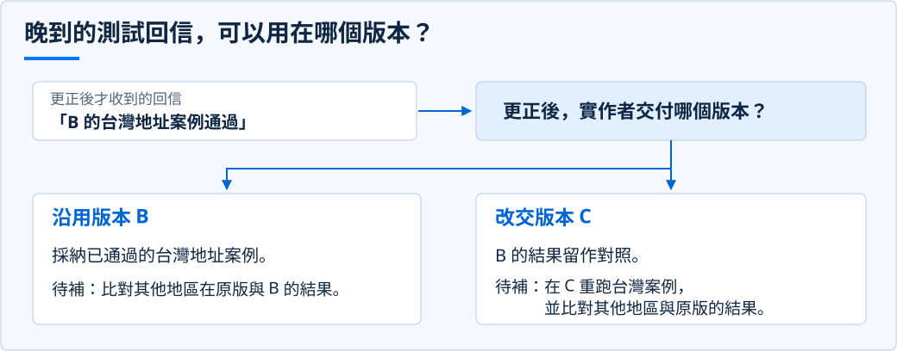

# 要求改了，哪些委派還有效？

實作者已交出地址驗證函式的版本 B，驗證者正在測試。這時操作人員補了一句：「這次只修台灣地址格式，其他地區維持原行為。」原 Task、收件人和版本 B 都沒換，驗收條件卻多了一項。即使稍後收到「B 的測試通過」，協調者也要先看測了哪些地區，才能決定這封回信還能用在哪裡。

這個教學情境假定操作人員有權調整範圍，由協調者更新原 Task，並向受影響的 Worker 更正交辦。實作者可以指出哪些修改受影響，驗證者可以建議補測案例；若兩人對範圍有不同解讀，由協調者向操作人員釐清，再把同一個決定交給雙方。

| 原交辦與進度 | 更正後如何處理 | 誰要收到什麼 |
|---|---|---|
| 實作者已交付版本 B | 先核對 diff。若 B 已將修改限於台灣地址，可沿用 B 進入驗證；若共用規則也改到其他地區，請實作者縮小修改並交出版本 C。 | 實作者收到新範圍與原交辦的識別，回覆可沿用的版本或新版本。 |
| 驗證者已準備台灣地址的失敗案例 | 保留案例，補上其他地區的代表輸入與原版預期結果。測試資料可以先準備，最終驗證要等交付版本確定。 | 驗證者收到更正後的驗收條件，以及要測的版本。 |
| 舊交辦的「B 測試通過」在更正後才抵達 | 依回信找回原交辦，核對版本、案例與結果。若最終沿用 B，已涵蓋的案例可採納；若改交 C，B 的紀錄留作對照，相關案例要在 C 重跑。 | 協調者向驗證者列出尚缺的結果，讓實作者知道是否仍有修改待交。 |

## 協調者怎麼判定可以結案？

假設最後沿用 B，驗證者先前只測了台灣地址。這份結果可以支持「原本失敗的輸入在 B 已通過」。協調者保留它，再請驗證者比較原版與 B 在其他地區代表案例上的行為。交付說明應列出實際涵蓋的案例，讓操作人員知道「其他地區維持原行為」查到了什麼範圍。

若實作者交出 C，協調者應把新版本明確交給驗證者。舊回信仍對應 B，收到時間再晚也不會讓它成為 C 的測試結果。此時平台要決定的是哪份證據符合目前的要求；更正信何時送達、Worker 何時能讀取，則可沿著收件流程查證。[收到回信後，誰能判定交付完成？](./02-delivery-and-acceptance-zh-TW.md) · [信已送達，Worker 何時會處理？](../../multi-agent-runtime/foundations/02-mailbox-and-cli-progress-zh-TW.md)

[回到本區基礎篇](./README-zh-TW.md)
