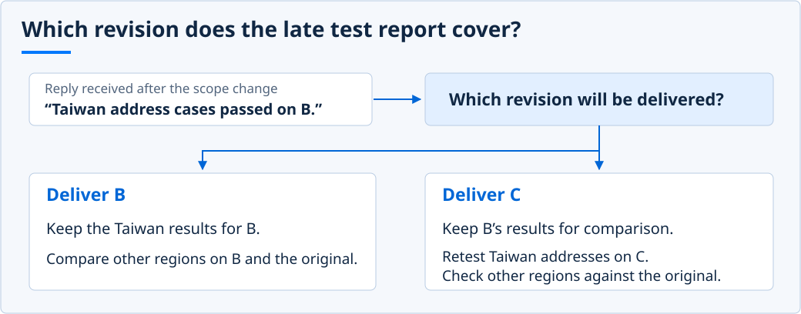

# Which assignments still apply when requirements change?

[English](./04-revising-delegated-work.md) | [繁體中文](./04-revising-delegated-work-zh-TW.md) | [简体中文](./04-revising-delegated-work-zh-CN.md)

The implementer has delivered revision B of the address validation function, and the verifier is testing it. The operator adds, “Only fix the Taiwan address format this time. Preserve the current behavior for other regions.” The task, recipients, and revision B are the same, but acceptance now depends on an additional condition. Even if “tests passed on B” arrives later, the coordinator needs to know which regions the tests covered before using the result.

In this example, the operator has authority to change the scope. The coordinator updates the original task and sends revised instructions to the affected workers. The implementer can identify affected changes, and the verifier can suggest additional cases. If they interpret the scope differently, the coordinator clarifies it with the operator and relays the same decision to both.

| Original assignment and progress | What changes | Who needs what |
|---|---|---|
| The implementer has delivered B | Check the diff. If B already limits the change to Taiwan addresses, verify B. If the shared rules changed for other regions too, ask the implementer to narrow the fix and deliver C. | The implementer receives the new scope and the original assignment ID, then identifies the revision to keep or supplies a new one. |
| The verifier has prepared the failing Taiwan address case | Keep the case and add representative inputs for other regions with their expected results on the original revision. Test data can be prepared now. Final verification requires the revision chosen for delivery. | The verifier receives the revised acceptance criteria and the revision to test. |
| A report that B passed under the old assignment arrives after the change | Match the reply to the original assignment and check its revision, cases, and results. If B is retained, the covered cases can count. If C is delivered, keep B’s record for comparison and rerun the relevant cases on C. | The coordinator tells the verifier which results are missing and lets the implementer know whether another change is due. |

## How does the coordinator decide when to close the task?

Suppose B is retained and the verifier previously tested only Taiwan addresses. That result supports the claim “the originally failing input passes on B.” The coordinator keeps it and asks the verifier to compare representative cases for other regions on the original revision and B. The delivery report should list the cases actually covered so the operator can see how far the check for unchanged behavior extends.

If the implementer delivers C, the coordinator should explicitly give that revision to the verifier. The old reply still describes B, however late it arrives. The platform must decide which evidence satisfies the current requirements. To trace when the revised message arrives and when a worker can read it, follow the mailbox flow. [Who decides whether the work is complete once the replies arrive?](./02-delivery-and-acceptance.md) · [When will the worker process a delivered message? (Traditional Chinese)](../../multi-agent-runtime/foundations/02-mailbox-and-cli-progress-zh-TW.md)

[Back to Multi-Agent Harness foundations](./README.md)
