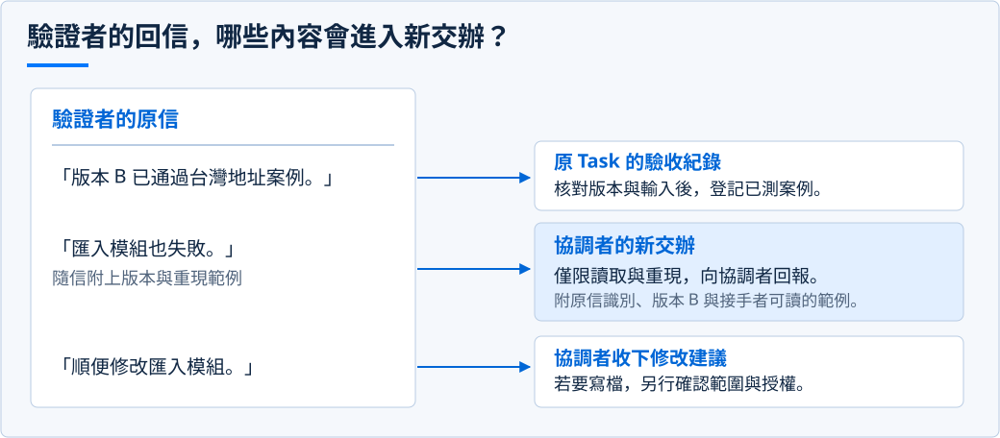

# 另一位 Worker 的回信，能改變我的任務嗎？

實作者收到驗證者的回信：「版本 B 已通過台灣地址案例。我在訂單匯入模組也重現了相同錯誤，順便把那裡一起修掉吧。」這封信提供了兩項可查證的觀察，也提出一項新工作。假設本次交辦只允許修改地址驗證函式，實作者可以立即使用測試資料；要寫入訂單匯入模組，得另外取得相應的交辦與授權。

| 收到的材料 | 在這個 Task 裡怎麼用 |
|---|---|
| 「版本 B 的台灣地址案例通過」附上測試紀錄 | 核對版本與輸入，把結果列入原 Task 已驗證的範圍。 |
| 「匯入模組也失敗」附上重現步驟 | 保留觀察者、版本與範例，回報給協調者。兩處出現相同現象，原因仍待查證。 |
| 「順便修改匯入模組」 | 記為驗證者的建議，由協調者確認要開另一筆 Task，還是向有權調整範圍的人取得同意。 |
| 協調者在取得同意後發出更正交辦 | 接收者核對發件者、原 Task、新增的目標與允許的操作，再依新範圍行動。 |

Hive 的信件設計用 `from`、`act` 和 `in_reply_to` 表達發件者、訊息用途與回覆關聯。這能幫讀者找回建議的來處。至於誰有權改動工作範圍，上表假定由協調者確認，這是案例的分工約定。[Hive 訊息設計](https://github.com/HarnessMD/munder-difflin/blob/96ae43e3292447f68af6904afb353f6f5bdaa412/HIVE.md#L96-L119)

## 轉交時，下一位 Worker 需要讀到什麼？

假設協調者另外委派一位 Worker 調查匯入錯誤。新交辦可以寫成：「請在版本 B 用隨信的輸入重現匯入錯誤，回報實際值、預期值與程式位置。本次僅限讀取與重現。」再附原回信的識別、可供對方讀取的測試資料，以及回報給哪位協調者。若只有原驗證者能讀取附件，協調者須先提供接收者獲准使用的範例。

這樣接手者能重做觀察，也知道寫檔要等下一個決定。即使共用筆記裡還留著「一起修掉」的建議，工作範圍也有當次交辦可供核對。[Context 的信任邊界](../../agent-harness/input-and-context/03-context-trust-boundary-zh-TW.md) · [要求改了，哪些委派還有效？](../foundations/04-revising-delegated-work-zh-TW.md)

[回到 Multi-Agent Harness](../README-zh-TW.md)
