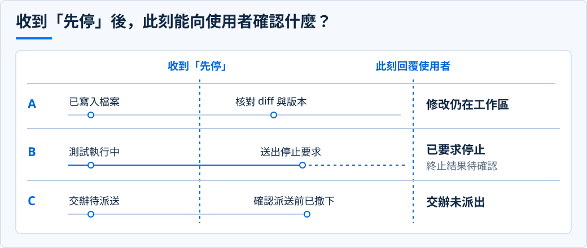

# 使用者說「先停」，平台能承諾停到哪裡？

操作人員要求暫停一筆地址修正任務。A 剛寫完檔案，B 還在跑測試，準備整理報告的 C 尚未收件。本文假設協調者有權暫停這筆 Task 的後續派工。「先停」到達時，它可以先停止發出新交辦，再逐項查核已派出的工作。這個教學情境把暫停與撤銷修改視為兩個決定。

| Worker 當時的進度 | 協調者要做什麼 | 有哪些結果可以告知使用者 |
|---|---|---|
| A 已寫檔 | 請 A 停止後續修改，核對工作區、版本及 diff，記下這次寫入的範圍。 | 查到 diff 可回報「修改已寫入」。若要撤回，需確認範圍、權限及其後他人的變更。 |
| B 正在測試 | 送出停止要求，查該次測試執行的終止狀態。若測試先跑完，保留版本與結果。 | 在取得終止證據前，回報「已要求停止，等待確認」。取得證據後，說明測試已中止，或已在停止生效前完成。 |
| C 尚未收件 | 查交辦是否仍待派送。若能撤下，核對撤下結果；若已進入 inbox，就另傳暫停要求並查 C 是否已開始。 | 已確認撤下且尚未派送，才可回報「未派出」。若只知道 C 尚未回信，仍須查投遞與執行情況。 |

## 哪些事還需要使用者決定？

假設協調者已核對 A 的 diff、送出 B 的停止要求，也確認 C 的交辦已撤下，此時可以這樣回覆：

> 已暫停這筆任務的新派工。A 的地址函式修改已寫入，仍留在工作區。已請 B 停止測試，目前還在等終止結果。C 的報告工作已在派送前撤下。A 的修改要保留供審閱，還是另行安排撤回？

若 B 之後送來「測試通過」，協調者要把它對回原測試與版本，再更新上一次回報。測試結果可以保留供審閱；是否恢復派工、交付或撤回 A 的修改，仍依操作人員後續決定。這些回報以可查得的狀態為前提，實際平台能否中止底層工具或撤下信件，須分別驗證。[取消、修正與已生效操作](../../agent-harness/interaction-and-feedback/04-cancellation-and-correction-zh-TW.md) · [平台如何核對程序與任務狀態](../../multi-agent-runtime/foundations/03-recovery-and-state-evidence-zh-TW.md)

[回到 Multi-Agent Harness](../README-zh-TW.md)
