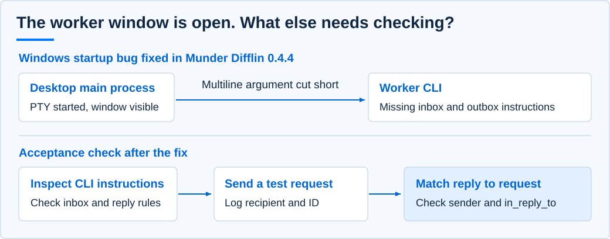
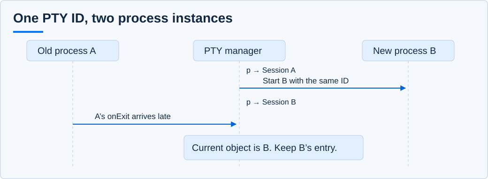

# Worker 重启后，平台还在和谁通信？

[English](./01-worker-identity.md) | [繁體中文](./01-worker-identity-zh-TW.md) | [简体中文](./01-worker-identity-zh-CN.md)

## 启动 Worker 时，主进程和 CLI 各负责什么？

Munder Difflin 的桌面主进程准备命令、参数、工作目录和环境，通过伪终端（PTY）启动 CLI，并登记一个 Session。主进程通过这个 Session 发送输入、接收输出并获取退出状态。选择哪个工具读文件、如何处理工具结果、何时结束模型回合，仍由 CLI 的运行时决定。[PTY 创建与退出处理](https://github.com/HarnessMD/munder-difflin/blob/96ae43e3292447f68af6904afb353f6f5bdaa412/src/main/pty.ts#L895-L975)

Windows 上曾出现过一个很难从界面看出来的故障。根据 0.4.4 的修复记录，启动代码截断了多行参数。Worker 窗口照常出现，Worker 却缺少使用 inbox 和 outbox 的协作指令。如果要验收的是“Worker 能接手任务”，测试时就要发送一条可识别的请求，再检查回信是否来自指定收件人、是否对应原请求。进程成功启动只能验证第一个交接点。[修复记录](https://github.com/HarnessMD/munder-difflin/blob/96ae43e3292447f68af6904afb353f6f5bdaa412/CHANGELOG.md)

## 哪些身份会延续？

同一位 Worker 回到原来的终端窗口，屏幕上只看到一个角色，背后却可能已经换过进程。排查这次重启时，先明确要找回的是角色、对话，还是一项尚未完成的工作。

| 身份 | 谁持有状态 | 重启时如何核对 |
|---|---|---|
| Agent ID | Hive 的角色注册表 | 在同一个 Hive 中找到原记录，确认负责人和工作范围。 |
| PTY ID | 主进程的 Session 映射表 | 同一个键可能已指向新进程，需要比对当前的 Session 对象。 |
| CLI Session ID | CLI 持有对话，Hive 保存用于恢复的候选 ID | 核对 Provider、候选 ID 和可读取的 Transcript，再确认 CLI 实际恢复了哪个对话。 |
| Task ID | Hive 的任务记录 | 查看原任务的负责人、进度和结果。即使换了 Worker，也能据此核对。 |
| Message ID | Hive 消息及其回复关系 | 用原消息 ID 和回信的 `in_reply_to` 对应任务分派与回复，再检查工作产物。 |

假设 A 正在退出，B 已用同一个 PTY ID 启动。如果 A 的退出回调直接按 ID 删除记录，B 的输入通道也会被清掉。Munder Difflin 的回调保留了 A 的 Session 对象，等事件到达时再与映射表中的当前对象比对。如果已经换成 B，A 的迟到输出和退出事件就会在各自的回调入口直接返回。这项检查只在同一主进程内的对象生命周期中有效。整个应用重启后，要查持久化的注册记录才能确认对话归属。[PTY 创建与退出处理](https://github.com/HarnessMD/munder-difflin/blob/96ae43e3292447f68af6904afb353f6f5bdaa412/src/main/pty.ts#L895-L975) · [Session 登记与恢复候选](https://github.com/HarnessMD/munder-difflin/blob/96ae43e3292447f68af6904afb353f6f5bdaa412/src/main/hive.ts#L2209-L2245) · [Hive 协作协议](https://github.com/HarnessMD/munder-difflin/blob/96ae43e3292447f68af6904afb353f6f5bdaa412/HIVE.md)

**待实测**　分别记录三种操作前后的标识：“重启 Worker 并恢复对话”“用原角色开启新对话”“关闭并重新启动整个应用”。在任务账本中保留同一项 Task，再逐项检查负责人、回复关系和对话 ID 是否延续。

[返回本节基础篇](./README-zh-CN.md)
