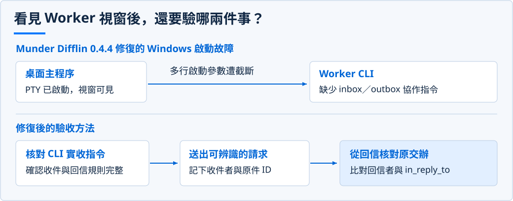
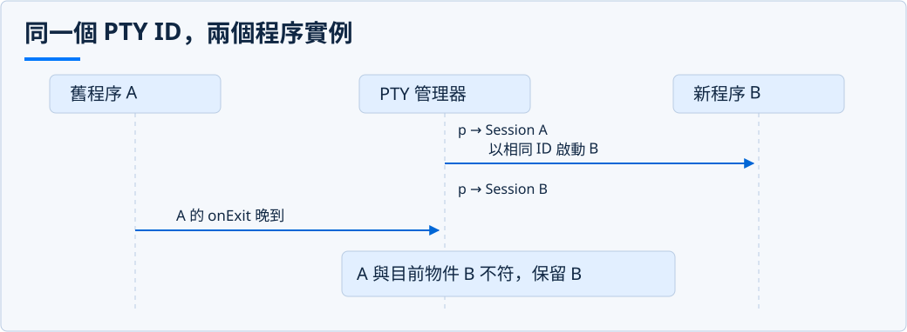

# Worker 重啟後，平台還在跟誰說話？

[English](./01-worker-identity.md) | [繁體中文](./01-worker-identity-zh-TW.md) | [简体中文](./01-worker-identity-zh-CN.md)

## 啟動 Worker 時的責任交接

Munder Difflin 的桌面主程序準備命令、參數、工作目錄與環境，透過虛擬終端（PTY）啟動 CLI，把它登錄為可接收輸入、回報輸出與退出狀態的 Session。選擇讀檔工具、處理工具結果及結束模型回合，仍由該 CLI 的執行核心負責。[PTY 建立與退出處理](https://github.com/HarnessMD/munder-difflin/blob/96ae43e3292447f68af6904afb353f6f5bdaa412/src/main/pty.ts#L895-L975)

這條邊界曾在 Windows 上造成一個很難從畫面發現的故障。依 0.4.4 修復紀錄，啟動路徑截斷多行參數，Worker 能正常出現在畫面上，卻少了認識 inbox 與 outbox 的協作指令。若驗收目標是「Worker 可以接手交辦」，測試就要送一封可辨識的請求，再從回信核對收件者與原請求。程序啟動成功只能驗到第一個交接點。[修復紀錄](https://github.com/HarnessMD/munder-difflin/blob/96ae43e3292447f68af6904afb353f6f5bdaa412/CHANGELOG.md)

## 哪些身分會延續？

同一位 Worker 回到原本的終端視窗，畫面上只有一個角色，背後卻可能已經換過程序。查這次重啟時，要先說清楚準備接回的是角色、對話，還是一件做到一半的工作。

| 身分 | 狀態由誰持有 | 重啟時如何核對 |
|---|---|---|
| Agent ID | Hive 的角色登錄 | 在同一個 Hive 找回原登錄，確認負責人與工作範圍。 |
| PTY ID | 主程序的 Session 對照表 | 同一個鍵可以指向新程序，須比對目前的 Session 物件。 |
| CLI Session ID | CLI 持有對話，Hive 保存恢復候選 | 核對 Provider、候選識別碼與可讀取的 Transcript，再確認續接結果。 |
| Task ID | Hive 任務紀錄 | 查原工作項目的負責人、進度與結果，即使 Worker 已被替換仍可對帳。 |
| Message ID | Hive 信件及回覆關聯 | 以原件 ID 與回信的 `in_reply_to` 串起交辦與回報，另查工作產物。 |

假設 A 正在退出，B 已用相同的 PTY ID 啟動。若 A 的退出回呼直接按 ID 刪除登錄，就會把 B 的輸入通道一起清掉。Munder Difflin 的回呼保留 A 的 Session 物件，等事件抵達時再跟對照表中的現值比對。若已換成 B，A 的晚到輸出與退出事件便各自在回呼入口返回。這項檢查的有效範圍限於同一主程序內的物件生命週期。整個應用程式重啟後，對話歸屬要回到持久化的登錄查證。[PTY 建立與退出處理](https://github.com/HarnessMD/munder-difflin/blob/96ae43e3292447f68af6904afb353f6f5bdaa412/src/main/pty.ts#L895-L975)、[Session 登錄與恢復候選](https://github.com/HarnessMD/munder-difflin/blob/96ae43e3292447f68af6904afb353f6f5bdaa412/src/main/hive.ts#L2209-L2245)、[Hive 協作協定](https://github.com/HarnessMD/munder-difflin/blob/96ae43e3292447f68af6904afb353f6f5bdaa412/HIVE.md)

**待實測**　分別記錄「重啟 Worker 並續接」「以原角色開新對話」「關閉再啟動整個應用程式」三組前後值。讓同一筆 Task 留在帳本，再檢查其負責人、回覆關聯與對話識別是否各自延續。

[回到本區基礎篇](./README-zh-TW.md)
