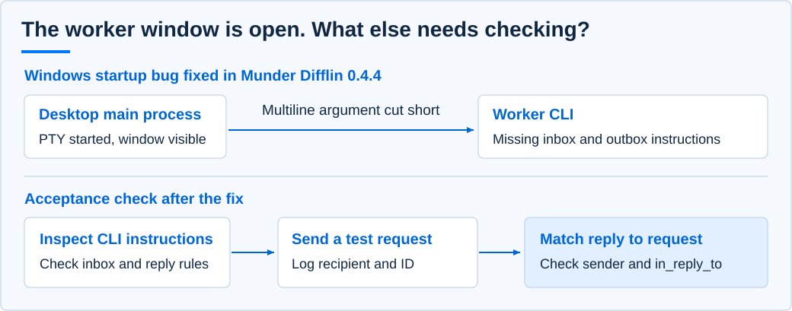
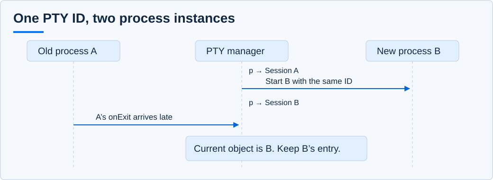

# How does the platform know which worker it is talking to after a restart?

[English](./01-worker-identity.md) | [繁體中文](./01-worker-identity-zh-TW.md) | [简体中文](./01-worker-identity-zh-CN.md)

## Who handles what at worker startup?

The Munder Difflin desktop main process prepares the command, arguments, working directory, and environment. It starts the CLI in a pseudoterminal (PTY) and registers a session through which it can send input, receive output, and observe the process exit. The CLI’s own runtime chooses the tool for reading a file, handles the result, and decides when to end the model turn. [PTY creation and exit handling](https://github.com/HarnessMD/munder-difflin/blob/96ae43e3292447f68af6904afb353f6f5bdaa412/src/main/pty.ts#L895-L975)

A Windows bug at this handoff was hard to spot on screen. According to the 0.4.4 changelog, the launch code truncated a multiline argument. The worker window appeared as usual, but the worker was missing the instructions for using its inbox and outbox. To test whether the worker can take an assignment, send it an identifiable request. Check who replied and which request the reply refers to. Seeing the process start verifies only the first handoff. [Changelog](https://github.com/HarnessMD/munder-difflin/blob/96ae43e3292447f68af6904afb353f6f5bdaa412/CHANGELOG.md)

## Which identities survive a restart?

A worker can return to the same terminal window under the same role even though a new process has taken over. When investigating a restart, identify what you want to recover: the role, the conversation, or a piece of unfinished work.

| Identity | Who holds the state | What to check after a restart |
|---|---|---|
| Agent ID | Hive’s role registry | Find the original entry in the same Hive and confirm the assignee and scope. |
| PTY ID | The main process’s session map | The same key can point to a new process. Compare the current session object with the one the callback holds. |
| CLI Session ID | The CLI owns the conversation. Hive stores candidate IDs for resuming it. | Check the provider, the candidate ID, and whether the transcript is readable. Then check what the CLI actually resumed. |
| Task ID | Hive’s task record | Look up the original assignee, progress, and result. The record can still be checked after another worker takes over. |
| Message ID | Hive’s messages and reply references | Match the original message ID to the reply’s `in_reply_to`, then check the work product itself. |

Suppose A is exiting and B has already started with the same PTY ID. If A’s exit callback removed the entry by ID alone, it would also remove B’s input channel. In Munder Difflin, the callback keeps a reference to A’s session object and compares it with the current entry when the event arrives. If the entry now points to B, A’s late output and exit callbacks each return immediately. This check works for objects within the lifetime of one main process. After the whole application restarts, consult the persisted registry to establish which worker the conversation belongs to. [PTY creation and exit handling](https://github.com/HarnessMD/munder-difflin/blob/96ae43e3292447f68af6904afb353f6f5bdaa412/src/main/pty.ts#L895-L975) · [Session registry and resume candidates](https://github.com/HarnessMD/munder-difflin/blob/96ae43e3292447f68af6904afb353f6f5bdaa412/src/main/hive.ts#L2209-L2245) · [Hive collaboration protocol](https://github.com/HarnessMD/munder-difflin/blob/96ae43e3292447f68af6904afb353f6f5bdaa412/HIVE.md)

**Still to test.** Record the identifiers before and after each of three operations: restarting the worker and resuming the conversation, starting a new conversation under the same role, and closing and reopening the entire application. Keep the same task in the ledger and check whether its assignee, reply references, and conversation ID each carry over.

[Back to Multi-Agent Runtime foundations](./README.md)
